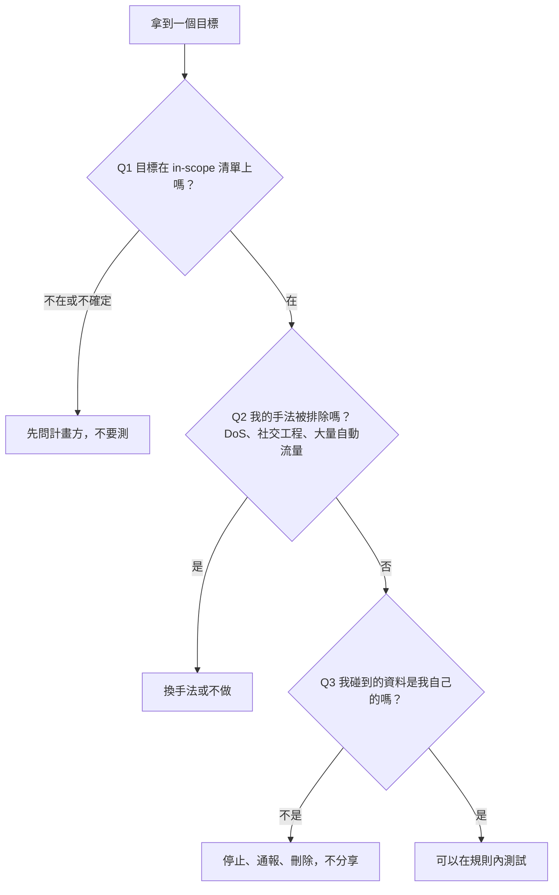

> 🌏 [English version](/posts/tech/2026-10-13-bug-bounty-zero-01-rules-and-scope-en)

上一篇我把網路流傳的三個頂級價碼對回官方獎金表，結論是[獎金表只給上限，不給成功率](/posts/tech/2026-10-13-bug-bounty-top-payouts-fact-check)。如果你讀完想入門，第一件事不是學技術，是搞清楚「哪些東西你可以碰」。這篇只回答一個問題：拿到一個 Bug Bounty 計畫頁面，怎麼判斷某個目標能不能測，不小心越線會怎樣。技術上的漏洞原理，留給之後的文章。

## 先用一個比喻

Bug Bounty 像是房東貼出公告：「我的公寓歡迎你來檢查門鎖，找到問題告訴我就給你獎金。」但公告會寫清楚幾件事：只限哪幾戶（scope）、不准做什麼（例如不准把門拆了、不准騙住戶開門）、檢查時只能用你自己那戶的鑰匙。公告沒寫的鄰居家、隔壁棟，房東根本沒資格幫你同意。

下面把這個比喻對回真實條文。

## Scope：計畫方只能授權它擁有的東西

Scope 就是計畫頁面列出的「可以測的目標清單」，反過來就是 out-of-scope。看 [Meta 的 Program scope 頁](https://bugbounty.meta.com/scope/)，它用一張表列出每個產品「Eligible」與「Ineligible」的網域。以 Facebook 為例，我在 2026-10-13 讀到的內容是：

| 項目 | Eligible | Ineligible |
|---|---|---|
| 網站 | facebook.com、fb.com、fb.me、thefacebook.com、m.facebook.com | fbsbx.com、investor.fb.com、accountkit.com |

同一個 Facebook 品牌，有的網域能測，有的不能。所以「是 Meta 的東西」不等於「在 scope 內」，要逐個網域對。

Google 的 [VRP 規則頁](https://bughunters.google.com/about/rules/google-friends/google-and-alphabet-vulnerability-reward-program-vrp-rules)（Vulnerability Reward Program，漏洞獎勵計畫）有兩項重要排除，很值得學。原文大意如下：

- 第三方網站：有些 Google 品牌的服務放在不常見的網域，可能是廠商或夥伴在營運，Google「無法代表網站擁有者授權你測試」，也不會給獎金；頁面要你看 WHOIS 確認，不確定就先問（原文 "If in doubt, talk to us first!"）。
- 新收購的公司：有六個月的封鎖期，太早回報通常拿不到獎金。

這兩條背後是同一個原理：**只有擁有者能授權測試**。計畫頁面能授權的，只有它自己擁有的系統。

Meta 對第三方 App 也寫得很明確：「Meta Bug Bounty 的條款不提供任何授權，讓你測試由第三方控制的 App 或網站」。

## 規則會排除「手法」，不只排除目標

除了清單上的目標，規則還會排除某些做法。Meta 的 Out of scope 清單第一、二條就是：

- Spam or social engineering techniques（垃圾訊息與社交工程）
- Denial-of-service attacks（阻斷服務攻擊）

Google 規則頁也寫：範圍僅限技術漏洞，「請不要試圖潛入 Google 辦公室、對員工發動網路釣魚」；出於對所有使用者可用性的考量，「請不要嘗試 DoS 攻擊、使用黑帽 SEO、對人發垃圾訊息」，並且不鼓勵使用會自動產生大量流量的測試工具。

白話翻譯：

- **DoS**：把服務灌爆讓別人用不了，你傷害的是一般使用者，不是系統設計者。
- **社交工程**：騙人，目標是「人」不是「系統」，計畫方沒辦法替員工同意被你測試。

這兩類即使目標在 scope 內也不能做。

## 只測自己的帳號

兩家都有同一條核心規則。Google：「調查漏洞時，請只針對你自己的帳號；絕對不要試圖存取別人的資料，也不要做任何會干擾其他使用者或 Google 的行為。」

Meta 寫得更細，在[Terms 頁](https://bugbounty.meta.com/terms/)的 Responsible research and disclosure policy：

- 沒有帳號擁有者的「明確書面同意」，不能與該帳號互動（包含存取或修改資料）。
- 測試只能在你自己的帳號、[測試帳號](https://www.facebook.com/whitehat/accounts/)，或有擁有者書面同意的帳號進行。
- 不小心碰到別人的資料時：立刻停止、通知 Meta 你碰到了什麼、從自己的系統刪除，並且不能分享給任何人。繼續存取「可能顯示缺乏善意」。

Google 的建議也很實用：另外開一個專門測試用的帳號，因為測試造成帳號被停用時，不保證能救回來。

## 不確定時怎麼辦

Meta 的 [Program scope 頁](https://bugbounty.meta.com/scope/)寫：在做任何「與條款不一致或條款未涵蓋」的行為前，先提交一份新報告詢問。Google 對第三方網域說的是「先跟我們談」。兩家的共同答案都是：**先問，再測**。

## Safe harbor 是什麼，不是什麼

Safe harbor（安全港）是計畫方的承諾：只要你照規則做，它不會追究你。看 Meta 的 Safe harbor provisions，原文可以拆成幾件事：

1. 把條款視為授權你測試 in-scope 的產品與系統（文中提到 CFAA，即美國的 Computer Fraud and Abuse Act，等類似法規）。
2. 但這份授權不包含「未經對方明確同意，故意存取公司資料或他人帳號的資料」，個人資料也寫在內。
3. 若 Meta「自行判斷」你「在所有方面」都遵守條款，就不會向執法機關提出申訴，也不採取民事行動。
4. 對於「明確的意外或善意違規」也不會採取法律行動。
5. 若第三方對你提告，而 Meta 判斷你符合條款，Meta 會設法讓大眾或法院知道你的行為是被授權的。

限制在哪裡，條文自己就寫了：

- 條件是「在所有方面都遵守」條款，或屬於「明確的」意外、善意違規，而且兩者都由 Meta「自行判斷」。
- 它只涵蓋 Meta 自己的行為。條文沒有承諾能約束 Meta 以外的人。
- 它不涵蓋 scope 以外的目標，也不涵蓋未經同意的他人資料。

Google 的規則頁（我讀到的版本）沒有使用「safe harbor」這個詞，最接近的一句是：「你的測試不得違反任何法律，也不得干擾或損害不屬於你的資料。」Google 是否另有專門的法律聲明頁，我這次**未能查證**。所以「有計畫」不等於「有安全港」，每個計畫要自己讀。

## 台灣的法律怎麼寫

> 這不是法律建議。以下只描述[全國法規資料庫](https://law.moj.gov.tw/LawClass/LawAll.aspx?pcode=C0000001)上《中華民國刑法》第三十六章「妨害電腦使用罪」的條文文字（2026-10-13 讀取）。是否構成犯罪、計畫條款在個案中算不算「有故」，是法律專業者才能回答的問題。

| 條號 | 條文要點（摘述） | 刑度 |
|---|---|---|
| 第 358 條 | 無故輸入他人帳號密碼、破解使用電腦之保護措施或利用電腦系統之漏洞，而入侵他人之電腦或其相關設備 | 三年以下有期徒刑、拘役，或科或併科三十萬元以下罰金 |
| 第 359 條 | 無故取得、刪除或變更他人電腦或其相關設備之電磁紀錄，致生損害於公眾或他人 | 五年以下有期徒刑、拘役，或科或併科六十萬元以下罰金 |
| 第 360 條 | 無故以電腦程式或其他電磁方式干擾他人電腦或其相關設備，致生損害於公眾或他人 | 三年以下有期徒刑、拘役，或科或併科三十萬元以下罰金 |
| 第 361 條 | 對公務機關的電腦或相關設備犯前三條之罪 | 加重其刑至二分之一 |
| 第 362 條 | 製作專供犯本章之罪之電腦程式，而供自己或他人犯本章之罪，致生損害於公眾或他人 | 五年以下有期徒刑、拘役，或科或併科六十萬元以下罰金 |
| 第 363 條 | 第 358 至 360 條之罪須告訴乃論 | — |

讀這張表時，有三個條文本身看得到的細節：

- 第 358 至 360 條都有「**無故**」這個要件。條文沒有定義它，怎麼解釋是法院與專業者的事。
- 第 358 條的行為裡直接寫了「利用電腦系統之漏洞」，跟漏洞獵人的工作內容重疊。
- 第 363 條寫明 358 至 360 條須告訴乃論，也就是要有人提出告訴。第 361 條對公務機關另有加重規定。

這張表你可以拿來提醒自己：scope 外的系統、別人的帳號、對服務的干擾，剛好就是條文描述的行為。至於計畫的授權在法律上效果如何，這篇不下結論。另外，各國法律不同，你測試的目標若在國外，可能適用當地法律，我這次沒有逐國查證。

## 用三個問題判斷目標能不能測

拿真實條文來走一遍：

1. 你看到 `fbsbx.com`。Q1：Meta 把它列在 Ineligible，停。
2. 你看到一個網址是 `foo.appspot.com` 的網站，覺得跟 Google 有關。Q1：Google 的 Non-qualifying 清單寫明 `*.appspot.com` 與 `*.bc.googleusercontent.com` 是 Google Cloud 客戶的應用，「VRP 不授權測試」，停。
3. 你在 `*.google.com` 找到一個問題，想用腳本自動送出大量請求掃描。Q2：Google 不鼓勵產生大量流量的工具，先降低頻率，或改用手動方式。
4. 你在 Facebook 發現用別人帳號可以看到私人資料。Q3：Meta 要求只能用自己或測試帳號，用別人的帳號要有書面同意；已經碰到就依規則停止並通報。

## 看懂「不給獎金」跟「不准測」是兩回事

Google 的 Non-qualifying 清單標題是「通常不會得到獎金的低風險問題」，像是 URL redirection、logout CSRF、版本資訊外露。這些是**沒有獎金**。但同一份清單裡 `*.appspot.com` 那條，原文多加了一句「不授權測試」，那是**不准測**。Meta 的 False positives 清單（例如 open redirects、公開的大頭貼）也是同樣性質：不算漏洞，不是授權問題。

讀清單時，找這兩種句型：「不給獎金」代表你測了也拿不到錢；「不授權」代表你根本不該碰。

## 限制

- 規則會變。Meta 頁面自己就寫「bounty amounts and qualifying issues may change with time」，Google 寫「我們可以隨時取消計畫」。本文是 2026-10-13 的內容，測試前請重讀原頁。
- 各計畫不同。Meta 要求年滿 14 歲，若在居住地仍屬未成年須先取得家長或法定監護人同意；Google 的 VRP 頁面寫參加者須 18 歲以上，未滿 18 歲的人要請家長、監護人或其他可信任的成年人代為提交。HackerOne、Bugcrowd 上的計畫還有各自的規則，本文沒有涵蓋。
- 台灣法條只是文字摘述，不含判例，不等於法律意見。

## 今晚能做的事

1. 打開 [Meta Program scope](https://bugbounty.meta.com/scope/)，把 Out of scope 的六條抄下來，每條旁邊寫「這會害到誰」。
2. 打開 [Google VRP 規則](https://bughunters.google.com/about/rules/google-friends/google-and-alphabet-vulnerability-reward-program-vrp-rules)的 Non-qualifying 清單，把每一條標成「沒獎金」或「不授權」。
3. 註冊一個只拿來測試的帳號，之後所有練習都只用它。

## 下一篇

下一篇（第 2 篇）預計講網站是怎麼運作的：瀏覽器送出請求、伺服器回應、帳號登入靠什麼記住你。看懂這些，後面才聽得懂漏洞在說什麼。

## 參考資料

- [Meta Bug Bounty：Program scope](https://bugbounty.meta.com/scope/)
- [Meta Bug Bounty：Terms & conditions（含 Responsible research and disclosure policy 與 Safe harbor provisions）](https://bugbounty.meta.com/terms/)
- [Meta Bug Bounty：Test accounts](https://www.facebook.com/whitehat/accounts/)
- [Google and Alphabet Vulnerability Reward Program (VRP) Rules](https://bughunters.google.com/about/rules/google-friends/google-and-alphabet-vulnerability-reward-program-vrp-rules)
- [全國法規資料庫：中華民國刑法（第三十六章 妨害電腦使用罪，第 358 至 363 條）](https://law.moj.gov.tw/LawClass/LawAll.aspx?pcode=C0000001)
- [Bug Bounty 頂級獎金查證：Google RCE、Meta 30 萬、Hyper-V 25 萬各是什麼（本站，第 0 篇）](/posts/tech/2026-10-13-bug-bounty-top-payouts-fact-check)
