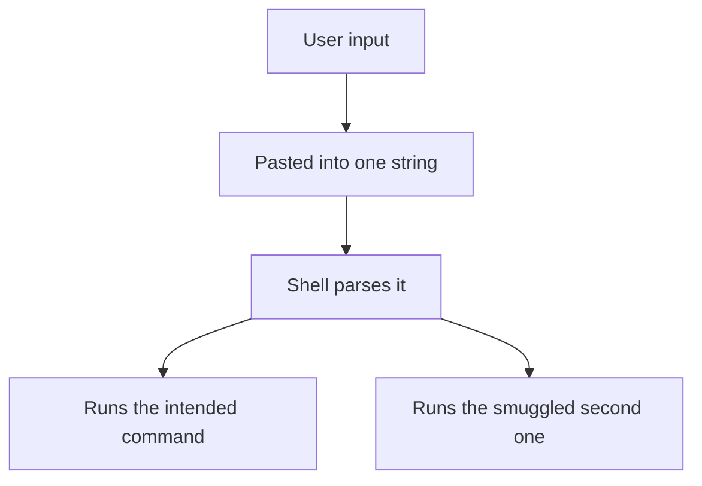

> 🌏 [中文版](/posts/tech/2026-10-13-bug-bounty-zero-04-what-is-rce)

In [the previous post](/posts/tech/2026-10-13-bug-bounty-zero-03-common-web-bugs), XSS and IDOR were bugs where a website does something it should not do for you. This post goes one layer down: could someone make the machine behind the website do things for them? That is RCE. By the end you should be able to spot code that glues user input into a shell command, say why it is dangerous, and rewrite it safely.

## What RCE is, and why it pays the most

RCE stands for Remote Code Execution: an attacker, without sitting at the machine, makes it run a program of their choosing.

An analogy: XSS is like tricking one customer out of their membership card, and IDOR is like finding that the counter hands over someone else's parcel without checking ID. RCE is an outsider getting the keys to the back office and telling the staff what to do. The first two affect certain users' data. RCE affects the whole server and everything the server can reach.

The reward table in the [Google VRP rules](https://bughunters.google.com/about/rules/google-friends/google-and-alphabet-vulnerability-reward-program-vrp-rules) puts it in the top row, under "Vulnerabilities giving direct access to Google servers": Remote code execution (S0), with the examples "Command injection, deserialization bugs, sandbox escapes". This post covers the first two; sandbox escapes belong to a later part of the series. In the column for normal Google applications (for example *.google.com), the base amounts are:

| Type | Example in the table | Base reward |
|---|---|---|
| RCE | Command injection, deserialization bugs, sandbox escapes | $75,000 |
| IDOR (most sensitive information tier) | Direct object reference | $31,337 |
| IDOR (next tier) | Direct object reference | $13,337 |
| XSS | Cross-site scripting | $10,000 |

On the most sensitive Tier 0 and Tier 1 domains, RCE is $101,010 while XSS is $20,000 and $15,000. A footnote in the rules defines Tier 0 domains as those where a critical vulnerability (e.g. XSS or RCE) could compromise a user's account or execute code on their system. Amounts depend on the version of the rules at the time, the panel sets the final figure, and a report-quality multiplier applies. [Part 0 of this series](/posts/tech/2026-10-13-bug-bounty-top-payouts-fact-check) walks through how to read those numbers cell by cell.

The table explains half of "why so expensive": Google classes RCE as direct access to its servers. The other half is difficulty, which the table does not state. My own judgment is that a usable RCE is usually harder to find than an XSS; that is not something the rules page says.

## Path one: gluing input into a command

[OWASP defines command injection](https://owasp.org/www-community/attacks/Command_Injection) as an attack whose goal is executing arbitrary commands on the host operating system through a vulnerable application. It is possible when the application passes unsafe user-supplied data to a system shell, and the commands usually run with the privileges of the vulnerable application.

In plain words: a program wants the shell to run `echo Hello, Ann`, where the name comes from a web form. If the program builds that line by pasting the name into a string, the name can carry "a semicolon, and then do one more thing." The shell cannot tell which part you wrote and which part the user slipped in.

The examples below run locally only, and use nothing but `echo` and `id` (which prints the current user's identity).

```python
import subprocess

def greet(name: str) -> None:
    # Vulnerable: user input is pasted into a string and handed to a shell
    subprocess.run(f"echo Hello, {name}", shell=True)

greet("Ann")
greet("Ann; id")
```

I ran this in a sandbox with Python 3.13. The output:

```text
Hello, Ann
Hello, Ann
uid=0(root) gid=0(root) groups=0(root)
```

On the second call, `; id` was run by the shell as a second command. My sandbox happens to run as root, hence `uid=0(root)`. On a real server it would print the identity of the web service account, and how much power that account has depends on the deployment.



### The fix: keep the shell out of it

The [Python subprocess documentation](https://docs.python.org/3/library/subprocess.html#security-considerations) is explicit: the library does not implicitly call a system shell, so all characters, including shell metacharacters, can safely be passed to child processes. If you invoke the shell explicitly with `shell=True`, it becomes the application's responsibility to quote all whitespace and metacharacters appropriately.

So the first fix is to write the command as a list:

```python
import subprocess

def greet(name: str) -> None:
    # Fix: argument list, no shell involved
    subprocess.run(["echo", "Hello,", name])

greet("Ann")
greet("Ann; id")
```

Actual output:

```text
Hello, Ann
Hello, Ann; id
```

Same input, but now `Ann; id` is just text and gets printed as-is; nothing is executed. The OWASP page draws the same line between Java's `Runtime.exec` and C's `system`: the latter hands the string to `/bin/sh` to parse, while the former splits it into a word array and runs it without involving a shell.

OWASP's other two suggestions: use your language's own API when one exists (use a mail library rather than shelling out to a mail command), and when you do validate input, use a positive model that defines the legal characters, which is easier than listing the forbidden ones.

## Path two: rebuilding objects from untrusted data

Serialization turns an in-memory object into data you can store or send; deserialization rebuilds it. The [OWASP Deserialization Cheat Sheet](https://cheatsheetseries.owasp.org/cheatsheets/Deserialization_Cheat_Sheet.html) warns that many languages' native formats offer more features than JSON, and those features can be repurposed on untrusted data, enabling denial-of-service, access control, or remote code execution attacks.

The [Python `pickle` documentation](https://docs.python.org/3/library/pickle.html) is blunter: the module is not secure, only unpickle data you trust, and malicious pickle data can execute arbitrary code during unpickling.

An intuition: an ordinary data file is like an order slip with items and quantities. A pickle is more like a sheet saying "assemble this by following these steps," and Python follows them on load. The example below deliberately makes the sheet do one harmless thing: call `print`.

```python
import json
import pickle

class Note:
    # Local demo: on load this calls print instead of restoring plain data
    def __reduce__(self):
        return (print, ("this line was executed during unpickling",))

blob = pickle.dumps(Note())

print("--- Unsafe: pickle.loads(untrusted data)")
pickle.loads(blob)

print("--- Safe: accept only JSON, then check the fields yourself")
try:
    json.loads(blob)
except Exception as e:
    print("JSON rejects this blob:", type(e).__name__)
data = json.loads('{"title": "hello", "pinned": false}')
assert set(data) == {"title", "pinned"} and isinstance(data["title"], str)
print("The parsed result is just data:", data)
```

Actual output:

```text
--- Unsafe: pickle.loads(untrusted data)
this line was executed during unpickling
--- Safe: accept only JSON, then check the fields yourself
JSON rejects this blob: UnicodeDecodeError
The parsed result is just data: {'title': 'hello', 'pinned': False}
```

The point is in the first block: `pickle.loads` did not read data at all. It called a function because the data told it to. Here that function is `print`; nothing in pickle limits the choice to harmless functions, which is why the documentation says arbitrary code.

The fix has two layers. First, do not use pickle on untrusted input. The Python docs note that deserializing untrusted JSON does not in itself create an arbitrary code execution vulnerability, and OWASP recommends plain data formats such as JSON. Second, a JSON parse is not the end: the last lines of the example check field names and types, treating the result as untrusted. If you truly must use a native format, OWASP suggests only deserializing signed data, and the Python docs suggest signing with `hmac` to ensure it has not been tampered with.

## Real cases on this site

These two daily alerts cover real, patched incidents. Details are as stated in the alerts and the sources they cite.

- [LangGraph checkpointer: SQL injection chained with unsafe deserialization](/posts/daily/2026-08-27-security-langgraph-checkpointer-post-injection-rce-en): this maps to path two. The alert describes the framework deserializing stored state with msgpack, and an earlier bug letting an attacker forge that stored row; chained together, that is unauthenticated RCE.
- [Manus taken over by a single email](/posts/daily/2026-10-03-security-manus-email-jsfuck-rce-en): not the shell-gluing from this post, but a similar root: untrusted content ended up in an environment that executes code. The alert describes an agent feeding email content into a pipeline that actually runs programs, so the attacker's code ran inside the cloud sandbox.

Neither case is as simple as "someone typed `shell=True`." Real RCE is often a chain of small problems, and it often hides where you thought you were only reading data.

## Limits and what to do next

This is an introductory intuition, and some things are out of scope. An argument list only removes the shell layer; how the called program interprets its arguments is a separate thing to check, which is why the allowlist advice above matters. Real bugs also rarely look like an obvious `shell=True`; they can sit inside frameworks, packages, or configuration.

When you practice, follow the Google rules page: when investigating, only target your own accounts, never access anyone else's data, and do nothing disruptive to other users or to Google. Every example here runs on your own computer; keep it that way.

One thing you can do today: open a project of yours and search for `shell=True`, `os.system`, `exec(`, and `pickle.loads`. For each hit ask two questions: can any part of this string be influenced by a user? Could it be an argument list or JSON instead?

The next stage moves from the web into memory.

## References

- [Google and Alphabet VRP Rules (Google Bug Hunters)](https://bughunters.google.com/about/rules/google-friends/google-and-alphabet-vulnerability-reward-program-vrp-rules)
- [Command Injection (OWASP)](https://owasp.org/www-community/attacks/Command_Injection)
- [Deserialization Cheat Sheet (OWASP)](https://cheatsheetseries.owasp.org/cheatsheets/Deserialization_Cheat_Sheet.html)
- [subprocess: Security Considerations (Python docs)](https://docs.python.org/3/library/subprocess.html#security-considerations)
- [pickle (Python docs)](https://docs.python.org/3/library/pickle.html)
- [Fact-Checking Bug Bounty's Top Payouts (series part 0)](/posts/tech/2026-10-13-bug-bounty-top-payouts-fact-check-en)
- [AI Security Alert: LangGraph Checkpointer unauthenticated RCE chain](/posts/daily/2026-08-27-security-langgraph-checkpointer-post-injection-rce-en)
- [AI Security Alert: Manus agent hijacked by one email](/posts/daily/2026-10-03-security-manus-email-jsfuck-rce-en)
