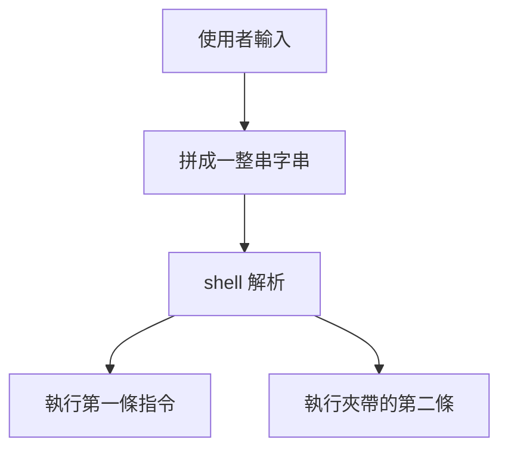

> 🌏 [English version](/posts/tech/2026-10-13-bug-bounty-zero-04-what-is-rce-en)

[上一篇](/posts/tech/2026-10-13-bug-bounty-zero-03-common-web-bugs)的 XSS 和 IDOR，漏洞出在「網站替你做了不該做的事」。這一篇往下一層走：網站背後那台機器，有沒有可能被外人叫去做事？這就是 RCE。讀完你應該能在程式碼裡認出「把使用者輸入拼進 shell 指令」這個寫法，說出它為什麼危險，並改成安全版本。

## RCE 是什麼，為什麼最貴

RCE 是 Remote Code Execution，遠端程式碼執行：攻擊者不用坐在那台機器前，就能讓它跑自己指定的程式。

用比喻來說，XSS 像是騙到某位客人的會員卡，IDOR 像是發現櫃檯沒核對就把別人的包裹交出來。RCE 則是外人直接拿到店裡後台的鑰匙，能叫店員做任何事。前兩種影響的是某幾位使用者的資料；RCE 影響的是整台伺服器，以及伺服器能碰到的所有東西。

[Google VRP 規則頁](https://bughunters.google.com/about/rules/google-friends/google-and-alphabet-vulnerability-reward-program-vrp-rules)的獎金表把它放在最上面一列，分類叫「Vulnerabilities giving direct access to Google servers」，項目是 Remote code execution（S0），例子寫的是「Command injection, deserialization bugs, sandbox escapes」。這一篇講前兩個，沙盒逃脫留給後面的篇章。同一張表裡，一般 Google 應用（例如 *.google.com）那一欄的基準金額是：

| 類型 | 表中的例子 | 基準獎金 |
|---|---|---|
| RCE | Command injection、deserialization bugs、sandbox escapes | 75,000 美元 |
| 邏輯漏洞／IDOR（Tier 0 資料或關鍵操作） | Direct object reference、remote user impersonation | 31,337 美元 |
| 邏輯漏洞／IDOR（Tier 1 資料或重要操作） | Direct object reference、remote user impersonation | 13,337 美元 |
| XSS | Cross-site scripting | 10,000 美元 |

最敏感的 Tier 0 與 Tier 1 網域，RCE 是 101,010 美元，XSS 是 20,000 與 15,000 美元。規則頁在腳註裡說明，Tier 0 網域是「重大漏洞（例如 XSS 或 RCE）可能導致使用者帳號被入侵，或讓程式碼在使用者系統上執行」的網域。獎金多寡以官方當時版本為準，最後金額由審查小組決定，並乘上報告品質係數。這些數字怎麼讀，[系列第 0 篇](/posts/tech/2026-10-13-bug-bounty-top-payouts-fact-check)已經逐格對過。

這張表只回答「為什麼貴」的一半：Google 把 RCE 列為直接取得伺服器存取。另一半是難度，表上沒有寫。找到能用的 RCE 通常比找到一個 XSS 難，這是我的判斷，不是規則頁的內容。

## 路徑一：把輸入拼進指令

[OWASP 對 command injection 的定義](https://owasp.org/www-community/attacks/Command_Injection)是：透過有漏洞的應用程式，在主機作業系統上執行任意指令；成因是應用程式把不安全的使用者輸入傳給系統 shell，而指令通常以該應用程式的權限執行。

白話版：程式想請 shell 幫忙跑一句 `echo Hello, Ann`，名字是從網頁表單來的。如果程式用字串把名字直接黏進指令，名字裡就能夾帶「分號，然後再跑一件事」。shell 看不出哪一段是你寫的、哪一段是使用者塞的。

以下範例只在本機跑，指令只用 `echo` 和 `id`（印出目前使用者身分）。

```python
import subprocess

def greet(name: str) -> None:
    # 有漏洞：把使用者輸入直接拼進字串，再交給 shell
    subprocess.run(f"echo Hello, {name}", shell=True)

greet("Ann")
greet("Ann; id")
```

我在沙盒用 Python 3.13 實際跑，輸出是：

```text
Hello, Ann
Hello, Ann
uid=0(root) gid=0(root) groups=0(root)
```

第二次呼叫時，`; id` 被 shell 當成第二條指令執行了。我的沙盒剛好以 root 身分跑，所以印出 `uid=0(root)`；在真實伺服器上，印出來的是那個網站服務帳號的身分，權限大小取決於部署怎麼設。



### 修法：不要經過 shell

[Python subprocess 官方文件](https://docs.python.org/3/library/subprocess.html#security-considerations)的安全章節寫得很清楚：這個函式庫不會自己去呼叫系統 shell，所以包含 shell 特殊字元在內的所有字元，都可以安全地傳給子行程；一旦用 `shell=True` 明確叫 shell 出來，就變成應用程式自己要負責把空白與特殊字元全部正確跳脫。

所以第一個修法就是把指令寫成陣列：

```python
import subprocess

def greet(name: str) -> None:
    # 修法：參數陣列，不經過 shell
    subprocess.run(["echo", "Hello,", name])

greet("Ann")
greet("Ann; id")
```

實際輸出：

```text
Hello, Ann
Hello, Ann; id
```

同樣的輸入，這次 `Ann; id` 只是一段普通文字，被原樣印出來，沒有任何東西被執行。OWASP 頁面也提到 Java 的 `Runtime.exec` 與 C 的 `system` 有同樣的差別：後者把字串交給 `/bin/sh` 解析，前者把字串切成陣列直接執行，不會經過 shell。

OWASP 的另外兩個建議是：能用語言內建的函式庫（例如要寄信就用寄信的 API）就不要自己呼叫外部指令；真的要檢查輸入時，用允許清單（先定義合法字元），比列舉禁用字元容易。

## 路徑二：把不可信的資料「還原」成物件

序列化是把程式裡的物件轉成可以存檔或傳送的資料，反序列化是反過來還原。[OWASP 的反序列化速查表](https://cheatsheetseries.owasp.org/cheatsheets/Deserialization_Cheat_Sheet.html)提醒：許多語言原生的序列化格式功能比 JSON 多，這些功能碰上不可信的資料時，可能被拿來做 DoS、繞過存取控制或 RCE。

Python 的 [`pickle` 官方文件](https://docs.python.org/3/library/pickle.html)寫得更直接：`pickle` 模組不安全，只該還原你信任的資料；有心人可以構造出在還原過程中執行任意程式碼的 pickle 資料。

直覺上，一般的資料檔像一份訂單，上面只有品項與數量。pickle 更像一張「請照這張紙上的步驟組裝」的說明書，還原時 Python 會照著做。下面的範例刻意讓說明書只做一件無害的事：呼叫 `print`。

```python
import json
import pickle

class Note:
    # 在本機示範：還原時會呼叫 print，而不是還原出一份資料
    def __reduce__(self):
        return (print, ("unpickle 時，這行字是被『執行』出來的",))

blob = pickle.dumps(Note())

print("--- 不安全：pickle.loads(不可信的資料)")
pickle.loads(blob)

print("--- 安全：只收 JSON，再自己檢查欄位")
try:
    json.loads(blob)
except Exception as e:
    print("JSON 不認這包東西：", type(e).__name__)
data = json.loads('{"title": "hello", "pinned": false}')
assert set(data) == {"title", "pinned"} and isinstance(data["title"], str)
print("解析結果只是資料：", data)
```

實際輸出：

```text
--- 不安全：pickle.loads(不可信的資料)
unpickle 時，這行字是被『執行』出來的
--- 安全：只收 JSON，再自己檢查欄位
JSON 不認這包東西： UnicodeDecodeError
解析結果只是資料： {'title': 'hello', 'pinned': False}
```

重點在第一段：`pickle.loads` 根本沒有「讀資料」，它照資料裡的指示呼叫了一個函式。這裡呼叫的是 `print`；pickle 能指定的函式不受這個範例限制，所以官方才說它可以執行任意程式碼。

修法有兩層。第一，對不可信的來源不要用 pickle。Python 文件說明，反序列化不可信的 JSON 本身不會造成任意程式碼執行的漏洞，OWASP 也建議改用 JSON 這類純資料格式。第二，JSON 解析完不代表安全：範例最後用 `assert` 檢查欄位名稱與型別，把結果當成不可信的資料處理。如果非用原生格式不可，OWASP 提到的做法是只還原簽過章的資料；Python 文件也建議用 `hmac` 簽章，確認資料沒被竄改。

## 站內的真實案例

以下兩篇日報記錄的是已修補的真實事件，技術細節以日報引用的原始研究為準：

- [LangGraph Checkpointer 的 SQL injection 串接不安全反序列化](/posts/daily/2026-08-27-security-langgraph-checkpointer-post-injection-rce)：對應路徑二。日報寫到，框架讀出儲存的狀態後做 msgpack 反序列化，加上前一個漏洞讓攻擊者能偽造那筆資料，兩段串起來，在自架部署、而且應用程式讓使用者能控制查詢條件時，就能做到遠端程式碼執行。
- [Manus 一封信接管 AI Agent](/posts/daily/2026-10-03-security-manus-email-jsfuck-rce)：不是這篇範例的 shell 拼接，但根源相近，都是不可信的內容被送進會執行的環境；差別在這次是 prompt injection 讓 Agent 自己去解碼並執行信裡的程式。Salt Labs 的原始報告寫到，Agent 把信件內容送進會實際執行程式的管線，結果在雲端 sandbox 裡跑了攻擊者的程式。

兩個案例都不是「某個人手滑寫了 `shell=True`」這麼單純。真實世界的 RCE 常常是幾個小問題串成的，也常出現在你以為只是「讀資料」的地方。

## 限制與下一步

這篇是入門直覺，有幾件事沒涵蓋。參數陣列只解決「經過 shell」這一層；被呼叫的程式怎麼解讀參數，是另一個要檢查的地方，所以前面才提到允許清單。真實漏洞也往往不是一眼看得出的 `shell=True`，可能藏在框架、套件或設定裡。

練習時請遵守 Google 規則頁的提醒：調查漏洞時只對自己的帳號下手，絕對不要碰別人的資料，也不要做會干擾使用者或 Google 的事。這篇的範例全部在自己電腦上跑，也請維持這樣。

你現在可以做的一件事：打開自己手上的專案，搜尋 `shell=True`、`os.system`、`exec(` 與 `pickle.loads`，每找到一個就問兩個問題：這串字裡有沒有使用者能影響的部分？能不能改成參數陣列或 JSON？

下一階段會從網站走到記憶體。

## 參考資料

- [Google and Alphabet VRP Rules（Google Bug Hunters）](https://bughunters.google.com/about/rules/google-friends/google-and-alphabet-vulnerability-reward-program-vrp-rules)
- [Command Injection（OWASP）](https://owasp.org/www-community/attacks/Command_Injection)
- [Deserialization Cheat Sheet（OWASP）](https://cheatsheetseries.owasp.org/cheatsheets/Deserialization_Cheat_Sheet.html)
- [subprocess: Security Considerations（Python 官方文件）](https://docs.python.org/3/library/subprocess.html#security-considerations)
- [pickle（Python 官方文件）](https://docs.python.org/3/library/pickle.html)
- [Bug Bounty 頂級獎金查證（系列第 0 篇）](/posts/tech/2026-10-13-bug-bounty-top-payouts-fact-check)
- [資安警報｜LangGraph Checkpointer：SQL injection 串接反序列化成 RCE](/posts/daily/2026-08-27-security-langgraph-checkpointer-post-injection-rce)
- [資安警報｜一封信接管 Manus AI Agent](/posts/daily/2026-10-03-security-manus-email-jsfuck-rce)
- [From SQLi to RCE - Exploiting LangGraph's Checkpointer（Check Point Research）](https://research.checkpoint.com/2026/from-sqli-to-rce-exploiting-langgraphs-checkpointer/)
- [GHSA-9rwj-6rc7-p77c（LangGraph security advisory，GitHub）](https://github.com/langchain-ai/langgraph/security/advisories/GHSA-9rwj-6rc7-p77c)
- [Manus 一封信被劫持的原始研究（Salt Labs）](https://salt.security/blog/how-we-hijacked-an-ai-agent-with-a-single-email)
