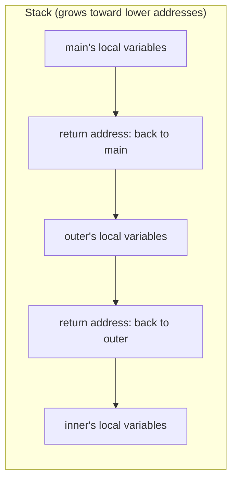

> 🌏 [繁體中文版](/posts/tech/2026-10-13-bug-bounty-zero-05-how-programs-use-memory)

The [RCE chapter](/posts/tech/2026-10-13-bug-bounty-zero-04-what-is-rce-en) covered RCE, and the scene was still a website: user input glued into a shell command, or untrusted data turned back into an object. The next stage goes one level lower, to bugs in how a program uses memory. This is the biggest cliff in the series. Up to now a browser and a little Python were enough; from here on, the bugs depend on where in memory something sits.

So this post covers no vulnerability at all. It answers one question: **how does a program actually run on a computer, and where do its data and instructions live?** By the end you should be able to say, in your own words, what sits on the stack and how the CPU knows where to go back to when a function ends. Those two ideas are all the next post (buffer overflows) assumes.

You only need to have written a few functions in any language. The example is in C because C lets you see addresses directly. You don't need to write C; run it and read the output.

The [reporting chapter](/posts/tech/2026-10-14-bug-bounty-zero-11-reports-and-expected-value-en) completed the first web-testing cycle. Before studying lower-level bugs, this chapter supplies the C and memory vocabulary needed to read the next examples.

## Three analogies first

**A program is a pile of instructions plus a pile of data.** Your code is compiled into instructions the CPU understands, and those, together with the data the program uses, are loaded into memory.

**Memory is a long row of numbered boxes.** Wikipedia's entry on a [memory address](https://en.wikipedia.org/wiki/Memory_address) defines it as a reference to a specific memory location, used by both software and hardware. That number is the address. Instructions sit in boxes and so does data; how the CPU tells them apart I'm leaving out here (that is my simplification for a first read).

One thing to be clear about: the addresses a program prints are usually virtual addresses. The same entry says that on computers with virtual memory, most application programs don't deal with physical addresses directly; they use logical or virtual addresses, which the memory management unit (MMU) and the operating system translate. For this post, think of it as "the numbering this program sees for itself."

**The CPU keeps a bookmark.** The [program counter](https://en.wikipedia.org/wiki/Program_counter) (also called the instruction pointer on x86) is a register that stores where in a program the processor is executing; usually it holds the memory address of an instruction. By default the processor fetches instructions one after another, and only an instruction that transfers control writes a new value into this bookmark so execution continues elsewhere.

Put together: the program is loaded, the bookmark points at the first instruction, and after each one it moves on. A function call means "the bookmark must jump somewhere else, and before jumping it has to remember where it was."

## Stack and heap: two places to keep data

A running program has many places to keep data. Two matter here.

**The stack is a pile of sticky notes: you add on top and take from the top.** Wikipedia's [Stack-based memory allocation](https://en.wikipedia.org/wiki/Stack-based_memory_allocation) entry says that in most modern systems each thread has a reserved region of memory as its stack; when a function runs, it can put some of its local state on top, and when it exits that data is removed. At a minimum, the stack stores a return address supplied by the caller so that a return goes to the right place. The same entry notes the stack is often used for fixed-length variables local to the currently active functions.

**The heap is a warehouse: you ask the clerk for as much space as you need, and give it back when done.** In C that request is `malloc`. The Linux [malloc(3) manual page](https://man7.org/linux/man-pages/man3/malloc.3.html) says `malloc()` normally allocates from the heap and adjusts the heap size as required; for blocks larger than `MMAP_THRESHOLD` (128 kB by default) the glibc implementation uses `mmap(2)` instead. The intuition: stack space is reclaimed automatically as functions come and go, while heap blocks are returned when the program decides.

Which way the stack grows depends on the processor: the [Call stack entry](https://en.wikipedia.org/wiki/Call_stack) says architectures differ as to whether call stacks grow towards higher or lower addresses. The diagram in the stack entry above shows a downward-growing stack, and so did my own run on x86-64 Linux (you'll see the addresses shrink in a moment).

## The return address: a note saying "go back to this page"

Say you are reading page 10 of a book and are told: "look something up on page 200, then come back." You leave a note on page 10: come back here. If page 200 sends you to page 300, you leave another note. After page 300 you pick up the top note and return to page 200; after that, the next note takes you to page 10.

That is the call stack. The [Call stack entry](https://en.wikipedia.org/wiki/Call_stack) says its main purpose is to keep track of where each active subroutine should return control when it finishes. To do that, the address following the instruction that jumps to the function, the return address, is pushed onto the top of the call stack on each call. When the called function finishes, it pops the return address off the stack and transfers control to it. The callee can call others in turn, and each level adds one more note.

The [program counter entry](https://en.wikipedia.org/wiki/Program_counter) says the same thing from the bookmark's side: a function call not only branches but saves the value of the PC, and a return restores it, resuming at the instruction following the call.



This is a simplified model. A real stack can also hold parameters (the Call stack entry lists this use) and saved registers (the [GCC documentation](https://gcc.gnu.org/onlinedocs/gcc/Return-Address.html) describes the frame as the area on the stack that holds local variables and saved registers), and the layout differs by compiler and platform. This post keeps just two things: local variables and return addresses.

## Try it: print addresses and look at the notes

The program below does two things: it prints the addresses of functions and variables, and it makes two nested calls (`main` calls `outer`, which calls `inner`). `__builtin_return_address(0)` is a GCC built-in that, per the [GCC documentation](https://gcc.gnu.org/onlinedocs/gcc/Return-Address.html), returns the return address of the current function.

```c
#include <stdio.h>
#include <stdlib.h>

int g_counter = 42;                 /* a global variable */

void inner(void) {
    int in_local = 3;
    printf("inner : in_local at %p\n", (void *)&in_local);
    printf("inner : return address %p\n", __builtin_return_address(0));
}

void outer(void) {
    int out_local = 2;
    printf("outer : out_local at %p\n", (void *)&out_local);
    printf("outer : return address %p\n", __builtin_return_address(0));
    inner();
    printf("outer : inner() returned, carrying on\n");
}

int main(void) {
    int main_local = 1;
    int *on_heap = malloc(sizeof(int));
    *on_heap = 99;

    printf("main  : function main  lives at %p\n", (void *)main);
    printf("main  : function outer lives at %p\n", (void *)outer);
    printf("main  : function inner lives at %p\n", (void *)inner);
    printf("main  : global g_counter at %p\n", (void *)&g_counter);
    printf("main  : main_local at %p\n", (void *)&main_local);
    printf("main  : malloc returned %p\n", (void *)on_heap);
    outer();
    printf("main  : outer() returned\n");
    free(on_heap);
    return 0;
}
```

Save it as `addr.c`, then compile and run:

```bash
gcc -O0 -fno-inline -fno-stack-protector -o addr addr.c
./addr
```

I added the three flags to keep the output simple: `-O0` turns off optimization, `-fno-inline` stops the compiler from expanding small functions in place (the GCC docs note that when a function is inlined, the returned address is that of the function being returned to, which would muddy the demo; the docs suggest the `noinline` function attribute to work around that, and at `-O0` this flag is usually redundant, which is my own judgment, so I keep it only as a precaution), and `-fno-stack-protector` turns off a protection this post doesn't cover. This is a teaching simplification, not how programs are normally built.

I ran it in a sandbox (Ubuntu's GCC 13.3.0, x86-64). The output:

```text
main  : function main  lives at 0x56092a3b5255
main  : function outer lives at 0x56092a3b51f5
main  : function inner lives at 0x56092a3b51a9
main  : global g_counter at 0x56092a3b8010
main  : main_local at 0x7ffe07bb6ea4
main  : malloc returned 0x560940cf22a0
outer : out_local at 0x7ffe07bb6e8c
outer : return address 0x56092a3b5333
inner : in_local at 0x7ffe07bb6e6c
inner : return address 0x56092a3b5243
outer : inner() returned, carrying on
main  : outer() returned
```

Reading it line by line:

1. **The three function addresses** all start with `0x56092a3b5` and differ only in the last three digits. This is where the instructions live: `inner` at `...51a9`, `outer` at `...51f5`, `main` at `...5255`.
2. **`g_counter` (the global)** is at `0x56092a3b8010`, sharing the same leading digits as the functions, so it sits near the program itself.
3. **The three local variables** `main_local`, `out_local` and `in_local` all start with `0x7ffe07`, far from the functions: that is the stack region. The order is `...6ea4`, `...6e8c`, `...6e6c`: the later a function is called, the smaller its address. That is the observed evidence that the stack grows toward lower addresses here.
4. **The `malloc` result `0x560940cf22a0`** is yet another region, with a prefix different from both the program and the stack. Given the man page quoted above, this is the heap (I inferred this from the different prefix plus the man page; I did not check `/proc/self/maps`).
5. **`inner`'s return address `0x56092a3b5243`** falls inside `outer` (which starts at `...51f5`), `0x4e` past its start. Meaning: when `inner` finishes it goes back into `outer`, just after the line that called it.
6. **`outer`'s return address `0x56092a3b5333`** falls inside `main` (which starts at `...5255`), `0xde` past its start. Same idea, back into `main`.
7. The last two lines, `inner() returned` and `outer() returned`, are the notes being picked up in order, control going back one level at a time.

## Check it yourself: the return address is the instruction after the call

If you don't believe it, look at the disassembly. You don't need to read assembly; just find the `call` line and the one after it:

```bash
nm ./addr | grep -E ' T (main|outer|inner)$'
objdump -d ./addr --no-show-raw-insn | grep -A1 'call.*<inner>'
```

What I got (objdump's format may differ slightly between versions):

```text
00000000000011a9 T inner
0000000000001255 T main
00000000000011f5 T outer
    123e:	call   11a9 <inner>
    1243:	lea    0xe2e(%rip),%rax        # 2078 <_IO_stdin_used+0x78>
```

In `outer`, the `call` to `inner` sits at offset `0x123e` in the file, and the next instruction is at `0x1243`. Look back at the output above: `inner`'s return address ends in `...243`. The three function offsets (`11a9`, `11f5`, `1255`) also match the tails of the runtime addresses. Subtract the file offset from the runtime address and you get the same base each time. That "they match" is my observation of this output.

## Why the addresses differ every run

Run it again and look at the first lines:

```text
main  : function main  lives at 0x559735ac1255
main  : function outer lives at 0x559735ac11f5
main  : function inner lives at 0x559735ac11a9
```

The leading part changed completely; the last three digits did not. The reason is that, by default, the operating system places the program at a random starting point each time it launches, known as ASLR (Address Space Layout Randomization). The Linux kernel documentation for `randomize_va_space` says: value 1 randomizes the addresses of the mmap base, the stack and the VDSO page, which implies shared libraries load at random addresses, and for PIE-linked binaries the location of the code start is randomized too; value 2 additionally randomizes the heap. You can check your own setting with `cat /proc/sys/kernel/randomize_va_space`; mine reads 2. That explains why the stack, the heap and the program body all moved in my output.

My GCC produced a PIE (position-independent executable) by default, which is why the program's own starting point moves. That is the default I saw in this environment; other distributions and build settings may differ.

What ASLR is for comes in a later post (my one-line summary: it makes it harder to know in advance where something is). For now, remember this: **addresses change each run, but the relative layout and who sits inside whom stay the same.**

## Limits

- This is a simplified model. Real CPUs and operating systems are far more complicated: the program counter entry itself warns that on modern processors "where execution is" gets murkier because of instruction-level parallelism and out-of-order execution, and virtual addresses go through translation, as noted above.
- The post uses common x86-64 Linux as its example. Which way the stack grows and how a return address is stored can differ on other architectures and platforms; the GCC documentation notes, for instance, that on AArch64 the stored return address may be signed and so differ from what the built-in returns.
- The numbers in the output (prefixes, gaps) belong to my environment; yours will differ. Look at the structure, not the numbers.
- The stack and the heap are only two parts of memory. A full process memory layout has other regions that this post does not cover.

## Self-check

1. Besides local variables, what else can be on a function's stack frame? (Hint: the note.)
2. When a function ends, how does the CPU know where to go?
3. Why does `inner`'s return address fall inside `outer`?

Suggested answers: the return address (and, depending on the platform, parameters and saved registers); on return the return address is taken off the stack and handed to the program counter, so execution continues at the instruction after the call; because `inner` was called from a line inside `outer`, and that line's successor is where it must return.

## One thing to do now

Save the program, add a `printf` of `__builtin_return_address(0)` to `inner` if you like, then add one more level `deeper()` called by `inner`. Predict which function its return address will fall inside, then run it to check.

The next post makes this note go wrong: what happens if someone can write data that doesn't belong there right next to it? That is [buffer overflows and memory bugs](/posts/tech/2026-10-13-bug-bounty-zero-06-memory-bugs-buffer-overflow-en).

## References

- [Call stack (Wikipedia)](https://en.wikipedia.org/wiki/Call_stack)
- [Stack-based memory allocation (Wikipedia)](https://en.wikipedia.org/wiki/Stack-based_memory_allocation)
- [Program counter (Wikipedia)](https://en.wikipedia.org/wiki/Program_counter)
- [Memory address (Wikipedia)](https://en.wikipedia.org/wiki/Memory_address)
- [malloc(3) (Linux man-pages)](https://man7.org/linux/man-pages/man3/malloc.3.html)
- [Getting the Return or Frame Address of a Function (GCC documentation)](https://gcc.gnu.org/onlinedocs/gcc/Return-Address.html)
- [Documentation for /proc/sys/kernel/ (Linux kernel documentation, randomize_va_space)](https://www.kernel.org/doc/html/latest/admin-guide/sysctl/kernel.html)
- [Previous: Why RCE Pays the Most in Google's Reward Table](/posts/tech/2026-10-13-bug-bounty-zero-04-what-is-rce-en)
- [Next: buffer overflows and memory bugs](/posts/tech/2026-10-13-bug-bounty-zero-06-memory-bugs-buffer-overflow-en)

[Previous: part 6](/posts/tech/2026-10-14-bug-bounty-zero-11-reports-and-expected-value-en) · [Next: part 8](/posts/tech/2026-10-13-bug-bounty-zero-06-memory-bugs-buffer-overflow-en)
