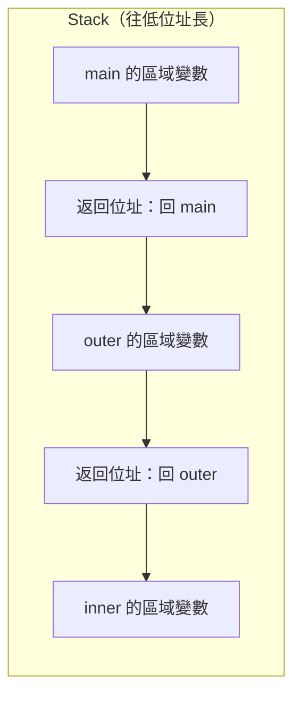

> 🌏 [English version](/posts/tech/2026-10-13-bug-bounty-zero-05-how-programs-use-memory-en)

[RCE 那一篇](/posts/tech/2026-10-13-bug-bounty-zero-04-what-is-rce)講的 RCE，場景還在網站：使用者輸入被拼進 shell 指令，或不可信的資料被還原成物件。下一階段要往更底層走，看程式在記憶體裡出的問題。這是整個系列最大的一道斷崖：前面的 Web 與報告篇你可以只靠瀏覽器和一點 Python 理解，接下來的漏洞卻發生在「資料放在哪個位置」這種層次。

所以這一篇不談任何漏洞，只回答一個問題：**一支程式在電腦裡到底是怎麼跑的，資料和指令放在哪裡？** 讀完你應該能用自己的話說出：stack 上有哪些東西、函式結束時 CPU 怎麼知道要回哪裡。這兩件事，是下一篇緩衝區溢位的全部前提。

先備知識只要寫過幾行任何語言的函式。範例用 C，因為 C 讓你直接看到位址；不需要會寫 C，照著跑、看輸出就好。

[上一章的報告與分流](/posts/tech/2026-10-14-bug-bounty-zero-11-reports-and-expected-value)走完了第一輪 Web 測試流程。接著讀底層漏洞前，先在這一篇補上讀懂範例需要的 C 與記憶體觀念。

## 先建立三個比喻

**程式是一疊指令加上一堆資料。** 你寫的程式經過編譯，變成一條條 CPU 看得懂的指令，連同程式用到的資料，一起被載入記憶體。

**記憶體像一整排編號的格子。** 維基百科對 [memory address](https://en.wikipedia.org/wiki/Memory_address) 的定義是：指向記憶體中某個特定位置的參照，軟體與硬體都會用到。這個編號就叫位址。指令放在格子裡，資料也放在格子裡；至於 CPU 怎麼分辨，這裡先不展開（這是我為了入門做的簡化說法）。

有一點要先講清楚：程式印出來的位址，通常是「虛擬位址」。同一個條目指出，有虛擬記憶體的電腦上，大多數應用程式不直接處理實體位址，而是使用由記憶體管理單元（MMU）與作業系統轉換的邏輯或虛擬位址。對本篇來說，把它想成「這支程式自己看到的編號」就夠了。

**CPU 手上有一個書籤。** [program counter](https://en.wikipedia.org/wiki/Program_counter)（程式計數器，x86 上也叫 instruction pointer）是一個暫存器，存放處理器目前執行到程式的哪裡，通常存的是一條指令的記憶體位址。預設情況下，處理器依序從記憶體取指令；遇到跳轉類的指令，才會把新的值寫進這個書籤，改從別處繼續。

把三者合起來：程式載入記憶體，CPU 的書籤指向第一條指令，一條跑完書籤往下移一格。函式呼叫就是「書籤要跳到別的地方，而且跳之前得記得原本在哪」。

## Stack 與 heap：兩種放資料的地方

程式執行時，需要放資料的地方很多，這裡先看兩個。

**Stack 像一疊便條紙，只能從最上面放、從最上面拿。** 維基百科的 [Stack-based memory allocation](https://en.wikipedia.org/wiki/Stack-based_memory_allocation) 條目說，在大多數現代系統裡，每個執行緒都有一塊保留的記憶體當作它的 stack；函式執行時可以把部分區域性的狀態放到 stack 頂端，函式結束時再把它們移除。stack 至少會存放呼叫者提供的返回位址，讓 return 能回到正確的地方。同一個條目還指出，stack 常用來放長度固定、屬於目前啟用中函式的區域變數。

**Heap 像倉庫，要用多少就向管理員登記，用完要還。** 在 C 裡，這個動作是 `malloc`。Linux 的 [malloc(3) 說明頁](https://man7.org/linux/man-pages/man3/malloc.3.html)寫道：`malloc()` 通常從 heap 配置記憶體，並視需要調整 heap 大小；配置的區塊大於 `MMAP_THRESHOLD`（預設 128 kB）時，glibc 的實作改用 `mmap(2)`。兩者差別的直覺是：stack 隨函式進出自動回收，heap 的區塊由程式自己決定何時歸還。

Stack 的長法，各處理器不同：[Call stack 條目](https://en.wikipedia.org/wiki/Call_stack)說，不同架構的 call stack 有的往高位址長、有的往低位址長。上面那篇 stack 條目的示意圖是「向下長」，我在 x86-64 Linux 上的實測也是（下一節會看到位址一路變小）。

## 返回位址：一張寫著「做完回哪一頁」的便條

假設你在讀一本書的第 10 頁，被要求「先去第 200 頁查個東西，查完回來」。你會在第 10 頁夾一張便條：回到這裡。如果第 200 頁又要你去第 300 頁，你再夾一張。查完 300 頁，拿起最上面那張便條回 200 頁；查完 200 頁，再拿下一張回 10 頁。

這就是 call stack。[Call stack 條目](https://en.wikipedia.org/wiki/Call_stack)說，它最主要的目的是記錄每個進行中的副程式做完之後應該把控制權交回哪裡；做法是把緊接在「跳去那個函式」的指令後面的位址，也就是返回位址，在每次呼叫時推到 stack 頂端。被呼叫的函式結束時，把返回位址從 stack 取出，控制權就轉到那個位址。呼叫者還能繼續呼叫別人，每多一層就多推一張便條。

[program counter 條目](https://en.wikipedia.org/wiki/Program_counter)從書籤的角度講同一件事：函式呼叫不只是跳轉，還會保存 PC 的值；return 則把保存的值還給 PC，回到呼叫指令的下一條繼續。



這張圖是簡化模型。一個函式實際上的 stack 內容還可能包含參數（Call stack 條目列了這項用途）和被保存的暫存器（[GCC 文件](https://gcc.gnu.org/onlinedocs/gcc/Return-Address.html)說 frame 是 stack 上存放區域變數與被保存暫存器的區域），而且各編譯器、各平台的排列方式不同。這一篇只抓兩樣：區域變數，和返回位址。

## 動手：印出位址，看便條

下面這支程式只做兩件事：印出函式、變數的位址，以及做兩層函式呼叫（`main` 呼叫 `outer`，`outer` 呼叫 `inner`）。`__builtin_return_address(0)` 是 GCC 的內建函式，依 [GCC 文件](https://gcc.gnu.org/onlinedocs/gcc/Return-Address.html)，它回傳目前函式的返回位址。

```c
#include <stdio.h>
#include <stdlib.h>

int g_counter = 42;                 /* 全域變數 */

void inner(void) {
    int in_local = 3;
    printf("inner : in_local 在 %p\n", (void *)&in_local);
    printf("inner : 返回位址   %p\n", __builtin_return_address(0));
}

void outer(void) {
    int out_local = 2;
    printf("outer : out_local 在 %p\n", (void *)&out_local);
    printf("outer : 返回位址   %p\n", __builtin_return_address(0));
    inner();
    printf("outer : inner() 回來了，繼續往下\n");
}

int main(void) {
    int main_local = 1;
    int *on_heap = malloc(sizeof(int));
    *on_heap = 99;

    printf("main  : 函式 main  住在 %p\n", (void *)main);
    printf("main  : 函式 outer 住在 %p\n", (void *)outer);
    printf("main  : 函式 inner 住在 %p\n", (void *)inner);
    printf("main  : 全域 g_counter 在 %p\n", (void *)&g_counter);
    printf("main  : main_local 在 %p\n", (void *)&main_local);
    printf("main  : malloc 拿到 %p\n", (void *)on_heap);
    outer();
    printf("main  : outer() 回來了\n");
    free(on_heap);
    return 0;
}
```

編譯與執行（存成 `addr.c`）：

```bash
gcc -O0 -fno-inline -fno-stack-protector -o addr addr.c
./addr
```

三個旗標是我為了讓輸出單純而加的：`-O0` 不做最佳化，`-fno-inline` 不讓編譯器把小函式直接展開（GCC 文件提到，函式被 inline 時，返回位址會變成「被返回到的那個函式」的位址，會干擾示範，文件建議對函式用 `noinline` 屬性來避開；在 `-O0` 下這個旗標通常多餘，這是我的判斷，我留著只是求保險），`-fno-stack-protector` 關掉一個這篇不展開的保護機制。這是教學簡化，不代表一般程式的建置方式。

我在沙盒（Ubuntu 的 GCC 13.3.0、x86-64）實際執行，輸出如下：

```text
main  : 函式 main  住在 0x564f501a5255
main  : 函式 outer 住在 0x564f501a51f5
main  : 函式 inner 住在 0x564f501a51a9
main  : 全域 g_counter 在 0x564f501a8010
main  : main_local 在 0x7ffe860f1cd4
main  : malloc 拿到 0x564f8aa8c2a0
outer : out_local 在 0x7ffe860f1cbc
outer : 返回位址   0x564f501a5333
inner : in_local 在 0x7ffe860f1c9c
inner : 返回位址   0x564f501a5243
outer : inner() 回來了，繼續往下
main  : outer() 回來了
```

逐行讀：

1. **三個函式的位址**都以 `0x564f501a5` 開頭，彼此只差最後三位。這是指令住的地方：`inner` 在 `...51a9`，`outer` 在 `...51f5`，`main` 在 `...5255`。
2. **`g_counter`（全域變數）** 在 `0x564f501a8010`，跟函式同一個前綴，也就是跟程式本體放在附近。
3. **三個區域變數** `main_local`、`out_local`、`in_local` 的位址都以 `0x7ffe86` 開頭，跟函式差很遠，這是 stack 區。順序是 `...1cd4`、`...1cbc`、`...1c9c`：越晚被呼叫的函式，位址越小。這就是「stack 往低位址長」的實測證據。
4. **`malloc` 拿到的 `0x564f8aa8c2a0`** 又是另一個區域：前綴跟程式本體不同、跟 stack 也不同。依前面 `malloc(3)` 的說明，這是 heap（我是由前綴不同加上說明頁推斷，沒有另外查 `/proc/self/maps` 確認）。
5. **`inner` 的返回位址 `0x564f501a5243`** 落在 `outer`（起點 `...51f5`）之內，比起點多 `0x4e`。意思是：`inner` 做完要回到 `outer` 裡面、呼叫它的那一行後面。
6. **`outer` 的返回位址 `0x564f501a5333`** 落在 `main`（起點 `...5255`）之內，多 `0xde`。同樣的道理，回到 `main`。
7. 最後兩行 `inner() 回來了` 與 `outer() 回來了`，就是便條被依序拿起、控制權一層層回去的結果。

## 自己驗證：返回位址真的是「呼叫指令的下一條」

不信的話，用反組譯工具看一眼。你不需要看懂組合語言，只要找 `call` 那一行和它的下一行：

```bash
nm ./addr | grep -E ' T (main|outer|inner)$'
objdump -d ./addr --no-show-raw-insn | grep -A1 'call.*<inner>'
```

我這邊得到（不同版本的 objdump 格式可能略有出入）：

```text
00000000000011a9 T inner
0000000000001255 T main
00000000000011f5 T outer
    123e:	call   11a9 <inner>
    1243:	lea    0xe2e(%rip),%rax        # 2078 <_IO_stdin_used+0x78>
```

`outer` 裡呼叫 `inner` 的那條 `call` 在檔案內偏移 `0x123e`，下一條指令在 `0x1243`。再看上面的輸出，`inner` 的返回位址尾巴正是 `...243`。三個函式的偏移（`11a9`、`11f5`、`1255`）也和執行時位址的尾巴對得上。把「執行時位址」減掉「檔案內偏移」，每次得到同一個基底。這裡的「對得上」是我對這份輸出的觀察。

## 為什麼每次跑位址都不一樣

再跑一次，只看前幾行：

```text
main  : 函式 main  住在 0x563c88d25255
main  : 函式 outer 住在 0x563c88d251f5
main  : 函式 inner 住在 0x563c88d251a9
main  : 全域 g_counter 在 0x563c88d28010
```

前面的部分整個換了，後面三位不變。原因是在預設情況下，作業系統每次啟動程式都把它放在隨機的起點，這叫 ASLR（Address Space Layout Randomization）。Linux 核心文件對 `randomize_va_space` 的說明是：值為 1 時，mmap 基底、stack 與 VDSO 頁面的位址被隨機化，連帶共享函式庫載入到隨機位址；對 PIE 方式連結的執行檔，程式碼起點也會被隨機化；值為 2 時，再加上 heap 的隨機化。你可以用 `cat /proc/sys/kernel/randomize_va_space` 看自己的設定，我的沙盒是 2。這解釋了為什麼我的輸出裡 stack、heap、程式本體三塊都會變。

我的 GCC 預設產生的是 PIE（可以重新定位的執行檔），所以程式本體的起點也會變。這是我在這個環境看到的預設，不同發行版與編譯設定可能不同。

ASLR 的用意留到後面的篇章再談（我的概括：它讓「事先知道某個東西在哪」變得比較難）。這一篇只要知道：**位址每次不同，但「相對位置」與「誰在誰裡面」的結構不變。**

## 限制

- 這是簡化模型。真實的 CPU 與作業系統複雜得多：program counter 條目就提醒，現代處理器的「執行到哪裡」因為指令層級平行化與亂序執行而更複雜，前面也提過虛擬位址要經過轉換。
- 本篇以常見的 x86-64 Linux 為例。stack 往哪個方向長、返回位址怎麼保存，在其他架構與平台可能不一樣；GCC 文件就提到，在 AArch64 上，記憶體中實際存放的返回位址可能經過簽章而與內建函式回傳的值不同。
- 輸出裡的數字（前綴、差距）屬於我的環境，你的機器會是別的值。看的是結構，不是數字。
- Stack 與 heap 只是記憶體的兩塊。完整的程式記憶體配置還有別的區域，本篇沒有展開。

## 自我檢查

1. 一個函式的 stack 上，除了區域變數，還會有什麼？（提示：便條。）
2. 函式結束時，CPU 怎麼知道回哪裡？
3. 為什麼 `inner` 的返回位址落在 `outer` 的範圍內？

參考答案：返回位址（還可能有參數、被保存的暫存器，視平台而定）；結束時從 stack 取出返回位址交給 program counter，從呼叫指令的下一條繼續；因為 `inner` 是被 `outer` 裡的一行程式呼叫的，要回去的就是那一行的後面。

## 你現在可以做的一件事

把上面的程式存下來，在 `inner` 裡再加一行 `printf` 印 `__builtin_return_address(0)`，然後再多寫一層 `deeper()`（被 `inner` 呼叫）。預測它的返回位址會落在哪個函式之內，再跑跑看驗證。

下一篇會讓這張「便條」出事：如果有人能把不屬於便條的資料寫到它旁邊，會發生什麼事？那就是[緩衝區溢位與記憶體漏洞](/posts/tech/2026-10-13-bug-bounty-zero-06-memory-bugs-buffer-overflow)。

## 參考資料

- [Call stack（Wikipedia）](https://en.wikipedia.org/wiki/Call_stack)
- [Stack-based memory allocation（Wikipedia）](https://en.wikipedia.org/wiki/Stack-based_memory_allocation)
- [Program counter（Wikipedia）](https://en.wikipedia.org/wiki/Program_counter)
- [Memory address（Wikipedia）](https://en.wikipedia.org/wiki/Memory_address)
- [malloc(3)（Linux man-pages）](https://man7.org/linux/man-pages/man3/malloc.3.html)
- [Getting the Return or Frame Address of a Function（GCC 文件）](https://gcc.gnu.org/onlinedocs/gcc/Return-Address.html)
- [Documentation for /proc/sys/kernel/（Linux 核心文件，randomize_va_space）](https://www.kernel.org/doc/html/latest/admin-guide/sysctl/kernel.html)
- [前面的 RCE 篇](/posts/tech/2026-10-13-bug-bounty-zero-04-what-is-rce)
- [下一篇：緩衝區溢位與記憶體漏洞](/posts/tech/2026-10-13-bug-bounty-zero-06-memory-bugs-buffer-overflow)

[上一篇：第 6 篇](/posts/tech/2026-10-14-bug-bounty-zero-11-reports-and-expected-value)・[下一篇：第 8 篇](/posts/tech/2026-10-13-bug-bounty-zero-06-memory-bugs-buffer-overflow)
