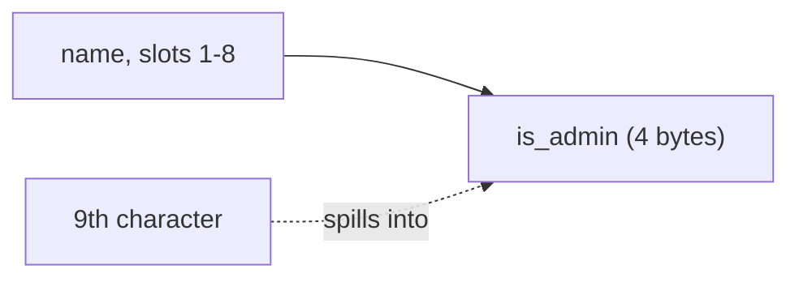

> 🌏 [中文版](/posts/tech/2026-10-13-bug-bounty-zero-06-memory-bugs-buffer-overflow)

[The previous post](/posts/tech/2026-10-13-bug-bounty-zero-05-how-programs-use-memory-en) covered how a program uses memory: where variables live, how the stack differs from the heap, and where a function returns to when it finishes. This post asks one concrete question: why can writing a few characters too many let someone take control of a program? By the end you should be able to read a short C program, point at the line that can overflow and say why, and rewrite it with a length-limited call.

## What a buffer overflow is

A buffer is a contiguous chunk of memory that holds a string or a row of numbers. [OWASP defines](https://owasp.org/www-community/vulnerabilities/Buffer_Overflow) a buffer overflow as a program trying to put more data in a buffer than it can hold, or trying to put data in a memory area past a buffer. Writing outside the bounds of a block of allocated memory can corrupt data, crash the program, or cause the execution of malicious code.

An analogy: you have a storage box with 8 slots, one character per slot. A five-letter name fits. A 20-letter name does not, but the program keeps filling slots one by one, and from slot 9 on it is writing outside the box, over whatever was stored in the next compartment. Nothing stops it, because C's string-copy functions do not check how big the box is. OWASP puts it this way: many memory manipulation functions in C and C++ do not perform bounds checking and can easily overwrite the allocated bounds of the buffers they operate upon.

## A deliberately vulnerable program

The program below has an 8-slot name field followed immediately by an `is_admin` flag, where 0 means an ordinary user. It copies a command-line argument into the name field, then picks a path based on the flag.

```c
#include <stdio.h>
#include <string.h>

struct user {
    char name[8];   /* the 8-slot box */
    int  is_admin;  /* the flag right behind it; 0 means not an admin */
};

int main(int argc, char **argv) {
    struct user u;
    u.is_admin = 0;
    if (argc < 2) return 1;

    strcpy(u.name, argv[1]);   /* no length check */

    printf("name     = %s\n", u.name);
    printf("is_admin = %d\n", u.is_admin);
    if (u.is_admin)
        puts("-> admin page");
    else
        puts("-> ordinary user");
    return 0;
}
```



This demo shows one harmless effect on purpose: overwriting an adjacent variable and changing a decision. It does not touch a return address and does not inject code.

I compiled it in my sandbox (x86-64 Linux, gcc 13.3.0), and **turned off some protections on purpose** so the result is stable for teaching:

```bash
gcc -O0 -g -fno-stack-protector -U_FORTIFY_SOURCE -D_FORTIFY_SOURCE=0 -o vuln vuln.c
```

That is for teaching only. Real software should not be built this way; more on why below. Actual output (the output comes from running the Chinese version of the program, with only the message text translated; the code on this page already uses English messages):

```text
$ ./vuln alice
name     = alice
is_admin = 0
-> ordinary user
$ ./vuln AAAAAAAA
name     = AAAAAAAA
is_admin = 0
-> ordinary user
$ ./vuln AAAAAAAAA
name     = AAAAAAAAA
is_admin = 65
-> admin page
```

Each run shows one thing. `alice` is the normal case. `AAAAAAAA` is exactly 8 characters and looks fine, but a C string also ends with a null byte (`'\0'`), so `strcpy` already wrote one byte too many; that byte happens to be 0, so the flag did not change. `AAAAAAAAA` is 9 characters: the ninth, `A` (value 65), lands in the first byte of `is_admin`, and the flag becomes 65. The program only asks "is it zero?", so it treats this user as an admin.

I changed no logic. I only supplied one extra character. That is the heart of this class of bug: a decision depends on the value in some piece of memory, and someone can change that value through a write that never checked its length.

## Why overwriting a neighbor is dangerous

How bad it is depends on what the neighbor holds. Here the neighbor is a permission flag.

Another neighbor that gets mentioned a lot is the return address. [CWE-121](https://cwe.mitre.org/data/definitions/121.html) (Stack-based Buffer Overflow) notes that an execution stack generally holds several pieces of security-critical data, and the most prominent is the stored return address: the address at which execution should continue once the current function finishes. The previous post covered how the return address sits on the stack and the function jumps back to it when done; if overflowing data happens to overwrite it, the program may jump somewhere else on return. The same entry says stack-based overflows can show up as return address, stack pointer or frame pointer overwrites, and can also be viewed as function pointer overwrites, array index overwrites and so on.

OWASP and CWE agree on the consequences: overflows generally lead to crashes, and often can be used to execute arbitrary code, which is usually outside the scope of a program's implicit security policy. This post stops at the concept. It does not show how to do it, and does not discuss getting around defenses. Real exploitation is far more involved than the concept, and OWASP says as much: buffer overflows are not easy to discover, and even when one is found it is generally extremely difficult to exploit, yet attackers have found them in a staggering array of products and components.

## The fix: limit the length

There are two layers. The first is to stop using functions that do not limit length. CWE-121's mitigations say outright: do not use dangerous functions such as `gets`; use safer, equivalent functions that check for boundary errors. [CWE-120](https://cwe.mitre.org/data/definitions/120.html) (Classic Buffer Overflow) suggests replacing unbounded copy functions with analogous functions that take a length argument.

The second layer is checking input length at the door. CWE-120 says that, if necessary, you should truncate input strings to a reasonable length before passing them to the copy and concatenation functions. The fixed version:

```c
#include <stdio.h>
#include <string.h>

struct user {
    char name[8];
    int  is_admin;
};

int main(int argc, char **argv) {
    struct user u;
    u.is_admin = 0;
    if (argc < 2) return 1;

    if (strlen(argv[1]) >= sizeof u.name) {   /* check length first; reject if too long */
        puts("name too long, rejected");
        return 1;
    }
    snprintf(u.name, sizeof u.name, "%s", argv[1]);   /* even if the check were missing, at most 8 slots are written */

    printf("name     = %s\n", u.name);
    printf("is_admin = %d\n", u.is_admin);
    if (u.is_admin)
        puts("-> admin page");
    else
        puts("-> ordinary user");
    return 0;
}
```

I picked `snprintf` over `strncpy` because CWE-120 warns that functions taking a byte count, such as `strncpy`, may not null-terminate the string when the destination buffer size equals the source size. POSIX specifies that for `snprintf`, output bytes beyond the n-1st are discarded, and a null byte is written after the bytes actually written. Actual output (output taken from the Chinese version's run, messages translated; the code on this page already prints English):

```text
$ ./fixed alice
name     = alice
is_admin = 0
-> ordinary user
$ ./fixed AAAAAAAAA
name too long, rejected
```

Swapping in a function with a length argument is not a cure-all. CWE-120 rates "replace `strcpy` with `strncpy`" as only moderately effective, because the length is still computed by a human, and off-by-one and wrong-buffer-length mistakes remain. OWASP likewise notes that even bounded functions such as `strncpy` can cause vulnerabilities when used incorrectly.

## Reading exercise: which line overflows?

All three lines assume `buf` is `char buf[64]`. Decide for yourself before reading the answer.

```c
gets(buf);                          /* A */
strcpy(buf, argv[1]);               /* B */
snprintf(buf, sizeof buf, "%s", s); /* C */
```

Answer: A and B can; C cannot. Treat `gets(buf)` as a read-the-code exercise only; do not compile and run it. `gets` writes as much as it reads, with no way to limit it. OWASP uses it as a simple example, noting that the code's safety then depends on the user always entering fewer characters than the buffer holds. `strcpy` copies until the end of the source string, however long that is. The [Linux man page](https://man7.org/linux/man-pages/man3/strcpy.3.html) is explicit: the programmer is responsible for allocating a destination buffer large enough, and if it is not, the behavior is undefined. C passes the buffer size to the function, so the excess is discarded.

## How modern systems add layers

Compilers and operating systems add several layers. This section only names them; it does not go deep and does not teach how to get around them.

| Defense | What it does | Limits, per the source |
|---|---|---|
| stack canary | Places a guard value on function entry and checks it on exit; if it changed, prints an error and exits | The [GCC docs](https://gcc.gnu.org/onlinedocs/gcc/Instrumentation-Options.html) say `-fstack-protector` guards functions with vulnerable objects, such as those that call `alloca` or have buffers of 8 bytes or more |
| ASLR | Randomizes where the program and libraries sit in memory so addresses are hard to predict | The CWE entries say it is not a complete solution: a bug that discloses addresses can raise reliability, and a side-channel attack has been shown to bypass ASLR |
| NX / DEP | Marks data pages non-executable; running code from a data page raises an exception | [Microsoft's docs](https://learn.microsoft.com/en-us/windows/win32/memory/data-execution-prevention) say DEP "is not intended to be a comprehensive defense against all exploits"; CWE-120 adds that an overflow can still overwrite nearby variables to change the program's state |

My own judgment is that these layers stop different things and work best together; none of them makes an overflow harmless. That matches CWE-120's general statement that most mitigating technologies at the compiler or OS level address only a subset of buffer overflow problems and rarely provide complete protection against even that subset.

The most direct check is one I ran myself: I compiled the same vulnerable program with Ubuntu's default gcc options (no extra flags), and `AAAAAAAAA` still printed `is_admin = 65` and still went to the admin page. I inspected that default binary with `readelf`: `readelf -lW` shows the `GNU_STACK` flags as `RW` (no `E`, so NX is on), `readelf -sW` finds `__stack_chk_fail` (the stack canary symbol is present), and `readelf -hW` reports type `DYN` (PIE). With all of those apparently on, the flag still became 65. I did not look up which other defenses the default build enables, so all I can say is that on my machine this demo was not stopped. So turning protections off earlier only made results more consistent across machines; it was not what made the demo work. The result echoes CWE-120's note on NX: an overflow can still overwrite nearby variables and change the program's state in dangerous ways.

## Why this is common in C and C++, and what Rust changes

OWASP and CWE both point at C and C++. OWASP's platform field lists C, C++, Fortran and assembly; CWE-121 marks C and C++ as languages where this weakness is often prevalent. The reason is what we saw: many memory operations in those languages do no bounds checking, so the programmer has to guard the boundary.

The most fundamental fix is a language that checks bounds. OWASP lists "use a language or compiler that performs automatic bounds checking" as a control. CWE-120 says many languages that manage their own memory, such as Java and Perl, are not subject to buffer overflows; Ada and C# typically provide overflow protection, but the programmer can disable it. It also warns that a language's interface to native code may still be subject to overflows even if the language itself is theoretically safe.

[CISA and the FBI put it more directly in a 2025 alert](https://www.cisa.gov/resources-tools/resources/secure-design-alert-eliminating-buffer-overflow-vulnerabilities): all types of memory safety vulnerabilities can be prevented by using memory-safe languages during development. They also acknowledge that rewriting codebases in such languages takes significant effort, so they recommend a phased plan: memory-safe languages for new code first, then, over time, the most privileged and exposed code. The alert adds two caveats: it is possible to disable or override the guarantees of some memory-safe languages, and developers must avoid doing so; and using a memory-safe language for one part of a package does not fix memory-unsafe code in other libraries.

Rust is the usual example. [The Rust book](https://doc.rust-lang.org/book/ch03-02-data-types.html) says that when you index into an array, Rust checks that the index is less than the array length, and panics (exits immediately) if it is not. It notes that in many low-level languages this check is not done, so an incorrect index can reach invalid memory, and that Rust protects against this by exiting instead of allowing the access. That is the only thing I verified: bounds checking on array indexing. I did not verify Rust's other guarantees or the scope of `unsafe`, so I draw no conclusions about them here.

## How this relates to the reward table

One easy misreading first. In the reward table of the [Google VRP rules](https://bughunters.google.com/about/rules/google-friends/google-and-alphabet-vulnerability-reward-program-vrp-rules), the top row is Remote code execution (S0) under "Vulnerabilities giving direct access to Google servers", with the examples "Command injection, deserialization bugs, sandbox escapes". The words buffer overflow do **not** appear. The table's categories are by impact (direct access to servers), and the examples column lists just three. The same page's "Qualifying vulnerabilities" list includes "Server-side code execution bugs".

So only one statement is justified: an overflow is a cause, and if its consequence is arbitrary code execution, it falls under the RCE row by category. OWASP and CWE say overflows often can be used to execute arbitrary code, which is the sources' claim; "so it lands in that row" is my inference. Whether any particular cell of the reward table was earned through a buffer overflow, the rules page does not say and I found no reliable source, so this post does not speculate.

## Limits

This is an introduction and leaves several things out. The demo overflows between adjacent fields of one struct so that the result is stable and easy to observe; real stack and heap overflows face more layers of defense, and real exploitation is far more complicated than anything here. The demo was run only on x86-64 Linux, and the number 65 is, in my judgment, tied to this platform storing the low byte of an integer first, so the number may differ elsewhere. And an overflow is only one kind of memory error; use-after-free, format string bugs and others are not covered.

## What you can do tonight

Look at a real AddressSanitizer report once. [Clang's documentation](https://clang.llvm.org/docs/AddressSanitizer.html) describes it as a fast memory error detector made of compiler instrumentation and a run-time library, able to detect out-of-bounds accesses to heap, stack and globals, use-after-free and more; you enable it by compiling and linking with `-fsanitize=address`. The [GCC docs](https://gcc.gnu.org/onlinedocs/gcc/Instrumentation-Options.html) also suggest adding `-g` for more meaningful output.

Start with a standalone-array version:

```c
#include <stdio.h>
#include <string.h>

int main(int argc, char **argv) {
    char name[8];              /* the 8-slot box */
    if (argc < 2) return 1;

    strcpy(name, argv[1]);     /* no length check */

    printf("name = %s\n", name);
    return 0;
}
```

```bash
gcc -g -O1 -fsanitize=address -fno-omit-frame-pointer -U_FORTIFY_SOURCE -D_FORTIFY_SOURCE=0 -o vuln2 vuln2.c
./vuln2 alice
./vuln2 AAAAAAAAAAAA
```

Why the extra flags: `-O1` and `-fno-omit-frame-pointer` are the Clang docs' recommendations for reasonable performance and nicer stack traces. `-U_FORTIFY_SOURCE -D_FORTIFY_SOURCE=0` is something my sandbox forced: without it, the program was stopped by a different check before ASan could report, printing only `*** buffer overflow detected ***: terminated`. My judgment is that this comes from glibc's `_FORTIFY_SOURCE` (the `strcpy` man page points to that mechanism right after saying the behavior is undefined when the destination is too small), but I did not verify that causal link in depth. Actual output, trimmed to the key lines:

```text
name = alice
=================================================================
==15306==ERROR: AddressSanitizer: stack-buffer-overflow on address 0x7fea6dd00028 ...
WRITE of size 13 at 0x7fea6dd00028 thread T0
    #0 0x7fea702a7922 in strcpy ../../../../src/libsanitizer/asan/asan_interceptors.cpp:563
    #1 0x56037c0b92f7 in main vuln2.c:8
...
Address 0x7fea6dd00028 is located in stack of thread T0 at offset 40 in frame
    #0 0x56037c0b9258 in main vuln2.c:4

  This frame has 1 object(s):
    [32, 40) 'name' (line 5) <== Memory access at offset 40 overflows this variable
SUMMARY: AddressSanitizer: stack-buffer-overflow ... in strcpy
```

How to read it: `stack-buffer-overflow` is the error type; `WRITE of size 13` is how many bytes this write tried (12 characters plus the null byte); `vuln2.c:8` points at the `strcpy` line; `[32, 40) 'name'` says the `name` object spans 8 bytes and the access landed outside it. The Clang docs say ASan exits on the first detected error with a non-zero exit code, by design.

Now do the same with the first, struct-based program:

```bash
gcc -g -O1 -fsanitize=address -fno-omit-frame-pointer -U_FORTIFY_SOURCE -D_FORTIFY_SOURCE=0 -o vuln_asan vuln.c
./vuln_asan AAAAAAAAA
```

My output was:

```text
name     = AAAAAAAAA
is_admin = 65
-> admin page
```

ASan reported nothing, and the decision was still changed. I am sure only that this happened; I found no documentation giving the reason. My guess is that ASan places guard zones between separate objects, while `name` and `is_admin` are part of one struct with no guard zone between them, but that is a guess, not something the docs say. The lesson is that tools have blind spots, and no report does not mean no bug. CISA's alert likewise says only that, in a codebase with significant unit test coverage, such tools can detect many (but not all) memory safety issues.

One last warning: the Clang docs say ASan is a bug-detection tool whose runtime was not developed with security-sensitive constraints in mind and should not be linked into production executables. Practice on your own machine.

If you want to go one step further, fix `vuln2.c` (with `snprintf` and a length check), rerun it with the same ASan flags on `AAAAAAAAAAAA`, and confirm the report is gone. The next post moves from programs to virtual machines and hypervisors.

## References

- [Buffer Overflow (OWASP)](https://owasp.org/www-community/vulnerabilities/Buffer_Overflow)
- [CWE-120: Buffer Copy without Checking Size of Input ('Classic Buffer Overflow') (MITRE)](https://cwe.mitre.org/data/definitions/120.html)
- [CWE-121: Stack-based Buffer Overflow (MITRE)](https://cwe.mitre.org/data/definitions/121.html)
- [AddressSanitizer (Clang documentation)](https://clang.llvm.org/docs/AddressSanitizer.html)
- [Program Instrumentation Options (GCC documentation)](https://gcc.gnu.org/onlinedocs/gcc/Instrumentation-Options.html)
- [Secure by Design Alert: Eliminating Buffer Overflow Vulnerabilities (CISA)](https://www.cisa.gov/resources-tools/resources/secure-design-alert-eliminating-buffer-overflow-vulnerabilities)
- [Data Execution Prevention (Microsoft Learn)](https://learn.microsoft.com/en-us/windows/win32/memory/data-execution-prevention)
- [strcpy(3) (Linux man-pages)](https://man7.org/linux/man-pages/man3/strcpy.3.html)
- [fprintf(3p), including snprintf (POSIX, man7.org)](https://man7.org/linux/man-pages/man3/fprintf.3p.html)
- [Data Types: Invalid Array Element Access (The Rust Programming Language)](https://doc.rust-lang.org/book/ch03-02-data-types.html)
- [Google and Alphabet VRP Rules (Google Bug Hunters)](https://bughunters.google.com/about/rules/google-friends/google-and-alphabet-vulnerability-reward-program-vrp-rules)
- [How Programs Use Memory (series part 5)](/posts/tech/2026-10-13-bug-bounty-zero-05-how-programs-use-memory-en)
- [VMs and Hypervisors (series part 7)](/posts/tech/2026-10-13-bug-bounty-zero-07-vm-and-hypervisor-en)
