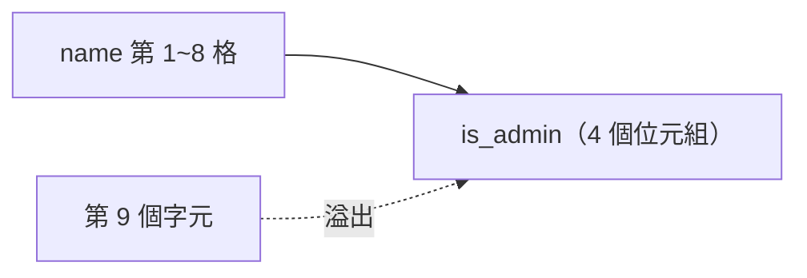

> 🌏 [English version](/posts/tech/2026-10-13-bug-bounty-zero-06-memory-bugs-buffer-overflow-en)

[上一篇](/posts/tech/2026-10-13-bug-bounty-zero-05-how-programs-use-memory)講了程式怎麼使用記憶體：變數放在哪、stack 和 heap 差在哪、函式結束後要回到哪裡。這一篇接著問一個很具體的問題：為什麼「多寫了幾個字元」，就可能讓別人控制一支程式？讀完你應該能看一段簡單的 C 程式，指出哪一行可能溢位、為什麼，並改成限制長度的寫法。

## 緩衝區溢位是什麼

緩衝區（buffer）是一段連續的記憶體，用來裝字串或一排數字。[OWASP 的定義](https://owasp.org/www-community/vulnerabilities/Buffer_Overflow)是：程式試圖把比緩衝區容量更多的資料放進去，或是把資料寫到緩衝區之後的記憶體區域。往界外寫入可能損毀資料、讓程式當掉，或是執行惡意程式碼。

用比喻來說：你有一個 8 格的收納盒，每格放一個字元。使用者名字只有 5 個字，沒問題。名字有 20 個字，程式又老實地一格一格往下放，第 9 格以後就放到盒子外面，蓋掉隔壁格子裡原本的東西。程式本身不會替你停下來，因為 C 語言的字串複製函式預設不檢查盒子有多大。OWASP 的說法是：C 和 C++ 裡許多操作記憶體的函式不做邊界檢查，可以輕易覆寫所操作緩衝區的邊界。

## 一支故意有漏洞的小程式

下面的程式有一個 8 格的名字欄位，緊接著是一個 `is_admin` 旗標，0 代表一般使用者。程式把命令列參數複製進名字欄位，再依旗標決定走哪條路。

```c
#include <stdio.h>
#include <string.h>

struct user {
    char name[8];   /* 8 格的收納盒 */
    int  is_admin;  /* 緊鄰在後面的旗標，0 代表不是管理員 */
};

int main(int argc, char **argv) {
    struct user u;
    u.is_admin = 0;
    if (argc < 2) return 1;

    strcpy(u.name, argv[1]);   /* 沒檢查長度 */

    printf("name     = %s\n", u.name);
    printf("is_admin = %d\n", u.is_admin);
    if (u.is_admin)
        puts("-> 進入管理員頁面");
    else
        puts("-> 一般使用者");
    return 0;
}
```



這個範例刻意只示範一種無害的效果：蓋到相鄰的變數，改變程式的判斷。沒有控制返回位址，也沒有注入程式碼。

我在沙盒（x86-64 Linux，gcc 13.3.0）編譯時，為了讓教學結果穩定，**刻意關掉了部分保護**：

```bash
gcc -O0 -g -fno-stack-protector -U_FORTIFY_SOURCE -D_FORTIFY_SOURCE=0 -o vuln vuln.c
```

這只是為了教學。真實的軟體不該這樣編譯，後面會說到原因。實際輸出：

```text
$ ./vuln alice
name     = alice
is_admin = 0
-> 一般使用者
$ ./vuln AAAAAAAA
name     = AAAAAAAA
is_admin = 0
-> 一般使用者
$ ./vuln AAAAAAAAA
name     = AAAAAAAAA
is_admin = 65
-> 進入管理員頁面
```

三次輸入各看一個重點。`alice` 是正常情況。`AAAAAAAA` 剛好 8 個字元，看起來沒事，但 C 字串結尾還有一個空字元（`'\0'`），所以 `strcpy` 已經多寫了一個位元組，只是這個位元組剛好是 0，旗標的值沒變。`AAAAAAAAA` 是 9 個字元：第 9 個字元 `A`（數值 65）落進 `is_admin` 的第一個位元組，旗標變成 65。程式只判斷「是不是 0」，於是把這個使用者當成管理員。

我沒有改程式的任何判斷，只是多給了一個字元。這就是這類漏洞的核心：程式的判斷依賴某塊記憶體的值，而別人能透過一個沒檢查長度的寫入去改它。

## 為什麼蓋到隔壁會危險

蓋到相鄰資料，危險程度取決於隔壁放了什麼。這個範例的隔壁是權限旗標。

另一種常被提到的鄰居是返回位址。[CWE-121](https://cwe.mitre.org/data/definitions/121.html)（Stack-based Buffer Overflow）的說明寫到，執行 stack 上有幾種對安全很關鍵的資料，最顯眼的是儲存起來的返回位址，也就是目前函式結束後程式要繼續執行的位置。上一篇講過返回位址放在 stack，函式用完就要照它跳回去；如果溢位的資料恰好蓋掉它，函式返回時程式就可能跳到別的地方。CWE 條目也說，stack 上的溢位可以表現為返回位址、stack pointer 或 frame pointer 的覆寫，也可以視為函式指標覆寫、陣列索引覆寫等。

OWASP 和 CWE 對後果的描述一致：溢位通常會導致當機；也常常可以被用來執行任意程式碼，而這通常超出程式原本的安全政策。這一篇停在概念，不示範怎麼做，也不討論如何繞過防護。實際利用遠比概念複雜，這是 OWASP 自己的說法：緩衝區溢位不容易被發現，即使發現了通常也極難利用，儘管如此，攻擊者還是在大量的產品與元件裡找到了溢位。

## 修法：限制長度

修法有兩層。第一層是不要用不限制長度的函式。CWE-121 的緩解建議直接寫：不要使用 `gets` 這類危險函式，改用會檢查邊界的同類函式。[CWE-120](https://cwe.mitre.org/data/definitions/120.html)（Classic Buffer Overflow）則建議把不限制長度的複製函式，換成接受長度參數的版本。

第二層是在入口檢查輸入長度。CWE-120 說，如果必要，應該先把所有輸入字串截到合理長度，再交給複製與串接函式。修好的版本：

```c
#include <stdio.h>
#include <string.h>

struct user {
    char name[8];
    int  is_admin;
};

int main(int argc, char **argv) {
    struct user u;
    u.is_admin = 0;
    if (argc < 2) return 1;

    if (strlen(argv[1]) >= sizeof u.name) {   /* 先檢查長度，太長就拒絕 */
        puts("名字太長，拒絕");
        return 1;
    }
    snprintf(u.name, sizeof u.name, "%s", argv[1]);   /* 就算漏檢查，最多也只寫 8 格 */

    printf("name     = %s\n", u.name);
    printf("is_admin = %d\n", u.is_admin);
    if (u.is_admin)
        puts("-> 進入管理員頁面");
    else
        puts("-> 一般使用者");
    return 0;
}
```

這裡選 `snprintf` 而不是 `strncpy`，原因是 CWE-120 提醒過：`strncpy` 這類接受位元組數的函式，當目的地大小等於來源大小時，可能不會補上字串結尾的空字元。POSIX 對 `snprintf` 的規定是：超過第 n-1 個位元組的輸出會被丟棄，並在實際寫入的位元組之後寫入空字元。實際輸出：

```text
$ ./fixed alice
name     = alice
is_admin = 0
-> 一般使用者
$ ./fixed AAAAAAAAA
名字太長，拒絕
```

要記得，換成有長度參數的函式不是萬靈丹。CWE-120 把「把 `strcpy` 換成 `strncpy`」的有效程度標為中等，原因是長度本身還是人算的，仍會有差一格（off-by-one）和算錯緩衝區長度的錯誤。OWASP 也提到，用法錯誤的有界函式（例如 `strncpy`）一樣會出事。

## 讀程式的練習：哪一行會溢位

下面三行都假設 `buf` 是 `char buf[64]`。先自己想，再看答案。

```c
gets(buf);                          /* A */
strcpy(buf, argv[1]);               /* B */
snprintf(buf, sizeof buf, "%s", s); /* C */
```

答案：A 和 B 會，C 不會。`gets(buf)` 這裡只當讀碼練習，不要實際編譯執行。A 的 `gets` 讀多少就寫多少，沒有任何辦法限制；OWASP 就用它當作簡單的例子，說這樣程式的安全完全取決於使用者輸入的字數不超過緩衝區。B 的 `strcpy` 複製到來源字串結尾為止，來源有多長就寫多長。[Linux man page](https://man7.org/linux/man-pages/man3/strcpy.3.html) 寫得很清楚：呼叫者必須自己負責配置夠大的目的地，目的地不夠大時行為是未定義的。C 把緩衝區大小傳給了函式，超過的部分會被丟掉。

## 現代系統怎麼補強

現代的編譯器與作業系統加了好幾層補強。這裡只點名，不展開，也不教怎麼繞過。

| 防護 | 做什麼 | 來源怎麼說的限制 |
|---|---|---|
| stack canary | 函式進入時放一個守衛值，離開時檢查，被改過就印錯誤並結束程式 | [GCC 文件](https://gcc.gnu.org/onlinedocs/gcc/Instrumentation-Options.html)說 `-fstack-protector` 為有易受攻擊物件的函式加守衛，例如呼叫 `alloca` 或有大於等於 8 位元組緩衝區的函式 |
| ASLR | 把程式與函式庫在記憶體裡的位置隨機排列，讓位址難以預測 | CWE 條目寫到，不完整：漏洞若洩漏位址就能提高可靠度，也有論文顯示側通道可繞過 ASLR |
| NX／DEP | 把資料頁標成不可執行，從資料頁跑程式會觸發例外 | [Microsoft 文件](https://learn.microsoft.com/en-us/windows/win32/memory/data-execution-prevention)寫明「不是要當作對所有攻擊的完整防禦」；CWE-120 補充，溢位仍可覆寫旁邊的變數改變程式狀態 |

我的判斷是：這幾層擋的是不同的事，彼此搭配才有效，沒有哪一層讓溢位無害。這也呼應 CWE-120 的整體說法：大多數編譯器或作業系統層級的緩解只處理溢位問題的一部分，很少能完整保護。

驗證這點的最直接方法是：我用 Ubuntu 的 gcc 預設選項（不加任何旗標）編譯同一份有漏洞的程式，`AAAAAAAAA` 的輸出一樣是 `is_admin = 65`，一樣走進管理員頁面。我用 `readelf` 看了這個預設編譯的二進位：`readelf -lW` 顯示 `GNU_STACK` 的旗標是 `RW`（沒有 `E`，也就是 NX 開啟），`readelf -sW` 找得到 `__stack_chk_fail`（有 stack canary 的符號），`readelf -hW` 顯示類型是 `DYN`（PIE）。這些防護看起來都開著，旗標照樣被改成 65。我沒有逐項去查預設編譯還開了哪些防護，只能說在我的機器上，這個範例沒有被擋下來。所以前面關掉保護只是讓不同機器上的結果比較一致，並不是範例能成立的前提；這個結果呼應 CWE-120 對 NX 的說明：溢位仍可能覆寫旁邊的變數，把程式狀態改成危險的樣子。

## 為什麼常見在 C 與 C++，Rust 改變了什麼

OWASP 和 CWE 都把這類問題的平台指向 C 與 C++：OWASP 的平台欄列的語言是 C、C++、Fortran 與組合語言；CWE-121 把 C 和 C++ 標為這類問題「經常出現」的語言。原因在前面看過：這兩種語言的許多記憶體操作不做邊界檢查，邊界由程式設計師自己守。

選用有邊界檢查的語言是最根本的辦法。OWASP 把「使用會自動做邊界檢查的語言或編譯器」列為控制措施。CWE-120 提到 Java、Perl 這類自己管理記憶體的語言不受影響，Ada 和 C# 通常提供溢位防護但程式設計師可以關閉；它也提醒，語言本身即使安全，與原生程式碼的介面仍可能有溢位。

[CISA 與 FBI 在 2025 年的警示](https://www.cisa.gov/resources-tools/resources/secure-design-alert-eliminating-buffer-overflow-vulnerabilities)說得更直接：所有類型的記憶體安全漏洞都可以靠使用記憶體安全語言來預防；他們也承認把既有程式碼庫改寫成記憶體安全語言要花很大力氣，所以建議分階段，先用在新程式碼，再逐步轉移最特權、最暴露的部分。警示同時提醒兩個限制：有些記憶體安全語言可以停用或覆寫它的保證，開發者要避免這麼做；而且程式一部分改用記憶體安全語言，並不會修好其他函式庫裡的記憶體不安全程式碼。

Rust 是常被拿來當例子的語言。[Rust 官方書](https://doc.rust-lang.org/book/ch03-02-data-types.html)的說法是：存取陣列元素時，Rust 會檢查索引是否小於陣列長度，如果索引大於等於長度就會 panic（立即結束程式）；書裡寫到，許多低階語言不做這類檢查，給了錯誤的索引就可能存取到無效的記憶體，而 Rust 以立即結束來取代允許那次存取。我只查證了這一件事：陣列索引的邊界檢查。Rust 的其他保證與 `unsafe` 的範圍，這一篇沒有查證，不下結論。

## 跟獎金表的關係

先講清楚一個容易誤解的地方。[Google VRP 規則頁](https://bughunters.google.com/about/rules/google-friends/google-and-alphabet-vulnerability-reward-program-vrp-rules)獎金表最上面一列是「Vulnerabilities giving direct access to Google servers」下的 Remote code execution（S0），例子寫的是「Command injection, deserialization bugs, sandbox escapes」，裡面**沒有** buffer overflow 這幾個字。表的類別是依影響分的（直接取得伺服器存取），例子欄只列了三個。同一頁的「Qualifying vulnerabilities」列的是「Server-side code execution bugs」。

所以合理的說法只有一個：溢位是一種成因，它導致的後果如果是任意程式碼執行，在分類上就會落到 RCE 這一列。OWASP 與 CWE 都寫了溢位常常可以被用來執行任意程式碼，這是來源的說法；「所以會落到那一列」是我的推論。至於獎金表上某一格是不是由緩衝區溢位賺來的，規則頁沒有寫，我也沒有查到可靠的來源，這一篇不推測。

## 限制

這一篇是入門直覺，幾件事沒有涵蓋。範例是同一個 struct 內相鄰的欄位，目的是讓結果穩定好觀察；真實的堆疊與堆積溢位面對的是更多層防護，實際利用遠比文中複雜。範例也只在 x86-64 Linux 上跑過，旗標變成 65 這個數字，我的判斷是與這個平台把整數的低位元組放在前面有關，換平台數字可能不同。另外溢位只是記憶體錯誤的一類，use-after-free、格式化字串之類的問題，這一篇都沒有講。

## 你今晚可以做的事

用 AddressSanitizer 看一次真的報告。[Clang 文件](https://clang.llvm.org/docs/AddressSanitizer.html)說它是快速的記憶體錯誤偵測器，由編譯器插碼加上執行期函式庫組成，能偵測堆積、堆疊與全域變數的越界存取、use-after-free 等問題；用法是編譯與連結時加上 `-fsanitize=address`。[GCC 文件](https://gcc.gnu.org/onlinedocs/gcc/Instrumentation-Options.html)則建議同時加 `-g` 讓輸出更有用。

先寫一個獨立陣列的版本：

```c
#include <stdio.h>
#include <string.h>

int main(int argc, char **argv) {
    char name[8];              /* 8 格的收納盒 */
    if (argc < 2) return 1;

    strcpy(name, argv[1]);     /* 沒檢查長度 */

    printf("name = %s\n", name);
    return 0;
}
```

```bash
gcc -g -O1 -fsanitize=address -fno-omit-frame-pointer -U_FORTIFY_SOURCE -D_FORTIFY_SOURCE=0 -o vuln2 vuln2.c
./vuln2 alice
./vuln2 AAAAAAAAAAAA
```

後面三個旗標的原因：`-O1` 與 `-fno-omit-frame-pointer` 是 Clang 文件為了效能與較好的堆疊追蹤給的建議。`-U_FORTIFY_SOURCE -D_FORTIFY_SOURCE=0` 是我的沙盒踩到的：不加的話，程式在 ASan 回報之前就被另一道檢查中止，只印出 `*** buffer overflow detected ***: terminated`。我的判斷是這來自 glibc 的 `_FORTIFY_SOURCE`（`strcpy` 的 man page 在說目的地不夠大時行為未定義後，指向了這個機制），但我沒有深入驗證這個因果。實際輸出，節錄重點：

```text
name = alice
=================================================================
==15306==ERROR: AddressSanitizer: stack-buffer-overflow on address 0x7fea6dd00028 ...
WRITE of size 13 at 0x7fea6dd00028 thread T0
    #0 0x7fea702a7922 in strcpy ../../../../src/libsanitizer/asan/asan_interceptors.cpp:563
    #1 0x56037c0b92f7 in main vuln2.c:8
...
Address 0x7fea6dd00028 is located in stack of thread T0 at offset 40 in frame
    #0 0x56037c0b9258 in main vuln2.c:4

  This frame has 1 object(s):
    [32, 40) 'name' (line 5) <== Memory access at offset 40 overflows this variable
SUMMARY: AddressSanitizer: stack-buffer-overflow ... in strcpy
```

怎麼讀：`stack-buffer-overflow` 是錯誤類型；`WRITE of size 13` 是這次寫了 13 個位元組（12 個字元加結尾空字元）；`vuln2.c:8` 指出是 `strcpy` 那一行；`[32, 40) 'name'` 說明 `name` 這個物件佔 8 個位元組，而存取落在它的外面。Clang 文件說明，ASan 偵測到第一個錯誤就會結束並回傳非零的結束碼，這是刻意的設計。

接著對第一份 struct 版本做同樣的事：

```bash
gcc -g -O1 -fsanitize=address -fno-omit-frame-pointer -U_FORTIFY_SOURCE -D_FORTIFY_SOURCE=0 -o vuln_asan vuln.c
./vuln_asan AAAAAAAAA
```

我實測的輸出是：

```text
name     = AAAAAAAAA
is_admin = 65
-> 進入管理員頁面
```

ASan 沒有報任何錯誤，程式照樣被改了判斷。我只確定這個結果發生了，沒有查到文件明說原因，我的推測是 ASan 在不同物件之間放警戒區，而 `name` 與 `is_admin` 同屬一個 `struct`、中間沒有警戒區可以踩到，但這是推測，不是文件寫的。重點是：工具有盲區，沒報錯不等於沒有問題。CISA 的警示也只說，在測試涵蓋足夠的程式碼庫裡，這類工具可以偵測到許多（不是全部）記憶體安全問題。

最後一個提醒：Clang 文件說明 ASan 是除錯用的偵測工具，它的執行期函式庫沒有以安全敏感的條件設計，不應連結到正式環境的執行檔。自己的電腦上練習即可。

如果你想再往前一步，可以修好 `vuln2.c`（用 `snprintf` 和長度檢查），再用同樣的 ASan 旗標跑 `AAAAAAAAAAAA`，確認報告消失。下一篇會從程式走到虛擬機器與 hypervisor。

## 參考資料

- [Buffer Overflow（OWASP）](https://owasp.org/www-community/vulnerabilities/Buffer_Overflow)
- [CWE-120: Buffer Copy without Checking Size of Input ('Classic Buffer Overflow')（MITRE）](https://cwe.mitre.org/data/definitions/120.html)
- [CWE-121: Stack-based Buffer Overflow（MITRE）](https://cwe.mitre.org/data/definitions/121.html)
- [AddressSanitizer（Clang 文件）](https://clang.llvm.org/docs/AddressSanitizer.html)
- [Program Instrumentation Options（GCC 文件）](https://gcc.gnu.org/onlinedocs/gcc/Instrumentation-Options.html)
- [Secure by Design Alert: Eliminating Buffer Overflow Vulnerabilities（CISA）](https://www.cisa.gov/resources-tools/resources/secure-design-alert-eliminating-buffer-overflow-vulnerabilities)
- [Data Execution Prevention（Microsoft Learn）](https://learn.microsoft.com/en-us/windows/win32/memory/data-execution-prevention)
- [strcpy(3)（Linux man-pages）](https://man7.org/linux/man-pages/man3/strcpy.3.html)
- [fprintf(3p)，含 snprintf（POSIX，man7.org）](https://man7.org/linux/man-pages/man3/fprintf.3p.html)
- [Data Types：Invalid Array Element Access（The Rust Programming Language）](https://doc.rust-lang.org/book/ch03-02-data-types.html)
- [Google and Alphabet VRP Rules（Google Bug Hunters）](https://bughunters.google.com/about/rules/google-friends/google-and-alphabet-vulnerability-reward-program-vrp-rules)
- [程式如何使用記憶體（系列第 5 篇）](/posts/tech/2026-10-13-bug-bounty-zero-05-how-programs-use-memory)
- [虛擬機器與 hypervisor（系列第 7 篇）](/posts/tech/2026-10-13-bug-bounty-zero-07-vm-and-hypervisor)
