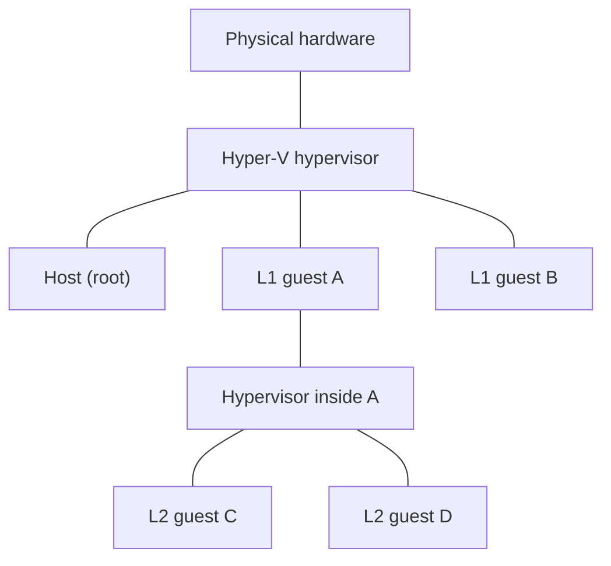

> 🌏 [繁體中文版](/posts/tech/2026-10-13-bug-bounty-zero-07-vm-and-hypervisor)

The [previous post](/posts/tech/2026-10-13-bug-bounty-zero-06-memory-bugs-buffer-overflow-en) covered memory bugs, the "a program makes its own mistake" side of the story. This one covers the "wall" side: how one physical computer gets sliced up for many people, and what the walls between them are made of. By the end you should be able to explain what an L1 guest escape and an L2 guest escape each mean in the [Hyper-V bounty table](https://www.microsoft.com/en-us/msrc/bounty-hyper-v), and where the $250,000 figure from [post 13 of the series](/posts/tech/2026-10-13-bug-bounty-top-payouts-fact-check-en) sits in it.

This post covers concepts and how to read the table. It does not cover any specific vulnerability or any escape technique. A concrete case comes in the [next post](/posts/tech/2026-10-13-bug-bounty-zero-08-hyper-v-escape-case-study-en).

## Virtual machines and hypervisors: the definitions

[Red Hat's explainer](https://www.redhat.com/en/topics/virtualization/what-is-a-hypervisor) defines a hypervisor as software that pools computing resources (processing, memory, storage) and reallocates them among virtual machines (VMs), so one physical machine can create and run many VMs. The same page fixes two terms: the physical machine that supplies the resources is the host, and the VMs that use them are guests.

[Microsoft Learn's Hyper-V architecture page](https://learn.microsoft.com/en-us/windows-server/virtualization/hyper-v/architecture) is closer to the security view. It describes a hypervisor as a layer of software between the hardware and one or more operating systems whose primary job is to provide isolated execution environments called partitions, and which controls and arbitrates access to the underlying hardware. That word "isolated" is the subject of this whole post: the walls between VMs are what the hypervisor is responsible for maintaining.

Hypervisors are commonly split into two types. According to Red Hat:

| Type | Also called | Where it runs | Red Hat's examples |
|---|---|---|---|
| Type 1 | native, bare metal | Directly on the host's hardware, taking the place of a host operating system | KVM, Microsoft Hyper-V, VMware vSphere |
| Type 2 | hosted | As software or an application on a conventional operating system | VMware Workstation, Oracle VirtualBox |

The split is rough. Learn's architecture page says Hyper-V needs at least one parent (root) partition running Windows, and the management stack runs inside it. So "bare metal" does not mean there is no operating system anywhere above the hardware; it means guests do not run inside that operating system. Don't lean too hard on the classification, since it is not the point here.

## The CPU's role: Hyper-V requires hardware-assisted virtualization

Learn's architecture page states that Hyper-V requires a processor with hardware-assisted virtualization, such as Intel VT or AMD Virtualization (AMD-V). A separate page on [nested virtualization](https://learn.microsoft.com/en-us/windows-server/virtualization/hyper-v/nested-virtualization) calls them Intel VT-x and AMD-V and says Hyper-V relies on these processor extensions to run VMs.

At the level needed here, Hyper-V requires hardware-assisted virtualization; partitions see a virtual processor view, and the hypervisor handles interrupts and redirects them to the relevant partition.

## A building analogy, and where it breaks

[Post 1](/posts/tech/2026-10-13-bug-bounty-zero-01-rules-and-scope-en) used an apartment to explain rules and scope. Here is the virtualization version:

- The physical machine is a building. Its CPU, memory and disks are shared equipment.
- Each VM is one unit. The tenant (the guest operating system) believes the whole unit is theirs.
- The hypervisor is the management office. It decides how much equipment each unit gets, what each tenant may use, and keeps the walls between units.
- A guest escape is a tenant getting through a wall into somewhere they should not be.

The analogy misleads in a few places, so here they are up front:

1. **The management office is not a separate person.** Physical hardware executes instructions, while the hypervisor manages scheduling. The analogy’s walls stand for isolation mechanisms: Learn describes hardware-assisted virtualization, virtual processor views, interrupt forwarding and the IOMMU for device isolation.
2. **The other side of the wall is not empty.** Per Learn, Hyper-V's root partition has direct access to physical hardware and child partitions (the guests) do not. They see virtual devices, and requests are redirected over the VMBus or the hypervisor to the root partition. The analogy needs a back office that runs errands for tenants, and tenants get their equipment through it.
3. **Walls stack.** Nested virtualization, next section, is a tenant subletting a room, and the subtenant gets walls of their own.
4. **This is the Hyper-V version.** KVM, Xen and VMware systems have different architectures. This building illustrates the Hyper-V components discussed here, rather than a universal implementation diagram for every hypervisor.

## Nested virtualization, L1 and L2

Learn's nested virtualization page says the feature lets you run Hyper-V inside a Hyper-V VM. With it enabled, Hyper-V exposes the hardware virtualization extensions to its VMs, so a guest VM can install its own hypervisor and run its own guests. The listed uses include test labs and Hyper-V isolation for containers. The page adds that a Hyper-V isolated container runs inside a highly optimized VM, so when the container host is itself a Hyper-V VM the setup is nested, and one level of nesting is supported in production.

A nested-virtualization diagram offers the following way to understand the starting points in MSRC’s table. Actual eligibility still depends on the table’s stated starting position and target:

- **L1 guest**: a VM running directly on the Hyper-V host.
- **L2 guest**: a VM running inside an L1 guest, where that L1 guest has installed a hypervisor of its own.

So the difference is "which level the wall is on".



## Which wall each cell of the bounty table is

MSRC separates RCE into two tables, each beginning with the qualifying starting position and outcome:

- **L1 guest escape**: an RCE vulnerability in Hyper-V that lets an L1 guest VM compromise the hypervisor, escape from the guest VM to the host, or escape to another L1 guest VM.
- **L2 guest escape**: an RCE vulnerability in Hyper-V that lets an L2 guest VM compromise the L1 hypervisor, escape to the L1 host, or escape from one L2 guest VM to another.

[Post 5](/posts/tech/2026-10-13-bug-bounty-zero-04-what-is-rce-en) covers what RCE means. The amounts (the page labels them maximum awards) are:

| Functioning exploit? | Report quality | L1 escape | L2 escape |
|---|---|---|---|
| Yes | High | $250,000 | $150,000 |
| No | High | $200,000 | $100,000 |
| No | Medium | $100,000 | $50,000 |
| No | Low | $50,000 | $25,000 |

Translating the wording into walls:

| Wall to cross | Wording on the page | Table |
|---|---|---|
| Between an L1 guest and the hypervisor | compromise the hypervisor | L1 |
| Between an L1 guest and the host | escape to the host | L1 |
| Between two L1 guests | escape to another L1 guest | L1 |
| Between an L2 guest and the L1 hypervisor | compromise the L1 hypervisor | L2 |
| Between an L2 guest and the L1 host | escape to the L1 host | L2 |
| Between two L2 guests | escape to another L2 guest | L2 |

The L2 table names the L1 hypervisor and L1 host as targets, and L1 is itself a guest layer. Read where the attack starts and ends; payout size alone does not establish the relative difficulty of the bugs.

The same page lists denial of service and information disclosure separately. These concern availability and confidentiality, so their outcome requirements should not be replaced with the RCE requirements:

- Denial of service: a non-transient crash of the host, a failure to start or stop VMs or the host that needs manual intervention or leaves the host unusable for 15 minutes or more. Up to $15,000.
- Information disclosure: gaining sensitive information from the host or from another guest. Up to $25,000.

The program's overall range is $5,000 to $250,000, and the page says higher awards are possible at Microsoft's discretion.

Finally, scope. The page says the program targets server hosting scenarios (Azure is the example), and covers Hyper-V on the latest Windows Server, Hyper-V on the latest Windows Insider Preview slow ring build, and Hyper-V isolation containers. Vulnerabilities that can only be triggered by an attacker running code on the host are listed among the issues that typically do not earn awards.

## Why this kind of bug pays so much

First consider who an isolation failure can affect.

**One physical machine, many customers.** [Azure's isolation documentation](https://learn.microsoft.com/en-us/azure/security/fundamentals/isolation-choices) says Azure runs applications and VMs on shared physical infrastructure. The benefit is spreading cost across tenants; the risk is sharing physical servers with VMs that may belong to an "arbitrary and potentially malicious user". The same page says Azure's compute platform is based on machine virtualization, all customer code runs in a Hyper-V VM, a hypervisor on each node runs directly over the hardware and divides the node into guest VMs, and the hypervisor and root OS manage the isolation of guest VMs from one another.

**A broken wall affects more than one machine.** Per Red Hat, a compromised VM should not impact the whole system, but if the hypervisor itself is hacked, that can cause problems for all the VMs it manages, leaving each one's data vulnerable. Azure's page also describes a cross-VM attack as two steps: placing an adversary-controlled VM on the same host as the victim, then breaching the isolation boundary.

When reading a report, ask whether the attacker can affect other tenants from their own guest, or gain host privileges. These questions make the impact more concrete than “a high-risk VM bug.” Compare the award conditions with the [payout map in part 13](/posts/tech/2026-10-13-bug-bounty-top-payouts-fact-check-en).

Azure also offers isolated VM sizes, where a VM is the only one on its server, and dedicated hosts reserved for a single subscription. For shared infrastructure, VM placement algorithms and defenses against known side-channel attacks help reduce cross-VM risk. Deployment choices still depend on the isolation requirements and service conditions.

## An intuition for the attack surface: where the doors are

If the wall is the isolation between guest and host, the places where guest and host have to communicate deserve the most care. Learn's architecture page describes those paths:

- **Virtual devices.** The disks and network cards a guest sees are virtual devices; requests are redirected over the VMBus or the hypervisor to the root partition.
- **VMBus.** A logical channel between partitions. Virtualization Service Providers (VSPs) in the root partition handle device requests that Virtualization Service Consumers (VSCs) in the guests send.
- **Hypercalls.** The interface for talking to the hypervisor, which the root partition also uses to create child partitions.
- **A device emulation layer.** The page says "enlightened I/O" can bypass the device emulation layer and use the VMBus directly, which implies a separate path through emulated devices.

MSRC's page echoes this: attacks against the virtualized network stack (VMSwitch is its example) are in scope, while attacks that need the VM to send traffic to the host's own TCP, SMB or RPC listeners are not.

This component list is a map of cross-boundary data paths, not evidence that each interface contains a bug. The next post follows one path involved in a documented vulnerability.

## A look inside the sandbox: we are already in a virtual environment

The sandbox used to write this post gives a direct example. This is the real output:

```bash
$ lscpu | grep -i virtual
Address sizes:                           46 bits physical, 48 bits virtual
Virtualization type:                     full

$ lscpu | grep -i "hypervisor vendor"
Hypervisor vendor:                       KVM

$ systemd-detect-virt
docker

$ systemd-detect-virt --vm
kvm

$ grep -c -wE "vmx|svm" /proc/cpuinfo
0

$ ls /dev/kvm
ls: cannot access '/dev/kvm': No such file or directory
```

How to read it:

- `lscpu` reports the hypervisor vendor as KVM, so there is a hypervisor under this environment and it is KVM. The `virtual` on the first line is just the number of virtual address bits, unrelated to virtualization; grep matched the word.
- `systemd-detect-virt` returns `docker` by default and `kvm` with `--vm`. That combination is consistent with a container inside a KVM guest. Red Hat distinguishes containers as isolated processes and VMs as environments with their own operating systems; the two can be layered.
- `vmx` and `svm` are the Intel and AMD hardware-virtualization flag names in `/proc/cpuinfo`; see the [Linux kernel’s cpufeatures.h](https://github.com/torvalds/linux/blob/master/arch/x86/include/asm/cpufeatures.h). Neither flag nor `/dev/kvm` is present here. This output therefore does not establish that KVM-accelerated nested VMs can run in this environment. It also does not identify the underlying provider’s virtualization configuration.

It is a tiny experiment, but it shows the point of this post: the environment you use every day may already be a guest on someone's hypervisor, with the wall one layer below where you can see.

## Limits

- This post is built around Hyper-V. Other hypervisors (KVM, Xen, VMware) have different architectures and attack surfaces that I did not cover, apart from the classification details Red Hat's page states outright.
- L1 and L2 in the diagram describe nested levels. A report must separately state the actual starting privileges, affected component and escape target.
- Hardware virtualization is covered only at the interface level described by Microsoft; processor instructions and microarchitecture are outside this post.
- Award amounts come from the page as read on 2026-10-13 (its last revision entry is April 2026). The official current version is the authority.

## Next step

The next post goes from the bounty table to a real Hyper-V guest-escape case, to see what a hole in the wall looks like in practice. Before then, try one thing: open the [MSRC Hyper-V page](https://www.microsoft.com/en-us/msrc/bounty-hyper-v), find the line "Vulnerabilities that can only be triggered by an attacker running code on the host", and think about why that case earns no award.

## References

- [Microsoft Hyper-V Bounty Program (MSRC)](https://www.microsoft.com/en-us/msrc/bounty-hyper-v)
- [Hyper-V Architecture (Microsoft Learn)](https://learn.microsoft.com/en-us/windows-server/virtualization/hyper-v/architecture)
- [What is Nested Virtualization? (Microsoft Learn)](https://learn.microsoft.com/en-us/windows-server/virtualization/hyper-v/nested-virtualization)
- [Isolation in the Azure public cloud (Microsoft Learn)](https://learn.microsoft.com/en-us/azure/security/fundamentals/isolation-choices)
- [What is a hypervisor? (Red Hat)](https://www.redhat.com/en/topics/virtualization/what-is-a-hypervisor)
- [cpufeatures.h (Linux kernel source)](https://github.com/torvalds/linux/blob/master/arch/x86/include/asm/cpufeatures.h)
- [Series post 13: Bug Bounty top payouts, fact-checked](/posts/tech/2026-10-13-bug-bounty-top-payouts-fact-check-en)
- [Series post 1: Rules and scope](/posts/tech/2026-10-13-bug-bounty-zero-01-rules-and-scope-en)
- [Series post 5: What is RCE](/posts/tech/2026-10-13-bug-bounty-zero-04-what-is-rce-en)
- [Series post 8: Memory bugs and buffer overflow](/posts/tech/2026-10-13-bug-bounty-zero-06-memory-bugs-buffer-overflow-en)
- [Series post 10: A Hyper-V escape case](/posts/tech/2026-10-13-bug-bounty-zero-08-hyper-v-escape-case-study-en)

[Previous: part 8](/posts/tech/2026-10-13-bug-bounty-zero-06-memory-bugs-buffer-overflow-en) · [Next: part 10](/posts/tech/2026-10-13-bug-bounty-zero-08-hyper-v-escape-case-study-en)
