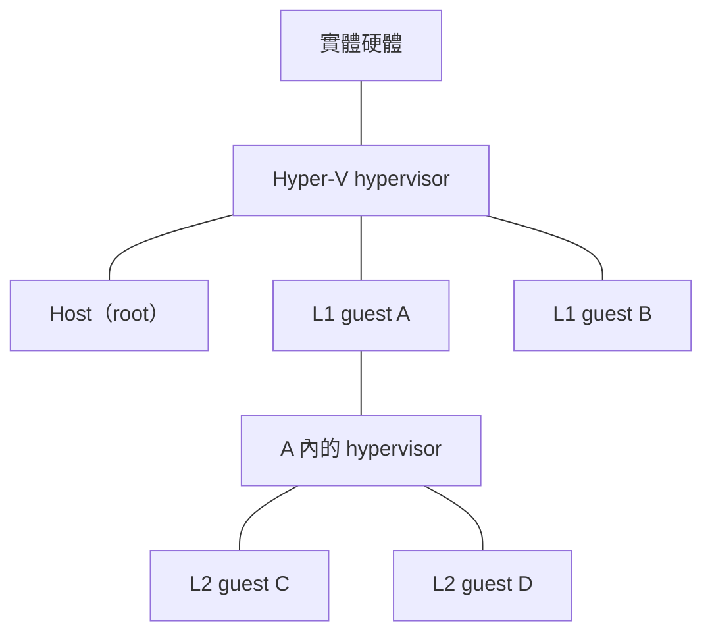

> 🌏 [English version](/posts/tech/2026-10-13-bug-bounty-zero-07-vm-and-hypervisor-en)

[上一篇](/posts/tech/2026-10-13-bug-bounty-zero-06-memory-bugs-buffer-overflow)講了記憶體漏洞，那是「程式自己出錯」的一面。這一篇換成「牆」的一面：一台實體電腦怎麼切給很多人用，那些隔開彼此的牆又是什麼做的。讀完你應該能向別人解釋，[Hyper-V 獎金表](https://www.microsoft.com/en-us/msrc/bounty-hyper-v)上的 L1 guest 逃脫與 L2 guest 逃脫，各是哪一道牆被穿過，以及[系列第 13 篇](/posts/tech/2026-10-13-bug-bounty-top-payouts-fact-check)提到的 25 萬美元為什麼落在這一格。

這篇只講概念和獎金表的讀法，不講任何具體漏洞和逃脫手法。具體的漏洞案例留到[下一篇](/posts/tech/2026-10-13-bug-bounty-zero-08-hyper-v-escape-case-study)。

## 虛擬機與 hypervisor：定義

[Red Hat 的說明](https://www.redhat.com/en/topics/virtualization/what-is-a-hypervisor)把 hypervisor 定義為：把處理器、記憶體、儲存這些運算資源集中起來，再重新分配給多台虛擬機（VM）的軟體，因此一台實體機可以建立並執行很多台 VM。同一頁也交代了兩個稱呼：提供資源的實體機叫 host（宿主），使用資源的那些 VM 叫 guest（訪客）。

[Microsoft Learn 的 Hyper-V 架構頁](https://learn.microsoft.com/en-us/windows-server/virtualization/hyper-v/architecture)說得更貼近安全：hypervisor 是夾在硬體與一或多個作業系統之間的軟體層，主要工作是提供稱為「分割區」（partition）的隔離執行環境，並且控制、仲裁各分割區對底層硬體的存取。這句話裡的「隔離」就是整篇的主角：VM 與 VM 之間的牆，是 hypervisor 負責維持的。

Hypervisor 有兩種常見分類。依 Red Hat 的說明：

| 類型 | 別名 | 位置 | Red Hat 舉的例子 |
|---|---|---|---|
| Type 1 | native、bare metal | 直接跑在 host 的硬體上，取代 host 作業系統的位置 | KVM、Microsoft Hyper-V、VMware vSphere |
| Type 2 | hosted | 當成一般作業系統上的軟體或應用程式執行 | VMware Workstation、Oracle VirtualBox |

這個分類是粗略的。Learn 的架構頁寫到，Hyper-V 至少要有一個跑 Windows 的 parent（root）分割區，管理堆疊就跑在裡面。所以「bare metal」不代表上面完全沒有作業系統，只是 guest 不是跑在那個作業系統「裡面」。這個分類別太當真，本篇的重點不在它。

## CPU 的角色：Hyper-V 要求硬體輔助虛擬化

Learn 的架構頁寫明，Hyper-V 需要具備硬體輔助虛擬化的處理器，例如 Intel VT 或 AMD Virtualization（AMD-V）。另一篇講[巢狀虛擬化](https://learn.microsoft.com/en-us/windows-server/virtualization/hyper-v/nested-virtualization)的頁面把它們稱為 Intel VT-x 與 AMD-V，並說 Hyper-V 靠這些處理器擴充功能來執行 VM。

就這篇需要的層次而言，Hyper-V 要求處理器提供硬體輔助虛擬化；分割區看到處理器的虛擬視圖，中斷由 hypervisor 接手再轉給對應分割區。

## 一棟大樓的比喻，與它的極限

[第 1 篇](/posts/tech/2026-10-13-bug-bounty-zero-01-rules-and-scope)用公寓講過規則與範圍。這裡把比喻升級成虛擬化版：

- 實體機像一棟大樓，裡面的 CPU、記憶體、硬碟是整棟共用的設備。
- 每台 VM 像一戶，住戶（guest 作業系統）以為整戶都是自己的。
- Hypervisor 像管理室，決定每戶分到多少設備、住戶只能用哪些設施，並維持戶與戶之間的牆。
- Guest 逃脫，就是住戶穿過牆，到了不該去的地方。

這個比喻有幾處會誤導，先講清楚：

1. **管理室不是另一個人。** 實際執行指令的仍是實體硬體，hypervisor 負責管理排程。比喻中的「牆」代表隔離機制：Learn 列出硬體輔助虛擬化、處理器虛擬視圖、中斷轉送，以及裝置隔離用的 IOMMU。
2. **牆的另一側不是空的。** 依 Learn，Hyper-V 的 root 分割區可以直接存取實體硬體，child 分割區（也就是 guest）不行，它們看到的是虛擬裝置，請求要透過 VMBus 或 hypervisor 轉給 root 分割區處理。比喻裡要有一間「後勤室」替住戶代辦事情，而住戶是透過它拿到設備的。
3. **牆會被疊起來。** 下一節的巢狀虛擬化就是住戶再把房間轉租出去，轉租的房客也有自己的牆。
4. **這是 Hyper-V 的版本。** KVM、Xen、VMware 等系統的架構各有差異，這棟大樓只用來理解本文介紹的 Hyper-V 元件，不適合直接當成所有 hypervisor 的實作圖。

## 巢狀虛擬化與 L1、L2

Learn 的巢狀虛擬化頁面說，這個功能讓你能在 Hyper-V 虛擬機裡再跑 Hyper-V：開啟後，Hyper-V 會把硬體虛擬化擴充功能暴露給它的 VM，guest VM 就可以安裝自己的 hypervisor，再執行自己的 guest。頁面列的用途包含測試環境，以及替容器使用 Hyper-V 隔離。同一頁也說，Hyper-V 隔離的容器是各自跑在一台高度最佳化的 VM 裡；若容器主機本身就是 Hyper-V VM，那就是巢狀的，產線支援一層巢狀。

把巢狀虛擬化畫成層級圖，可用以下方式理解 MSRC 表中的攻擊起點；實際是否符合獎金類別，仍須對照表內列出的起點與目標：

- **L1 guest**：直接跑在 Hyper-V host 上的 VM。
- **L2 guest**：跑在 L1 guest 裡面的 VM，而那台 L1 guest 自己裝了 hypervisor。

兩者的差別就是「牆在第幾層」。



## 獎金表每一格對應哪一道牆

MSRC 把 RCE 分成兩張表，每張先列出符合條件的攻擊起點與結果：

- **L1 guest 逃脫**：Hyper-V 裡的 RCE 漏洞，讓 L1 guest VM 能攻破 hypervisor、從 guest 逃到 host，或逃到另一台 L1 guest。
- **L2 guest 逃脫**：Hyper-V 裡的 RCE 漏洞，讓 L2 guest VM 能攻破 L1 hypervisor、逃到 L1 host，或從一台 L2 guest 逃到另一台 L2 guest。

RCE 是什麼，[第 5 篇](/posts/tech/2026-10-13-bug-bounty-zero-04-what-is-rce)講過。兩張表的獎金（頁面標的是最高金額）如下：

| 有可運作的 exploit？ | 報告品質 | L1 逃脫 | L2 逃脫 |
|---|---|---|---|
| 有 | 高 | 250,000 美元 | 150,000 美元 |
| 沒有 | 高 | 200,000 美元 | 100,000 美元 |
| 沒有 | 中 | 100,000 美元 | 50,000 美元 |
| 沒有 | 低 | 50,000 美元 | 25,000 美元 |

把每一格翻成「哪一道牆」：

| 要穿過的牆 | 對應的表述 | 所在表 |
|---|---|---|
| L1 guest 與 hypervisor 之間 | 攻破 hypervisor | L1 |
| L1 guest 與 host 之間 | 逃到 host | L1 |
| 兩台 L1 guest 之間 | 逃到另一台 L1 guest | L1 |
| L2 guest 與 L1 hypervisor 之間 | 攻破 L1 hypervisor | L2 |
| L2 guest 與 L1 host 之間 | 逃到 L1 host | L2 |
| 兩台 L2 guest 之間 | 逃到另一台 L2 guest | L2 |

L2 表列出的目標包含 L1 hypervisor 與 L1 host，而 L1 本身也是一層 guest。這裡要讀清楚的是攻擊從哪一層開始、到哪一層結束；不能只憑獎金高低推斷兩種漏洞的難度。

同一頁另列拒絕服務與資訊洩漏，分別看服務可用性與資料保密性，不能直接套用 RCE 的結果要求：

- 拒絕服務（DoS）：讓 host 當機且不是暫時性的，或讓 VM 或 host 無法啟動或停止、需要人工介入，或讓 host 無法使用 15 分鐘以上，最高 15,000 美元。
- 資訊洩漏：從 host 或另一台 guest 取得敏感資訊，最高 25,000 美元。

整個計畫的獎金範圍是 5,000 到 250,000 美元，頁面也寫明，微軟可以斟酌給更高金額。

最後是範圍的限制。頁面說這個計畫針對的是伺服器代管情境（例如 Azure），範圍包含 Windows Server 上最新的 Hyper-V、Windows Insider Preview 慢速通道的 Hyper-V，以及 Hyper-V 隔離容器。只有在 host 上已經能執行程式碼才能觸發的漏洞，列在常見不給獎金的項目裡。

## 為什麼這個洞這麼貴

先看隔離失效會影響誰。

**一台實體機上有很多客戶。** [Azure 的隔離說明](https://learn.microsoft.com/en-us/azure/security/fundamentals/isolation-choices)寫到，Azure 在共用的實體基礎設施上執行應用程式與 VM，好處是把成本分攤給多個租戶，但也帶來風險：你的敏感應用可能和「任意、而且可能有惡意的使用者」的 VM 共用實體伺服器。同一頁說，Azure 運算平台是以機器虛擬化為基礎，所有客戶程式碼都跑在 Hyper-V VM 裡，每個節點上有 hypervisor 直接跑在硬體上，把節點切成若干 guest VM；而 guest VM 彼此的隔離，正是由 hypervisor 與 root OS 負責管理。

**牆壞了，影響的不只一台。** 依 Red Hat 的說法，VM 被攻破時整個系統通常不該受影響；但如果 hypervisor 本身被攻破，會對它管理的所有 VM 造成問題，每台 VM 裡的資料都可能暴露。Azure 的頁面也把「攻擊者先讓自己的 VM 和受害者的 VM 放在同一台主機上，再突破隔離邊界」描述為跨 VM 攻擊的兩個步驟。

因此，讀這類報告時要追問：攻擊者是否能從自己的 guest 影響其他租戶，或者取得 host 權限？用這兩個問題描述影響，比只寫「高風險 VM 漏洞」具體。獎金條件可再對照[第 13 篇](/posts/tech/2026-10-13-bug-bounty-top-payouts-fact-check)的價碼地圖。

Azure 同時提供「隔離 VM 大小」與專用主機：前者讓 VM 成為伺服器上唯一的 VM，後者讓整台實體機專用於單一訂閱。共用基礎設施則有 VM 放置演算法與已知 side-channel 攻擊防護，降低跨 VM 攻擊風險。選用哪種部署方式，仍需依隔離需求與服務條件評估。

## 攻擊面的直覺：牆上有哪些門

牆既然是 guest 與 host 之間的隔離，guest 與 host 要溝通的地方，就是最需要小心的地方。Learn 的架構頁描述了這些溝通路徑：

- **虛擬裝置。** guest 看到的磁碟、網路卡等是虛擬裝置，請求會透過 VMBus 或 hypervisor 轉給 root 分割區處理。
- **VMBus。** 一條跨分割區的邏輯溝通通道。root 分割區上的 VSP（虛擬化服務提供者）處理 guest 上的 VSC（虛擬化服務用戶端）送來的裝置請求。
- **Hypercall。** 與 hypervisor 溝通的介面，root 分割區也用它建立 child 分割區。
- **裝置模擬層。** 頁面提到「Enlightened I/O」可以繞過裝置模擬層直接走 VMBus，這暗示另有一條走模擬裝置的路。

MSRC 頁面也呼應了這點：它寫明針對虛擬化網路堆疊（例如 VMSwitch）的攻擊在範圍內，而要求 VM 對 host 的 TCP、SMB 或 RPC 網路服務送流量的攻擊則不在範圍內。

這份元件清單是理解跨邊界資料路徑的地圖，不代表每個介面都有漏洞。下一篇用公開案例追一條實際出過問題的路徑。

## 在沙盒裡看一眼：我們自己就在虛擬環境裡

這個寫稿用的沙盒是能直接驗證的例子。以下是實際執行的輸出：

```bash
$ lscpu | grep -i virtual
Address sizes:                           46 bits physical, 48 bits virtual
Virtualization type:                     full

$ lscpu | grep -i "hypervisor vendor"
Hypervisor vendor:                       KVM

$ systemd-detect-virt
docker

$ systemd-detect-virt --vm
kvm

$ grep -c -wE "vmx|svm" /proc/cpuinfo
0

$ ls /dev/kvm
ls: cannot access '/dev/kvm': No such file or directory
```

怎麼讀這些輸出：

- `lscpu` 回報 Hypervisor vendor 是 KVM，也就是這個環境底下有 hypervisor，而且是 KVM。第一列的 `virtual` 是「虛擬位址的位元數」，跟虛擬化無關，是 grep 撞名。
- `systemd-detect-virt` 不加參數回 `docker`，加 `--vm` 回 `kvm`。這組輸出符合「容器位於 KVM guest 內」的環境。依 Red Hat，容器是一組隔離的行程，VM 則自帶作業系統；兩者可以疊用。
- `vmx`／`svm` 是 Intel／AMD 硬體虛擬化功能在 `/proc/cpuinfo` 的旗標名稱，可對照[Linux 核心的 cpufeatures.h](https://github.com/torvalds/linux/blob/master/arch/x86/include/asm/cpufeatures.h)。此處沒有這些旗標，也沒有 `/dev/kvm`，因此這份輸出不足以支持「可在此執行 KVM 硬體加速的巢狀 VM」。它也無法單獨指出底層供應商如何設定虛擬化。

這是一個很小的實驗，卻足以說明這篇的核心：你每天用的環境，可能早就是某個 hypervisor 之上的 guest，牆就在你看不到的下一層。

## 限制

- 本篇以 Hyper-V 為主軸，其他 hypervisor（KVM、Xen、VMware）的架構和攻擊面沒有展開，除了 Red Hat 頁面明說的幾句分類資訊。
- 圖中的 L1、L2 用來表示巢狀層級；報告須另外交代實際起始權限、受影響元件與逃脫目標。
- CPU 硬體虛擬化只介紹到 Microsoft 文件所描述的介面；這裡不展開處理器指令或微架構。
- 獎金金額來自 2026-10-13 讀到的頁面（頁面最後一次修訂記為 2026 年 4 月），以官方當時版本為準。

## 下一步

下一篇會從獎金表走到一個真實的 Hyper-V guest 逃脫案例，看牆上的洞實際長什麼樣。在那之前可以做一件事：打開 [MSRC Hyper-V 頁](https://www.microsoft.com/en-us/msrc/bounty-hyper-v)，找出「Vulnerabilities that can only be triggered by an attacker running code on the host」這一條，自己想想為什麼這種情況不給獎金。

## 參考資料

- [Microsoft Hyper-V Bounty Program（MSRC）](https://www.microsoft.com/en-us/msrc/bounty-hyper-v)
- [Hyper-V Architecture（Microsoft Learn）](https://learn.microsoft.com/en-us/windows-server/virtualization/hyper-v/architecture)
- [What is Nested Virtualization?（Microsoft Learn）](https://learn.microsoft.com/en-us/windows-server/virtualization/hyper-v/nested-virtualization)
- [Isolation in the Azure public cloud（Microsoft Learn）](https://learn.microsoft.com/en-us/azure/security/fundamentals/isolation-choices)
- [What is a hypervisor?（Red Hat）](https://www.redhat.com/en/topics/virtualization/what-is-a-hypervisor)
- [cpufeatures.h（Linux 核心原始碼）](https://github.com/torvalds/linux/blob/master/arch/x86/include/asm/cpufeatures.h)
- [系列第 13 篇：Bug Bounty 頂級獎金查證](/posts/tech/2026-10-13-bug-bounty-top-payouts-fact-check)
- [系列第 1 篇：規則與範圍](/posts/tech/2026-10-13-bug-bounty-zero-01-rules-and-scope)
- [系列第 5 篇：什麼是 RCE](/posts/tech/2026-10-13-bug-bounty-zero-04-what-is-rce)
- [系列第 8 篇：記憶體漏洞與 buffer overflow](/posts/tech/2026-10-13-bug-bounty-zero-06-memory-bugs-buffer-overflow)
- [系列第 10 篇：Hyper-V 逃脫案例](/posts/tech/2026-10-13-bug-bounty-zero-08-hyper-v-escape-case-study)

[上一篇：第 8 篇](/posts/tech/2026-10-13-bug-bounty-zero-06-memory-bugs-buffer-overflow)・[下一篇：第 10 篇](/posts/tech/2026-10-13-bug-bounty-zero-08-hyper-v-escape-case-study)
