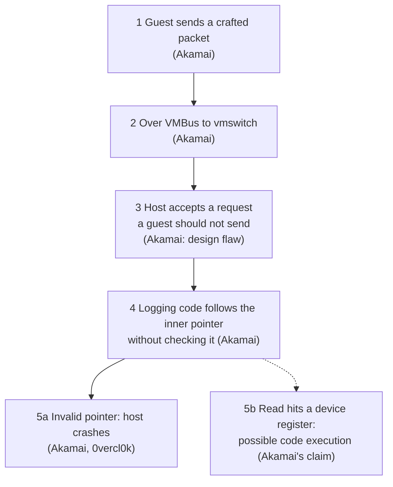

> 🌏 [繁體中文版](/posts/tech/2026-10-13-bug-bounty-zero-08-hyper-v-escape-case-study)

[Post 13 of this series](/posts/tech/2026-10-13-bug-bounty-top-payouts-fact-check-en) found that the [Microsoft Hyper-V bounty table](https://www.microsoft.com/en-us/msrc/bounty-hyper-v) pays up to $250,000 for an L1 guest escape. [The previous post](/posts/tech/2026-10-13-bug-bounty-zero-07-vm-and-hypervisor-en) covered the wall between a virtual machine and its hypervisor. This post takes one real, patched bug with public technical analysis and looks at what a hole in that wall actually looks like: [CVE-2021-28476](https://msrc.microsoft.com/update-guide/vulnerability/CVE-2021-28476).

By the end you should be able to explain the case to a friend in three sentences and say which cell of the bounty table it sits in.

This post does not reproduce the bug and does not teach you to run the public PoC. The PoC link appears only in the references, as a source.

## The case at a glance

| Item | What the sources say | Source |
|---|---|---|
| Where | Hyper-V's virtual network switch driver, vmswitch.sys | Akamai write-up |
| Found by | Peleg Hadar (SafeBreach) and Ophir Harpaz (Guardicore), using their own fuzzer, hAFL1 | Akamai write-up |
| Another public account | australeo's GitHub page says they found it while reverse engineering and auditing code, and lists the patch date as May 11, 2021; 0vercl0k's README lists four finders: australeo, ergot86, peleghd and OphirHarpaz | australeo README, 0vercl0k README |
| First appeared | A vmswitch build from August 2019 | Akamai write-up |
| Patch and score | Patched May 2021, CVSS 9.9 (Critical) | Akamai write-up, NVD |
| Details made public | Technical write-up on July 28, 2021; Black Hat USA 2021 talk and hAFL1 open-sourced on August 4 | Akamai write-up, hAFL1 post, SafeBreach post |
| Affected products | Windows 7, 8.1, 10 and Windows Server 2008, 2012, 2016, 2019 | Akamai write-up |

What I read: Akamai's [technical write-up](https://www.akamai.com/blog/security/critical-vulnerability-in-hyper-v-allowed-attackers-to-exploit-azure) (Guardicore was later folded into Akamai), their companion post on [how hAFL1 found it](https://www.akamai.com/blog/security/discovering-a-critical-0-day), the [NVD entry](https://nvd.nist.gov/vuln/detail/CVE-2021-28476), and the GitHub pages by [0vercl0k](https://github.com/0vercl0k/CVE-2021-28476) and [australeo](https://github.com/australeo/CVE-2021-28476).

## What kind of bug is it

First, the roles. In [Microsoft's Hyper-V architecture documentation](https://learn.microsoft.com/en-us/windows-server/virtualization/hyper-v/architecture), the host operating system runs in the root partition and virtual machines run in child partitions. A child partition has no direct access to hardware; when it needs the network, the request travels over [VMBus](https://learn.microsoft.com/en-us/windows-server/virtualization/hyper-v/architecture), a channel between partitions, to a matching component in the root partition. For networking, that component is vmswitch.sys.

So vmswitch's job is to take network-related requests from a virtual machine and handle them. The contents of those requests are chosen by the VM, and the VM is the untrusted side. This is the doorway through the wall from the previous post. My own summary: code on this side of the wall should check every value that arrives from across it.

According to Akamai, the check that was missing is this. When vmswitch handles an OID request (a network-adapter setting request carried in the [RNDIS](https://learn.microsoft.com/en-us/windows-hardware/drivers/network/remote-ndis--rndis-2) message format), it logs the contents for debugging. One kind of request, OID_SWITCH_NIC_REQUEST, wraps another request inside it, so the logging code follows a pointer to read the inner one. **It never validates the value of that pointer**, so it can end up reading from an invalid location.

An analogy: a clerk receives a slip that says "the goods are on shelf X in the warehouse." The clerk runs to shelf X without checking that it exists. If the slip came from someone untrustworthy, they can write any shelf number they like. The pointer is the shelf number, and following it is "going to that address and reading what is there." It is the same intuition as the earlier memory-bug posts: the program trusted an address it should not have trusted.

The sources do not name the class identically. Akamai says arbitrary pointer dereference, 0vercl0k says arbitrary memory read, and australeo's page says Arbitrary Dereference. NVD's weakness field is NVD-CWE-noinfo, meaning no classification was given.

Akamai adds a second layer. The bug was severe because a missing pointer check combined with a design flaw: a communication channel between guest and host that was too permissive. As Akamai explains it, the guest's own network driver never sends this kind of request, yet the host side still accepts and processes it when a guest does.

## The stations a packet passes

The diagram is my drawing based on Akamai's description, with the source in parentheses. Akamai describes "two exploitation scenarios" and does not publish a complete exploit chain, so "stages" here means the path a packet takes into the flaw, followed by two possible outcomes.

Walking through it:

1. **The guest sends a crafted packet.** Akamai says the bug is triggered by a specially crafted packet sent from a guest VM.
2. **It travels over VMBus to vmswitch.** This is the normal channel described above, carrying an RNDIS "set" message.
3. **The host accepts a request it should not.** This is the design flaw mentioned earlier.
4. **The logging code reads the pointer.** The failure is in debug-logging code, not in the main logic that processes network data. That is from Akamai; I find it worth noticing that the broken spot was a side feature that looks unimportant.
5. **Two outcomes.**
   - 5a: the pointer is invalid and the host crashes. 0vercl0k's public PoC demonstrates this step, and its README shows the debugger screen from a crashed host.
   - 5b: the pointer targets a memory-mapped device register, and the read causes device-specific side effects (code execution, in Akamai's words); Akamai also says getting to RCE takes a more complex exploitation chain. Akamai's executive summary even says, in the past tense, that an attacker could run arbitrary code on the host, but the write-up publishes no steps or screenshots for it. The dashed line marks this as the researchers' claim, not something publicly demonstrated. australeo's page also says RCE might be possible under some conditions, but the mechanism it describes differs from Akamai's (a request passed to an underlying hardware device with a pointer to attacker-controlled data), and it says they are not aware of the technique being demonstrated publicly. So it does not back the 5b path. I did not find a public full RCE exploit, but not finding one does not mean none exists.

## Which cell of the bounty table

The [Hyper-V bounty page](https://www.microsoft.com/en-us/msrc/bounty-hyper-v) has two cells relevant here:

| Cell | Page criteria | Amount |
|---|---|---|
| L1 Guest Escape (RCE), working exploit | An L1 guest compromises the hypervisor, escapes to the host or to another L1 guest; high-quality report | $250,000 |
| L1 Guest Escape (RCE), no working exploit | Same | $200,000 high-quality report, $100,000 medium, $50,000 low |
| Denial of Service | Crashing the host, a non-transient denial of service; high-quality report | up to $15,000 |

The page also says attacks on the virtualized network stack (VMSwitch is its example) are in scope.

My judgment, not a conclusion from any source: the CVE is titled Remote Code Execution, but the publicly shown result is a host crash. Measured against the page by what was publicly shown, it comes closest to the DoS cell (whether that crash counts as "non-transient" under the page's wording, I cannot judge). The L1 escape cell does not require an exploit to pay: without a working exploit it still has $200,000, $100,000 and $50,000 rows, and only the $250,000 row requires one. But the cell presupposes the bug is accepted as an RCE that lets an L1 guest compromise the hypervisor or escape to the host, and the public record shows only a crash, so I cannot judge whether it would be accepted as that class; I also did not see a working RCE exploit in the public record. So the top amounts are more than ten times apart, and the dividing line is not just whether an exploit was written; it is how far the bug can be demonstrated and which class it is accepted as.

Two cautions. First, I read the current 2026 page, which has a revision history, and I cannot confirm the 2021 table looked the same. So this is "placed on today's table," not "what it paid back then." Second, none of the sources I read say whether Hadar and Harpaz received a bounty or how much, so this post does not say.

## The patch, and what defenders can take from it

What the sources support:

- **A patch was released.** NVD lists affected versions with the fixed build numbers. What the patch changed, Akamai does not say, and I could not read Microsoft's advisory page directly, so I say nothing about it.
- **A design problem stacked on an implementation problem.** Akamai attributes the severity to a missing pointer check plus an overly permissive channel. The direct lesson for people writing defensive code is to validate values that cross a trust boundary before using them, even in code that is "only logging." That is my inference from Akamai's account, not advice quoted from it.
- **Automation can find it.** According to Akamai's companion post, hAFL1 found the bug within two hours of starting; australeo's account shows that reading documentation plus reverse engineering also found it. Both paths are on the public record.
- **Patched does not mean everyone updated.** [BleepingComputer](https://www.bleepingcomputer.com/news/security/critical-microsoft-hyper-v-bug-could-haunt-orgs-for-a-long-time/) quotes Harpaz saying she would not be surprised if the bug stayed unpatched in organizations for a very long time. That is a researcher's observation from the field, not a statistic.

## Limits

This is a single case and does not represent hypervisor bugs in general. It happens to be patched, publicly analyzed, and checkable against its sources; cases with only an advisory, such as [CVE-2024-49117](https://msrc.microsoft.com/update-guide/vulnerability/CVE-2024-49117), do not give you this level of detail. This case also stops at the crash and does not demonstrate a full escape. For technical details, trust the Akamai write-up and the PoC author's pages; my summary leaves things out.

## The three-sentence version, and one thing to do tonight

Three sentences: Hyper-V's virtual network switch driver took a request from a guest VM and followed a pointer inside it without checking it. The result is a host crash, and Akamai claims a code-execution scenario too, but the public PoC only shows the crash. On the bounty table, what was publicly shown maps to the DoS cell, while the top amount in the L1 escape cell asks for a working RCE exploit.

Tonight, read without running anything. Open Akamai's [technical write-up](https://www.akamai.com/blog/security/critical-vulnerability-in-hyper-v-allowed-attackers-to-exploit-azure) and redraw the "stations a packet passes" diagram yourself, writing next to each station which passage of the original supports it. A station you cannot source is a place you have not understood yet.

## References

- [Critical 9.9 Vulnerability in Hyper-V Allowed Attackers to Exploit Azure (Ophir Harpaz, Peleg Hadar, Akamai / Guardicore Labs)](https://www.akamai.com/blog/security/critical-vulnerability-in-hyper-v-allowed-attackers-to-exploit-azure)
- [hAFL1 – Our Journey of Fuzzing Hyper-V and Discovering a Critical 0-Day (Akamai)](https://www.akamai.com/blog/security/discovering-a-critical-0-day)
- [CVE-2021-28476 (NVD)](https://nvd.nist.gov/vuln/detail/CVE-2021-28476)
- [CVE-2021-28476 (MSRC Security Update Guide; not directly readable for this post, content taken from NVD)](https://msrc.microsoft.com/update-guide/vulnerability/CVE-2021-28476)
- [CVE-2021-28476 PoC (0vercl0k, GitHub; this post does not reproduce it)](https://github.com/0vercl0k/CVE-2021-28476)
- [CVE-2021-28476: Hyper-V vmswitch.sys arbitrary pointer dereference from guest VM (australeo, GitHub)](https://github.com/australeo/CVE-2021-28476)
- [Two New Tools and Techniques to Find, Fight 0-Days (SafeBreach)](https://www.safebreach.com/blog/two-new-tools-and-techniques-to-find-fight-0-days/)
- [Critical Microsoft Hyper-V bug could haunt orgs for a long time (BleepingComputer)](https://www.bleepingcomputer.com/news/security/critical-microsoft-hyper-v-bug-could-haunt-orgs-for-a-long-time/)
- [Microsoft Hyper-V Bounty Program (MSRC)](https://www.microsoft.com/en-us/msrc/bounty-hyper-v)
- [Hyper-V Architecture (Microsoft Learn)](https://learn.microsoft.com/en-us/windows-server/virtualization/hyper-v/architecture)
- [Introduction to Remote NDIS (RNDIS) (Microsoft Learn)](https://learn.microsoft.com/en-us/windows-hardware/drivers/network/remote-ndis--rndis-2)
- [CVE-2024-49117 (MSRC Security Update Guide)](https://msrc.microsoft.com/update-guide/vulnerability/CVE-2024-49117)
- [Bug Bounty Top Payouts Fact-Check (series post 13)](/posts/tech/2026-10-13-bug-bounty-top-payouts-fact-check-en)
- [VMs and hypervisors (series post 9)](/posts/tech/2026-10-13-bug-bounty-zero-07-vm-and-hypervisor-en)

[Previous: part 9](/posts/tech/2026-10-13-bug-bounty-zero-07-vm-and-hypervisor-en) · [Next: part 11](/posts/tech/2026-10-14-bug-bounty-zero-09-tee-and-confidential-computing-en)
