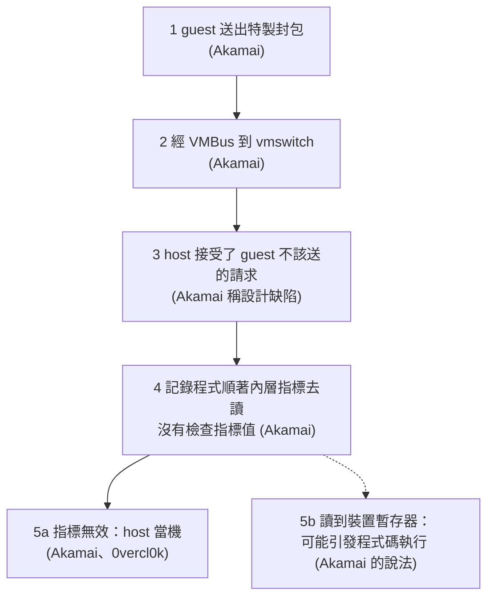

> 🌏 [English version](/posts/tech/2026-10-13-bug-bounty-zero-08-hyper-v-escape-case-study-en)

[系列第 0 篇](/posts/tech/2026-10-13-bug-bounty-top-payouts-fact-check)查到，[Microsoft Hyper-V 獎金表](https://www.microsoft.com/en-us/msrc/bounty-hyper-v)裡 L1 guest 逃脫最高 250,000 美元。[上一篇](/posts/tech/2026-10-13-bug-bounty-zero-07-vm-and-hypervisor)講了虛擬機和 hypervisor 之間那道牆。這一篇拿一個真實、已修補、有公開技術分析的案例，看牆上的洞長什麼樣子：[CVE-2021-28476](https://msrc.microsoft.com/update-guide/vulnerability/CVE-2021-28476)。

讀完你應該能用三句話向朋友說明這個案例出了什麼事，並指出它在獎金表上落在哪一格。

本文不重現這個漏洞，也不教怎麼跑公開的 PoC。PoC 連結只放在參考資料，當作來源。

## 案例基本資料

| 項目 | 來源怎麼寫 | 出處 |
|---|---|---|
| 位置 | Hyper-V 的虛擬網路交換器驅動 vmswitch.sys | Akamai 漏洞文 |
| 發現者 | Peleg Hadar（SafeBreach）與 Ophir Harpaz（Guardicore），用自製的模糊測試工具 hAFL1 找到 | Akamai 漏洞文 |
| 另一份公開紀錄 | australeo 的 GitHub 頁面寫他是逆向與程式碼稽核時發現，並標示修補日為 2021 年 5 月 11 日；0vercl0k 的 README 則列了四位發現者：australeo、ergot86、peleghd、OphirHarpaz | australeo README、0vercl0k README |
| 首次出現 | 2019 年 8 月的 vmswitch 建置版本 | Akamai 漏洞文 |
| 修補與評分 | 2021 年 5 月修補，CVSS 9.9（Critical） | Akamai 漏洞文、NVD |
| 細節公開 | 2021 年 7 月 28 日發表技術文章，8 月 4 日在 Black Hat USA 2021 演講並開源 hAFL1 | Akamai 漏洞文、hAFL1 文、SafeBreach 文 |
| 受影響產品 | Windows 7、8.1、10 與 Windows Server 2008、2012、2016、2019 | Akamai 漏洞文 |

這張表我讀過的原文：Akamai 的[漏洞技術文](https://www.akamai.com/blog/security/critical-vulnerability-in-hyper-v-allowed-attackers-to-exploit-azure)（Guardicore 後來併入 Akamai）、他們另一篇講[怎麼用 hAFL1 找到它](https://www.akamai.com/blog/security/discovering-a-critical-0-day)的文章、[NVD 條目](https://nvd.nist.gov/vuln/detail/CVE-2021-28476)，以及 [0vercl0k](https://github.com/0vercl0k/CVE-2021-28476) 與 [australeo](https://github.com/australeo/CVE-2021-28476) 兩個 GitHub 頁面。

## 漏洞出在哪一類

先把角色說清楚。依 [Microsoft 的 Hyper-V 架構文件](https://learn.microsoft.com/en-us/windows-server/virtualization/hyper-v/architecture)，host（宿主）的作業系統跑在 root 分割區，guest（虛擬機）跑在 child 分割區；child 分割區沒有直接碰硬體，要用網路時，請求會透過 [VMBus](https://learn.microsoft.com/en-us/windows-server/virtualization/hyper-v/architecture)（跨分割區的溝通通道）交給 root 分割區裡的對應元件處理。網路的對應元件就是 vmswitch.sys。

所以 vmswitch 的工作是：收 guest 送來的網路相關請求，替它處理。這些請求的內容由 guest 決定，而 guest 是不可信的一方。這正是上一篇那道牆的入口。我的整理是：牆這一側的程式，對跨牆送來的每個值都該先檢查。

這個案例漏掉的檢查，在 Akamai 的說法裡是：vmswitch 處理 OID 請求（用 [RNDIS](https://learn.microsoft.com/en-us/windows-hardware/drivers/network/remote-ndis--rndis-2) 訊息格式送出的網卡設定請求）時，會把內容記錄下來供除錯，其中一種請求（OID_SWITCH_NIC_REQUEST）裡包著另一個請求，記錄程式要順著裡面的指標去讀，**但從來沒有檢查那個指標的值**，所以可能讀到無效的位置。

用比喻：櫃檯收到一張單子，上面寫「貨在倉庫 X 號架」。收件人沒看 X 號架存不存在，就直接衝去讀。如果單子是不可信的人寫的，他想寫幾號就寫幾號。指標就是這個「架號」，順著指標去讀就是「去那個位址拿東西」。這個直覺跟前面談記憶體漏洞時的是同一個：程式相信了一個不該相信的位址。

來源給這類漏洞的名字不完全一致：Akamai 寫 arbitrary pointer dereference，0vercl0k 寫 arbitrary memory read，australeo 的頁面寫 Arbitrary Dereference。NVD 的弱點分類欄位是 NVD-CWE-noinfo，也就是沒有給分類。

Akamai 的結論還多了一層：這個漏洞會嚴重，是因為一個指標檢查缺失，加上一個「guest 與 host 之間的通道太寬鬆」的設計缺陷。依 Akamai 的說明，guest 的網路驅動本來就不會送這種請求，但 host 仍然會接受並處理 guest 送來的這種請求。

## 封包走過哪幾站

下圖是我根據 Akamai 的描述畫的，標在括號裡的是出處。Akamai 說的是「兩種利用情境」，沒有公開一條完整的利用鏈，所以這裡的「階段」指的是封包進入漏洞的路徑，最後再分成兩種結果。

逐站說明：

1. **guest 送出特製封包。**Akamai 寫，它由 guest 送出特製封包觸發。
2. **經 VMBus 交給 vmswitch。**這是前一節講的正常通道，封包裡裝的是 RNDIS 的「設定」訊息。
3. **host 接受了不該接受的請求。**這是上面說的設計缺陷。
4. **記錄程式讀指標。**出錯的地方是除錯記錄的程式，不是處理網路資料的主要邏輯。這是 Akamai 寫的；我覺得值得注意，出錯的地方是看起來不重要的旁支功能。
5. **兩種結果。**
   - 5a：指標是無效值，host 當機。這一步有 0vercl0k 公開的 PoC 展示，README 貼了 host 當機時的除錯畫面。
   - 5b：指標指向記憶體映射的裝置暫存器，讀取動作會帶來裝置端的副作用，Akamai 說這會引發裝置相關的副作用（也就是程式碼執行），並提到要做到 RCE 需要更複雜的利用鏈。Akamai 的執行摘要甚至用過去式寫攻擊者能對 host 執行任意程式碼，但全文沒有公開展示任何步驟或畫面。虛線代表這一步是研究者的主張，不是公開展示過的結果。australeo 的頁面也寫：在某些條件下可能得到 RCE，但他描述的機制和 Akamai 不完全相同（他說的是請求被轉給底層硬體裝置、帶著指向攻擊者可控資料的指標），而且他不知道這個技巧被公開展示過，所以它不能當成 5b 路徑的背書。我沒有找到公開的完整 RCE exploit，但沒找到不等於不存在。

## 它落在獎金表的哪一格

[Hyper-V 獎金頁](https://www.microsoft.com/en-us/msrc/bounty-hyper-v)有兩格跟這個案例有關：

| 格子 | 頁面條件 | 金額 |
|---|---|---|
| L1 Guest Escape（RCE），有可運作的 exploit | 讓 L1 guest 攻破 hypervisor、逃到 host 或另一台 L1 guest；報告品質高 | 250,000 美元 |
| L1 Guest Escape（RCE），沒有可運作的 exploit | 同上 | 報告品質高 200,000、中 100,000、低 50,000 美元 |
| Denial of Service | 讓 host 當機且屬非暫時性的服務中斷；報告品質高 | 最高 15,000 美元 |

頁面也寫明，針對虛擬化網路堆疊（舉例就是 VMSwitch）的攻擊屬於範圍內。

我的判斷，不是來源的結論：這個 CVE 的標題是 Remote Code Execution，公開分析展示的結果是 host 當機。如果拿公開展示的內容去對頁面，它最接近 DoS 那格（至於當機是否符合頁面所說的「非暫時性」，我無法判斷）。L1 逃脫那格不是沒有 exploit 就拿不到錢：沒有可運作的 exploit 時，同一格仍有 200,000、100,000、50,000 美元三列，只有 250,000 美元要求可運作的 exploit。但這一格的前提是漏洞被認定為能讓 L1 guest 攻破 hypervisor 或逃到 host 的 RCE，而公開資料只展示了當機，能不能被認定成這一類我無法判斷，可運作的 RCE exploit 我也沒有在公開資料裡看到。所以最高金額差了十幾倍，分界不只是 exploit 有沒有寫出來，還有漏洞能被示範、被認定到哪一類。

兩個提醒。第一，我讀的是 2026 年的現行頁面，頁面有修訂紀錄，我沒辦法確認 2021 年的獎金表長一樣，所以這是「放到今天的表上看」，不是「當年拿了多少」。第二，Hadar 與 Harpaz 是否領過獎金、領了多少，我讀到的來源都沒有寫，所以本文不寫。

## 修補與防守方學到什麼

來源能支持的只有這幾點：

- **修補確實發生了。**NVD 列出各受影響版本與對應的修補後建置版本號。修補到底改了什麼，Akamai 沒寫，Microsoft 的公告頁我這次沒能直接讀取，所以這部分我不寫。
- **設計問題與實作問題疊在一起。**Akamai 把原因歸結為指標檢查缺失加上通道過寬。對寫防守程式的人，直接的啟發是：跨信任邊界送來的值，用之前先驗證，連「只是拿來記錄」的程式也一樣。這是我從 Akamai 的敘述推出來的做法，不是原文逐字的建議。
- **自動化找得到。**依 Akamai 的另一篇文章，hAFL1 開跑後兩小時內就找到這個漏洞；同時 australeo 的紀錄顯示，翻文件加逆向也能找到。兩條路徑都有公開紀錄。
- **修補不等於人人已更新。**[BleepingComputer 的報導](https://www.bleepingcomputer.com/news/security/critical-microsoft-hyper-v-bug-could-haunt-orgs-for-a-long-time/)引述 Harpaz 說，她預期這個漏洞會在不少組織裡長期沒修。這是研究者對現場的觀察，不是統計。

## 限制

這是單一案例，不能代表所有 hypervisor 漏洞。它剛好是有完整公開分析、已修補、細節能對得上來源的案例；沒有公開分析的案例（例如只有公告的 [CVE-2024-49117](https://msrc.microsoft.com/update-guide/vulnerability/CVE-2024-49117)）看不到這種細節。這個案例也剛好停在「當機」，沒有示範完整逃脫。技術細節以 Akamai 與 PoC 作者的原文為準，我的整理有省略。

## 三句話版本，加一個今晚能做的事

三句話：Hyper-V 的虛擬網路交換器驅動收到 guest 送來的請求，沒有檢查裡面的指標就去讀；結果是 host 會當機，Akamai 宣稱還有程式碼執行的情境，但公開 PoC 只展示當機；放到獎金表上，公開展示的結果對應 DoS 那格，L1 逃脫那格最高金額要可運作的 RCE exploit。

今晚能做的事：只讀不跑。打開 Akamai 的[漏洞技術文](https://www.akamai.com/blog/security/critical-vulnerability-in-hyper-v-allowed-attackers-to-exploit-azure)，把「封包走過哪幾站」那張圖自己重畫一次，每一站旁邊寫上原文的哪一段支持它；寫不出出處的那一站，就是你還沒讀懂的地方。

## 參考資料

- [Critical 9.9 Vulnerability in Hyper-V Allowed Attackers to Exploit Azure（Ophir Harpaz、Peleg Hadar，Akamai／Guardicore Labs）](https://www.akamai.com/blog/security/critical-vulnerability-in-hyper-v-allowed-attackers-to-exploit-azure)
- [hAFL1 – Our Journey of Fuzzing Hyper-V and Discovering a Critical 0-Day（Akamai）](https://www.akamai.com/blog/security/discovering-a-critical-0-day)
- [CVE-2021-28476（NVD）](https://nvd.nist.gov/vuln/detail/CVE-2021-28476)
- [CVE-2021-28476（MSRC Security Update Guide；本次未能直接讀取，內容以 NVD 為準）](https://msrc.microsoft.com/update-guide/vulnerability/CVE-2021-28476)
- [CVE-2021-28476 PoC（0vercl0k，GitHub；本文不重現）](https://github.com/0vercl0k/CVE-2021-28476)
- [CVE-2021-28476: Hyper-V vmswitch.sys arbitrary pointer dereference from guest VM（australeo，GitHub）](https://github.com/australeo/CVE-2021-28476)
- [Two New Tools and Techniques to Find, Fight 0-Days（SafeBreach）](https://www.safebreach.com/blog/two-new-tools-and-techniques-to-find-fight-0-days/)
- [Critical Microsoft Hyper-V bug could haunt orgs for a long time（BleepingComputer）](https://www.bleepingcomputer.com/news/security/critical-microsoft-hyper-v-bug-could-haunt-orgs-for-a-long-time/)
- [Microsoft Hyper-V Bounty Program（MSRC）](https://www.microsoft.com/en-us/msrc/bounty-hyper-v)
- [Hyper-V Architecture（Microsoft Learn）](https://learn.microsoft.com/en-us/windows-server/virtualization/hyper-v/architecture)
- [Introduction to Remote NDIS (RNDIS)（Microsoft Learn）](https://learn.microsoft.com/en-us/windows-hardware/drivers/network/remote-ndis--rndis-2)
- [CVE-2024-49117（MSRC Security Update Guide）](https://msrc.microsoft.com/update-guide/vulnerability/CVE-2024-49117)
- [Bug Bounty 頂級獎金查證（系列第 0 篇）](/posts/tech/2026-10-13-bug-bounty-top-payouts-fact-check)
- [虛擬機與 hypervisor（系列第 7 篇）](/posts/tech/2026-10-13-bug-bounty-zero-07-vm-and-hypervisor)
