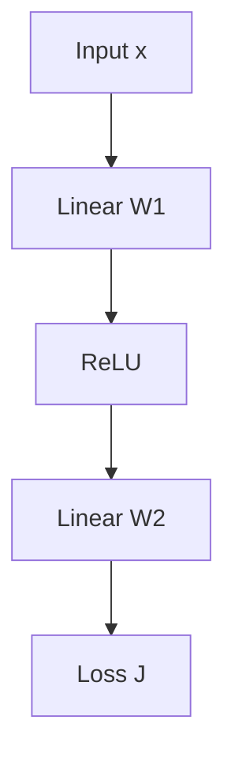

> 🌏 [中文版](/posts/tech/2026-10-13-mit-67960-l02-how-to-train-a-neural-net)

**Video status: Videos included.** [Video source and notes](#lecture-video-source)

> **Edition**: based on **MIT 6.7960 Fall 2024 OCW** (OCW Lec 02, How to Train a Neural Net, taught by Sara Beery). This post is written from the official OCW transcript and slides. The transcript has no timestamps, so references point to content rather than times.

---

## The Question This Lecture Answers

Anyone who has written PyTorch has called `loss.backward()`, but many cannot say why it is affordable: how does one backward sweep through a network with hundreds of millions of parameters return a gradient for every one of them?

Lecture 2 of [MIT 6.7960](https://ocw.mit.edu/courses/6-7960-deep-learning-fall-2024/) gives a plain answer. Sara Beery says in class that backpropagation is "basically an efficiency trick": once you expand the chain rule, the gradient expressions for different layers share a long common factor, and backprop computes that factor once.

After this post you should be able to:

- Say why a given loss landscape is hard to train on, and which remedy applies.
- Write the forward, backward and weight-update equations for a linear layer and the backward rule for ReLU, with the shape of every quantity.
- Compute gradients by hand on any directed acyclic graph, including shared parameters.

Prerequisites are the chain rule and matrix multiplication. The lecture assumes you have seen the multilayer perceptron from [Lecture 1](/posts/tech/2026-08-30-mit-67960-l01-introduction-en).

## Gradient Descent, SGD and Momentum

Training searches for parameters $\theta^*$ that minimize the total loss $J(\theta)$ over the training set. There are only three things we can do with $J$: evaluate it, evaluate its gradient, and evaluate its Hessian. In practice we almost always stop at the first two, which is first-order optimization:

$$
\theta^{k+1} = \theta^{k} - \eta \, \nabla_\theta J(\theta^{k})
$$

$\eta$ is the learning rate. When the landscape is not convex, the point you reach may be only a local minimum, and you usually do not know how far it is from the global one.

With millions or billions of examples, a gradient over all the data is too slow, so we approximate it with the gradient over a small batch. That is stochastic gradient descent (SGD). A batch size of 1 updates after every example; a batch size equal to the dataset is ordinary gradient descent.

The trade-offs Beery lists:

| | |
|---|---|
| Advantages | Faster; small batches already approximate the full gradient; the noise is an implicit regularizer that can bounce you out of local minima |
| Disadvantages | High variance, unstable updates |

She adds an observation from her own experiments: the more imbalanced the classes, the less stable SGD is. A rare class can be absent for several batches in a row, and when it appears it shifts the gradient sharply.

**Momentum** biases each step toward the direction of the previous one, the way a heavy object gains speed rolling downhill. Its strength $\alpha$ is a hyperparameter. In the classroom demo, momentum 0 rolls steadily to the minimum; 0.5 gets there in about half the steps; too much overshoots and oscillates, and ends up slower. For intuition she recommends Gabriel Goh's interactive 2017 article [Why Momentum Really Works](https://distill.pub/2017/momentum/).

## Six Loss Landscapes: Differentiable Does Not Mean Trainable

The lecture shows six one-dimensional loss landscapes and asks three questions. The answers separate "differentiable" from "easy to optimize":

1. **Which are differentiable?** Only the smooth bowl and the nearly flat one.
2. **Which have defined gradients in PyTorch?** All of them. Autograd gives a directional derivative even next to a discontinuity.
3. **Which are hard to optimize?** This is the question that matters.

| Landscape | Problem | Remedy given in class |
|---|---|---|
| Multiple local minima | Where you end depends on where you start | Try several random seeds; the variance across seeds itself tells you how unstable the landscape is |
| Two plateaus with a jump between them (zero gradient) | The gradient is 0 everywhere and completely uninformative; the low-loss part is never reached | Evolution strategies; the slides show them minimizing this function |
| Nearly flat (vanishing gradient) | Progress is very slow and batch noise dominates the signal | No dedicated remedy given in class; in Q&A evolution strategies are said to maybe help |
| Steeper toward the minimum (exploding gradient) | One step throws you far away, so you never land on the minimum | Gradient clipping |

**Evolution strategies** ignore the gradient. They sample small normally distributed perturbations around the current parameters and move toward the perturbations with lower loss, so they can still move where the gradient is uninformative. **Gradient clipping** is more direct: if the gradient magnitude exceeds a cap $m$, scale it back to $m$. Beery calls it "a useful and commonly used hack." An example of my own: the gradient is $(30, 40)$ with magnitude 50; scaling by overall magnitude with a cap of $m = 5$ gives $(3, 4)$, same direction, smaller step. The formula on the slide clips each component instead, which turns the same gradient into $(5, 5)$ and changes its direction.

A student follows up on differentiability in PyTorch (the question is incomplete in the transcript). Her answer is that being able to compute a gradient does not make it useful; on a flat landscape the gradient you compute is simply 0.

### Three Properties of Activation Functions

Continuous, differentiable and smooth: each of these might make optimization easier, though none is required. ReLU is continuous everywhere and differentiable almost everywhere, but it has a kink at 0, so it is not smooth. [GELU](https://arxiv.org/abs/1606.08415) is $x \cdot \Phi(x)$, where $\Phi$ is the cumulative distribution function of the standard normal, and it satisfies all three.

Beery is careful not to say GELU is always better. Her claim is that we do not yet know, experimentally or theoretically, which properties training needs, but the trend does move toward functions that satisfy all three.

## Computation Graphs and the Forward Pass

A **computation graph** draws a model as a graph: each node is a functional transformation and each edge carries data. Deep learning deals almost entirely with directed acyclic graphs (DAGs), and assumes every node is differentiable.

A two-layer multilayer perceptron is a chain:



In the forward pass each node takes its input and its own parameters, produces an output, and hands it to the next node until the loss comes out.

## Backprop: Compute the Shared Part Once

To update layer 1 you need $\partial J / \partial \theta_1$; to update layer 2 you need $\partial J / \partial \theta_2$. Expand both with the chain rule and the long stretch running back from the loss is identical; only the last factor differs.

Backprop passes that shared quantity from the output end to the input end once. Each layer tracks two things:

- $L$: the derivative of the layer's output with respect to its input (or its parameters), determined by the layer's function.
- $g$: the gradient of the loss with respect to the layer's output, a row vector passed back from later layers.

There is one recurrence: **gradient in = gradient out × this layer's $L$**.

### Get the Shapes Right First

The lecture pauses for a matrix calculus refresher, because shapes are where backprop most often goes wrong:

- If $x$ is an $n \times 1$ column vector and $y$ is a scalar, $\partial y / \partial x$ is a $1 \times n$ row vector.
- If $y$ is an $m \times 1$ vector, $\partial y / \partial x$ is an $m \times n$ Jacobian.
- For the chain rule $z = f(u)$, $u = g(x)$ with lengths $m$, $p$, $n$: $\partial z/\partial x$ ($m \times n$) $= \partial z/\partial u$ ($m \times p$) $\times\ \partial u/\partial x$ ($p \times n$).

### Three Equations for a Linear Layer

For a linear layer $x_{\text{out}} = W x_{\text{in}}$ everything comes out clean:

| | Equation | Why |
|---|---|---|
| Forward | $x_{\text{out}} = W x_{\text{in}}$ | Multiply by the weight matrix |
| Backward | $g_{\text{in}} = g_{\text{out}} W$ | Because $\partial x_{\text{out},i} / \partial x_{\text{in},j} = W_{ij}$ |
| Weight gradient | $\partial J / \partial W_{ij} = g_{\text{out},i}\; x_{\text{in},j}$ | Only output $i$ depends on $W_{ij}$, and its derivative with respect to $W_{ij}$ is $x_{\text{in},j}$ |

So the weight gradient is the outer product of the layer's input and the gradient coming back. Written with column-vector gradients, the backward equation becomes $g_{\text{in}}^\top = W^\top g_{\text{out}}^\top$: forward multiplies by $W$, backward by $W^\top$.

### ReLU Becomes a Gate on the Way Back

On the backward pass ReLU is not ReLU again. It becomes a diagonal matrix with 1 where the forward input was positive and 0 elsewhere. Units that were zeroed on the way forward do not pass gradient on the way back.

Two consequences follow:

- **The whole backward pass is linear**, including the ReLU step. Beery relays an intuition from "Phil" (presumably co-instructor Phillip Isola): a first-order approximation fits a plane to the curved loss landscape and moves along it, so it has to be linear.
- **The backward pass needs intermediate values from the forward pass.** A student points out that this makes the two passes asymmetric: going forward only, you can discard a layer's output once the next layer is computed, but to go backward you must keep them all. Beery confirms it: to compute backprop efficiently you have to save the intermediate representations.

### When It Is Not a Chain: Merging and Branching

Real networks share weights, split or concatenate data, and attach multiple heads and objectives; they are not chains. Extending everything above to an arbitrary DAG takes only two more operations:

| Forward | Backward |
|---|---|
| Merge (add, concatenate, and so on): several inputs become one | Route each part of the gradient back to the input it belongs to |
| Branch: one output goes to several places | **Sum** the gradients coming back from the branches |

Parameter sharing is a special case of branching: one set of parameters is sent to several places, so its gradient is the sum of the gradients from each use.

**A shared-parameter example, worked** (written for this post). Let $y = w \cdot \tanh(w x)$, where the same $w$ is used twice, with $x = 1$ and $w = 0.5$.

- Forward: $u = wx = 0.5$, $h = \tanh(0.5) = 0.4621$, $y = w h = 0.2311$.
- Gradient from the outer use: $\partial y / \partial w = h = 0.4621$.
- Gradient from the inner use: pass back through the outer multiplication (times $w$), then through tanh (times $1 - h^2 = 0.7864$), then multiply by the input $x$, giving $0.5 \times 0.7864 \times 1 = 0.3932$.
- Add the two: $0.4621 + 0.3932 = 0.8553$.

Either one alone underestimates it. This is what the branching rule looks like for a shared parameter.

## One Update by Hand: The Exercise at the End of the Slides

The slides end with an exercise the lecture had no time for, though slides 74–80 include a step-by-step solution. The presentation and notation below are this post's own, and both the intermediate values and the final weights were compared with that solution.

**Setup**: two input nodes (1, 2), two tanh hidden nodes (3, 4), one linear output node (5), no bias terms.

| Weight | $w_{13}$ | $w_{23}$ | $w_{14}$ | $w_{24}$ | $w_{35}$ | $w_{45}$ |
|---|---|---|---|---|---|---|
| Initial | 1 | −3 | 0.2 | 1 | 1 | −1 |

There is one training example: $x_1 = 1.0$, $x_2 = 0.1$, target $t = 0.5$. The problem says Euclidean loss, and the solution slides use the form $J = \tfrac12 (y - t)^2$; the learning rate is 0.2.

**Forward**

- $z_3 = 1(1.0) + (-3)(0.1) = 0.7$, $h_3 = \tanh(0.7) = 0.6044$
- $z_4 = 0.2(1.0) + 1(0.1) = 0.3$, $h_4 = \tanh(0.3) = 0.2913$
- $y = 1(0.6044) + (-1)(0.2913) = 0.3131$
- $J = \tfrac12(0.3131 - 0.5)^2 = 0.0175$

**Backward**. The gradient at the output is $g_5 = y - t = -0.1869$.

The output layer is linear, so its weight gradient is input times the gradient coming back:

- $\partial J/\partial w_{35} = g_5 \, h_3 = -0.1130$
- $\partial J/\partial w_{45} = g_5 \, h_4 = -0.0545$

The gradient passes back through the output layer (multiply by the weight) and then through tanh (multiply by $1 - h^2$):

- $g_3 = g_5 \, w_{35} \, (1 - h_3^2) = -0.1869 \times 1 \times 0.6347 = -0.1187$
- $g_4 = g_5 \, w_{45} \, (1 - h_4^2) = -0.1869 \times (-1) \times 0.9151 = 0.1711$

(The slide solution writes $g_3$ as −0.1186, truncated to four digits; rounded it is −0.1187.)

The first-layer weight gradients are again input times the gradient coming back:

- $\partial J/\partial w_{13} = g_3 x_1 = -0.1187$, $\partial J/\partial w_{23} = g_3 x_2 = -0.0119$
- $\partial J/\partial w_{14} = g_4 x_1 = 0.1711$, $\partial J/\partial w_{24} = g_4 x_2 = 0.0171$

**Update** ($w \leftarrow w - 0.2 \times$ gradient)

| Weight | $w_{13}$ | $w_{23}$ | $w_{14}$ | $w_{24}$ | $w_{35}$ | $w_{45}$ |
|---|---|---|---|---|---|---|
| Updated | 1.0237 | −2.9976 | 0.1658 | 0.9966 | 1.0226 | −0.9891 |
| Slide answer (two digits) | 1.02 | −3.0 | 0.17 | 1.0 | 1.02 | −0.99 |

Run the forward pass again with the new weights: the output moves from 0.3131 to 0.3768 and the loss drops from 0.0175 to 0.0076.

The thing to notice is that $g_5$ is computed once and reused by all six weight gradients, while $g_3$ and $g_4$ are each computed once and reused by two. That is the "compute the shared part once" from the opening.

The slides write the learning rate as $\eta = -0.2$ and note that this is because their update uses a plus sign. This post uses the minus-sign convention, so the learning rate is a positive 0.2; the two are equivalent.

## Differentiable Programming: Weights Are Not the Only Thing You Can Optimize

The last part steps back. Deep nets are popular for two reasons: they are differentiable and therefore easy to optimize, and they are compositional, like building blocks. General models with these two properties came to be called **differentiable programming**.

Beery cites Andrej Karpathy's [Software 2.0](https://karpathy.medium.com/software-2-0-a64152b37c35): in traditional software a person writes the program; in Software 2.0 a person defines a space of possible programs and data optimizes within it. Real systems are hybrids, with some nodes hard-coded by people (image normalization values, for example) and some "written" by backprop. [Neural Module Networks](https://arxiv.org/abs/1511.02799) is the example from class: the parser that reads the question might not be learned at all, while the CNN that recognizes objects might be updated from training data.

Because the whole graph is differentiable, you can take any scalar cost and optimize any node or edge with respect to it. Hold the weights fixed and optimize the **input** instead, and you get several well-known applications:

- **Feature visualization**: find the image that maximizes the "cat" output neuron to see what the model considers most cat-like (see [Feature Visualization](https://distill.pub/2017/feature-visualization/)). [DeepDream](https://research.google/blog/inceptionism-going-deeper-into-neural-networks/) is the same idea.
- **Steering image generation with [CLIP](https://openai.com/index/clip/)**: CLIP's text and image encoders and the image generator are all frozen; only the generator's input vector is optimized so that the generated image lands closest to the text prompt in CLIP space.

One practical detail from class: optimizing the logit **before** the softmax is more stable than optimizing the probability after it. The cheapest way to raise one class's probability is often to push the other classes down, not to make the image look more like that class.

## Common Misunderstandings

- **"Backprop is an optimization algorithm."** It is not. It only computes gradients; SGD, Adam and other optimizers are what use them to update parameters.
- **"Adam is just momentum."** The lecture mentions Adam in one sentence as a popular example with momentum. Adam also rescales each parameter's step adaptively by gradient magnitude, which this lecture does not cover; see the [Optimization Overview](/posts/tech/2026-08-30-mit-67960-optimization-sgd-adam-en) in this series.
- **"PyTorch can differentiate it, so it will train."** Being able to compute a gradient and the gradient carrying signal are different things.

## Check Yourself

1. A linear layer has a $3 \times 5$ matrix $W$. What is the shape of the incoming $g_{\text{out}}$? What are the shapes of $g_{\text{in}}$ and the weight gradient?
   **Answer**: $g_{\text{out}}$ is $1 \times 3$; $g_{\text{in}} = g_{\text{out}} W$ is $1 \times 5$; the weight gradient has the shape of $W$, $3 \times 5$.
2. In the exercise above, replace node 3 with ReLU. What is $g_3$?
   **Answer**: $z_3 = 0.7 > 0$, so the gate is 1 and $g_3 = g_5 w_{35} = -0.1869$. If $z_3$ were negative, $g_3 = 0$ and neither $w_{13}$ nor $w_{23}$ would update on this step.
3. Change the shared-parameter example above to $x = 2$ (with $w$ still 0.5). What is $\partial y / \partial w$?
   **Answer**: $u = 1$, $h = \tanh(1) = 0.7616$, $1 - h^2 = 0.4200$. The outer use gives $h = 0.7616$ and the inner use gives $0.5 \times 0.4200 \times 2 = 0.4200$, for a total of 1.1816. One gradient per use, then add: that is the branching rule.
4. Late in training the loss curve suddenly shows huge spikes. Which tool from this lecture do you try first?
   **Answer**: gradient clipping. A spike usually means one step's gradient was too large and threw the parameters far away.

## Lecture Video Source

Rechecked against the live MIT OCW Fall 2024 gallery on 2026-10-13: the lecture number matches and the video is public and embeddable. Lecture numbering and topics follow OCW.

```youtube
url: https://www.youtube.com/watch?v=vidCX_dMCu0
title: MIT 6.7960 Fall 2024 — Lec 02. How to Train a Neural Net
```

Original video: [MIT 6.7960 Fall 2024 — Lec 02. How to Train a Neural Net](https://www.youtube.com/watch?v=vidCX_dMCu0)

Course and recording links:

- [MIT OCW — Lec 02. How to Train a Neural Net](https://ocw.mit.edu/courses/6-7960-deep-learning-fall-2024/resources/mit6_7960f24_lec02_mp4/)
- [MIT 6.7960 Fall 2024 — official lecture video gallery](https://ocw.mit.edu/courses/6-7960-deep-learning-fall-2024/video_galleries/lecture-videos/)

Checked: 2026-10-13.

Content check: verified against the video transcript (2026-10-13): read the full official OCW transcript and the slides. The transcript has no timestamps and the audio was not replayed for this post. The closing exercise is not explained in class; the working here was compared with the step-by-step solution on slides 74–80. The two small examples on gradient clipping and a shared parameter are this post's own.

## References

- [MIT 6.7960 Fall 2024 OCW course home](https://ocw.mit.edu/courses/6-7960-deep-learning-fall-2024/)
- [Lec 02 official transcript (PDF)](https://ocw.mit.edu/courses/6-7960-deep-learning-fall-2024/mit6_7960f24_lec02_transcript.pdf)
- [Lecture 2: How to Train a Neural Net slides](https://ocw.mit.edu/courses/6-7960-deep-learning-fall-2024/resources/mit6_7960_f24_lec2_pdf/)
- Gabriel Goh, [Why Momentum Really Works](https://distill.pub/2017/momentum/) (Distill, 2017)
- Hendrycks & Gimpel, [Gaussian Error Linear Units (GELUs)](https://arxiv.org/abs/1606.08415)
- Andreas et al., [Neural Module Networks](https://arxiv.org/abs/1511.02799)
- Andrej Karpathy, [Software 2.0](https://karpathy.medium.com/software-2-0-a64152b37c35)
- Olah et al., [Feature Visualization](https://distill.pub/2017/feature-visualization/) (Distill, 2017)
- Google Research, [Inceptionism: Going Deeper into Neural Networks](https://research.google/blog/inceptionism-going-deeper-into-neural-networks/)
- OpenAI, [CLIP: Connecting text and images](https://openai.com/index/clip/)
