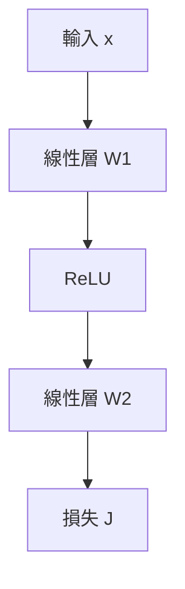

> 🌏 [English version](/posts/tech/2026-10-13-mit-67960-l02-how-to-train-a-neural-net-en)

**影片狀態：已附影片。** [影片來源與說明](#課程影片來源)

> **教材版本**：基於 **MIT 6.7960 Fall 2024 OCW**（對應 OCW Lec 02 How to Train a Neural Net，Sara Beery 主講）。本文依 OCW 官方逐字稿與投影片整理；逐字稿沒有時間戳，所以引用以段落內容定位，不標時間。

---

## 這一堂要回答的問題

寫過 PyTorch 的人都呼叫過 `loss.backward()`，但很多人說不出它為什麼算得動：一個幾億參數的網路，憑什麼一次反向掃過去就拿到每個參數的梯度？

[MIT 6.7960](https://ocw.mit.edu/courses/6-7960-deep-learning-fall-2024/) 第 2 堂給的答案很樸素。Sara Beery 在課堂上直接說，反向傳播「基本上是一個效率技巧」：連鎖律展開後，各層的梯度式子有一大段是共用的，把共用的那段只算一次，就是反向傳播。

讀完這篇，你應該能做三件事：

- 判斷一個損失地形為什麼難訓練，以及該用哪個補救手段。
- 寫出線性層的前向、反向、權重更新三條式子與 ReLU 的反向，並說出每個量的形狀。
- 對任意有向無環圖手算梯度，包括共用參數的情況。

先備是微積分的連鎖律與矩陣乘法。這堂假設你已經看過[第 1 堂](/posts/tech/2026-08-30-mit-67960-l01-introduction)的多層感知器。

## 梯度下降、SGD 與動量

訓練是在找一組參數 $\theta^*$，讓整個訓練集上的損失總和 $J(\theta)$ 最小。我們對 $J$ 能做的事只有三件：算它的值、算它的梯度、算它的 Hessian。實務上幾乎只用前兩件，也就是一階最佳化：

$$
\theta^{k+1} = \theta^{k} - \eta \, \nabla_\theta J(\theta^{k})
$$

$\eta$ 是學習率。地形不是凸的時候，這樣走到的可能只是局部最小值，而且通常不知道它離全域最小值多遠。

資料集大到百萬、十億筆時，對全部資料算梯度太慢，所以改用一小批資料的梯度來近似，這就是隨機梯度下降（SGD）。批次大小是 1 時每看一筆就更新一次；等於資料總數時就退回一般的梯度下降。

Beery 列出的取捨：

| | 內容 |
|---|---|
| 好處 | 比較快；小批次就能近似整體梯度；雜訊本身是一種隱性正則化，有機會把你彈出局部最小值 |
| 壞處 | 變異大、更新不穩 |

她補了一個自己做實驗的觀察：類別越不平衡，SGD 越不穩。因為稀有類別可能連續好幾個批次都沒出現，一出現就把梯度大幅拉走。

**動量**（momentum）是讓這一步偏向上一步的方向，像重物滾下坡會越滾越快。強度 $\alpha$ 是超參數，課堂上的示範是：動量 0 時穩穩滾到底；0.5 時大約一半的步數就到；太大時會衝過頭來回擺盪，反而更慢。想建立直覺，她推薦 Gabriel Goh 2017 年的互動文章 [Why Momentum Really Works](https://distill.pub/2017/momentum/)。

## 六種損失地形：可微不等於好訓練

課堂上放了六張一維的損失地形，問了三個問題，答案剛好把「可微」與「好最佳化」分開：

1. **哪些可微？** 只有平滑的碗形與那張近乎平坦的。
2. **哪些在 PyTorch 裡有定義梯度？** 全部。autograd 在不連續點旁邊也會給一個方向導數。
3. **哪些難最佳化？** 這才是重點。

| 地形 | 問題 | 課堂給的對策 |
|---|---|---|
| 多個局部最小值 | 終點取決於起點 | 多跑幾個隨機種子；種子間的表現差異本身就在告訴你地形多不穩 |
| 兩段平台、中間斷開（零梯度） | 梯度處處是 0，完全沒有訊號，到不了低損失的那一段 | 演化策略；投影片示範它能把這個函數降下來 |
| 幾乎平坦（梯度消失） | 進展極慢，批次雜訊蓋過訊號 | 課堂沒有給專屬的解法；問答時提到演化策略也許有幫助 |
| 越靠近最小值越陡（梯度爆炸） | 一步就被彈到很遠，永遠踩不到底 | 梯度裁剪 |

**演化策略**（evolution strategies）不看梯度，改在目前參數附近加常態分布的小擾動取樣，往損失較低的擾動方向移動，所以在梯度沒訊號的地方也走得動。**梯度裁剪**（gradient clipping）更直接：梯度的大小超過上限 $m$ 就縮回 $m$。Beery 稱它是「有用而且常用的 hack」。舉個本文的例子：梯度是 $(30, 40)$，大小是 50；依整體大小縮放的話，上限 $m = 5$ 時把它縮成 $(3, 4)$，方向不變，只是步子變小。投影片的公式是逐分量裁剪，同一個梯度會變成 $(5, 5)$，方向會偏。

有學生追問 PyTorch 的可微性（提問在逐字稿裡不完整）。她的回答是，算得出梯度不代表梯度有用，平坦地形的梯度算出來就是 0。

### 活化函數的三個性質

連續、可微、平滑，這三個性質可能讓最佳化比較容易，但都不是必要條件。ReLU 處處連續、幾乎處處可微，但在 0 有個折角，不平滑。[GELU](https://arxiv.org/abs/1606.08415) 是 $x \cdot \Phi(x)$，其中 $\Phi$ 是標準常態分布的累積分布函數，三個性質都滿足。

Beery 很小心地沒有說 GELU 一定比較好。她的說法是：實驗上與理論上都還不確定訓練到底需要哪些性質，但趨勢確實往三個都滿足的函數移動。

## 計算圖與前向傳遞

**計算圖**把一個模型畫成一張圖：每個節點是一個函數變換，邊是資料。深度學習處理的幾乎都是有向無環圖（DAG），而且假設每個節點都可微。

一個兩層的多層感知器就是一條鏈：



前向傳遞是每個節點拿輸入與自己的參數算出輸出，再交給下一個節點，最後得到損失。

## 反向傳播：共用的那一段只算一次

要更新第 1 層的參數，需要 $\partial J / \partial \theta_1$；要更新第 2 層，需要 $\partial J / \partial \theta_2$。用連鎖律各自展開，會發現兩條式子從損失往回走的那一大段是一樣的，只有最後一項不同。

反向傳播就是把那段共用的量從輸出端往輸入端傳一次。每一層只需要記兩種量：

- $L$：這一層輸出對輸入（或對參數）的導數，由這一層的函數決定。
- $g$：損失對這一層輸出的梯度，是一個列向量，由後面的層傳回來。

遞迴關係只有一條：**傳進來的梯度 = 傳出去的梯度 × 這一層的 $L$**。

### 形狀要先對

課堂中間插了一段矩陣微積分複習，因為反向傳播最常錯在形狀：

- $x$ 是 $n \times 1$ 的行向量、$y$ 是純量時，$\partial y / \partial x$ 是 $1 \times n$ 的列向量。
- $y$ 是 $m \times 1$ 的向量時，$\partial y / \partial x$ 是 $m \times n$ 的 Jacobian。
- 連鎖律 $z = f(u)$、$u = g(x)$，三者長度為 $m$、$p$、$n$ 時，$\partial z/\partial x$（$m \times n$）$= \partial z/\partial u$（$m \times p$）$\times\ \partial u/\partial x$（$p \times n$）。

### 線性層的三條式子

線性層 $x_{\text{out}} = W x_{\text{in}}$ 的結果特別乾淨：

| | 式子 | 說明 |
|---|---|---|
| 前向 | $x_{\text{out}} = W x_{\text{in}}$ | 乘上權重矩陣 |
| 反向 | $g_{\text{in}} = g_{\text{out}} W$ | 因為 $\partial x_{\text{out},i} / \partial x_{\text{in},j} = W_{ij}$ |
| 權重梯度 | $\partial J / \partial W_{ij} = g_{\text{out},i}\; x_{\text{in},j}$ | 只有第 $i$ 個輸出受 $W_{ij}$ 影響，而它對 $W_{ij}$ 的導數就是 $x_{\text{in},j}$ |

所以權重梯度是「這一層的輸入」與「傳回來的梯度」的外積。把梯度改寫成行向量時，反向那條變成 $g_{\text{in}}^\top = W^\top g_{\text{out}}^\top$：前向乘 $W$，反向乘 $W^\top$。

### ReLU 的反向是一個閘門

ReLU 在反向時不是再做一次 ReLU。它變成一個對角矩陣：前向時輸入為正的位置是 1，其餘是 0。意思是前向時被壓成 0 的單元，反向時不讓梯度通過。

這帶出兩個推論：

- **整個反向傳遞是線性的**，連 ReLU 那一步也是。Beery 轉述「Phil」（應指共同授課的 Phillip Isola）的直覺：一階近似是在彎曲的損失地形上貼一張平面，再沿平面移動，所以必然是線性的。
- **反向需要前向留下的中間值**。有學生指出這讓前向與反向不對稱：純前向時算完下一層就能丟掉上一層的輸出，但要做反向就得全部留著。Beery 確認這是對的：要有效率地做反向傳播，就得把中間表示存下來。

### 不是鏈的時候：合流與分岔

真實的網路會共用權重、把資料分拆或串接、接多個輸出頭與目標，不是一條鏈。把上面的做法推廣到任意 DAG 只需要多兩個操作：

| 前向 | 反向 |
|---|---|
| 合流（相加、串接等）：多個輸入併成一個 | 把梯度依各輸入對應的部分分別傳回去 |
| 分岔：一個輸出送往多處 | 把各分支傳回來的梯度**相加** |

共用參數就是分岔的特例：同一組參數被送到多個地方用，所以它的梯度是各處梯度的總和。

**算一個共用參數的例子**（本文自擬）。令 $y = w \cdot \tanh(w x)$，同一個 $w$ 用了兩次，取 $x = 1$、$w = 0.5$。

- 前向：$u = wx = 0.5$，$h = \tanh(0.5) = 0.4621$，$y = w h = 0.2311$。
- 外層那次使用的梯度：$\partial y / \partial w = h = 0.4621$。
- 內層那次使用的梯度：先穿過外層的乘法（乘上 $w$），再穿過 tanh（乘上 $1 - h^2 = 0.7864$），最後乘上輸入 $x$，得到 $0.5 \times 0.7864 \times 1 = 0.3932$。
- 兩處相加：$0.4621 + 0.3932 = 0.8553$。

只算其中一處都會低估。這就是分岔規則在共用參數上的樣子。

## 手算一次：投影片最後的習題

投影片最後留了一題，課堂上沒時間講，但投影片第 74–80 頁附了逐步解答。以下的寫法與符號是本文的，中間值與最終權重都和投影片的解答對過。

**題目**：兩個輸入節點（1、2）、兩個 tanh 隱藏節點（3、4）、一個線性輸出節點（5），沒有偏差項。

| 權重 | $w_{13}$ | $w_{23}$ | $w_{14}$ | $w_{24}$ | $w_{35}$ | $w_{45}$ |
|---|---|---|---|---|---|---|
| 初始值 | 1 | −3 | 0.2 | 1 | 1 | −1 |

訓練資料只有一筆：$x_1 = 1.0$、$x_2 = 0.1$，目標 $t = 0.5$。題目寫的是 Euclidean loss，解答頁用的形式是 $J = \tfrac12 (y - t)^2$；學習率 0.2。

**前向**

- $z_3 = 1(1.0) + (-3)(0.1) = 0.7$，$h_3 = \tanh(0.7) = 0.6044$
- $z_4 = 0.2(1.0) + 1(0.1) = 0.3$，$h_4 = \tanh(0.3) = 0.2913$
- $y = 1(0.6044) + (-1)(0.2913) = 0.3131$
- $J = \tfrac12(0.3131 - 0.5)^2 = 0.0175$

**反向**。輸出端的梯度是 $g_5 = y - t = -0.1869$。

輸出層是線性層，權重梯度是「輸入 × 傳回來的梯度」：

- $\partial J/\partial w_{35} = g_5 \, h_3 = -0.1130$
- $\partial J/\partial w_{45} = g_5 \, h_4 = -0.0545$

梯度往回穿過輸出層（乘上權重），再穿過 tanh（乘上 $1 - h^2$）：

- $g_3 = g_5 \, w_{35} \, (1 - h_3^2) = -0.1869 \times 1 \times 0.6347 = -0.1187$
- $g_4 = g_5 \, w_{45} \, (1 - h_4^2) = -0.1869 \times (-1) \times 0.9151 = 0.1711$

（投影片的解答把 $g_3$ 寫成 −0.1186，是截斷到四位；四捨五入是 −0.1187。）

第一層的權重梯度一樣是「輸入 × 傳回來的梯度」：

- $\partial J/\partial w_{13} = g_3 x_1 = -0.1187$，$\partial J/\partial w_{23} = g_3 x_2 = -0.0119$
- $\partial J/\partial w_{14} = g_4 x_1 = 0.1711$，$\partial J/\partial w_{24} = g_4 x_2 = 0.0171$

**更新**（$w \leftarrow w - 0.2 \times$ 梯度）

| 權重 | $w_{13}$ | $w_{23}$ | $w_{14}$ | $w_{24}$ | $w_{35}$ | $w_{45}$ |
|---|---|---|---|---|---|---|
| 更新後 | 1.0237 | −2.9976 | 0.1658 | 0.9966 | 1.0226 | −0.9891 |
| 投影片答案（取兩位） | 1.02 | −3.0 | 0.17 | 1.0 | 1.02 | −0.99 |

用新權重再跑一次前向，輸出從 0.3131 變成 0.3768，損失從 0.0175 降到 0.0076。

這題值得看的地方是 $g_5$ 只算了一次，卻被六個權重的梯度共用；$g_3$、$g_4$ 各算一次，各被兩個權重共用。這就是開頭說的「共用的那一段只算一次」。

投影片把學習率寫成 $\eta = -0.2$，並註明是因為它的更新式用加號。本文用減號的寫法，所以學習率是正的 0.2，兩者等價。

## 可微分程式設計：能最佳化的不只是權重

最後一段把視角拉高。深度網路受歡迎有兩個原因：可微所以好最佳化、可組合所以像積木。具備這兩個性質的一般模型，後來被稱為**可微分程式設計**（differentiable programming）。

Beery 引了 Andrej Karpathy 的 [Software 2.0](https://karpathy.medium.com/software-2-0-a64152b37c35)：傳統軟體是人直接寫出程式；Software 2.0 是人定義一個可能程式的空間，再用資料在裡面最佳化。實際的系統是混合的，有些節點由人寫死（例如影像的正規化數值），有些由反向傳播「寫」出來。[Neural Module Networks](https://arxiv.org/abs/1511.02799) 是課堂舉的例子：解析問題的 parser 可以不是學來的，辨識物件的 CNN 則可以由訓練資料更新。

既然整張圖都可微，就可以拿任何一個純量成本，對圖上任何節點或邊最佳化。固定權重、改成最佳化**輸入**，就得到幾個著名的應用：

- **特徵視覺化**：找一張讓「貓」這個輸出神經元最大的影像，看模型認為什麼最像貓（見 [Feature Visualization](https://distill.pub/2017/feature-visualization/)）。[DeepDream](https://research.google/blog/inceptionism-going-deeper-into-neural-networks/) 是同一個想法。
- **用 [CLIP](https://openai.com/index/clip/) 引導影像生成**：CLIP 的文字與影像編碼器、影像生成器全部固定，只最佳化生成器的輸入向量，讓生成的影像在 CLIP 空間裡最接近文字提示。

課堂上有個實用細節：最佳化 softmax **之前**的 logit 比最佳化 softmax 之後的機率穩定。因為要拉高某一類的機率，最省事的路常常是把其他類壓低，而不是讓影像真的更像那一類。

## 常見誤解

- **「反向傳播是一種最佳化演算法」**：不是。它只負責算梯度；拿梯度去更新參數的是 SGD、Adam 這些最佳化器。
- **「Adam 就是動量」**：課堂把 Adam 當成帶動量的常見例子一句帶過。Adam 另外還對每個參數做梯度大小的自適應縮放，這部分這堂沒有講，見本系列的[優化總覽](/posts/tech/2026-08-30-mit-67960-optimization-sgd-adam)。
- **「PyTorch 能微分，所以一定訓練得起來」**：算得出梯度與梯度有訊號是兩回事。

## 自我檢查

1. 線性層的 $W$ 是 $3 \times 5$，傳回來的 $g_{\text{out}}$ 是什麼形狀？$g_{\text{in}}$ 與權重梯度各是什麼形狀？
   **答**：$g_{\text{out}}$ 是 $1 \times 3$；$g_{\text{in}} = g_{\text{out}} W$ 是 $1 \times 5$；權重梯度與 $W$ 同形，是 $3 \times 5$。
2. 上面習題如果把節點 3 換成 ReLU，$g_3$ 變成多少？
   **答**：$z_3 = 0.7 > 0$，閘門是 1，所以 $g_3 = g_5 w_{35} = -0.1869$。若 $z_3$ 是負的，$g_3 = 0$，$w_{13}$ 與 $w_{23}$ 這一步完全不會更新。
3. 把上面共用參數的例子改成 $x = 2$（$w$ 仍是 0.5），$\partial y / \partial w$ 是多少？
   **答**：$u = 1$，$h = \tanh(1) = 0.7616$，$1 - h^2 = 0.4200$。外層那次是 $h = 0.7616$，內層那次是 $0.5 \times 0.4200 \times 2 = 0.4200$，相加得 1.1816。兩個使用位置各算一份梯度再相加，就是分岔規則。
4. 損失曲線在訓練後期突然出現極大的尖峰，這堂課的工具箱裡先試哪一個？
   **答**：梯度裁剪。尖峰通常代表某一步的梯度過大，把參數彈到很遠的地方。

## 課程影片來源

2026-10-13 已即時回 MIT OCW Fall 2024 官方錄影列表核對講次，影片公開且允許嵌入；講次與主題以 OCW 的標示為準。

```youtube
url: https://www.youtube.com/watch?v=vidCX_dMCu0
title: MIT 6.7960 Fall 2024 — Lec 02. How to Train a Neural Net
```

原始影片：[MIT 6.7960 Fall 2024 — Lec 02. How to Train a Neural Net](https://www.youtube.com/watch?v=vidCX_dMCu0)

課程與錄影入口：

- [MIT OCW — Lec 02. How to Train a Neural Net](https://ocw.mit.edu/courses/6-7960-deep-learning-fall-2024/resources/mit6_7960f24_lec02_mp4/)
- [MIT 6.7960 Fall 2024 — official lecture video gallery](https://ocw.mit.edu/courses/6-7960-deep-learning-fall-2024/video_galleries/lecture-videos/)

查核日期：2026-10-13。

內容核對：已依字幕核對（2026-10-13）：讀了 OCW 官方逐字稿全文與投影片。逐字稿沒有時間戳，本文未回聽原音；課末習題課堂上沒有講解；本文的計算已與投影片第 74–80 頁的逐步解答對照。梯度裁剪與共用參數的兩個小例子是本文自擬。

## 參考資料

- [MIT 6.7960 Fall 2024 OCW 課程首頁](https://ocw.mit.edu/courses/6-7960-deep-learning-fall-2024/)
- [Lec 02 官方逐字稿（PDF）](https://ocw.mit.edu/courses/6-7960-deep-learning-fall-2024/mit6_7960f24_lec02_transcript.pdf)
- [Lecture 2: How to Train a Neural Net 投影片](https://ocw.mit.edu/courses/6-7960-deep-learning-fall-2024/resources/mit6_7960_f24_lec2_pdf/)
- Gabriel Goh，[Why Momentum Really Works](https://distill.pub/2017/momentum/)（Distill，2017）
- Hendrycks & Gimpel，[Gaussian Error Linear Units (GELUs)](https://arxiv.org/abs/1606.08415)
- Andreas et al.，[Neural Module Networks](https://arxiv.org/abs/1511.02799)
- Andrej Karpathy，[Software 2.0](https://karpathy.medium.com/software-2-0-a64152b37c35)
- Olah et al.，[Feature Visualization](https://distill.pub/2017/feature-visualization/)（Distill，2017）
- Google Research，[Inceptionism: Going Deeper into Neural Networks](https://research.google/blog/inceptionism-going-deeper-into-neural-networks/)
- OpenAI，[CLIP: Connecting text and images](https://openai.com/index/clip/)
