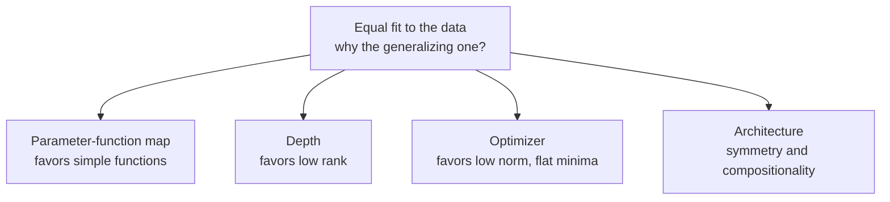

> 🌏 [中文版](/posts/tech/2026-10-13-mit-67960-l06-generalization-theory)

**Video status: Videos included.** [Video source and notes](#lecture-video-source)

> **Edition**: based on **MIT 6.7960 Fall 2024 OCW** (OCW Lec 06, Generalization Theory, taught by Phillip Isola). This post is written from the official OCW transcript and slides. The transcript has no timestamps, so references point to content rather than times.

---

## The Question This Lecture Answers

Textbooks say a model that is too large overfits, so you should control the number of parameters. Yet today's networks have enough capacity to memorize their entire training set, random labels included, and keep improving as they grow. What went wrong?

Lecture 6 of [MIT 6.7960](https://ocw.mit.edu/courses/6-7960-deep-learning-fall-2024/) is candid about it. Phillip Isola opens by saying this material is "not really textbook material" but ongoing science, and that the generalization properties of deep networks are among the biggest open questions in the field. So the lecture delivers two things: which classical explanations are known to fail, and which leads exist today.

After this post you should be able to:

- Separate what approximation, optimization and generalization each ask.
- Explain why parameter count and VC dimension cannot serve as complexity measures for deep nets, with one counterexample each.
- Look at a double descent curve and say where the peak is and why the error falls again afterward.

Prerequisites are basic machine learning ideas (training error, test error, overfitting). Architectural symmetry already appeared in [Lecture 4 on CNNs](/posts/tech/2026-08-30-mit-67960-cnn-architectures-en) and [Lecture 5 on GNNs](/posts/tech/2026-08-30-mit-67960-gnn-en).

## Three Questions: Approximation, Optimization, Generalization

Machine learning factors into three questions:

| Question | What it asks |
|---|---|
| Approximation | How low can the best parameters $\theta^*$ in this function family push the training error? |
| Optimization | Can we actually find $\theta^*$? |
| Generalization | Once found, how far apart are training error and population error? |

Training minimizes the **empirical risk**, the average loss on the training data. What we care about is the **population risk**: the expected loss over all new samples from the data-generating process. The gap between them is the generalization error.

Earlier lectures in this series (such as [Lecture 3 on approximation theory](/posts/tech/2026-08-30-mit-67960-approximation-theory-en)) were about approximation. This is the first one to ask: the fit is good, now what?

## Two Bad Models

**The filing cabinet.** Store every training pair $(x, y)$ in a dictionary; answer $y$ if the key is there and 0 if it is not. Its approximation error is 0, since it answers every training example. Its generalization is almost certainly bad, unless the true function happens to be 0 almost everywhere. This is pure memorization.

**Paul the Octopus.** The octopus that predicted soccer results by swimming into the tank with one country's flag; the lecture says it got 6 out of 6. Paul is not a filing cabinet, since it does make a decision, but it simply got lucky. A function can be right on all the training data and have learned nothing about soccer.

The two examples frame the problem: fitting the training data does not guarantee generalization. Are deep nets more like a filing cabinet, or like something else?

## Are Deep Nets Filing Cabinets? A Counting Experiment

Fit the same one-dimensional data points with a filing cabinet and with a three-layer ReLU MLP. Both reach zero training error, but the cabinet answers 0 everywhere between the points while the MLP draws a smooth curve. The only difference is what they answer where there is no data, and that is generalization.

Large language models are harder to judge, because with that much training data the test question may already have been seen. Isola proposes a counting argument: **suppose the model is a filing cabinet; how big must the cabinet be?**

- Draw $n$ words at random from a vocabulary of $m$ to form a sequence; there are $m^n$ of them.
- Ask the model a question about the sequence and estimate the fraction $p$ it gets right.
- A filing cabinet with the same performance must store at least $p \times m^n$ entries.

His run used 30 fruit names, 10 drawn per sequence, and asked GPT-4o "how many citrus fruits are in this list"; it got 5 out of 5.

One number needs checking here. $30^{10} \approx 5.9 \times 10^{14}$, about 590 trillion; the lecture and the slides both say "100 trillion," which does not match the stated 30 and 10. The materials are inconsistent in two more places: aloud he says "10 to the 30th," and the slide swaps the labels $n$ and $m$; and the 12.5 trillion in the second experiment is exactly 0.125 times 100 trillion, so 100 trillion is the figure he used throughout. The materials do not let this post confirm the vocabulary size and length he actually used. Either way the conclusion holds: Isola estimates these models are trained on something like tens of trillions of items, and the cabinet would need more entries than that. He says himself that this is not a rigorous experiment and suggests someone do it properly as a final project.

### Generalizing to an Unseen Distribution

The [pix2pix](https://arxiv.org/abs/1611.07004) example is more direct. The model was trained to turn sketches into cat photos using edge maps produced by an edge detector, yet it also works on hand-drawn cats, which are statistically a different distribution from edge maps. Draw three eyes and it places an eye at each of the three positions, although the training data has no three-eyed cats.

Isola's explanation is the inductive bias of convolutional nets: a convolution cuts the image into patches and processes each one independently and identically. For each patch, "when I see an oval, draw an eye" is still in distribution; more eyes are simply more patches. Decompose the problem into independent small decisions, and new combinations need no extra learning.

## What Classical Theory Says

### Occam's Razor

Almost all generalization theory is a variation on Occam's razor: among explanations that **fit the data equally well**, prefer the simplest. Isola stresses that the first half is often dropped. Without it you get absurd conclusions like "so use a linear model."

The most rigorous version comes from Solomonoff: the **shortest program** that generates the data predicts best. An equivalent statement is that the most compressed representation of the data is the best model of it. The trouble is that finding the shortest program means searching all possible programs, which cannot be done. So we need a complexity measure we can compute.

### Measure One: Number of Parameters

The classical picture is the bias-variance trade-off: as capacity grows, training error keeps falling, while test error falls and then rises.

The lecture demonstrates with polynomial regression. The true function is cubic and the data is noisy:

| Degree $d$ | Result |
|---|---|
| 1 | A straight line; underfits |
| 3 | Nearly recovers the true function |
| 20 | Swings wildly to pass through every noisy point; classic overfitting |
| 1000 | Still passes through every point, but overall hugs the smooth true function again, leaving only thin spikes at the data points |

The last row is **double descent**. Test error peaks where the model can just barely memorize all the training data (the **interpolation threshold**), and as capacity grows beyond it the error falls a second time.

Isola's intuition is the "simple plus spiky" hypothesis: when capacity is just enough to memorize the data, it takes a very contorted function to do it; with more capacity, many functions memorize the data, and you can pick the smoothest among them. The learned model is a smooth component that generalizes plus some spikes that only memorize noise.

An observation supporting this: the more features there are, the smaller the norm of the learned weight vector. That is provable for linear models and only empirical for deep nets.

Two practical notes:

- Double descent is hard to reproduce. Isola says he tried to build his own example and could not get it to work. He goes on to say that the double descent papers show it only appears in certain regimes, and that common practices such as momentum and weight decay can make the peak disappear. Not seeing it in your curves is normal.
- Deep learning today sits almost entirely to the right of the peak, so the rule of thumb is that training longer is better. He adds that double descent also appears in training time.

Why is parameter count the wrong measure? The lecture gives a thought experiment. Let $h(x) = 10^{-100} f(x) + (1 - 10^{-100})\, g(x)$, where $f$ has many parameters and $g$ only a few. Nominally $h$ has as many parameters as $f$ plus $g$, but $g$ alone approximates it to within $10^{-100}$. What matters is the size of the parameters, not how many there are. Parameter norm is closer, but it is not the whole answer either.

### Measure Two: How Many Functions the Model Can Represent

VC theory counts differently: how many distinct functions are in the hypothesis space. Its argument fits in one picture.

Think of the hypothesis space as a set of dots, each a candidate function. Purple dots fit the training data, and exactly one green dot is the true function. Suppose you pick at random among the purple and green dots:

- **Add data**: every new data point is a new constraint, and some purple dots stop fitting and switch off. In the lecture's picture 6 candidates become 4, and the chance of picking the true function rises from 1/6 to 1/4.
- **Reduce capacity**: remove dots outright, which also removes purple dots that fit by luck.

So fewer functions and more data both lower the chance of a fit that does not generalize. A continuous function family cannot be counted directly, so the lecture counts how many distinct binary labelings (dichotomies) the model can realize on the $n$ training points, calls that $d$, and gives a generalization bound of roughly $\sqrt{d/n}$. This is the lecture's simplified version; the textbook definition of VC dimension and the form of the bound are more careful, and the lecture does not go into them.

### VC Theory Fails for Deep Nets

Randomly shuffle the labels of a dataset and a neural network can still push training accuracy to 100%. This is the experiment in Zhang et al.'s 2017 paper [Understanding deep learning requires rethinking generalization](https://arxiv.org/abs/1611.03530).

That means the network can realize almost any labeling, and there are $2^n$ of them for $n$ points, so $d = 2^n$. Plug it into the bound and you get $\sqrt{2^n / n}$, which grows exponentially in $n$. A small number of my own to make it concrete: at $n = 10$, $\sqrt{1024/10} \approx 10.1$. Classification error is at most 1, so a bound that says "error is no more than 10.1" carries no information. Such a bound is called vacuous.

The other half of the same paper matters even more: the same network trained on true labels has high test accuracy, and trained on random labels its test accuracy collapses. Capacity is identical in both cases, so capacity alone cannot tell a solution that generalizes from one that does not.

Isola thinks VC theory has the right way of thinking but that its assumptions are violated, one of the main ones being that you pick **at random** among the functions that fit the data. Gradient descent does not pick at random.

## Beyond Fitting the Data, What Other Pressures Are There?

All parameter settings that reach zero training error form the **version space**. It contains solutions that generalize and it contains filing cabinets. The question becomes why training lands on the good side. Isola gives four leads and says none of them is settled.



**1. The parameter-function map favors simplicity.** Many different parameter vectors map to the same function. [Valle-Pérez et al.](https://arxiv.org/abs/1805.08522) observed empirically that a randomly sampled parameter vector mostly maps to a simple function (measured by Lempel-Ziv compression complexity). Most of the volume of parameter space maps to simple functions, so when training pushes the parameters into the version space, it lands in the simple corner by chance.

**2. Depth favors low rank.** [A paper Isola took part in](https://arxiv.org/abs/2103.10427) measures simplicity by the rank of the kernel matrix of the network's outputs (how similar the representations of each pair of data points are). Lower rank means the data is grouped into clearer clusters. The usual story is that deeper nets have more capacity and therefore cluster better; but remove every nonlinearity and stack only linear layers, and the same effect appears. A deep linear net is equivalent to a single linear map and has no extra capacity, so "capacity" cannot explain it. Their explanation is that products of matrices tend to be low rank: the deeper the network, the larger the volume of parameter space that maps to low-rank representations.

**3. The optimizer's preferences.**

- Weight decay shrinks the weights toward 0 a little on every step, so weights that are not being used go to 0.
- Initialization near 0 already biases toward low-norm solutions.
- Gradient descent with a fixed step size cannot step into a narrow, sharp well and jumps over it, so it tends to settle in wide, flat basins. There are arguments that flat minima generalize better; the lecture does not go through them.

**4. Architectural symmetry.** Isola says outright that he considers this the most important.

- Invariance: max pooling is invariant over the dimension it pools.
- Equivariance: convolutions are equivariant to translation, graph nets to relabeling of nodes. Having seen some permutations is enough to generalize to the others; it does not have to be learned from data.
- Compositionality: cut the input into parts, process each, and stitch them back in a way the architecture fixes. The stitching rule is not learned.

He says first that he does not know, but thinks much of the generalization in models like ChatGPT comes from factoring the world into parts such as words, sentences and paragraphs, with the composition of those parts determined by the architecture. Building domain knowledge into the architecture (NeRF builds in the equations of perspective projection and light transport, for instance) belongs to the same family: data plus structural constraints.

## Back to the Shortest Program

The lecture ends by returning to Solomonoff. Finding the **shortest** program is impossible, but perhaps shortest is not required and **short enough** will do.

Isola relays a conversation with Ilya Sutskever from around 2018, stressing that it is from memory and not a direct quote. Sutskever said deep nets generalize because they find small circuits that fit the data. Isola pushed back: deep nets are huge, so don't we need something else to bias them toward small circuits? Sutskever's reply was no; deep nets are finite and that is enough, because anything finite looks small once you have enough data.

## Common Misunderstandings

- **"Occam's razor says the simplest model is best."** That drops the condition "that fits the data."
- **"An overfit model must generalize badly."** Past the interpolation threshold, a model that memorizes the training data completely, noise included, can have lower test error than one near the threshold.
- **"Networks can memorize random labels, so that is what they normally do."** Having the capacity to memorize does not mean training on real data takes that route. The same network generalizes on true labels.
- **"Double descent is specific to deep learning."** Polynomial regression and random feature models show it too, and there it can be proven.

## Check Yourself

1. A model has zero training error and high test error. Is that a failure of approximation, optimization, or generalization?
   **Answer**: generalization. Approximation and optimization both succeeded (parameters with zero training error were found); the gap between training and population is what is large.
2. You double the model's width and test error gets worse. By this lecture, what might you see next?
   **Answer**: you may be approaching the peak at the interpolation threshold. Keep widening and test error may fall again; but if you train with weight decay or momentum, the peak may not be visible in the first place.
3. Why is the deep linear network the key evidence for "depth favors low rank"?
   **Answer**: it has the same capacity as a single linear layer and still shows lower-rank, more clustered representations, so the effect cannot be attributed to added capacity.
4. In the worked VC bound, change $n$ to 20. What is the bound, and why is it uninformative?
   **Answer**: $\sqrt{2^{20}/20} \approx 229$. Error is at most 1, so saying it is no more than 229 says nothing; and the bound grows with $n$, the opposite of the intuition that more data makes things more reliable. The counterexample for parameter count is the $h(x)$ thought experiment: many parameters, yet $g$ with a few approximates it.
5. Using the dot picture from the slides: 6 candidates fit the data, and after adding data 4 remain. Now halve the hypothesis space, and the dots removed happen to be 2 wrong candidates. What is the chance of picking the true function?
   **Answer**: 2 candidates remain (1 true, 1 wrong), so the chance is 1/2. This assumes the true function was not removed, which is also one of the assumptions of the VC argument.

## Lecture Video Source

Rechecked against the live MIT OCW Fall 2024 gallery on 2026-10-13: the lecture number matches and the video is public and embeddable. Lecture numbering and topics follow OCW. The gallery titles this lecture Generalization Theory and the slide deck is titled Neural Network Generalization; they are the same lecture.

```youtube
url: https://www.youtube.com/watch?v=EiO8BBa-xdc
title: MIT 6.7960 Fall 2024 — Lec 06. Generalization Theory
```

Original video: [MIT 6.7960 Fall 2024 — Lec 06. Generalization Theory](https://www.youtube.com/watch?v=EiO8BBa-xdc)

Course and recording links:

- [MIT OCW — Lec 06. Generalization Theory](https://ocw.mit.edu/courses/6-7960-deep-learning-fall-2024/resources/mit6_7960f24_lec06_mp4/)
- [MIT 6.7960 Fall 2024 — official lecture video gallery](https://ocw.mit.edu/courses/6-7960-deep-learning-fall-2024/video_galleries/lecture-videos/)

Checked: 2026-10-13.

Content check: verified against the video transcript (2026-10-13): read the full official OCW transcript and the slides. The transcript has no timestamps and the audio was not replayed for this post. The "100 trillion" in the counting experiment does not match the stated 30 fruits and 10 draws, as noted in the text; the $n=10$ example for the VC bound is this post's own.

## References

- [MIT 6.7960 Fall 2024 OCW course home](https://ocw.mit.edu/courses/6-7960-deep-learning-fall-2024/)
- [Lec 06 official transcript (PDF)](https://ocw.mit.edu/courses/6-7960-deep-learning-fall-2024/mit6_7960f24_lec06_transcript.pdf)
- [Lecture 6: Neural Network Generalization slides](https://ocw.mit.edu/courses/6-7960-deep-learning-fall-2024/resources/mit6_7960_f24_lec6_pdf/)
- Zhang et al., [Understanding deep learning requires rethinking generalization](https://arxiv.org/abs/1611.03530) (2017)
- Belkin, Hsu, Ma, Mandal, [Reconciling modern machine learning practice and the bias-variance trade-off](https://arxiv.org/abs/1812.11118) (PNAS 2019, double descent)
- Valle-Pérez, Camargo, Louis, [Deep learning generalizes because the parameter-function map is biased towards simple functions](https://arxiv.org/abs/1805.08522) (ICLR 2019)
- Huh et al., [The Low-Rank Simplicity Bias in Deep Networks](https://arxiv.org/abs/2103.10427) (TMLR 2023)
- Isola, Zhu, Zhou, Efros, [Image-to-Image Translation with Conditional Adversarial Networks](https://arxiv.org/abs/1611.07004) (pix2pix)
