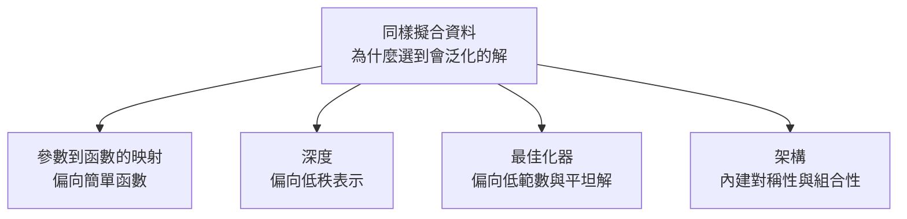

> 🌏 [English version](/posts/tech/2026-10-13-mit-67960-l06-generalization-theory-en)

**影片狀態：已附影片。** [影片來源與說明](#課程影片來源)

> **教材版本**：基於 **MIT 6.7960 Fall 2024 OCW**（對應 OCW Lec 06 Generalization Theory，Phillip Isola 主講）。本文依 OCW 官方逐字稿與投影片整理；逐字稿沒有時間戳，引用以段落內容定位。

---

## 這一堂要回答的問題

教科書說模型太大會過擬合，所以要控制參數數量。但現在的網路容量大到能把整份訓練資料背下來，連隨機標籤都背得起來，卻愈大愈好。哪裡出了問題？

[MIT 6.7960](https://ocw.mit.edu/courses/6-7960-deep-learning-fall-2024/) 第 6 堂的立場很坦白。Phillip Isola 開場就說這堂的內容「不是教科書教材」，是進行中的科學；他認為深度網路的泛化性質是這個領域最大的未解問題之一。所以這堂給的是兩件事：哪些古典解釋已經確定行不通，以及目前有哪幾條線索。

讀完這篇，你應該能：

- 分清楚近似、最佳化、泛化各自在問什麼。
- 說明參數數量與 VC 維度為什麼不能當深度網路的複雜度量尺，並各舉出一個反例。
- 看到 double descent 曲線時，說得出尖峰在哪裡、為什麼之後又下降。

先備是基本的機器學習概念（訓練誤差、測試誤差、過擬合）。架構的對稱性在[第 4 堂 CNN](/posts/tech/2026-08-30-mit-67960-cnn-architectures) 與[第 5 堂 GNN](/posts/tech/2026-08-30-mit-67960-gnn) 已經出現過。

## 三個問題：近似、最佳化、泛化

機器學習可以拆成三個問題：

| 問題 | 在問什麼 |
|---|---|
| 近似 | 這個函數族裡最好的那組參數 $\theta^*$，能把訓練誤差壓到多低？ |
| 最佳化 | 我們實際找得到 $\theta^*$ 嗎？ |
| 泛化 | 找到之後，訓練誤差與母體誤差差多少？ |

訓練時最小化的是**經驗風險**，也就是訓練資料上的平均損失。真正在乎的是**母體風險**：對資料生成過程的所有新樣本，期望損失是多少。兩者的差就是泛化誤差。

本系列前面幾堂（[第 3 堂近似理論](/posts/tech/2026-08-30-mit-67960-approximation-theory)）談的都是近似。這堂是第一次問：擬合好了，然後呢？

## 兩個壞模型

**檔案櫃**。把每筆訓練資料 $(x, y)$ 存進字典，查得到就回答 $y$，查不到就回答 0。它的近似誤差是 0，因為每筆訓練資料都答得出來；泛化則幾乎一定很差，除非真實函數剛好幾乎處處是 0。這就是純粹的記憶。

**章魚保羅**。靠游進哪一國國旗的水箱來預測足球賽勝負的那隻章魚，課堂上說牠 6 場猜中 6 場。牠不是檔案櫃，牠確實在做決定，只是剛好猜中。一個函數可以在訓練資料上全對，卻完全沒有學到足球。

這兩個例子界定了問題：只擬合訓練資料不足以保證泛化。深度網路到底比較像檔案櫃，還是別的東西？

## 深度網路是不是檔案櫃：一個計數實驗

拿同一組一維資料點，分別用檔案櫃與三層 ReLU 多層感知器擬合。兩者訓練誤差都是 0，但檔案櫃在資料點之間全部回答 0，多層感知器則畫出一條平滑的曲線。差別只在沒有資料的地方怎麼回答，而那正是泛化。

大型語言模型比較難判斷，因為訓練資料多到測試題可能本來就看過。Isola 提了一個計數的辦法：**假設模型是檔案櫃，那這個櫃子要多大？**

- 從 $m$ 個詞裡隨機抽 $n$ 個排成序列，共有 $m^n$ 種。
- 對模型問一個關於這個序列的問題，估計答對的比例 $p$。
- 檔案櫃要做到同樣的表現，至少要存 $p \times m^n$ 筆。

他的實驗用 30 種水果名、每次抽 10 個，問 GPT-4o「這份清單裡有幾種柑橘類」，5 次全對。

這裡有個數字要對一下。$30^{10} \approx 5.9 \times 10^{14}$，約 590 兆；課堂口頭與投影片寫的都是「100 trillion」（100 兆），與題目給的 30 與 10 對不上。教材裡還有兩處不一致：他口頭說成「10 的 30 次方」，投影片把 $n$ 與 $m$ 標反了；第二個實驗的 12.5 trillion 正好是 0.125 乘上 100 trillion，可見他一路用的就是 100 trillion。本文無法從教材確認他實際用的詞彙量與長度。不論取哪一個，結論不變：Isola 估計這類模型的訓練資料量在數十兆的等級，檔案櫃需要的筆數已經超過它。他也自己說這不是嚴謹的實驗，並建議有人拿去當期末專題認真做一次。

### 泛化到沒看過的分布

[pix2pix](https://arxiv.org/abs/1611.07004) 的例子更直接。模型用邊緣偵測器產生的邊緣圖訓練「草圖轉貓照片」，卻對手繪的貓也有效，而手繪圖與邊緣圖在統計上是不同的分布。畫三隻眼睛，它就在三個位置各放一隻眼睛，雖然訓練資料裡沒有三眼貓。

Isola 的解釋是卷積網路的歸納偏置：卷積把影像切成小塊，每一塊獨立而且用同一套方式處理。對每一塊來說，「看到橢圓就畫眼睛」都還在訓練分布內；多幾隻眼睛只是多幾塊。把問題拆成獨立的小決定，新的組合就不必另外學。

## 古典理論怎麼說

### 奧坎剃刀

泛化理論幾乎都是奧坎剃刀的變形：在**同樣能擬合資料**的解釋裡，選最簡單的。Isola 特別強調前半句常被漏掉。少了它就會得到「所以該用線性模型」這種荒謬結論。

最嚴格的版本來自 Solomonoff：能產生這份資料的**最短程式**，預測得最好。等價的說法是，最能壓縮資料的表示就是最好的模型。問題是要找最短程式得搜尋所有可能的程式，做不到。所以需要一個算得出來的複雜度量尺。

### 量尺一：參數數量

古典的看法是偏差與變異的取捨：容量加大，訓練誤差一路下降，測試誤差先降後升。

課堂用多項式回歸示範。真實函數是三次的，資料帶雜訊：

| 次數 $d$ | 結果 |
|---|---|
| 1 | 直線，擬合不足 |
| 3 | 幾乎重現真實函數 |
| 20 | 為了穿過每個雜訊點而劇烈擺盪，典型的過擬合 |
| 1000 | 仍然穿過每個點，但整體反而貼回平滑的真實函數，只在資料點上留下細小的尖刺 |

最後一列就是 **double descent**。測試誤差在模型剛好能背下全部訓練資料的地方（**插值門檻**）達到尖峰，之後容量再加大，誤差會再降一次。

Isola 的直覺是「簡單加尖刺」假說：容量剛好夠背資料時，只能用很扭曲的函數才做得到；容量再大，能背下資料的函數變成很多個，就可以在裡面挑最平滑的那個。學到的模型等於一個會泛化的平滑成分，加上一些只負責記住雜訊的尖刺。

支持這個說法的觀察是：特徵愈多，學到的權重向量的範數反而愈小。這在線性模型上可以證明，在深度網路上只是經驗觀察。

兩個實務提醒：

- double descent 在實驗裡不容易重現。Isola 說他自己試著做一個例子沒有成功。他接著說，讀相關論文會發現它只在特定條件下出現，動量、weight decay 這些常用做法都可能讓那個尖峰消失。在你的曲線上看不到是正常的。
- 現在的深度學習幾乎都在尖峰右邊，所以經驗法則是訓練愈久愈好。他也提到訓練時間上同樣有 double descent。

為什麼參數數量不是對的量尺？課堂給了一個思想實驗。令 $h(x) = 10^{-100} f(x) + (1 - 10^{-100})\, g(x)$，$f$ 有很多參數，$g$ 只有幾個。$h$ 名義上有 $f$ 加 $g$ 那麼多參數，但只用 $g$ 就能把它近似到 $10^{-100}$ 以內。重要的是參數的大小，不是個數。參數範數比較接近，但也不是全部的答案。

### 量尺二：能表示多少個函數

VC 理論換一種數法：數假設空間裡有多少個不同的函數。它的論證可以用一張圖說完。

把假設空間想成一堆圓點，每一點是一個候選函數。紫色的點能擬合訓練資料，其中只有一個綠色的是真實函數。假設你從紫色與綠色的點裡隨機挑一個：

- **加資料**：每筆新資料都是新的限制，一些紫點因此不再能擬合而熄滅。課堂的圖從 6 個候選變成 4 個，挑中真實函數的機率從 1/6 升到 1/4。
- **降容量**：直接拿掉一些圓點，同樣會減少碰巧擬合的紫點。

所以函數愈少、資料愈多，碰巧擬合卻不泛化的機率就愈低。連續的函數族沒辦法直接數，課堂的做法是數模型能在 $n$ 筆訓練資料上做出幾種不同的二元標記（dichotomy），記為 $d$，泛化誤差的界大致是 $\sqrt{d/n}$。這是課堂的簡化版本；教科書裡 VC 維度的正式定義與界的形式比較細，這堂沒有展開。

### VC 理論對深度網路失效

把一個資料集的標籤隨機打亂，神經網路仍然能把訓練準確率推到 100%。這是 Zhang 等人 2017 年論文 [Understanding deep learning requires rethinking generalization](https://arxiv.org/abs/1611.03530) 的實驗。

這表示網路幾乎能做出任何一種標記，$n$ 筆資料共有 $2^n$ 種，所以 $d = 2^n$。代進界裡是 $\sqrt{2^n / n}$，隨 $n$ 指數成長。用本文自擬的小數字算一次：$n = 10$ 時，$\sqrt{1024/10} \approx 10.1$。分類錯誤率最高就是 1，一個說「誤差不超過 10.1」的界沒有提供任何資訊。這種界稱為空洞的（vacuous）。

同一篇論文的另一半更關鍵：同一個網路用真實標籤訓練，測試準確率很高；用隨機標籤訓練，測試準確率就垮掉。兩種情況的容量完全一樣，所以容量本身無法區分會泛化與不會泛化的解。

Isola 認為 VC 理論的思考方向是對的，但它的假設被違反了，其中最主要的一個是：它假設你從能擬合資料的函數裡**隨機**挑一個。梯度下降不是隨機挑的。

## 擬合資料之外，還有什麼壓力

所有能把訓練誤差降到 0 的參數設定，合稱 **version space**。裡面有會泛化的解，也有檔案櫃。問題變成：為什麼訓練最後落在好的那一邊？Isola 列了四條線索，並說明這些都還不是定論。



**一、參數到函數的映射偏向簡單。** 許多組不同的參數會對應到同一個函數。[Valle-Pérez 等人](https://arxiv.org/abs/1805.08522)的經驗觀察是：隨機抽一組參數，對應到的函數大多是簡單的（以 Lempel-Ziv 壓縮複雜度衡量）。參數空間的大部分體積都對應簡單函數，所以訓練把參數推進 version space 時，碰巧落在簡單那一角。

**二、深度偏向低秩。** Isola 參與的[一篇論文](https://arxiv.org/abs/2103.10427)用網路輸出的核矩陣（每兩筆資料的表示有多相似）的秩來衡量簡單程度。秩愈低，資料被分成愈清楚的群。一般的說法是深的網路容量大，所以分群分得好；但把非線性全部拿掉，只疊線性層，也有同樣的效果。深的線性網路等價於一個線性變換，容量沒有增加，所以「容量」解釋不了這件事。他們的解釋是矩陣連乘傾向於低秩：網路愈深，參數空間裡對應到低秩表示的體積就愈大。

**三、最佳化器的偏好。**

- Weight decay 每一步把權重往 0 縮一點，沒有在用的權重會趨近 0。
- 初始化在 0 附近，本身就偏向低範數的解。
- 固定步長的梯度下降踩不進又窄又尖的谷，會直接跨過去，所以傾向停在寬而平的谷底。有論證認為平坦的極小值泛化得比較好，課堂沒有展開。

**四、架構的對稱性。** Isola 明說他認為這一項最重要。

- 不變性：最大池化對被池化的那個維度不變。
- 等變性：卷積對平移等變，圖網路對節點重新編號等變。只看過某些排列，就能泛化到其他排列，不必從資料裡學。
- 組合性：把輸入切成零件，各自處理，再用架構規定好的方式拼回去。拼接的規則不是學來的。

他先說自己不確定，但認為 ChatGPT 這類模型的泛化，很大一部分來自它把世界切成詞、句、段這些零件，而零件的組合方式由架構決定。把領域知識寫進架構（例如 NeRF 內建透視投影與光傳輸的方程式）也是同一類做法：資料加上結構限制。

## 回到最短程式

課堂最後回到 Solomonoff。找**最短**的程式做不到，但也許不必最短，**夠短**就可以。

Isola 轉述他大約 2018 年與 Ilya Sutskever 的一段對話，並強調是憑記憶、不是逐字引述。Sutskever 說深度網路會泛化，是因為它找到能擬合資料的小電路。Isola 反問：網路那麼大，不是還需要別的東西把它推向小電路嗎？Sutskever 的回答是：不用，網路是有限的就夠了，資料夠多的時候任何有限的東西看起來都很小。

## 常見誤解

- **「奧坎剃刀說最簡單的模型最好」**：漏了「能擬合資料」這個前提。
- **「過擬合的模型一定泛化很差」**：過了插值門檻，把訓練資料（連同雜訊）完全背下來的模型，測試誤差可以比門檻附近低。
- **「網路能背下隨機標籤，所以它平常也在背」**：容量夠背不代表訓練真實資料時走的是那條路。同一個網路在真實標籤上會泛化。
- **「double descent 是深度學習才有的」**：多項式回歸與隨機特徵模型都有，而且那裡可以證明。

## 自我檢查

1. 一個模型訓練誤差 0、測試誤差很高。這是近似、最佳化還是泛化出了問題？
   **答**：泛化。近似與最佳化都成功了（找到了訓練誤差為 0 的參數），是訓練與母體之間的落差太大。
2. 你把模型寬度加倍，測試誤差變差了。依這堂的內容，接下來可能看到什麼？
   **答**：你可能正在接近插值門檻的尖峰。繼續加寬，測試誤差有可能再降下來；但如果訓練時用了 weight decay 或動量，尖峰本來就可能不明顯。
3. 為什麼深的線性網路是「深度偏向低秩」這個說法的關鍵證據？
   **答**：它的容量與單層線性網路相同，卻一樣出現更低秩、更成群的表示，所以這個現象不能歸因於容量增加。
4. VC 界的算例把 $n$ 改成 20，界是多少？為什麼它沒有資訊？
   **答**：$\sqrt{2^{20}/20} \approx 229$。錯誤率最高是 1，說它不超過 229 等於什麼都沒說；而且 $n$ 愈大這個界愈大，與「資料愈多愈可靠」的直覺相反。參數數量的反例則是 $h(x)$ 那個思想實驗：參數很多，但用幾個參數的 $g$ 就能近似。
5. 用投影片的圓點圖：原本 6 個候選能擬合資料，加資料後剩 4 個。再把假設空間砍半，隨機拿掉的剛好是 2 個錯的候選，挑中真實函數的機率是多少？
   **答**：剩 2 個候選（1 個真實、1 個錯的），機率是 1/2。前提是真實函數沒有被拿掉，這也是 VC 論證的假設之一。

## 課程影片來源

2026-10-13 已即時回 MIT OCW Fall 2024 官方錄影列表核對講次，影片公開且允許嵌入；講次與主題以 OCW 的標示為準。OCW 錄影列表把這堂標為 Generalization Theory，投影片標題是 Neural Network Generalization，是同一堂。

```youtube
url: https://www.youtube.com/watch?v=EiO8BBa-xdc
title: MIT 6.7960 Fall 2024 — Lec 06. Generalization Theory
```

原始影片：[MIT 6.7960 Fall 2024 — Lec 06. Generalization Theory](https://www.youtube.com/watch?v=EiO8BBa-xdc)

課程與錄影入口：

- [MIT OCW — Lec 06. Generalization Theory](https://ocw.mit.edu/courses/6-7960-deep-learning-fall-2024/resources/mit6_7960f24_lec06_mp4/)
- [MIT 6.7960 Fall 2024 — official lecture video gallery](https://ocw.mit.edu/courses/6-7960-deep-learning-fall-2024/video_galleries/lecture-videos/)

查核日期：2026-10-13。

內容核對：已依字幕核對（2026-10-13）：讀了 OCW 官方逐字稿全文與投影片。逐字稿沒有時間戳，本文未回聽原音。計數實驗的「100 trillion」與題目給的 30 種、抽 10 個對不上，已在正文標明；VC 界的 $n=10$ 算例是本文自擬。

## 參考資料

- [MIT 6.7960 Fall 2024 OCW 課程首頁](https://ocw.mit.edu/courses/6-7960-deep-learning-fall-2024/)
- [Lec 06 官方逐字稿（PDF）](https://ocw.mit.edu/courses/6-7960-deep-learning-fall-2024/mit6_7960f24_lec06_transcript.pdf)
- [Lecture 6: Neural Network Generalization 投影片](https://ocw.mit.edu/courses/6-7960-deep-learning-fall-2024/resources/mit6_7960_f24_lec6_pdf/)
- Zhang et al.，[Understanding deep learning requires rethinking generalization](https://arxiv.org/abs/1611.03530)（2017）
- Belkin, Hsu, Ma, Mandal，[Reconciling modern machine learning practice and the bias-variance trade-off](https://arxiv.org/abs/1812.11118)（PNAS 2019，double descent）
- Valle-Pérez, Camargo, Louis，[Deep learning generalizes because the parameter-function map is biased towards simple functions](https://arxiv.org/abs/1805.08522)（ICLR 2019）
- Huh et al.，[The Low-Rank Simplicity Bias in Deep Networks](https://arxiv.org/abs/2103.10427)（TMLR 2023）
- Isola, Zhu, Zhou, Efros，[Image-to-Image Translation with Conditional Adversarial Networks](https://arxiv.org/abs/1611.07004)（pix2pix）
