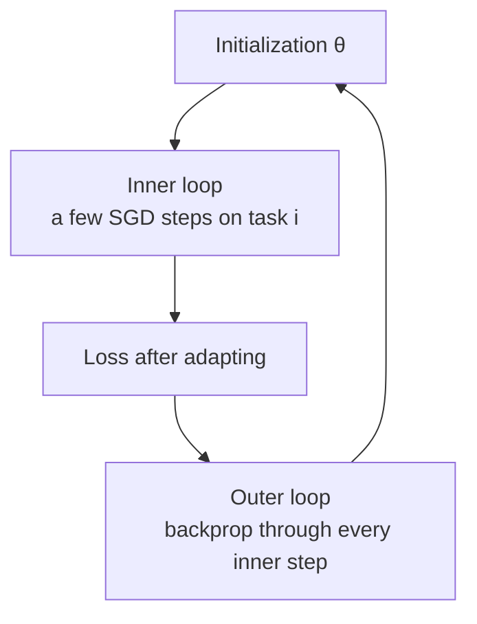

> 🌏 [中文版](/posts/tech/2026-10-13-mit-67960-l19-transfer-learning-data)

**Video status: Videos included.** [Video source and notes](#lecture-video-source)

> **Edition**: based on **MIT 6.7960 Fall 2024 OCW** (OCW Lec 19, Transfer Learning: Data, taught by Sara Beery). This post is written from the official OCW transcript and slides. The transcript has no timestamps, so references point to content rather than times.

---

## The Question This Lecture Answers

You already have a dataset, and you trained a generative model on it. Everything the model produces was learned from that data, so what can it give you that the data could not?

[MIT 6.7960](https://ocw.mit.edu/courses/6-7960-deep-learning-fall-2024/) splits transfer learning into three kinds of knowledge you can transfer: about the mapping, about the outputs, and about the inputs. [Lecture 18](/posts/tech/2026-08-30-mit-67960-l18-transfer-learning-en) approaches it from the model side; this lecture covers the third kind, in two parts:

1. Treating a generative model as **data++**, data with an operating interface the original lacks.
2. **Meta-learning**: not just doing transfer, but training a model that is good at being transferred.

After this post you should be able to:

- Name the four operations data++ adds and give a use for each.
- Judge whether images obtained by moving along a latent direction can serve as training data, and where the risk lies.
- Work one step of MAML by hand and see how its learned initialization differs from ordinary pretraining.

Prerequisites are the latent spaces of GANs and VAEs ([Lecture 15](/posts/tech/2026-08-30-mit-67960-l15-vae-en)) and contrastive learning ([Lecture 12](/posts/tech/2026-08-30-mit-67960-l12-representation-similarity-en)).

## Data++: Data Plus a Generator

Sara Beery quotes the release announcement of the first Stable Diffusion model: the release compresses "the visual information of humanity into a few gigabytes." Seen that way, a generative model is data compression, and what comes out of the compression can be operated on.

Write one data++ object as four things together: the original data $x$, the latent variables $z$, the generator $G$ (from $z$ to $x$), and the inverse mapping $G^{-1}$ (from $x$ back to $z$). With these four you can define operations the raw data does not support:

| Operation | Meaning | Use |
|---|---|---|
| Interpolation | Take a point between two points (or two data++ objects) | Samples that lie between the two |
| Manipulation | Add an offset in some direction | Counterfactuals: "what would it look like at night" |
| Composition | Combine different parts of two objects | Swap backgrounds, swap objects |
| Optimization | Find the point that maximizes some objective | Explain a classifier, design a sample |

The "Use" column is this post's mapping, drawn from the examples later on; the lecture lists only the application areas of graphics, visualization, data augmentation and counterfactual reasoning. Beery notes that all of this is work in progress.

Walk one cat photo through the four operations (an example written for this post). First find its $z$ with $G^{-1}$. **Interpolation**: generate from the midpoint between its $z$ and another cat's, giving a cat between the two. **Manipulation**: add the "night" direction to $z$ to get the same cat at night. **Composition**: keep the part that corresponds to this cat and swap in the background part of another image. **Optimization**: change $z$ in the direction that raises a classifier's "dog" score fastest and see which features change first; the idea behind StylEx below is close to this. All four need $z$ and $G$; a stack of photos alone cannot do them.

## Directions in Latent Space

The generator maps every point in latent space to an image. If some direction happens to correspond to a single factor of variation (a bird's orientation, lighting, season), that direction is a control lever.

**How to find a direction.** The most direct way is experimental: take day and night images of the same scene, find each one's latent point with $G^{-1}$, and subtract; the difference is the "make it night" direction. Averaging many such differences gives a direction that does not depend on the input. The lecture shows directions for zooming in and out, shifting, brightening, darkening, winter to spring, turning on the lights, and a volcano erupting. Text shows the same thing: the [word2vec](https://arxiv.org/abs/1301.3781) embedding space has a direction that corresponds to verb tense.

**Three caveats**:

- **Cherry-picked examples.** A student asks whether these directions are linearly independent. Beery answers that the assumption is that separable directions exist, but in practice they are hard to find and papers often show only the ones that worked; the higher the dimension of the latent space, the harder it is to disentangle cleanly.
- **Directions carry the bias of the data.** Darken an image of a volcano and the model makes it erupt, because nobody photographs a non-erupting volcano at night.
- **Directions can cross a class boundary.** If the task is cat versus dog, moving nearby in latent space is usually harmless; if the task is cat breed, slightly longer ears can already be a different breed. Which variations are safe depends on the problem you are solving.

### Which Space to Interpolate In

Interpolate linearly in pixel space between a bird and a fly and the midpoint is two pictures superimposed, nothing like a real image, because the straight line leaves the manifold of natural images. Interpolate linearly in latent space and the path in data space is curved, with every point mapped back onto the manifold by the generator. [BigGAN](https://arxiv.org/abs/1809.11096) interpolations therefore look like photographs, even if the middle shows something half bird and half fly.

But the input $z$ space is not necessarily the best place to interpolate. Forcing a curved data manifold into a Gaussian is like crumpling a sheet of paper into a ball: two points that are neighbors in latent space can be far apart in data space. A straight line that crosses such a seam makes the image jump.

[StyleGAN](https://arxiv.org/abs/1812.04948) found that a representation from the middle of the model (called the $W$ space) is a better latent space than the input $z$. Beery's explanation is that the intermediate space is less distorted and less likely to hit a seam; her verdict on that claim is "empirically and qualitatively, that's sometimes true." The follow-up [StyleSpace](https://arxiv.org/abs/2011.12799) isolates very fine controls in such an intermediate space, like a car's hood style, headlight shape and body color, and she says the qualitative results are really nice.

## Three Ways to Use It

### Expanding a Few Labels into a Whole Dataset

Semantic segmentation labels are expensive, and object boundaries are the slowest part. [DatasetGAN](https://arxiv.org/abs/2104.06490) works like this:

1. The generator's intermediate features keep spatial structure and are organized more semantically than pixels.
2. Manually label only a very small number of generated images and train a lightweight model that predicts a part label for each pixel from those features.
3. Generate images in bulk and produce labels with that lightweight model at the same time, giving a large (weakly labeled) dataset.
4. Train a segmentation model on the synthetic data and test it on real data.

The efficiency the paper reports: one labeled GAN image is worth about 100 ordinary labeled images.

Beery adds that people doing segmentation today mostly start from a foundation model like [Segment Anything](https://arxiv.org/abs/2304.02643). The idea underneath is the same: a well-organized representation space first, a lightweight predictor on top.

### Explaining a Classifier

An ordinary classifier gives only an answer. With data++ you can ask the reverse: how must this image change for the prediction to change?

[StylEx](https://arxiv.org/abs/2104.13369) maps an image into latent space and finds the top few directions that most change the classifier's output. For a cat-versus-dog classifier the directions include opening the mouth (dogs pant more), pupil size relative to the eye, and how pointy the ears are.

The same method exposes bias. For a classifier that predicts perceived age, the directions that make the prediction younger include thicker eyebrows and lighter skin. Those are not features you want a model to rely on.

On medical images it can build trust. For a retinal fundus classifier, the top four attributes found (exudates, cotton wool spots, hemorrhages, clustered exudates) agree with what doctors actually look for, which suggests the model is not leaning on odd correlations.

The limitation is that these directions must be found and interpreted by hand, one at a time. Newer work uses text-conditioned diffusion models instead: describe the counterfactual in words ("a plate in the grass," "an empty plate"), generate the images, and measure model performance on them. [Dataset Interfaces](https://arxiv.org/abs/2302.07865) probes bias this way without paging through the whole dataset.

### A Data Source for Representation Learning

Contrastive learning needs two views of the same thing. The standard approach (SimCLR and its relatives) builds views with crops, flips and color changes. [Jahanian et al.](https://arxiv.org/abs/2106.05258) build them in latent space instead: sample within a small ball around a point, and treat the generated images as different views of the same thing.

The numbers cited in class (top-1 accuracy, linear transfer on ImageNet-1000):

| Training | Accuracy |
|---|---|
| Contrastive learning on real data | 43.9% |
| Generated data only, no latent views | 35.7% |
| Generated data with latent views | 42.6% |

Latent views add almost 7 points, but real data still wins. Beery states the conclusion cautiously: if the generative model is good enough it could outperform real data, but for uncommon things generators are not good enough.

## Can Generated Data Hold More Than the Original?

The lecture keeps returning to this question, and it is not settled.

**Against**: from an information-theoretic view the data is all the information you have, and you cannot create something from nothing.

**For**: architecture and training procedure inject knowledge that is not in the data. The design of a convolutional net already says "images have local structure." Random flipping counts as an image generation algorithm too: take an image and produce a new one guaranteed to be the same class. Copy-paste augmentation is closer still to a generative model, since it assumes foreground objects can be placed on different backgrounds. She asks how that is any different from learning a generator that interpolates on the image manifold, and says the question is "a bit semantic."

Beery says her own research goal is to recognize rare classes better with generative models, but it is a chicken-and-egg problem: the thing is rare, so you cannot train a model that generates it well. She says plainly that some papers claiming gains on rare classes from generative models "cheat" by training the generator on a lot of data.

Some concrete limits:

- **Diversity versus fidelity.** Knowing that two very different images are the same class is more useful than knowing that two nearly identical ones are. But ask a generator for robins in different poses and scenes and the outputs often stop looking like robins. There seems to be a Pareto frontier between the two.
- **How far still counts as the same class.** A student asks how far you can move in latent space and whether that distance is the same for every class. Beery admits that in papers this is just a hyperparameter: set a radius and keep the one that does best on test data. She finds that disappointing, because the question itself is interesting. Knowing where a class boundary lies requires having seen all the real variation in that class, which is also why few-shot learning is hard.
- **Shape is harder to change than texture.** Her observation is that generators have strong shape priors: a furry baseball is easy, a star-shaped baseball is somewhat harder, and a toucan with a short beak is nearly impossible to get.
- **Unrealistic data can still raise test scores.** Guide a generator with a classifier and you can get better numbers on a given test set, even when what is generated is "Bigfoot with a crow texture." Whether that corresponds to improvement in the real world is hard to quantify.
- **Model collapse.** Once more of the training data is generated than real, a vicious cycle sets in and parts of the distribution that the real data covered start to disappear. With more and more text on the internet being generated, this is a very active research area.

On class boundaries the lecture turns philosophical for a while. A student argues this is a shortcoming of classification as an objective, and that CLIP's approach of aligning images with text descriptions is better. Beery responds that for any fixed list of attributes you can find a counterexample, and where to draw a boundary ultimately depends on what you need the representation space to do. A person recognizes an albino robin at a glance; she argues models like CLIP still cannot capture that well.

## Learning to Learn

Everything above asks "given a pretrained model, how do we adapt it quickly." Meta-learning asks whether we can directly train a model that is easy to adapt.

### MAML

[MAML](https://arxiv.org/abs/1703.03400) (Model-Agnostic Meta-Learning; Finn, Abbeel, Levine, 2017) learns an **initialization** from which a few steps of SGD are enough to adapt to a new task. The algorithm is two nested loops:



The outer loop backpropagates through the steps of SGD. That is possible because one SGD step is itself a forward pass plus a backward pass. Here the lecture recalls a point made earlier (it corresponds to backpropagation in [Lecture 2](/posts/tech/2026-10-13-mit-67960-l02-how-to-train-a-neural-net-en)): forward plus backward unrolls into one large forward pass. The cost is that once all the nested loops are unrolled, you are optimizing through a very deep computation graph, which is expensive.

### One Step by Hand: How a MAML Initialization Differs from Pretraining

The following is a teaching example written for this post, not material from the lecture.

Two one-dimensional tasks, each with loss $L_i(\theta) = \tfrac12 c_i (\theta - a_i)^2$:

| Task | Optimum $a_i$ | Curvature $c_i$ |
|---|---|---|
| A | 0 | 1 |
| B | 4 | 3 |

**Ordinary pretraining** minimizes the sum of the two losses, and the solution is the curvature-weighted average: $\theta = (1 \times 0 + 3 \times 4)/(1+3) = 3$. It leans toward task B, which has the larger curvature.

**MAML** minimizes the loss after one adaptation step. Take the inner learning rate $\alpha = 0.25$ and step once:

$$
\theta_i' = \theta - \alpha c_i (\theta - a_i) \quad\Rightarrow\quad \theta_i' - a_i = (1 - \alpha c_i)(\theta - a_i)
$$

So the post-adaptation loss is $\tfrac12 c_i (1-\alpha c_i)^2 (\theta - a_i)^2$. The coefficient for task A is $1 \times 0.75^2 = 0.5625$ and for task B $3 \times 0.25^2 = 0.1875$. Minimizing their sum:

$$
\theta = \frac{0.5625 \times 0 + 0.1875 \times 4}{0.5625 + 0.1875} = 1
$$

Compare the total loss after one adaptation step from each initialization:

| Initialization | A after adapting | B after adapting | Total |
|---|---|---|---|
| Pretraining, $\theta = 3$ | 2.531 | 0.094 | 2.625 |
| MAML, $\theta = 1$ | 0.281 | 0.844 | 1.125 |

What the result means: task B has high curvature and covers three quarters of the distance in one step, so the initialization need not sit near it; task A moves slowly, so the initialization has to be placed near it. MAML learns "where to start so that every task is easy to catch up to," not "where the average loss is lowest." If the two tasks had the same curvature, both methods would give the same initialization; in this toy example the entire difference comes from the curvatures being different.

### Is It Worth It in Practice?

Beery's assessment is blunt: the gains from methods like MAML are often not worth the extra compute at training time, and are sometimes worse than pretraining on all the datasets together and fine-tuning.

She gives one case where it works. [TIML by Tseng et al.](https://arxiv.org/abs/2202.02124) adds a geospatial embedding that encodes task context into meta-learning, applied to crop type classification (maize, for example) across countries. Plain meta-learning and pretraining perform about the same; with task conditioning the model can specialize to a country or region, and only then does a clear gain appear.

### In-Context Learning Is Meta-Learning Too

Change the definition: "learning" takes a sequence $(x_0, y_0), (x_1, y_1), \dots$ as input and outputs a function $f$ that answers $y$ for a new $x$.

For an RNN or an autoregressive model, the hidden state after reading the examples, together with the parameters, is that $f$. Give a few English and Spanish pairs, then one English sentence, and the model continues with the Spanish. During training the model sees a huge variety of sequences and is asked to work out quickly what comes next, which is the same motivation as meta-learning.

Beery's view is that GPT-style models are doing meta-learning at large scale, and that sequence modeling may give a much better result than the inner-and-outer-loop approach.

## Common Misunderstandings

- **"Each latent dimension corresponds to one semantic factor."** No. Meaningful directions have to be searched for, and what is found is usually only a subset.
- **"More generated data is always better."** Too high a generated share leads to model collapse, and generators are least reliable on rare classes.
- **"If synthetic data raises the test score, the model is better."** It may only be tracing one classifier's boundary more closely, which need not match the real world.
- **"MAML always beats pretraining plus fine-tuning."** The lecture says it is often not worth the extra compute, and gives one case where a clear gain appeared only after task context was added.

## Check Yourself

1. You want to use a "darken" latent direction to augment a volcano dataset for an "is it erupting" classifier. What goes wrong?
   **Answer**: the direction is entangled with eruption. Darkening the image also makes the volcano erupt, but the label does not change with it, so you are manufacturing wrong labels.
2. Why is interpolating in $W$ space usually better than in $z$ space?
   **Answer**: $z$ is forced to follow a Gaussian, so the data manifold is crumpled more severely and neighboring latent points can map to distant data points; the intermediate space is less distorted, so a straight line is less likely to cross a seam.
3. In the MAML example above, change $\alpha$ to $1/3$. What does the MAML initialization become?
   **Answer**: the coefficient for task B is $3 \times (1 - 1)^2 = 0$, meaning B reaches its optimum in one step from anywhere. The initialization only has to serve task A, so $\theta = 0$.
4. Which data++ operation does each of these correspond to? (a) Turning a portrait into a version with glasses; (b) finding the change that most makes an age classifier call a person young; (c) producing a series of faces between two faces; (d) putting a car into the street scene of another image.
   **Answer**: (a) manipulation, an offset along the "glasses" direction; (b) optimization, with the classifier output as the objective; (c) interpolation; (d) composition.
5. Viewing in-context learning as meta-learning, what corresponds to MAML's inner-loop adaptation?
   **Answer**: the hidden state (or the context the attention sees) updated by reading the examples in the prompt. The parameters do not change; adaptation happens inside the forward pass.

## Lecture Video Source

Rechecked against the live MIT OCW Fall 2024 gallery on 2026-10-13: the lecture number matches and the video is public and embeddable. Lecture numbering and topics follow OCW. The gallery titles this lecture Transfer Learning: Data and the slide deck is titled Transfer Learning II; they are the same lecture.

```youtube
url: https://www.youtube.com/watch?v=RUdQMHV-7KM
title: MIT 6.7960 Fall 2024 — Lec 19. Transfer Learning: Data
```

Original video: [MIT 6.7960 Fall 2024 — Lec 19. Transfer Learning: Data](https://www.youtube.com/watch?v=RUdQMHV-7KM)

Course and recording links:

- [MIT OCW — Lec 19. Transfer Learning: Data](https://ocw.mit.edu/courses/6-7960-deep-learning-fall-2024/resources/mit6_7960f24_lec19_mp4/)
- [MIT 6.7960 Fall 2024 — official lecture video gallery](https://ocw.mit.edu/courses/6-7960-deep-learning-fall-2024/video_galleries/lecture-videos/)

Checked: 2026-10-13.

Content check: verified against the video transcript (2026-10-13): read the full official OCW transcript and the slides. The transcript has no timestamps and the audio was not replayed for this post. The figures from papers (the 100x labeling efficiency, 43.9% / 35.7% / 42.6%) are the ones cited in class and on the slides and were not rechecked against the original papers for this post; the one-dimensional MAML example is this post's own.

## References

- [MIT 6.7960 Fall 2024 OCW course home](https://ocw.mit.edu/courses/6-7960-deep-learning-fall-2024/)
- [Lec 19 official transcript (PDF)](https://ocw.mit.edu/courses/6-7960-deep-learning-fall-2024/mit6_7960f24_lec19_transcript.pdf)
- [Lecture 19: Transfer Learning II slides](https://ocw.mit.edu/courses/6-7960-deep-learning-fall-2024/resources/mit6_7960_f24_lec19_pdf/)
- Karras, Laine, Aila, [A Style-Based Generator Architecture for Generative Adversarial Networks](https://arxiv.org/abs/1812.04948) (StyleGAN)
- Brock, Donahue, Simonyan, [Large Scale GAN Training for High Fidelity Natural Image Synthesis](https://arxiv.org/abs/1809.11096) (BigGAN)
- Wu, Lischinski, Shechtman, [StyleSpace Analysis](https://arxiv.org/abs/2011.12799)
- Zhang et al., [DatasetGAN](https://arxiv.org/abs/2104.06490) (CVPR 2021)
- Lang et al., [Explaining in Style: Training a GAN to explain a classifier in StyleSpace](https://arxiv.org/abs/2104.13369) (ICCV 2021)
- Vendrow et al., [Dataset Interfaces: Diagnosing Model Failures Using Controllable Counterfactual Generation](https://arxiv.org/abs/2302.07865)
- Jahanian, Puig, Tian, Isola, [Generative Models as a Data Source for Multiview Representation Learning](https://arxiv.org/abs/2106.05258) (ICLR 2022)
- Kirillov et al., [Segment Anything](https://arxiv.org/abs/2304.02643)
- Mikolov et al., [Efficient Estimation of Word Representations in Vector Space](https://arxiv.org/abs/1301.3781) (word2vec)
- Finn, Abbeel, Levine, [Model-Agnostic Meta-Learning for Fast Adaptation of Deep Networks](https://arxiv.org/abs/1703.03400) (MAML)
- Tseng et al., [TIML: Task-Informed Meta-Learning for Agriculture](https://arxiv.org/abs/2202.02124)
