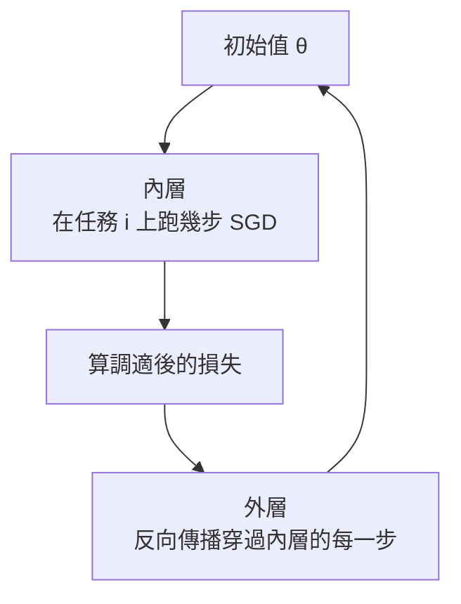

> 🌏 [English version](/posts/tech/2026-10-13-mit-67960-l19-transfer-learning-data-en)

**影片狀態：已附影片。** [影片來源與說明](#課程影片來源)

> **教材版本**：基於 **MIT 6.7960 Fall 2024 OCW**（對應 OCW Lec 19 Transfer Learning: Data，Sara Beery 主講）。本文依 OCW 官方逐字稿與投影片整理；逐字稿沒有時間戳，引用以段落內容定位。

---

## 這一堂要回答的問題

你已經有一份資料集，又拿它訓練了一個生成模型。這個模型吐出來的東西都是從原資料學來的，它還能給你什麼原資料沒有的？

[MIT 6.7960](https://ocw.mit.edu/courses/6-7960-deep-learning-fall-2024/) 把遷移學習拆成三種可以轉移的知識：關於映射的、關於輸出的、關於輸入的。[第 18 堂](/posts/tech/2026-08-30-mit-67960-l18-transfer-learning)從模型那一側談，這堂談第三種，分成兩部分：

1. 把生成模型當成 **data++**，也就是比原資料多了操作介面的資料。
2. **元學習**（meta-learning）：不只做遷移，而是訓練一個擅長被遷移的模型。

讀完這篇，你應該能：

- 說出 data++ 多了哪四種操作，並各舉一個用途。
- 判斷「沿潛在方向移動」得到的影像能不能拿來當訓練資料，以及風險在哪。
- 手算一步 MAML，看出它學到的初始值與一般預訓練差在哪裡。

先備是 GAN、VAE 的潛在空間（[第 15 堂](/posts/tech/2026-08-30-mit-67960-l15-vae)）與對比學習（[第 12 堂](/posts/tech/2026-08-30-mit-67960-l12-representation-similarity)）。

## Data++：資料加上生成器

Sara Beery 引了第一版 Stable Diffusion 發布時的一句話：這次發布是把「人類的視覺資訊壓縮成幾 GB 的單一檔案」。換個角度看，生成模型是一種資料壓縮，而且壓縮後的東西可以操作。

把一份 data++ 寫成四樣東西的組合：原始資料 $x$、潛在變數 $z$、生成器 $G$（從 $z$ 到 $x$）、以及反向映射 $G^{-1}$（從 $x$ 找回 $z$）。有了這四樣，就能定義原始資料做不到的操作：

| 操作 | 意思 | 用途 |
|---|---|---|
| 內插 | 在兩個點（或兩份 data++）之間取中間值 | 產生介於兩者之間的樣本 |
| 操弄 | 往某個方向加一個偏移 | 反事實：「如果是晚上會長怎樣」 |
| 組合 | 把兩份的不同部分拼起來 | 換背景、換物件 |
| 最佳化 | 找出讓某個目標最大的那一點 | 解釋分類器、設計樣本 |

「用途」一欄是本文依後面的例子整理的對應；課堂只列出圖學、視覺化、資料增強、反事實推理這幾個應用方向。Beery 提醒這些都還是進行中的研究。

用一張貓的照片把四種操作走一遍（本文的例子）。先用 $G^{-1}$ 找到它的 $z$。**內插**：取它與另一隻貓的 $z$ 的中點再生成，得到介於兩隻之間的貓。**操弄**：把 $z$ 加上「夜晚」方向，得到同一隻貓在晚上的樣子。**組合**：保留這隻貓對應的部分、換上另一張圖的背景部分。**最佳化**：沿著讓分類器的「狗」分數上升最快的方向改 $z$，看是哪些特徵先變；後面 StylEx 的想法與此相近。四種操作都需要 $z$ 與 $G$，只有一疊照片做不到。

## 潛在空間的方向

生成器把潛在空間的每一點對應到一張影像。如果某個方向剛好對應到單一的變化因素（鳥的朝向、光線、季節），這個方向就是一個控制桿。

**怎麼找方向**。最直接的做法是實驗：拿同一個場景的白天與夜晚影像，各自用 $G^{-1}$ 找到潛在點，兩點相減就是「變成夜晚」的方向。把很多組這樣的差取平均，可以得到與輸入無關的方向。課堂展示了放大、縮小、平移、變亮、變暗、冬天變春天、開燈、火山爆發等方向。文字也有同樣的現象：[word2vec](https://arxiv.org/abs/1301.3781) 的嵌入空間裡有一個方向對應動詞時態。

**三個但書**：

- **挑過的例子**。有學生問這些方向是不是線性獨立。Beery 的回答是：假設上存在可以分開的方向，實際上很難找，論文常常只展示找到的那幾個；潛在空間維度愈高，愈難乾淨地拆開。
- **方向帶著資料的偏誤**。把火山的影像變暗，模型會讓它噴發，因為沒有人在晚上拍沒噴發的火山。
- **方向可能跨過類別邊界**。如果任務是分辨貓與狗，在潛在空間附近移動通常不會出事；如果任務是分辨貓的品種，耳朵長一點就可能變成另一個品種。哪些變化是安全的，取決於你要解的問題。

### 在哪個空間內插

在像素空間對一隻鳥與一隻蒼蠅做線性內插，中間得到的是兩張圖疊在一起，完全不像真實影像，因為直線離開了自然影像的流形。在潛在空間做線性內插，對應到資料空間是一條彎曲的路徑，而且每一點都被生成器映回流形上。[BigGAN](https://arxiv.org/abs/1809.11096) 的內插因此看起來像照片，雖然中間會出現半鳥半蠅的東西。

但輸入端的 $z$ 空間不一定是最好的內插位置。把一個彎曲的資料流形硬塞進高斯分布，像把一張紙揉成球：潛在空間裡相鄰的兩點，在資料空間可能隔很遠。直線內插一旦跨過這種接縫，影像就會突然跳變。

[StyleGAN](https://arxiv.org/abs/1812.04948) 的發現是，模型中間層的表示（稱為 $W$ 空間）比輸入的 $z$ 更適合當潛在空間。Beery 的解釋是中間層扭曲得比較少，比較不會踩到接縫；她對這個說法的評語是「經驗上、定性上，有時候成立」。後續的 [StyleSpace](https://arxiv.org/abs/2011.12799) 在這類中間空間裡分離出很細的控制，例如車子的引擎蓋樣式、頭燈形狀、車身顏色，她說定性的結果很漂亮。

## 三種用法

### 用少量標註擴出整份資料集

語意分割的標註很貴，物件邊界尤其花時間。[DatasetGAN](https://arxiv.org/abs/2104.06490) 的做法：

1. 生成器的中間特徵保有空間結構，而且語意上排列得比像素整齊。
2. 只人工標註很少數的生成影像，訓練一個很輕的模型，從這些特徵預測每個像素的部位標籤。
3. 用生成器大量產生影像，同時用那個輕模型產生標籤，得到一份大的（弱標註）資料集。
4. 拿這份合成資料訓練分割模型，在真實資料上測試。

論文報告的效率是：一張標註過的 GAN 影像大約抵 100 張一般的標註影像。

Beery 補充，現在做分割的人多半從 [Segment Anything](https://arxiv.org/abs/2304.02643) 這類基礎模型出發。背後的想法相同：先有一個排列良好的表示空間，上面再接很輕的預測器。

### 解釋分類器

一般的分類器只給答案。有了 data++，可以反過來問：這張圖要怎麼改，預測才會變？

[StylEx](https://arxiv.org/abs/2104.13369) 把影像映到潛在空間，找出最能改變分類器輸出的前幾個方向。在貓狗分類器上，找到的方向包括張開嘴巴（狗比較常喘氣）、瞳孔相對眼睛的大小、耳朵尖不尖。

同一個方法也會照出偏誤。在一個預測年齡的分類器上，讓預測變年輕的方向包括眉毛變粗與膚色變淺。這些不是你希望模型依賴的特徵。

用在醫療影像時，它可以用來建立信任。在視網膜眼底影像的分類器上，找到的前四個屬性（滲出物、棉絮斑、出血、成群的滲出物）與醫師實際在看的特徵一致，表示模型沒有依賴奇怪的相關性。

限制是這些方向得靠人逐一找出來、逐一解讀。比較新的做法改用文字條件的擴散模型：直接用文字描述反事實（「草地上的盤子」「空的盤子」），生成影像後量測模型在上面的表現。[Dataset Interfaces](https://arxiv.org/abs/2302.07865) 就是這樣不必翻完整個資料集就能探測偏誤。

### 當成表示學習的資料來源

對比學習需要「同一個東西的兩個視角」。標準做法（SimCLR 這類）用裁切、翻轉、調色來造視角。[Jahanian 等人](https://arxiv.org/abs/2106.05258)的做法是改在潛在空間裡造：在一個點周圍的小球內取樣，生成出來的影像就當成同一個東西的不同視角。

課堂引用的數字（ImageNet-1000 線性遷移的 top-1 準確率）：

| 訓練方式 | 準確率 |
|---|---|
| 真實資料上的對比學習 | 43.9% |
| 只用生成資料，沒有潛在視角 | 35.7% |
| 生成資料加上潛在視角 | 42.6% |

潛在視角帶來將近 7 個百分點，但仍然沒有贏過真實資料。Beery 把結論說得很保守：如果生成模型夠好，有可能超過真實資料；但對不常見的東西，生成模型並不夠好。

## 生成資料能不能比原資料多

課堂上反覆回到這個問題，也沒有定論。

**反方**：從資訊理論看，資料就是你全部的資訊，不可能無中生有。

**正方**：架構與訓練方式會注入資料以外的知識。卷積網路的設計本身就在說「影像有局部結構」。隨機翻轉也算一種影像生成演算法：拿一張圖，產生一張保證還是同一類的新圖。複製貼上式的增強更接近生成模型，它假設前景物件可以放到不同背景上。她反問：學一個能在影像流形上內插的生成器，與這些增強有什麼不同？並說這有點是語意上的爭論。

Beery 說她自己的研究目標是用生成模型把稀有類別辨識得更好，但這是雞生蛋的問題：東西稀有，所以訓練不出能把它生成好的模型。她直言，宣稱用生成模型改善稀有類別的論文，有些是用大量資料訓練生成器，等於作弊。

幾個具體的限制：

- **多樣性與保真度的取捨**。知道兩張差很多的圖是同一類，比知道兩張幾乎一樣的圖是同一類有用。但要生成器產生姿勢、場景都不同的知更鳥，產出來的往往不再像知更鳥。兩者之間像有一條 Pareto 邊界。
- **走多遠算同一類**。有學生問潛在空間裡可以離多遠、每一類是否一樣。Beery 承認論文裡這只是一個超參數：設一個半徑，挑測試表現最好的那個。她覺得這個答案令人失望，因為問題本身很有意思。要知道類別邊界在哪，前提是看過這一類所有真實的變化，這也是少樣本學習困難的原因。
- **形狀比紋理難改**。她的觀察是生成模型的形狀先驗很強：要一顆毛茸茸的棒球很容易，要一顆星形的棒球就比較難；要它畫短喙的巨嘴鳥幾乎做不到。
- **不真實的資料也可能提升測試分數**。用分類器引導生成器，可以在某個測試集上拿到更好的數字，即使生成的是「披著烏鴉紋理的大腳怪」。這是否對應到真實世界的改善，很難量化。
- **模型崩塌**。訓練資料裡生成的比例超過真實的之後，會進入惡性循環，分布裡原本由真實資料涵蓋的部分逐漸消失。網路上的文字愈來愈多是生成的，這是現在很活躍的研究題目。

關於類別邊界，課堂有一段偏哲學的討論。有學生認為這是「分類」這個目標本身的缺陷，CLIP 那種把影像與文字描述對齊的做法比較好。Beery 的回應是：不管給哪一份固定的屬性清單，都找得到反例；邊界畫在哪裡終究取決於你要這個表示空間做什麼。白化的知更鳥人一眼認得，她認為 CLIP 這類模型還抓不好。

## 學會怎麼學

前面談的都是「給定一個預訓練模型，怎麼快速調適」。元學習問的是：能不能直接訓練出一個容易調適的模型？

### MAML

[MAML](https://arxiv.org/abs/1703.03400)（Model-Agnostic Meta-Learning，Finn、Abbeel、Levine，2017）學的是一個**初始值**，目標是從它出發只要幾步 SGD 就能適應新任務。演算法是兩層迴圈：



外層要對「SGD 的步驟」做反向傳播。這做得到，因為一步 SGD 本身就是前向加反向。課堂在這裡回顧了先前講過的一點（對應[第 2 堂](/posts/tech/2026-10-13-mit-67960-l02-how-to-train-a-neural-net)的反向傳播）：前向加反向可以攤開成一個大的前向傳遞。代價是把巢狀迴圈全部攤開後，要最佳化的是一個非常深的計算圖，所以很貴。

### 手算一步：MAML 的初始值與預訓練差在哪

以下是本文自擬的教學例子，不是課堂內容。

兩個一維任務，損失都是 $L_i(\theta) = \tfrac12 c_i (\theta - a_i)^2$：

| 任務 | 最佳點 $a_i$ | 曲率 $c_i$ |
|---|---|---|
| A | 0 | 1 |
| B | 4 | 3 |

**一般預訓練**是把兩個損失加起來最小化，解是用曲率加權的平均：$\theta = (1 \times 0 + 3 \times 4)/(1+3) = 3$。它偏向曲率大的任務 B。

**MAML** 最小化的是調適一步之後的損失。內層學習率取 $\alpha = 0.25$，走一步：

$$
\theta_i' = \theta - \alpha c_i (\theta - a_i) \quad\Rightarrow\quad \theta_i' - a_i = (1 - \alpha c_i)(\theta - a_i)
$$

所以調適後的損失是 $\tfrac12 c_i (1-\alpha c_i)^2 (\theta - a_i)^2$。任務 A 的係數是 $1 \times 0.75^2 = 0.5625$，任務 B 是 $3 \times 0.25^2 = 0.1875$。最小化兩者的和：

$$
\theta = \frac{0.5625 \times 0 + 0.1875 \times 4}{0.5625 + 0.1875} = 1
$$

比較兩個初始值調適一步後的總損失：

| 初始值 | A 調適後 | B 調適後 | 總和 |
|---|---|---|---|
| 預訓練的 $\theta = 3$ | 2.531 | 0.094 | 2.625 |
| MAML 的 $\theta = 1$ | 0.281 | 0.844 | 1.125 |

結果的意思：任務 B 曲率大，一步就能走完四分之三的距離，所以初始值不必靠近它；任務 A 走得慢，初始值就得放在它附近。MAML 學到的是「從哪裡出發最容易追上所有任務」，不是「哪裡的平均損失最低」。如果兩個任務的曲率相同，兩種做法會給出同一個初始值；在這個玩具例子裡，兩者的差別完全來自曲率不同。

### 實務上划不划算

Beery 的評價很直接：MAML 這類方法的效益常常抵不過訓練時多出來的運算成本，有時甚至輸給「把所有資料集混在一起預訓練再微調」。

她舉了一個有效的例子。[Tseng 等人的 TIML](https://arxiv.org/abs/2202.02124) 在元學習裡加入一個編碼任務脈絡的地理空間嵌入，用在多國的作物類型辨識（例如玉米）。單純的元學習與預訓練表現差不多；加上任務條件後，模型能針對國家或地區專門化，才出現明顯的提升。

### In-context learning 也是元學習

換一個定義：「學習」是輸入一串 $(x_0, y_0), (x_1, y_1), \dots$，輸出一個函數 $f$，使得給它新的 $x$ 能答出 $y$。

對 RNN 或自迴歸模型來說，讀完這串範例後的隱藏狀態加上參數，就是那個 $f$。給幾組英文與西班牙文的對照，再給一句英文，模型接著吐出西班牙文。訓練時模型看過大量不同的序列，被要求快速推出「接下來是什麼」，這與元學習的動機相同。

Beery 認為 GPT 這類模型做的就是大規模的元學習，而且靠序列建模得到的結果，可能比內外迴圈的做法好得多。

## 常見誤解

- **「潛在空間的每個維度對應一個語意」**：不是。有意義的方向要另外找，而且找到的通常只是一部分。
- **「生成資料愈多愈好」**：生成的比例過高會造成模型崩塌；而且生成器在稀有類別上最不可靠。
- **「合成資料讓測試分數變好就代表模型變好」**：可能只是把某個分類器的邊界描得更準，不一定對應真實世界。
- **「MAML 一定比預訓練加微調好」**：課堂的說法是常常不值得多出來的運算成本，並舉了一個加進任務脈絡後才有明顯提升的例子。

## 自我檢查

1. 你想用「變暗」這個潛在方向擴增一份火山資料集，訓練「是否正在噴發」的分類器。會出什麼問題？
   **答**：這個方向與噴發糾纏在一起，把影像變暗會順便讓火山噴發，但標籤沒有跟著改，等於製造錯誤標籤。
2. 為什麼在 $W$ 空間內插通常比在 $z$ 空間好？
   **答**：$z$ 被迫符合高斯分布，資料流形被揉得比較嚴重，相鄰的潛在點可能對應到很遠的資料點；中間層的扭曲比較少，直線內插比較不會跨過接縫。
3. 上面的 MAML 例子把 $\alpha$ 改成 $1/3$，MAML 的初始值變成多少？
   **答**：任務 B 的係數是 $3 \times (1 - 1)^2 = 0$，表示 B 從任何地方出發一步就到最佳點。初始值只需要顧任務 A，所以 $\theta = 0$。
4. 下面四件事各對應 data++ 的哪一種操作？（a）把一張人像變成戴眼鏡的版本；（b）找出最能讓年齡分類器把人判成年輕的那個改動；（c）產生介於兩張臉之間的一系列臉；（d）把一輛車放到另一張圖的街景裡。
   **答**：（a）操弄，沿「戴眼鏡」方向加偏移；（b）最佳化，目標是分類器的輸出；（c）內插；（d）組合。
5. 把 in-context learning 看成元學習時，哪個東西對應 MAML 的「內層調適」？
   **答**：模型讀過提示裡的範例後更新的隱藏狀態（或注意力所見的上下文）。參數沒有改，調適發生在前向傳遞裡。

## 課程影片來源

2026-10-13 已即時回 MIT OCW Fall 2024 官方錄影列表核對講次，影片公開且允許嵌入；講次與主題以 OCW 的標示為準。OCW 錄影列表把這堂標為 Transfer Learning: Data，投影片標題是 Transfer Learning II，是同一堂。

```youtube
url: https://www.youtube.com/watch?v=RUdQMHV-7KM
title: MIT 6.7960 Fall 2024 — Lec 19. Transfer Learning: Data
```

原始影片：[MIT 6.7960 Fall 2024 — Lec 19. Transfer Learning: Data](https://www.youtube.com/watch?v=RUdQMHV-7KM)

課程與錄影入口：

- [MIT OCW — Lec 19. Transfer Learning: Data](https://ocw.mit.edu/courses/6-7960-deep-learning-fall-2024/resources/mit6_7960f24_lec19_mp4/)
- [MIT 6.7960 Fall 2024 — official lecture video gallery](https://ocw.mit.edu/courses/6-7960-deep-learning-fall-2024/video_galleries/lecture-videos/)

查核日期：2026-10-13。

內容核對：已依字幕核對（2026-10-13）：讀了 OCW 官方逐字稿全文與投影片。逐字稿沒有時間戳，本文未回聽原音。各論文的數字（100 倍標註效率、43.9%／35.7%／42.6%）是課堂與投影片引用的數字，本文沒有另外回原論文核對；MAML 的一維算例是本文自擬。

## 參考資料

- [MIT 6.7960 Fall 2024 OCW 課程首頁](https://ocw.mit.edu/courses/6-7960-deep-learning-fall-2024/)
- [Lec 19 官方逐字稿（PDF）](https://ocw.mit.edu/courses/6-7960-deep-learning-fall-2024/mit6_7960f24_lec19_transcript.pdf)
- [Lecture 19: Transfer Learning II 投影片](https://ocw.mit.edu/courses/6-7960-deep-learning-fall-2024/resources/mit6_7960_f24_lec19_pdf/)
- Karras, Laine, Aila，[A Style-Based Generator Architecture for Generative Adversarial Networks](https://arxiv.org/abs/1812.04948)（StyleGAN）
- Brock, Donahue, Simonyan，[Large Scale GAN Training for High Fidelity Natural Image Synthesis](https://arxiv.org/abs/1809.11096)（BigGAN）
- Wu, Lischinski, Shechtman，[StyleSpace Analysis](https://arxiv.org/abs/2011.12799)
- Zhang et al.，[DatasetGAN](https://arxiv.org/abs/2104.06490)（CVPR 2021）
- Lang et al.，[Explaining in Style: Training a GAN to explain a classifier in StyleSpace](https://arxiv.org/abs/2104.13369)（ICCV 2021）
- Vendrow et al.，[Dataset Interfaces: Diagnosing Model Failures Using Controllable Counterfactual Generation](https://arxiv.org/abs/2302.07865)
- Jahanian, Puig, Tian, Isola，[Generative Models as a Data Source for Multiview Representation Learning](https://arxiv.org/abs/2106.05258)（ICLR 2022）
- Kirillov et al.，[Segment Anything](https://arxiv.org/abs/2304.02643)
- Mikolov et al.，[Efficient Estimation of Word Representations in Vector Space](https://arxiv.org/abs/1301.3781)（word2vec）
- Finn, Abbeel, Levine，[Model-Agnostic Meta-Learning for Fast Adaptation of Deep Networks](https://arxiv.org/abs/1703.03400)（MAML）
- Tseng et al.，[TIML: Task-Informed Meta-Learning for Agriculture](https://arxiv.org/abs/2202.02124)
