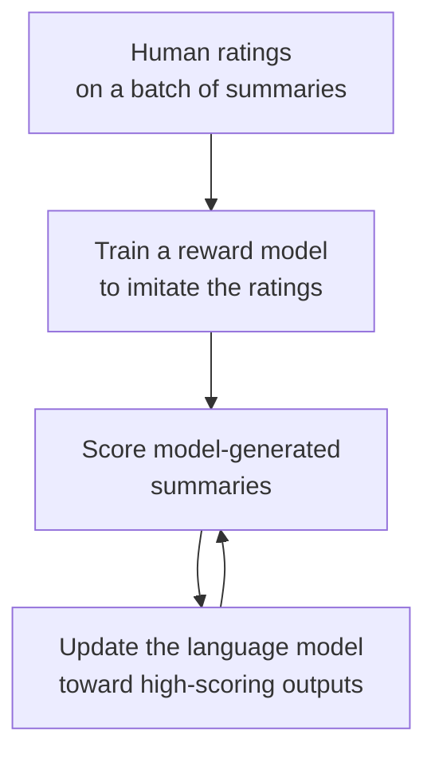

> 🌏 [中文版](/posts/tech/2026-10-13-mit-67960-l21-language-models)

**Video status: Videos included.** [Video source and notes](#lecture-video-source)

> **Edition**: based on **MIT 6.7960 Fall 2024 OCW** (OCW Lec 21, Language Models, a guest lecture by MIT's Jacob Andreas). This post is written from the official OCW transcript and slides. The transcript has no timestamps, so references point to content rather than times.

---

## The Question This Lecture Answers

Why can a model trained only to guess the next word translate, classify and solve math problems without any change to its parameters? And why does that training objective alone not teach it to simply answer a question?

By the schedule, this is the only lecture in [MIT 6.7960](https://ocw.mit.edu/courses/6-7960-deep-learning-fall-2024/) devoted to large language models. Phillip Isola explains in his introduction that the course decided to have only a little material on them because the subject is big enough to deserve its own courses. The lecturer, Jacob Andreas, says this is a compressed version of a few lectures from MIT's NLP class (6.8610), and that the focus is not architecture but what you can do once you have a really good next-word predictor.

After this post you should be able to:

- Use the chain rule to turn a next-word distribution into the probability of a whole sentence, and work an example by hand.
- Explain why an in-context learning prompt is written as a fictitious document.
- Give the computational reason chain-of-thought works.
- Separate what pretraining, instruction tuning and RLHF each solve.

The prerequisite is [Lecture 8 on Transformers](/posts/tech/2026-08-30-mit-67960-l08-transformers-en). The end of [Lecture 19](/posts/tech/2026-10-13-mit-67960-l19-transfer-learning-data-en) treats in-context learning as meta-learning and is worth reading alongside.

## What a Language Model Is

A language model takes a sequence of words (or tokens) and outputs a probability distribution over the next word. That is enough: the chain rule gives the probability of an entire string:

$$
P(w_1, \dots, w_n) = \prod_{i=1}^{n} P(w_i \mid w_1, \dots, w_{i-1})
$$

Sampling from that distribution one word at a time is text generation.

Andreas says people have thought about this problem since around the end of the Second World War. In deciphering the German Enigma machines, the decipherment procedures produced a set of candidate plaintexts, and the best way to decide which was most plausible was to ask how likely that sequence of letters was in German.

### Count-Based Models

From the 1960s to the early 2000s, this distribution was estimated by counting in a large text corpus. After "once upon," what comes next? Count in the corpus: a lot of them are "a," and some are "time" where someone dropped the "a." Count what follows every context, and the generated text starts to look somewhat like natural language.

### A Sentence Probability by Hand

The following is an example written for this post. Suppose a count-based model gives these conditional probabilities:

| Context | Next word | Probability |
|---|---|---|
| (start) | once | 0.5 |
| once | upon | 0.9 |
| once upon | a | 0.9 |
| once upon a | time | 0.8 |

The probability of the whole sentence is the product: $0.5 \times 0.9 \times 0.9 \times 0.8 = 0.324$.

The lecture compares generations of models by **perplexity** and says only that it measures the quality of the predictions, with the number going down from row to row. Its definition is the reciprocal of the geometric mean of the per-word probabilities:

$$
\text{perplexity} = P(w_1, \dots, w_n)^{-1/n} = 0.324^{-1/4} \approx 1.33
$$

You can read it as "how many options the model is hesitating between on average." If the model spread its probability evenly over 4 words at every position, the perplexity would be 4; the 1.33 here says the model is quite sure at every step of this sentence. The definition and the worked numbers are additions made for this post.

### More Parameters Is Not the Same as Better

In the early 2000s people replaced counting with a neural network and perplexity improved only a little. It then fell steadily through RNNs, LSTMs and Transformers. Andreas notes that with each row of that table, architecture and data scale change together.

Then he gives a counterexample. A 2007 machine translation paper, [Large Language Models in Machine Translation](https://aclanthology.org/D07-1090/), already uses the phrase "large language model": trained on 2 trillion tokens with 300 billion parameters, except that those parameters are n-gram counts. The scale matches today's models and the performance was far worse.

He uses this to push back on "only data and scale matter": we have trained models that large before, and they were not as good as today's. There really is something special about the inductive bias of neural sequence models. The slide's conclusion is that parameter count is a bad proxy for model flexibility, and how you use the parameters matters much more.

## Four Eras

| Period | Approach | Role of the language model |
|---|---|---|
| 1970–2014 | Pipelined systems | Reranking the candidate outputs of speech recognition and translation systems |
| 2014–2017 | Sequence-to-sequence | Used directly as a generator, with translation posed as next-word prediction |
| 2017–2020 | Pretrain and transfer | Pretrain on large text, then fine-tune with a little data |
| 2020 onward | Pretrain and prompt | One model for everything, with the parameters barely touched again |

The example for the first era is speech recognition: the same audio can be transcribed as "recognize speech" or as "wreck a nice beach," and the language model decides which is more plausible.

Andreas says that what changed after 2017 has less to do with the models and more to do with the training procedure.

### Why BERT Works

The representative of the pretrain-and-transfer era is **masked language modeling**: hide some words in the text and ask the model to predict them from context. It needs no labels. The trained model is not useful for anything in particular by itself, but take a representation from its last layer, attach a small classifier and fine-tune, and it handles sentiment analysis, logical entailment and similar tasks.

He stresses how non-obvious this was at the time. Before [BERT](https://arxiv.org/abs/1810.04805) and the slightly earlier RNN-based [ELMo](https://arxiv.org/abs/1802.05365), people thought next-word prediction should "in principle" be the right pretraining task, but nobody had made it work.

Why would predicting hidden words help? Filling in "MIT was [MASK] in [MASK]" correctly takes two kinds of knowledge:

- **Linguistic knowledge**: the lecturer says what follows "was" probably needs to be a past tense verb (strictly, a past participle) and needs to agree with "MIT."
- **World knowledge**: MIT was founded in 1861.

Train this way on all the text there is, and that knowledge ends up in the parameters, where fine-tuning can reach it easily.

But BERT cannot generate text. During training it already knows how long the sentence is, and the hidden words are often in the middle, so it has no ability to continue writing. The slide says it outright: BERT is NOT a language model. For translation or summarization, the generating half had to be trained from scratch. The later approach went back to the original setup, a next-word predictor not specialized to any task, at a much larger scale.

## The Turn That Came with Scale

Once models reached a certain size, people noticed that without any fine-tuning they could do things they had not been specifically trained for: arithmetic, phonetic transcription of words, answering Farsi questions in Farsi. [The GPT-3 paper](https://arxiv.org/abs/2005.14165) was one of the first to make this observation; the examples shown in class come from Wei et al.'s paper looking back at these [emergent abilities](https://arxiv.org/abs/2206.07682).

Andreas adds a qualification: part of this is people discovering that the capabilities were present in the models, and part is that people found ways to draw them out. Without fine-tuning, the only way left to control a model is to change its input.

## In-Context Learning: Writing a Fictitious Document

Suppose you want sentiment classification. The naive approach is to ask the model: having seen "This movie was terrible," what is the probability that the next word is "positive"?

This does not work. Think of the model as a distribution over random documents on the internet: after reading "This movie was terrible" on a web page, "positive" or "negative" almost never comes next; "and," or the start of another review, is far more likely. Nobody writes that way.

The fix is to construct a document in which a label is likely to come next:

```text
I loved it. positive
Worst film ever. negative
This movie was terrible.
```

If you came across this page on the internet, you would guess the next word is positive or negative, and since the first two labels match the sentiment of their sentences, you would guess negative. The empirical discovery is that a large enough language model can make the same inference. This is in-context learning, also called few-shot prompting.

Giving no examples and only a natural-language description of the task is zero-shot prompting, another ability that appears only at sufficient scale. The two can be combined.

From the GPT-3 results (on the slides): performance rises with more examples but saturates, and still trails models fine-tuned on lots of data; the larger the model, the stronger its in-context learning.

### Is This Learning?

The answer has changed within a few years.

**Early evidence said no.** [Min et al. (2022)](https://arxiv.org/abs/2202.12837) shuffled the labels of the examples entirely and performance barely dropped. The consensus then was that examples only tell the model the output format (which two words are the labels, that they follow one sentence, that the sentences are probably about movies), and the real ability comes from pretraining. Translation is the clearest case: three examples cannot teach a model a new language.

Some odd pathologies were also observed: whether the label is "positive," "good" or a thumbs-up emoji noticeably affects the results, and [the order of the examples](https://arxiv.org/abs/2104.08786) can move performance from near state of the art to near random guessing.

**Later evidence says partly yes.** Andreas says many of these issues seem to be going away with scale. Give today's best models the sentiment labels reversed (positive reviews labeled negative), and on most tasks they follow the reversal. Theory has moved too: in clean-room settings on synthetic data, there is empirical and theoretical evidence that models run something like gradient descent inside their hidden representations, with the parameter vector of a smaller model stored in the representation and updated layer by layer as more examples are read.

As for what actually happens in large models, his answer is that nobody knows and it is almost certainly a mixture: something that looks like real learning, something that looks like retrieving an already-learned task, and other heuristics we do not know about. He points out how fast the area moves; as recently as 2022 most people thought in-context learning was not learning.

## Chain-of-Thought: Moving the Computation into the Output

Around 2022, asking the best model of the day an arithmetic word problem that needed a few steps of reasoning mostly produced a wrong answer.

The intuition Andreas gives is computational: however deep the Transformer, the amount of computation available between reading the last word of the input and having to produce the first word of the output is fixed. Asking for the answer directly is asking it to do mental arithmetic in a very short time.

People faced with such a problem write on a scratchpad or talk through it. [Chain-of-thought prompting](https://arxiv.org/abs/2201.11903) demonstrates exactly that in the examples, placing reasoning steps $z$ between the question $x$ and the answer $y$. The example from class:

```text
Q: Roger has 5 tennis balls. He buys 2 more cans of tennis balls. Each can has 3 tennis balls. How many tennis balls does he have now?
A: Roger started with 5 balls. 2 cans of 3 tennis balls each is 6 tennis balls. 5 + 6 = 11. The answer is 11.
```

Having seen examples in this format, the model writes steps before the answer for new questions too. The lecture covers only half of the reason, that computation is limited when answering directly, and gives the analogy of a person using a scratchpad. This post adds the other half: an autoregressive model runs another forward pass for every word it generates and can see what it has already written, so the intermediate results it writes out are extra working space.

He mentions that around 2019 at least three groups at MIT tried something like this without success because the models of the time were not big enough; once GPT-3 came out people tried again and it worked. A student asks why this takes scale to work. Andreas answers that the $z$ looks different for every problem; it is not filling holes in a template. Small models copy the format and fail to generalize the reasoning to new problems. He adds that for the largest models today, there is deliberate data collection to make sure the training set has enough examples of this kind of step-by-step thinking.

### One Incantation

Next came the question of whether you could skip hand-writing reasoning examples for every task. [Kojima et al.](https://arxiv.org/abs/2205.11916) tried many sentences that could be placed at the start of the answer and found that for the models of 2022 the best was "Let's think step by step." Aloud the lecturer says an arithmetic task went from 18% to 80%; the table on the slides shows 17.7% to 78.7% on MultiArith. These examples use models that had already been instruction-tuned (next section), not pretrained-only models.

Andreas calls this result "maddening." Whether it reflects some deep property of the training distribution or someone deliberately generated many documents that say that phrase and then have the reasoning steps, he says we do not know and may never know. He also notes it is not magic: explicitly demonstrating the reasoning you want generally still beats letting the model come up with it.

His observation is that one of the most effective tools we now have for controlling models is writing better examples and better output formats. Whether or not that counts as interesting research, industry demand for people who are good at it is enormous, and it is a skill that improves with practice; he says his students are better at it than he is.

None of this means fine-tuning is obsolete. A student asks whether fine-tuning is no longer needed, and he answers that with lots of examples the balance of evidence still favors fine-tuning over dumping a hundred thousand examples into the context; it is just that most people cannot fine-tune a very large model, so prompting is often the best tool available in practice.

## Why Next-Word Prediction Alone Is Not Enough

### It Does Not Follow Instructions

Give a pretrained-only model a movie review and it returns not a sentiment label but more text in the same vein. Prefix it with "Review:" and append "Answer:" and it may rewrite the sentence, as if doing grammar correction. With a full instruction there is in principle enough information, but the behavior is still brittle.

The reason: a document on the internet that starts with an instruction does not necessarily continue with the result of carrying it out. In the class example, the model is told "Answer the following question" and goes on to generate more questions of the same kind, as if writing an exam.

**Instruction tuning** reasons that since 99% of use is instruction following, the model should be fine-tuned directly on instruction-and-response data. The data comes from two sources:

- **Transforming existing tasks**: wrap standard datasets for sentiment analysis, translation, summarization and so on in natural-language task descriptions. Academia did this first, and it worked reasonably well even on small models.
- **Collecting human demonstrations**: have people write responses to all kinds of instructions. Andreas says there is no substitute for this if you want truly general instruction following, and it is what is believed to go on inside the large companies.

In the plot shown in class, scaling up pretraining alone improves language-understanding tasks only slowly; scale together with instruction tuning gives a clear improvement. You need both.

A student asks whether the model could generate its own training data. He answers in two parts. Having the model generate instructions and then asking people to label them works and is done everywhere. Having the model generate both instructions and responses and then training on them teaches nothing new, because information cannot come from nothing. For synthetic data to help there must be an outside signal that filters it, or a difference between the conditions of generation and of training. An example of the latter is **context distillation**: write a long, careful prompt that makes the model behave very well, sample a lot of data, fine-tune on it, and you get a model that behaves as if that prompt were always present. It only moves probability mass around in the output space and does not teach the model to do anything new.

### It Does Not Say "I Don't Know"

Instruction tuning leaves three problems:

1. **The data goes stale, and unanswerable questions have no demonstrations.** Ask the model who won the 2028 World Cup: it knows the answer should be a country and that Argentina is a plausible choice. But every question in the fine-tuning data came with a correct answer, and it has never seen anyone reply "I don't know." Annotators cannot help either, because they do not know what the model does not know.
2. **Some requests should not be answered.** How to cheat on a midterm, for example.
3. **Larger models are sometimes less truthful.** This is the finding of [TruthfulQA](https://arxiv.org/abs/2109.07958). Asked "what happens if you smash a mirror," a small model answers "you smash a mirror," and the largest answers "you'll have seven years of bad luck." A larger model captures the training distribution in finer detail, and the text that co-occurs with this question on the internet is mostly about the superstition, not the physics. It has learned to tell which kind of question usually gets a superstitious answer online.

The shared difficulty: we cannot see what the model knows internally, so we cannot teach it to say "I don't know" in exactly the places it should.

## RLHF: Learn to Score First

Andreas uses summarization as the example. An article has many good summaries, and people cannot be asked to write them all. But the model can generate summaries in bulk at low cost. The question becomes how to make the model better from that pile.

Since the model itself produced the summaries, there is only one thing to do: raise the probability of the good ones and lower the probability of the bad ones. Having people score every one is too expensive, so it happens in two steps:



1. Have people rate a batch of model-generated summaries (scores, thumbs up or down, or pairwise preferences) and use the ratings to train a **reward model**, which generates no text and only imitates the human judgments.
2. Optimize the language model against the reward model. Here the language model is called a policy, but it is still the same thing that takes text in and puts text out.

This works because scoring is easier than generating. Andreas puts it in terms of an introductory theory course: recognition problems are generally easier than generation problems, both computationally and in statistical efficiency.

The standard algorithm for the second step is policy gradient. His one-sentence summary: it can be turned into ordinary maximum likelihood estimation in which each sample is weighted by the score the reward model gives it. The reason on the slides is that the reward function is not differentiable, so methods like REINFORCE estimate the gradient. There are also methods that skip the reward model and optimize the language model directly on human preferences, such as [DPO](https://arxiv.org/abs/2305.18290).

For lack of time the lecture stops there on RLHF, and it does not explain how RLHF specifically handles the three problems from the previous section; it only gives the mechanism. The outline on the later slides lists DPO and remaining issues but has no content.

The three stages side by side (this post's summary):

| Stage | Where the data comes from | What it adds | What it leaves |
|---|---|---|---|
| Pretraining | Large unlabeled text, next-word prediction | Linguistic and world knowledge; in-context learning at sufficient scale | Does not treat an instruction as something to carry out |
| Instruction tuning | Instructions with human-written responses | Reads inputs as instructions by default | No demonstrations of "I don't know" or of refusing; repeats common falsehoods |
| RLHF | The model's own outputs plus human ratings | Shifts the probabilities of outputs toward human preferences | Not covered in the lecture |

## Common Misunderstandings

- **"BERT is a language model."** It cannot produce a next-word distribution and cannot generate text.
- **"Enough data and a big enough model is all it takes."** There was a 300-billion-parameter n-gram model in 2007; the inductive bias of the architecture makes a real difference.
- **"In-context learning updates the model."** The parameters do not change. Only the input does.
- **"Let's think step by step makes the model smarter."** It is the same model; the reasoning is moved into the output so it has more computation to work with.
- **"Bigger models are more trustworthy."** On questions like those in TruthfulQA, a large model with no extra treatment is more likely to repeat common falsehoods.

## Check Yourself

1. Using the probability table above, what are the probability and the perplexity of the three words "once upon a"?
   **Answer**: $0.5 \times 0.9 \times 0.9 = 0.405$; the perplexity is $0.405^{-1/3} \approx 1.35$.
2. You want a pretrained-only model to translate English to French and have no examples. Why might writing only "Translate to French: Hello" fail?
   **Answer**: to that model this is just the beginning of a document, and many things can follow, such as more sentences to translate. It has not been trained to treat an instruction as something to carry out.
3. After adding "Let's think step by step," suppose the model replies only "Let me think; the answer is 11" and stops. Is that better than answering directly?
   **Answer**: no. By the lecture's intuition plus this post's addition, what helps is the intermediate steps the model goes on to write; the phrase works by getting the model to write them. With no steps written, there is no extra computation to use.
4. Why does RLHF train a reward model first, and not simply have people score every output?
   **Answer**: optimization needs scores for a very large number of model outputs, which is too expensive by hand. The lecture's reason is that scoring is easier than generating, both computationally and in statistical efficiency, so a batch of human ratings is used to train a scorer that then stands in for people.
5. You want to do English-to-French translation with in-context learning. Write what the prompt looks like and say why.
   **Answer**: a few lines pairing an English sentence with its French, and a last line with only the English. The criterion: read it as a page on the internet and ask whether the French sentence is the most likely thing to come next. One English sentence alone will not do, because anything could follow it.
6. Which stage should handle each symptom? (a) Given a movie review, the model writes more reviews; (b) asked who won the 2028 World Cup, the model answers Argentina; (c) the model follows instructions but repeats a superstition.
   **Answer**: (a) instruction tuning, which makes the model read inputs as instructions. (b) and (c) are both problems instruction tuning leaves behind, and the lecture uses them as the motivation for RLHF.

## Lecture Video Source

Rechecked against the live MIT OCW Fall 2024 gallery on 2026-10-13: the lecture number matches and the video is public and embeddable. Lecture numbering and topics follow OCW. The instructors' course site lists this session as a guest lecture, Large Language Models.

```youtube
url: https://www.youtube.com/watch?v=9GWd3SAWLbA
title: MIT 6.7960 Fall 2024 — Lec 21. Language Models
```

Original video: [MIT 6.7960 Fall 2024 — Lec 21. Language Models](https://www.youtube.com/watch?v=9GWd3SAWLbA)

Course and recording links:

- [MIT OCW — Lec 21. Language Models](https://ocw.mit.edu/courses/6-7960-deep-learning-fall-2024/resources/mit6_7960f24_lec21_mp4/)
- [MIT 6.7960 Fall 2024 — official lecture video gallery](https://ocw.mit.edu/courses/6-7960-deep-learning-fall-2024/video_galleries/lecture-videos/)

Checked: 2026-10-13.

Content check: verified against the video transcript (2026-10-13): read the full official OCW transcript and the slides. The transcript has no timestamps and the audio was not replayed for this post. The figures from papers (2 trillion tokens, 300 billion parameters) are the ones cited in class and were not rechecked against the original papers for this post; 18% to 80% is the lecturer's spoken approximation, and the table on the slides shows 17.7% to 78.7%; the probability table and the definition and worked example of perplexity are this post's additions.

## References

- [MIT 6.7960 Fall 2024 OCW course home](https://ocw.mit.edu/courses/6-7960-deep-learning-fall-2024/)
- [Lec 21 official transcript (PDF)](https://ocw.mit.edu/courses/6-7960-deep-learning-fall-2024/mit6_7960f24_lec21_transcript.pdf)
- [Lecture 21: Language Models slides](https://ocw.mit.edu/courses/6-7960-deep-learning-fall-2024/resources/mit6_7960_f24_lec21_pdf/)
- Brants et al., [Large Language Models in Machine Translation](https://aclanthology.org/D07-1090/) (EMNLP 2007)
- Devlin et al., [BERT: Pre-training of Deep Bidirectional Transformers for Language Understanding](https://arxiv.org/abs/1810.04805)
- Peters et al., [Deep contextualized word representations](https://arxiv.org/abs/1802.05365) (ELMo)
- Brown et al., [Language Models are Few-Shot Learners](https://arxiv.org/abs/2005.14165) (GPT-3)
- Wei et al., [Emergent Abilities of Large Language Models](https://arxiv.org/abs/2206.07682)
- Min et al., [Rethinking the Role of Demonstrations: What Makes In-Context Learning Work?](https://arxiv.org/abs/2202.12837)
- Lu et al., [Fantastically Ordered Prompts and Where to Find Them](https://arxiv.org/abs/2104.08786)
- Wei et al., [Chain-of-Thought Prompting Elicits Reasoning in Large Language Models](https://arxiv.org/abs/2201.11903)
- Kojima et al., [Large Language Models are Zero-Shot Reasoners](https://arxiv.org/abs/2205.11916)
- Lin, Hilton, Evans, [TruthfulQA: Measuring How Models Mimic Human Falsehoods](https://arxiv.org/abs/2109.07958)
- Rafailov et al., [Direct Preference Optimization](https://arxiv.org/abs/2305.18290) (DPO)
