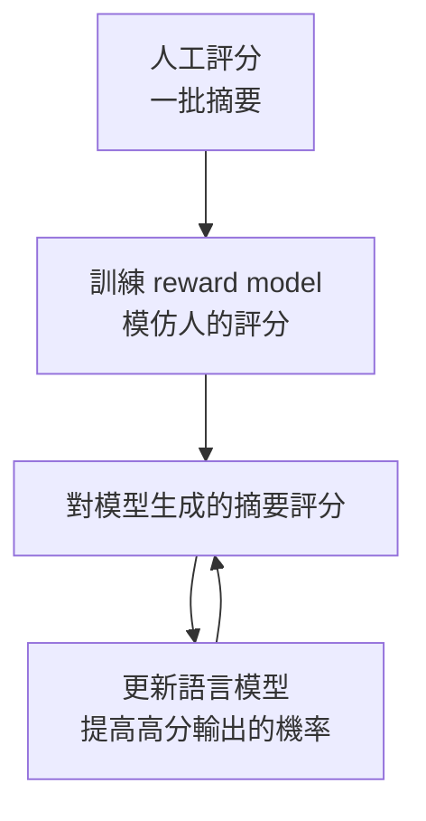

> 🌏 [English version](/posts/tech/2026-10-13-mit-67960-l21-language-models-en)

**影片狀態：已附影片。** [影片來源與說明](#課程影片來源)

> **教材版本**：基於 **MIT 6.7960 Fall 2024 OCW**（對應 OCW Lec 21 Language Models，MIT 的 Jacob Andreas 客座主講）。本文依 OCW 官方逐字稿與投影片整理；逐字稿沒有時間戳，引用以段落內容定位。

---

## 這一堂要回答的問題

一個只被訓練來猜下一個詞的模型，為什麼不改任何參數，就能翻譯、分類、解數學題？又為什麼光靠這個訓練目標，它學不會乖乖回答問題？

依課表，這是 [MIT 6.7960](https://ocw.mit.edu/courses/6-7960-deep-learning-fall-2024/) 唯一一堂專講大型語言模型的課。Phillip Isola 開場解釋，課程決定只放少量語言模型的內容，因為這個主題大到該有自己的課。講者 Jacob Andreas 說這堂是他在 MIT 自然語言處理課（6.8610）幾堂內容的濃縮，重點不是架構，而是：手上有一個很好的下一詞預測器之後，可以拿它做什麼。

讀完這篇，你應該能：

- 用連鎖律把「下一個詞的分布」變成「整句的機率」，並手算一個例子。
- 說明 in-context learning 的提示為什麼要寫成一份假文件。
- 解釋 chain-of-thought 有效的計算理由。
- 分清楚預訓練、instruction tuning、RLHF 三個階段各自解決什麼問題。

先備是[第 8 堂 Transformer](/posts/tech/2026-08-30-mit-67960-l08-transformers)。[第 19 堂](/posts/tech/2026-10-13-mit-67960-l19-transfer-learning-data)最後把 in-context learning 看成元學習，可以對照著讀。

## 語言模型是什麼

語言模型吃一串詞（或 token），輸出下一個詞的機率分布。只要有這個，用連鎖律就能得到整個字串的機率：

$$
P(w_1, \dots, w_n) = \prod_{i=1}^{n} P(w_i \mid w_1, \dots, w_{i-1})
$$

從這個分布一個詞一個詞取樣，就是生成文字。

Andreas 說這個問題從二戰結束前後就有人在想。破譯德軍 Enigma 密碼時，解密程序會吐出一堆候選明文，要判斷哪一個最像真的德文，最好的辦法就是問：這串字母在德文裡有多可能出現？

### 計數模型

從 1960 年代到 2000 年代初，估計這個分布的方法就是拿一大堆文字來數。看到「once upon」，下一個詞是什麼？在語料裡數一數：很多是「a」，有些是漏打了「a」直接接「time」。把每一種前文後面接什麼都數出來，生成的文字就開始有點像自然語言。

### 手算一句的機率

以下是本文自擬的例子。假設一個計數模型給出這些條件機率：

| 前文 | 下一個詞 | 機率 |
|---|---|---|
| （句首） | once | 0.5 |
| once | upon | 0.9 |
| once upon | a | 0.9 |
| once upon a | time | 0.8 |

整句的機率是四個數相乘：$0.5 \times 0.9 \times 0.9 \times 0.8 = 0.324$。

課堂上用 **perplexity** 比較各代模型，只說它衡量預測品質，表上的數字一路往下降。它的定義是每個詞機率的幾何平均的倒數：

$$
\text{perplexity} = P(w_1, \dots, w_n)^{-1/n} = 0.324^{-1/4} \approx 1.33
$$

可以把它讀成「模型平均在幾個選項之間猶豫」。如果模型對每個位置都在 4 個詞之間均分機率，perplexity 就是 4；這個例子的 1.33 表示模型在這句的每一步都相當有把握。這個定義與算例是本文補充的。

### 參數多不等於好

2000 年代初，有人把計數換成神經網路，perplexity 只好一點點。之後隨著 RNN、LSTM、Transformer 一路往下降。Andreas 提醒，這張表上每換一列，架構與資料規模是一起變的。

但他接著舉了一個反例。2007 年的機器翻譯論文 [Large Language Models in Machine Translation](https://aclanthology.org/D07-1090/) 已經用了「large language model」這個詞：在 2 兆個 token 上訓練，有 3,000 億個參數，只是那些參數是 n-gram 的計數。規模不輸現在的模型，表現卻差得多。

他由此反駁「只有資料與規模重要」的說法：我們早就訓練過同樣大的模型，它們沒有現在的好。神經序列模型的歸納偏置確實有特別之處。投影片的結論是，參數數量是模型彈性的差勁指標，怎麼用參數重要得多。

## 四個時代

| 時期 | 做法 | 語言模型的角色 |
|---|---|---|
| 1970–2014 | 管線式系統 | 替語音辨識、翻譯系統的候選輸出重新排序 |
| 2014–2017 | 序列到序列 | 直接當生成器，把翻譯當成下一詞預測 |
| 2017–2020 | 預訓練加遷移 | 先在大量文字上預訓練，再用少量資料微調 |
| 2020 之後 | 預訓練加提示 | 一個模型做所有事，幾乎不再碰參數 |

第一個時代的例子是語音辨識：聽到的聲音可以轉寫成「recognize speech」，也可以是「wreck a nice beach」，語言模型負責判斷哪個比較像人話。

Andreas 說 2017 年之後的變化主要不在模型，而在訓練程序。

### BERT 為什麼有效

預訓練加遷移時代的代表是**遮蔽語言模型**：把文字裡的一些詞蓋掉，要模型依上下文猜回來。這不需要任何標註。訓練完的模型本身沒什麼用，但取它最後一層的表示接一個小分類器微調，就能做情感分析、邏輯蘊涵等任務。

他強調當年這件事有多不理所當然。在 [BERT](https://arxiv.org/abs/1810.04805) 與稍早用 RNN 的 [ELMo](https://arxiv.org/abs/1802.05365) 之前，大家覺得下一詞預測「理論上」該是好的預訓練任務，但沒有人真的做成。

為什麼猜被蓋住的詞會有用？要把「MIT was [MASK] in [MASK]」填對，需要兩種知識：

- **語言知識**：講者說「was」後面大概要接過去式動詞（嚴格說是過去分詞），而且要與 MIT 搭配。
- **世界知識**：MIT 創立於 1861 年。

把所有文字都拿來這樣訓練，這些知識就存進參數裡，微調時很容易取用。

但 BERT 生不出文字。它訓練時已經知道句子有多長，被蓋住的詞常常在句子中間，所以沒有「接著往下寫」的能力。投影片直接寫：BERT 不是語言模型。要做翻譯或摘要，生成的那一半得從頭訓練。後來的做法是回到最原始的設定，訓練一個不針對任何任務的下一詞預測器，只是規模大得多。

## 規模帶來的轉折

模型大到某個程度後，有人發現不做任何微調，它就能做一些沒被特別訓練過的事：算術、把單字轉成音標、用波斯語回答波斯語的問題。[GPT-3 的論文](https://arxiv.org/abs/2005.14165)是最早指出這件事的論文之一；課堂用的例子來自 Wei 等人回顧這些[湧現能力](https://arxiv.org/abs/2206.07682)的論文。

Andreas 加了一句但書：一半是人們發現這些能力已經在模型裡，另一半是人們找到了把能力叫出來的方法。不微調的話，控制模型的手段只剩下改輸入。

## In-context learning：寫一份假文件

想做情感分類。最直接的做法是問模型：看到「This movie was terrible」，下一個詞是「positive」的機率多少？

這行不通。把模型想成「網路上隨機文件」的分布：在網頁上讀到「This movie was terrible」，後面幾乎不會接「positive」或「negative」，比較可能接「and」或下一篇影評。沒有人這樣寫。

解法是造一份讓標籤很可能出現的文件：

```text
I loved it. positive
Worst film ever. negative
This movie was terrible.
```

如果在網路上看到這樣一頁，你會猜下一個詞是 positive 或 negative，而且因為前兩個標籤都與句子的情感相符，你會猜 negative。經驗上的發現是：夠大的語言模型也做得到這種推斷。這就是 in-context learning，也叫 few-shot prompting。

不給範例、只用自然語言描述任務的做法叫 zero-shot prompting，同樣是規模夠大才出現的能力。兩者可以混用。

依 GPT-3 論文的結果（投影片）：範例愈多表現愈好但會飽和，而且仍然輸給用大量資料微調的模型；模型愈大，in-context learning 的能力愈強。

### 這算學習嗎

這個問題的答案在幾年內改過。

**早期的證據說不算。** [Min 等人 2022 年的實驗](https://arxiv.org/abs/2202.12837)把範例的標籤整個打亂，表現幾乎沒掉。當時的共識是：範例只是告訴模型輸出的格式（標籤是哪兩個詞、接在一句話後面、句子大概在談電影），真正的能力來自預訓練。翻譯是最清楚的例子，三組範例不可能教會模型一個新語言。

那時還觀察到一些怪毛病：標籤用「positive」還是「good」或讚的表情符號會明顯影響結果；[範例的順序](https://arxiv.org/abs/2104.08786)可以讓表現從接近最佳掉到接近亂猜。

**後來的證據說部分算。** Andreas 說這些問題有許多似乎隨規模逐漸消失。對現在最好的模型，把情感標籤反過來給（正面標成 negative），多數任務上它會跟著反過來答。理論上也有進展：在合成資料的乾淨設定下，有經驗與理論證據顯示模型在隱藏表示裡跑著類似梯度下降的演算法，一個小模型的參數向量存在表示裡，隨著讀進更多範例逐層更新。

大模型裡實際發生什麼，他的回答是沒有人知道，幾乎可以確定是混合的：有些像真的學習，有些像取回已經會的任務，還有些我們不知道的捷徑。他提醒這個領域變得很快，2022 年多數人還認為 in-context learning 不是學習。

## Chain-of-thought：把算力放到輸出裡

2022 年前後，直接問當時最好的模型一道需要幾步推理的算術題，多半答錯。

Andreas 給的直覺是計算上的：不管 Transformer 多深，從讀完輸入最後一個詞，到必須吐出輸出第一個詞之間，能用的計算量是固定的。直接要答案，等於要它在極短的時間內心算。

人遇到這種題目會寫草稿或邊想邊講。[Chain-of-thought prompting](https://arxiv.org/abs/2201.11903) 就是在範例裡示範這件事，在問題 $x$ 與答案 $y$ 之間插入推理步驟 $z$。課堂的例子（原文是英文，以下是中譯）：

```text
Q: Roger 有 5 顆網球，又買了 2 罐，每罐 3 顆。他現在有幾顆？
A: Roger 一開始有 5 顆。2 罐各 3 顆是 6 顆。5 + 6 = 11。答案是 11。
```

模型看到這種格式的範例後，對新問題也會先寫步驟再給答案。課堂只講到「直接作答時計算量有限」這一半，並用人寫草稿來類比。本文補上另一半：自迴歸模型每生成一個詞就多做一次前向傳遞，而且看得到自己前面寫的東西，所以寫出來的中間結果等於多出來的工作空間。

他提到 2019 年前後 MIT 至少有三個團隊試過類似的做法都沒成功，因為當時的模型不夠大；GPT-3 出來後再試就成了。有學生問為什麼要規模夠大才有效。Andreas 的回答是：每一題的 $z$ 長得都不一樣，不是在填模板的空格。小模型會模仿格式，但不會把推理推廣到新題目。他也補充，現在最大的模型在訓練時，已經有人刻意收集這種一步步推理的資料。

### 一句咒語

接下來有人問：能不能不必每個任務都手寫推理範例？[Kojima 等人](https://arxiv.org/abs/2205.11916)試了各種可以加在答案開頭的句子，發現對 2022 年的模型最好的是「Let's think step by step」。講者口頭說的是在一個算術任務上從 18% 升到 80%；投影片的表是 MultiArith 上從 17.7% 到 78.7%。這些例子用的是已經做過 instruction tuning 的模型（下一節），不是只做過預訓練的模型。

Andreas 用「令人抓狂」形容這個結果。原因是訓練資料的某種深層性質，還是有人刻意產生了大量寫著這句話、後面接推理步驟的文件，他說我們不知道，可能永遠不會知道。他也提醒這不是魔法：明確示範你要的推理方式，通常還是比讓模型自己想來得好。

他的觀察是，現在控制模型最有效的工具之一，就是寫出更好的範例與輸出格式。不管這算不算有趣的研究，業界對擅長這件事的人需求很大，而且這是可以練的；他說他的學生比他厲害。

這不表示微調沒用了。有學生問是不是不必再微調，他回答：手上有很多範例時，目前的證據仍然偏向微調，而不是把十萬筆範例塞進上下文；只是多數人沒有能力微調很大的模型，所以提示常常是實際上最好用的工具。

## 光預測下一個詞還不夠

### 聽不懂指令

把一句影評丟給只做過預訓練的模型，它不會給情感標籤，只會接著寫類似的文字。前面加「Review:」、後面加「Answer:」，它可能把句子改寫一遍，像在做文法修正。給完整的指令，資訊其實夠了，但行為還是不穩。

原因是：網路上以指令開頭的文件，後面不一定接著執行指令的結果。課堂的例子是對模型說「回答下面這個問題」，模型接著產生更多同類型的問題，像在出考卷。

**Instruction tuning** 的想法是：既然九成九的用途都是照指令做事，就直接在「指令與回應」的資料上微調。資料有兩種來源：

- **改寫既有任務**：把情感分析、翻譯、摘要等標準資料集套上自然語言的任務描述。這是學術界先做的，連小模型都有不錯的效果。
- **收集人類示範**：針對各式各樣的指令請人寫回應。Andreas 說要得到真正通用的指令遵循，這沒有替代品，也是一般認為大公司內部在做的事。

依課堂的圖，只加大預訓練規模，語言理解任務的進步不快；規模加上 instruction tuning 才有明顯的提升。兩者要一起。

有學生問能不能讓模型自己生成訓練資料。他的回答分兩層：讓模型生成指令再請人標註，可以，而且到處都在做。讓模型生成指令與回應再拿來訓練自己，學不到新東西，因為資訊不會無中生有。合成資料要有用，必須有外部訊號過濾，或是生成與訓練的條件不同。後者的例子是 **context distillation**：先寫一個很長、很仔細的提示讓模型表現很好，取樣一堆資料，再微調，得到的模型表現得像那個提示一直在場。它只是在輸出空間裡搬動機率，沒有教會模型新能力。

### 不會說不知道

Instruction tuning 留下三個問題：

1. **資料會過時，而且問不到的事沒有示範。** 問模型 2028 年世界盃誰贏，它知道答案該是一個國家，也知道阿根廷是合理的選項。但微調資料裡每個問題都配了正確答案，它從沒看過有人回答「我不知道」。標註者也幫不上忙，因為他們不知道模型不知道什麼。
2. **有些請求不希望它回答。** 例如怎麼在期中考作弊。
3. **愈大的模型有時愈不老實。** 這是 [TruthfulQA](https://arxiv.org/abs/2109.07958) 的發現。問「打破鏡子會怎樣」，小模型回答「你打破了一面鏡子」，最大的模型回答「會倒楣七年」。模型愈大，把訓練分布學得愈細；網路上與這個問題一起出現的文字多半在談迷信，不是談物理。它學會了分辨哪種問題在網路上通常得到迷信的答案。

共同的困難是：我們看不到模型內部知道什麼，所以沒辦法精準地只在該說不知道的地方教它說不知道。

## RLHF：先學會評分

Andreas 用摘要當例子。一篇文章有很多種好的摘要，不可能請人全部寫出來。但模型可以自己生成大量摘要，成本很低。問題變成：怎麼從這堆摘要裡讓模型變好？

既然摘要是模型自己產生的，能做的只有一件事：讓它提高好摘要的機率、降低壞摘要的機率。請人逐一評分太貴，所以分兩步：



1. 請人對一批模型生成的摘要評分（給分數、按讚或倒讚、或兩兩比較），用來訓練一個 **reward model**，它不生成文字，只模仿人的評分。
2. 用 reward model 當目標最佳化語言模型。這裡語言模型被稱為 policy，但它還是那個吃文字、吐文字的模型。

這個做法成立，是因為評分比生成容易。Andreas 用計算理論課的說法：辨識問題一般比生成問題容易，在計算上與統計效率上都是。

第二步的標準演算法是 policy gradient。他的一句話總結：它可以改寫成一般的最大概似估計，只是每個樣本用 reward model 給的分數加權。投影片給的理由是 reward 函數不可微，所以用 REINFORCE 這類方法估計梯度。另外也有不訓練 reward model、直接用人的偏好最佳化語言模型的方法，例如 [DPO](https://arxiv.org/abs/2305.18290)。

RLHF 的細節課堂因為時間只講到這裡，也沒有說明它具體怎麼處理上一節的三個問題，只給了機制。投影片後面的大綱列了 DPO 與遺留的問題，但沒有內容。

把三個階段並排（本文的整理）：

| 階段 | 資料從哪來 | 補上什麼 | 留下什麼 |
|---|---|---|---|
| 預訓練 | 大量未標註文字，預測下一個詞 | 語言與世界知識；規模夠大時出現 in-context learning | 不把指令當成要執行的事 |
| Instruction tuning | 指令與人寫的回應 | 預設把輸入讀成指令 | 沒有「我不知道」與拒絕的示範；會複述常見的錯誤說法 |
| RLHF | 模型自己的輸出加上人的評分 | 依人的偏好調整各種輸出的機率 | 課堂沒有講到 |

## 常見誤解

- **「BERT 是語言模型」**：它產生不了下一個詞的分布，也無法生成文字。
- **「資料夠多、模型夠大就夠了」**：2007 年就有 3,000 億參數的 n-gram 模型，架構的歸納偏置有實質影響。
- **「In-context learning 更新了模型」**：參數沒有變。改變的只有輸入。
- **「Let's think step by step 讓模型變聰明」**：模型是同一個，只是把推理放到輸出裡，讓它有更多計算可用。
- **「模型愈大愈可信」**：在 TruthfulQA 這類問題上，沒有額外處理的大模型反而更會複述常見的錯誤說法。

## 自我檢查

1. 用上面的機率表，「once upon a」這三個詞的機率與 perplexity 各是多少？
   **答**：$0.5 \times 0.9 \times 0.9 = 0.405$；perplexity 是 $0.405^{-1/3} \approx 1.35$。
2. 你想讓只做過預訓練的模型把英文翻成法文，沒有任何範例可用。只寫「Translate to French: Hello」為什麼可能失敗？
   **答**：對這種模型來說這只是一段文件的開頭，後面可以接很多東西，例如更多待翻的句子。它沒有被訓練成把指令當成要執行的事。
3. 加了「Let's think step by step」之後，模型如果只回一句「讓我想想，答案是 11」就結束，會比直接作答好嗎？
   **答**：不會。依課堂的直覺加上本文的補充，有用的是它接著寫出來的中間步驟；那句話的作用是讓模型去寫那些步驟。沒寫出步驟，能用的計算就沒有變多。
4. 為什麼 RLHF 要先訓練 reward model，而不是直接請人替每個輸出評分？
   **答**：最佳化需要對大量模型輸出評分，人工太貴。課堂的理由是評分比生成容易，在計算上與統計效率上都是，所以先用一批人工評分訓練出評分器，再讓它替人評分。
5. 你想用 in-context learning 做英翻法，請寫出提示的樣子，並說明為什麼這樣寫。
   **答**：幾行「英文句子、對應的法文」的配對，最後一行只有英文。判準是：把它當成網路上的一頁文件來讀，下一個最可能出現的東西是不是那句法文。只寫一句英文不行，因為後面接什麼都有可能。
6. 三個症狀各該由哪個階段處理？（a）給一句影評，模型接著寫更多影評；（b）問 2028 年世界盃冠軍，模型回答阿根廷；（c）模型照指令回答，但複述迷信的說法。
   **答**：（a）instruction tuning，讓模型把輸入讀成指令。（b）與（c）都是 instruction tuning 留下的問題，課堂把它們當成引入 RLHF 的動機。

## 課程影片來源

2026-10-13 已即時回 MIT OCW Fall 2024 官方錄影列表核對講次，影片公開且允許嵌入；講次與主題以 OCW 的標示為準。授課教師的課程網站把這堂列為客座演講 Large Language Models。

```youtube
url: https://www.youtube.com/watch?v=9GWd3SAWLbA
title: MIT 6.7960 Fall 2024 — Lec 21. Language Models
```

原始影片：[MIT 6.7960 Fall 2024 — Lec 21. Language Models](https://www.youtube.com/watch?v=9GWd3SAWLbA)

課程與錄影入口：

- [MIT OCW — Lec 21. Language Models](https://ocw.mit.edu/courses/6-7960-deep-learning-fall-2024/resources/mit6_7960f24_lec21_mp4/)
- [MIT 6.7960 Fall 2024 — official lecture video gallery](https://ocw.mit.edu/courses/6-7960-deep-learning-fall-2024/video_galleries/lecture-videos/)

查核日期：2026-10-13。

內容核對：已依字幕核對（2026-10-13）：讀了 OCW 官方逐字稿全文與投影片。逐字稿沒有時間戳，本文未回聽原音。各論文的數字（2 兆 token、3,000 億參數）是課堂引用的數字，本文沒有另外回原論文核對；18% 到 80% 是講者口述的約數，投影片的表是 17.7% 到 78.7%；機率表、perplexity 的定義與算例是本文補充。

## 參考資料

- [MIT 6.7960 Fall 2024 OCW 課程首頁](https://ocw.mit.edu/courses/6-7960-deep-learning-fall-2024/)
- [Lec 21 官方逐字稿（PDF）](https://ocw.mit.edu/courses/6-7960-deep-learning-fall-2024/mit6_7960f24_lec21_transcript.pdf)
- [Lecture 21: Language Models 投影片](https://ocw.mit.edu/courses/6-7960-deep-learning-fall-2024/resources/mit6_7960_f24_lec21_pdf/)
- Brants et al.，[Large Language Models in Machine Translation](https://aclanthology.org/D07-1090/)（EMNLP 2007）
- Devlin et al.，[BERT: Pre-training of Deep Bidirectional Transformers for Language Understanding](https://arxiv.org/abs/1810.04805)
- Peters et al.，[Deep contextualized word representations](https://arxiv.org/abs/1802.05365)（ELMo）
- Brown et al.，[Language Models are Few-Shot Learners](https://arxiv.org/abs/2005.14165)（GPT-3）
- Wei et al.，[Emergent Abilities of Large Language Models](https://arxiv.org/abs/2206.07682)
- Min et al.，[Rethinking the Role of Demonstrations: What Makes In-Context Learning Work?](https://arxiv.org/abs/2202.12837)
- Lu et al.，[Fantastically Ordered Prompts and Where to Find Them](https://arxiv.org/abs/2104.08786)
- Wei et al.，[Chain-of-Thought Prompting Elicits Reasoning in Large Language Models](https://arxiv.org/abs/2201.11903)
- Kojima et al.，[Large Language Models are Zero-Shot Reasoners](https://arxiv.org/abs/2205.11916)
- Lin, Hilton, Evans，[TruthfulQA: Measuring How Models Mimic Human Falsehoods](https://arxiv.org/abs/2109.07958)
- Rafailov et al.，[Direct Preference Optimization](https://arxiv.org/abs/2305.18290)（DPO）
