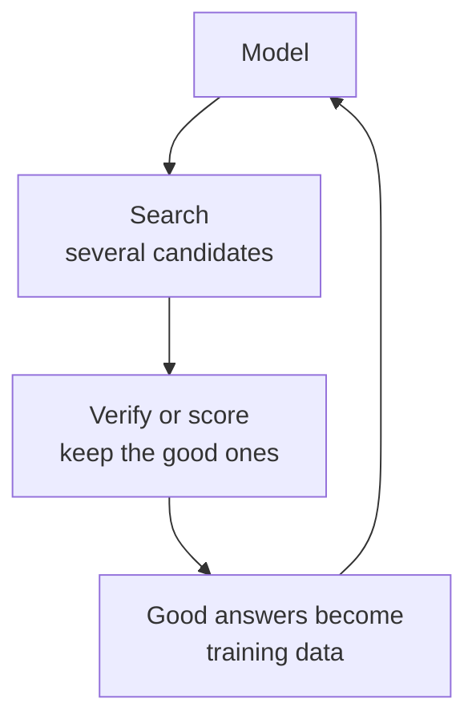

> 🌏 [中文版](/posts/tech/2026-10-13-mit-67960-l24-inference-methods)

**Video status: Videos included.** [Video source and notes](#lecture-video-source)

> **Edition**: based on **MIT 6.7960 Fall 2024 OCW** (OCW Lec 24, Inference Methods for Deep Learning, taught by Phillip Isola). This post is written from the official OCW transcript and slides. The transcript has no timestamps, so references point to content rather than times. This lecture was new in Fall 2024, and the lecturer states that the part about o1 is his speculation.

---

## The Question This Lecture Answers

The model's weights are fixed and it still answers poorly. Short of retraining, what can you do?

Until this lecture, [MIT 6.7960](https://ocw.mit.edu/courses/6-7960-deep-learning-fall-2024/) is almost entirely about training; at test time the only thing done is a forward pass. Phillip Isola says this topic was not a big thing in earlier years and suddenly became hot in 2024: spending more compute at test time buys clearly better results. He draws on Sasha Rush's [tutorial slides](https://srush.github.io/awesome-o1/o1-tutorial.pdf) and says the payoff of the lecture is knowing how models like OpenAI's o1 "presumably" work.

After this post you should be able to:

- Explain why choosing the most likely word at each step need not give the most likely sentence, and work out a counterexample.
- Compare three kinds of search: Best-of-N, beam search and chain-of-thought.
- Say how test-time training differs from in-context learning.
- Draw the loop in which search improves learning and learning improves search.

Prerequisites are autoregressive language models, in-context learning and chain-of-thought from [Lecture 21](/posts/tech/2026-10-13-mit-67960-l21-language-models-en), and scaling laws from [Lecture 20](/posts/tech/2026-10-13-mit-67960-l20-scaling-laws-en).

## Two Meanings of "Inference"

In statistics, inference is figuring out properties of a data-generating process from samples, which machine learning calls training. In machine learning, inference is using a trained model to make predictions about new data, which statisticians call prediction. This lecture uses the machine learning definition.

## A Spectrum from Training to Search

Isola lays all the methods out along one line, noting that the categorization is his own and the boundaries are not hard.

| Stage | Given what, do what | Examples |
|---|---|---|
| Pre-training | Given data, learn a model or representation | Generative modeling, representation learning |
| Post-training | Given a model and new data, update the model | Fine-tuning, RLHF |
| Adaptation at deployment | Given a model and test data, change the model's behavior | Prompting, in-context learning, test-time training |
| Search | Given a model and a query, find the best answer | Best-of-N, beam search, MCTS, chain-of-thought |

The first two rows happen "in the factory"; the last two happen after the model is in a user's hands.

He calls training **amortized inference**: inference is thinking through to an answer step by step, and training amortizes that process into a set of weights that map directly from question to answer without rethinking each time.

## Why Search, Why Now

Richard Sutton's [The Bitter Lesson](http://www.incompleteideas.net/IncIdeas/BitterLesson.html) says only two general-purpose methods keep scaling with computation: search and learning. Deep learning has bet almost entirely on learning.

OpenAI's [post introducing o1](https://openai.com/index/learning-to-reason-with-llms/) has two plots: more train-time compute gives higher accuracy, and more **test-time** compute also gives higher accuracy, with a steeper slope in that plot than the training one. Isola says this is the shift under way in industry: from deploying compute only at train time to deploying a lot at test time as well, not one forward pass but many.

### Search Is How AI Used to Be Done

- **Deep Blue** beat Kasparov almost entirely by search: if the opponent plays this, I reply with that, expanding the tree a dozen or twenty moves ahead and choosing the move with the best expected outcome. Chess has a modest branching factor, so this was feasible. (The lecture says "1994 maybe"; the match was in 1997.)
- **[AlphaGo](https://www.nature.com/articles/nature16961)** also expands a tree of futures, but Go's branching factor is far larger and brute force is impossible, so learned heuristics go on top. It uses both search and learning.

[Jones (2021)](https://arxiv.org/abs/2104.03113) measures the trade-off between the two in board games: more search reaches the same Elo with less training, and the reverse holds too. Isola's phrasing is that there are "two different ways of being smart." Learning has the advantage of not needing much compute at test time; search has the advantage of not needing as much time spent learning.

## Why Greedy Sampling Is Not Optimal

The lecture's example is a model that captions a molecule (input: the molecular graph of caffeine; output: "a mild stimulant that enhances cognitive abilities").

Autoregressive models are trained with **teacher forcing**: when predicting each word, the preceding words given are the ground truth from the training data. At test time the preceding words are whatever the model itself just generated. There is a gap, and once the generated text deviates slightly from the true distribution, later predictions fall outside what was seen in training and the deviation compounds.

The more fundamental problem: the model defines the probability of an entire sequence (the product of the per-step conditionals), and what we want is the sequence that maximizes that joint probability. Greedy sampling picks the most likely word at each step, and the resulting sequence does **not necessarily** maximize the joint probability. The random sampling used in practice certainly does not.

### A Counterexample, Worked

The following is an example written for this post. Sequences have two words, and the model gives:

| First word | Probability | Conditional probabilities of the second word |
|---|---|---|
| A | 0.6 | x: 0.5, y: 0.5 |
| B | 0.4 | z: 0.9, w: 0.1 |

The joint probabilities of the four complete sequences:

| Sequence | Joint probability |
|---|---|
| A x | $0.6 \times 0.5 = 0.30$ |
| A y | 0.30 |
| B z | $0.4 \times 0.9 = 0.36$ |
| B w | 0.04 |

Greedy sampling picks A first (0.6 beats 0.4) and can then reach at most 0.30. The best sequence is B z at 0.36. The first step that looked worse is followed by a much more certain continuation.

Isola also leaves the class a question: does step-by-step denoising in a diffusion model have the same problem? Yes, because it is also done step by step and the best choice at each step does not guarantee the best result at the end. He thinks a VAE that decodes in one step does not have it. He says there is less work on intelligent inference for diffusion models than for language models, which makes it a possible topic to work on.

## Three Kinds of Search

### Best-of-N

Sample $N$ times in the usual random way, compute each sequence's joint probability with the chain rule, and keep the highest. The temperature should not be 0 (which falls back to greedy sampling) and should not be too high (which becomes a random search over all sequences).

With the example above at temperature 1, each sample is B z with probability 0.36. With 5 samples the chance of drawing it at least once is $1 - 0.64^5 \approx 0.89$, while greedy sampling never draws it.

A student suggests starting from one solution and changing a word at a time to see whether it improves. Isola says there are many such methods (MCMC, Gibbs sampling, hill climbing), and some people simply ask a language model to rewrite the answer in ten ways that might be better.

His assessment of Best-of-N: to his knowledge, this most naive approach is about as good as anything right now.

### Beam Search

At every step keep the $k$ most probable candidates, expand each, and at the end choose the path with the highest total probability. It is a form of tree search. In the example above with $k = 2$: the first step keeps both A and B, and after expanding the second step B z is found. Isola says it is a little like what that student suggested.

### Chain-of-Thought: Learned Search

Isola calls chain-of-thought an emergent, learned search. His demonstration asks ChatGPT to "use beam search to solve 4 × 5 + 10," and the model does write out two candidate trajectories in its output and choose one. The idea: a reasoning or search process that could be written as a classical algorithm is carried out by the language model itself, which writes the intermediate steps into its context and continues autoregressively.

This belongs to what Eric Jang calls [just ask](https://evjang.com/2021/10/23/generalization.html): do not actually run the search algorithm, just tell the model to do it.

## Swapping the Scoring Criterion

The searches above all maximize the model's own likelihood. The same procedure works with **any** function that maps an output to a score: another model, human ratings, a compiler, a proof checker.

Isola describes RLHF from this angle: have people rate the outputs and pick the one rated highest.

The most useful scoring function is a **verifier**. Ask a language model for a program that computes the Fibonacci sequence, get several candidates, and have the verifier run each one and check whether the output is the Fibonacci sequence. This works because verification is easier than generation:

- Checking a proof is easier than coming up with it.
- Finding the prime factors of a large number is hard; multiplying a set of factors to check them is easy.

He connects this to P and NP: there is a class of problems whose solutions can be checked in polynomial time but which, it is generally believed, cannot be solved in polynomial time.

### Image Generation: Searching in Latent Space

The same idea applies to image generators with latent variables: keep the generator fixed and optimize over the latent $z$ so that the generated image scores highest. Searching only the high-probability region of latent space keeps the result within what the generator considers plausible images.

- **CLIP + VQGAN**: the score is the image-text similarity computed by CLIP. Isola says this was among the first batch of really impressive text-to-image methods, later replaced by diffusion models. His point is that no model at the time could do this through training alone, and the method made a fairly weak generator much stronger through search at test time.
- **[GANalyze](https://arxiv.org/abs/1906.10112)**: the score is a model that predicts whether people will remember an image. Here the whole path is differentiable, so the search can simply be gradient descent, which is easier than the symbolic tree search needed for language models. Making a dog more memorable zooms in and enlarges the eyes; swap in a scorer for aesthetics or emotional valence and the result changes. Isola says the paper was meant as psychology research and that he is connecting it here to the trend of optimizing for human preferences.

A student asks what to do when you care about several objectives at once. The answer is multi-objective optimization: the simplest approach is a weighted sum, but the objectives may be on very different scales, which is where concepts like the Pareto frontier come in.

### Just Asking

Can a continuous score also be handled by just asking? The lecture's example prompts an early DALL·E with "a painting of a mountain next to a waterfall," then "a beautiful painting," then "very beautiful," stacking more "very" each time; the paintings do become more saturated and more beautiful, and max out at some point. The model learned the conditional distribution of "given the reward I want, what should the output look like."

But such learned abilities carry no guarantees. Ask for a "1e-40 Reuben" sandwich and the model draws not a tiny sandwich but a microscope, because that is the connotation numbers like that have in the data. Isola's conclusion is that learned search depends on the training data and, unlike well-understood search algorithms, has no proofs behind it.

## Test-Time Training: Updating the Weights at Test Time

Next come inference methods that change the model itself.

**In-context learning** takes as input a sequence $(x_1, y_1), (x_2, y_2), \dots$ followed by a query, and the model completes the pattern. Isola says this is just the definition of supervised learning, so in-context learning is "learning to do supervised learning."

[The paper by von Oswald et al.](https://arxiv.org/abs/2212.07677) asks: can a Transformer with a context, $f_\theta(x, c)$, be written as a Transformer that sees no context but has different weights, $f_{\theta'}(x)$? They find a case where the two sets of weights are related by exactly one step of gradient descent:

$$
\theta' = \theta + \lambda\, \nabla_\theta\, \mathcal{L}\big(f_\theta(x),\, c\big)
$$

The formula is written as on the slide; the plus sign can be read as folding the descent direction into the sign of $\lambda$. That is, in certain cases in-context learning can be expressed as gradient descent over the examples in the context. Isola notes that the result holds in a simplified setting, a single layer of linear self-attention, and is not the full picture.

This suggests a thought: in that case, why not **actually** do gradient descent over the context?

| | In-context learning | Gradient descent over the context |
|---|---|---|
| Guarantees | It is learned learning, not guaranteed to work; more examples do not guarantee improvement | With a small enough step it is guaranteed to improve performance on those examples |
| Compute it can use | One forward pass | Forward and backward passes repeated for as long as you like |
| Possible downside | — | Gradient descent is not the smartest learning algorithm; in-context learning could learn a better way to update |

This approach is called **test-time training**: update the model's weights as a function of what is seen at test time.

A student offers a reason: at training time you have to be a generalist and cannot learn every scenario in advance; at test time you are handed the most relevant examples and can learn a specialized skill on the spot. Isola says that is exactly why people like in-context learning and test-time compute.

### It Works Without Labels Too

What if at test time there is just one image and no label? [Sun et al. (2020)](https://arxiv.org/abs/1909.13231) split the network into a shared trunk $f$ and a task head $g$. The trunk also feeds a self-supervised head. The self-supervised task as described in class is masking some image patches and predicting them back. At test time the trunk is fine-tuned on that test image with the self-supervised loss; Isola says he believes the task head stays frozen. With a better representation the classification improves as well.

Isola's analogy is going to Mars: the distribution of images has changed (more red), there are no labels, but the representation can be adapted on the fly. A student asks how forgetting is avoided; he says the details are in the paper, and his understanding is that it works as long as the trunk is not changed much.

### ARC

A result from a week or two before the lecture: [the paper by Akyürek et al.](https://arxiv.org/abs/2411.07279) reaches 61.9% on the ARC challenge with test-time training, which the slides mark as the best result at the time. Each ARC problem gives a few input-output examples and asks you to infer the rule and apply it to a new input; Isola says the challenge was designed to defeat deep nets that only do a forward pass, and that expert humans get 80% to 90%.

The method: pre-train a model that is generally good at this kind of problem; for each problem, treat its few examples as a small training set and do supervised learning on them with gradient descent; then answer the query. It does not feed the examples to a Transformer as context. Fine-tuning on a training set of similar problems works less well, because the problem's own examples are the most relevant data.

A student asks whether this is cheating by looking at the test data. Isola says no: the problem is defined as examples given, answer to a new query wanted, and the model never sees the answer to the query.

From this he raises a question: do we really need fancy new symbolic reasoning methods, or is gradient descent still one of the best tools even at inference time?

## The Loop Between Search and Learning

The last part connects the two.



**Using search to improve learning**: the model produces several answers; Best-of-N, tree search or some other optimization finds a better answer than the default output; then the pair of question and better answer becomes training data for supervised learning, so the model learns to output it directly. This is sometimes called self-improvement. Isola points out that if the verifier is external, the information actually comes in through the verifier; but the verifier can also be a learned model, because learning to verify is easier than learning to generate.

**Using learning to improve search**: in the other direction, the learned model can guide the search so it is no longer random.

Together, Isola says, this is the basic loop of reinforcement learning. He explains it with Mario:

1. Try random action sequences until one gets a high score (jumping over the pipe, say).
2. Train a network (a policy) that maps directly from the state to that good action, so no search is needed afterward.
3. Repeat, this time guiding the search with the policy so that it preferentially tries what the policy thinks is good.

AlphaGo works this way: tree search finds the best move, which is then distilled into a heuristic that predicts the result without expanding the tree.

### STaR and a Speculation About o1

A student asks: games have a score from the environment, so what about general reasoning in language? Isola answers with [STaR](https://arxiv.org/abs/2203.14465). The model is prompted to write its reasoning (the paper calls it a rationale) before answering; if the answer is checked and found correct, that pair of rationale and answer is added to the training data and the model is fine-tuned to produce such rationales, the ones that lead to correct answers, more often. The rationales are generated by the model itself; Isola says he does not remember the details but thinks only a handful written by people were used as a seed.

Finally, the speculation about o1. Isola stresses that nobody knows how it actually works and that what follows is his best guess, which matches one of Sasha Rush's candidate explanations (the slide lists four points; this post splits deployment out as a fifth):

1. For each problem, randomly sample many chains of thought.
2. Use some scoring function to find the ones that actually solve it. The scorer could be a learned verifier, people, a compiler or a proof checker; this is not known.
3. Fine-tune the model to output those good chains of thought more often.
4. Repeat. As the model improves, the search converges on a narrower set of good chains.
5. At deployment you can use the fine-tuned model alone or add a layer of search on top.

The fifth point explains why such models take longer to answer. A student asks how this could be more efficient. Isola says the claim is not efficiency but accuracy: more compute per query buys a better answer; once distilled back, the base model is as fast as before, and for better still you add search on top.

## Common Misunderstandings

- **"Temperature 0 gives the answer the model thinks is best."** That is greedy sampling, and the most likely word at each step is not the most likely sentence.
- **"Chain-of-thought is the model running a search algorithm."** It is learned behavior that reads like search, without the guarantees of a search algorithm.
- **"Test-time training is peeking at the answer."** It uses the test input itself or the examples that come with the problem, not the answer to the query.
- **"Self-improvement is getting better out of nothing."** The lecture's account is that with an external verifier the information actually comes in through the verifier; the verifier can also be a learned model, because learning to verify is easier than learning to generate, and only then is it purely self-improvement.
- **"Computing more at test time is more efficient."** What it buys is accuracy, at the cost of more compute per query.

## Check Yourself

1. Change $P(z \mid B)$ in the example above to 0.7 (and $w$ to 0.3). Does greedy sampling still miss the best sequence?
   **Answer**: B z becomes $0.4 \times 0.7 = 0.28$, below A x at 0.30. Now greedy sampling does reach one of the best sequences. Greedy is not always wrong; it just has no guarantee.
2. With the original example, how many samples does Best-of-N need for the chance of drawing B z to exceed 99%?
   **Answer**: we need $0.64^N < 0.01$, so $N > \ln 0.01 / \ln 0.64 \approx 10.3$, which means 11 samples.
3. You have an environment that can run unit tests and want a language model's code to be more reliable. Which approach from this lecture is most direct?
   **Answer**: Best-of-N with the unit tests as the verifier: generate several candidates and keep the ones that pass. Verification is easier than generation, and the result is actually correct, not merely probable.
4. Given some extra test-time compute, what do Best-of-N and chain-of-thought each spend it on? Which one comes with a guarantee?
   **Answer**: Best-of-N spends it on several independent candidates and then picks one by likelihood or with a verifier; as long as the scoring is reliable, more candidates raise the chance of picking a good answer. Chain-of-thought has the model write its own intermediate steps within one generation, which resembles search but is learned behavior without the guarantees of a search algorithm.
5. In the STaR loop, which steps are search, verification and learning? What changes if the verifier is replaced by a learned model?
   **Answer**: search is the model generating a rationale and an answer for each question; verification is checking whether the answer is right; learning is fine-tuning on the rationale-and-answer pairs that pass. With an external verifier the information comes in through the verifier; with a learned one it is what the lecture calls purely self-improvement, on the premise that verifying is easier to learn than generating.
6. An ARC problem comes with three examples. How do test-time training and in-context learning each use them?
   **Answer**: in-context learning puts the three examples and the query into the input together and does one forward pass. Test-time training treats the three examples as training data, updates the weights with gradient descent for some number of steps, and then answers the query alone with the updated model.

## Lecture Video Source

Rechecked against the live MIT OCW Fall 2024 gallery on 2026-10-13: the lecture number matches and the video is public and embeddable. Lecture numbering and topics follow OCW.

```youtube
url: https://www.youtube.com/watch?v=mbgFTqKxR7A
title: MIT 6.7960 Fall 2024 — Lec 24. Inference Methods for Deep Learning
```

Original video: [MIT 6.7960 Fall 2024 — Lec 24. Inference Methods for Deep Learning](https://www.youtube.com/watch?v=mbgFTqKxR7A)

Course and recording links:

- [MIT OCW — Lec 24. Inference Methods for Deep Learning](https://ocw.mit.edu/courses/6-7960-deep-learning-fall-2024/resources/mit6_7960f24_lec24_mp4/)
- [MIT 6.7960 Fall 2024 — official lecture video gallery](https://ocw.mit.edu/courses/6-7960-deep-learning-fall-2024/video_galleries/lecture-videos/)

Checked: 2026-10-13.

Content check: verified against the video transcript (2026-10-13): read the full official OCW transcript and the slides. The transcript has no timestamps and the audio was not replayed for this post. The 61.9% on ARC is from the slides (the lecturer says 62% aloud) and reflects late 2024; its current status was not checked here. The two-word probability table and the calculations based on it are this post's own; the section on o1 is the lecturer's speculation.

## References

- [MIT 6.7960 Fall 2024 OCW course home](https://ocw.mit.edu/courses/6-7960-deep-learning-fall-2024/)
- [Lec 24 official transcript (PDF)](https://ocw.mit.edu/courses/6-7960-deep-learning-fall-2024/mit6_7960f24_lec24_transcript.pdf)
- [Lecture 24: Inference Methods for Deep Learning slides](https://ocw.mit.edu/courses/6-7960-deep-learning-fall-2024/resources/mit6_7960_f24_lec24_pdf/)
- Sasha Rush, [Speculations on Test-Time Scaling (o1 tutorial slides)](https://srush.github.io/awesome-o1/o1-tutorial.pdf)
- OpenAI, [Learning to reason with LLMs](https://openai.com/index/learning-to-reason-with-llms/)
- Richard Sutton, [The Bitter Lesson](http://www.incompleteideas.net/IncIdeas/BitterLesson.html)
- Silver, Huang et al., [Mastering the game of Go with deep neural networks and tree search](https://www.nature.com/articles/nature16961) (Nature 2016)
- Andy Jones, [Scaling Scaling Laws with Board Games](https://arxiv.org/abs/2104.03113)
- Goetschalckx, Andonian, Oliva, Isola, [GANalyze: Toward Visual Definitions of Cognitive Image Properties](https://arxiv.org/abs/1906.10112) (ICCV 2019)
- Eric Jang, [Just Ask for Generalization](https://evjang.com/2021/10/23/generalization.html)
- von Oswald et al., [Transformers learn in-context by gradient descent](https://arxiv.org/abs/2212.07677) (ICML 2023)
- Sun et al., [Test-Time Training with Self-Supervision for Generalization under Distribution Shifts](https://arxiv.org/abs/1909.13231) (ICML 2020)
- Akyürek et al., [The Surprising Effectiveness of Test-Time Training for Abstract Reasoning](https://arxiv.org/abs/2411.07279) (the title as cited in class; a later arXiv version is retitled "...for Few-Shot Learning")
- Zelikman, Wu, Mu, Goodman, [STaR: Bootstrapping Reasoning With Reasoning](https://arxiv.org/abs/2203.14465)
