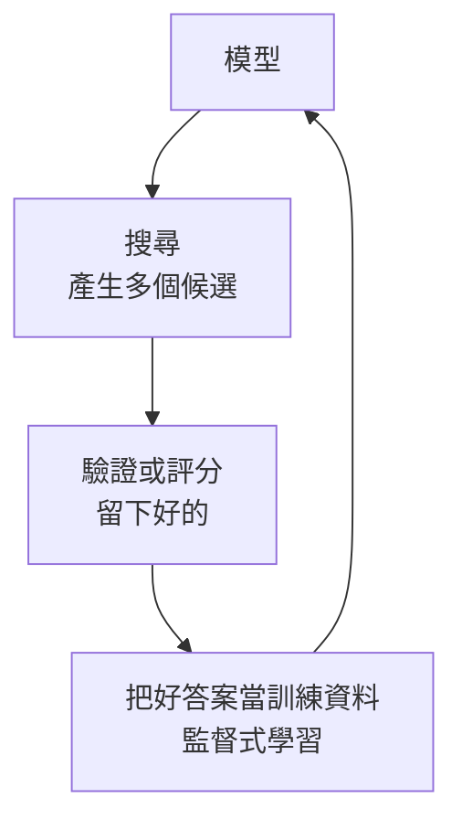

> 🌏 [English version](/posts/tech/2026-10-13-mit-67960-l24-inference-methods-en)

**影片狀態：已附影片。** [影片來源與說明](#課程影片來源)

> **教材版本**：基於 **MIT 6.7960 Fall 2024 OCW**（對應 OCW Lec 24 Inference Methods for Deep Learning，Phillip Isola 主講）。本文依 OCW 官方逐字稿與投影片整理；逐字稿沒有時間戳，引用以段落內容定位。這是 2024 年秋季新增的一堂，講者說明關於 o1 的部分是他的推測。

---

## 這一堂要回答的問題

模型的權重已經固定，題目卻答不好。除了重新訓練，還有什麼辦法？

到這堂之前，[MIT 6.7960](https://ocw.mit.edu/courses/6-7960-deep-learning-fall-2024/) 幾乎都在談訓練；測試時做的事只有一次前向傳遞。Phillip Isola 說這堂的主題前幾年還不算大事，2024 年突然變成熱門：在測試時花更多運算，可以換到明顯更好的結果。他參考了 Sasha Rush 的[教學投影片](https://srush.github.io/awesome-o1/o1-tutorial.pdf)，並說這堂的回報是：你會知道 OpenAI o1 這類模型「大概」怎麼運作。

讀完這篇，你應該能：

- 說明為什麼逐步挑最可能的詞，得到的不一定是最可能的整句，並算出一個反例。
- 比較 Best-of-N、beam search、chain-of-thought 三種搜尋。
- 說明 test-time training 與 in-context learning 差在哪。
- 畫出「搜尋改進學習、學習改進搜尋」的迴圈。

先備是[第 21 堂](/posts/tech/2026-10-13-mit-67960-l21-language-models)的自迴歸語言模型、in-context learning 與 chain-of-thought，以及[第 20 堂](/posts/tech/2026-10-13-mit-67960-l20-scaling-laws)的 scaling law。

## 兩個「inference」

統計學說的 inference 是從樣本推斷資料生成過程的性質，機器學習把這件事叫訓練。機器學習說的 inference 是拿訓練好的模型對新資料做預測，統計學家把這叫 prediction。這堂用機器學習的定義。

## 從訓練到搜尋的光譜

Isola 把所有方法排在一條線上，並說明這是他自己的分類，邊界不是硬的。

| 階段 | 給定什麼、做什麼 | 例子 |
|---|---|---|
| 預訓練 | 給資料，學出模型或表示 | 生成模型、表示學習 |
| 後訓練 | 給模型與新資料，更新模型 | 微調、RLHF |
| 部署時調適 | 給模型與測試資料，改變模型的行為 | 提示、in-context learning、test-time training |
| 搜尋 | 給模型與一個問題，找出最好的答案 | Best-of-N、beam search、MCTS、chain-of-thought |

前兩列發生在「工廠裡」，後兩列發生在模型已經交到使用者手上之後。

他把訓練稱為**攤銷的推論**（amortized inference）：推論是一步步想出答案；訓練是把這個過程攤銷成一組權重，之後直接從問題對應到答案，不必每次重想。

## 為什麼現在談搜尋

Richard Sutton 的 [The Bitter Lesson](http://www.incompleteideas.net/IncIdeas/BitterLesson.html) 說，能隨運算量持續放大的通用方法只有兩種：搜尋與學習。深度學習這些年幾乎只押學習。

OpenAI 介紹 [o1 的文章](https://openai.com/index/learning-to-reason-with-llms/)裡有兩張圖：訓練時的運算愈多，準確率愈高；**測試時**的運算愈多，準確率也愈高，而且在那張圖上斜率比訓練那條更陡。Isola 說這是業界正在發生的轉向：從只在訓練時投入運算，變成測試時也大量投入，不是一次前向傳遞，而是很多次。

### 搜尋是 AI 原本的做法

- **深藍**打敗 Kasparov 靠的幾乎全是搜尋：對手下這步、我回那步，往前展開十幾二十步的樹，選期望結果最好的走法。西洋棋的分支因子不大，所以做得到。（課堂上說「大概 1994 年」，那場比賽是 1997 年。）
- **[AlphaGo](https://www.nature.com/articles/nature16961)** 同樣展開未來的樹，但圍棋的分支因子大得多，無法暴力搜尋，所以要加上學來的啟發式。它同時用了搜尋與學習。

[Jones 2021 年的論文](https://arxiv.org/abs/2104.03113)在棋類遊戲上量出兩者的替代關係：多搜尋一點，就能用比較少的訓練達到同樣的 Elo；反過來也成立。Isola 的說法是「變聰明有兩種方式」。學習的好處是測試時不必花大量運算；搜尋的好處是不必花那麼多時間學。

## 貪婪取樣為什麼不是最佳

課堂用一個替分子寫說明文字的模型當例子（輸入咖啡因的分子圖，輸出「一種提升認知能力的溫和興奮劑」）。

自迴歸模型訓練時用 **teacher forcing**：預測每個詞的時候，前文給的是訓練資料裡的正確答案。測試時前文卻是模型自己剛生成的詞。兩者有落差，模型生成的內容一旦稍微偏離真實分布，接下來的預測就落在訓練時沒看過的情況，偏差會累積。

更根本的問題是：模型定義的是整個序列的機率（各步條件機率的乘積），而我們想要讓這個聯合機率最大的序列。貪婪取樣每一步挑最可能的詞，得到的序列**不一定**讓聯合機率最大。實務上常用的隨機取樣更不是。

### 算一個反例

以下是本文自擬的例子。兩個詞的序列，模型給的機率如下：

| 第一個詞 | 機率 | 第二個詞的條件機率 |
|---|---|---|
| A | 0.6 | x：0.5，y：0.5 |
| B | 0.4 | z：0.9，w：0.1 |

四個完整序列的聯合機率：

| 序列 | 聯合機率 |
|---|---|
| A x | $0.6 \times 0.5 = 0.30$ |
| A y | 0.30 |
| B z | $0.4 \times 0.9 = 0.36$ |
| B w | 0.04 |

貪婪取樣第一步選 A（0.6 大於 0.4），之後最多拿到 0.30。最佳的序列是 B z，0.36。第一步看起來比較差的選擇，後面接得比較確定。

課堂上 Isola 還留了一個問題：擴散模型的逐步去雜訊有同樣的問題嗎？有，因為它也是一步步做的，每一步的最佳不保證最後的最佳。他認為一步到位的 VAE 解碼沒有這個問題。他說擴散模型的聰明推論研究比語言模型少，是可以做的題目。

## 三種搜尋

### Best-of-N

照平常的方式隨機取樣 $N$ 次，用連鎖律算出每個序列的聯合機率，留下最高的那個。溫度不能設成 0（那就退回貪婪取樣），也不能太高（變成在所有序列裡亂找）。

用上面的例子，溫度為 1 時每次取樣抽到 B z 的機率是 0.36。取樣 5 次，至少抽到一次的機率是 $1 - 0.64^5 \approx 0.89$，而貪婪取樣永遠抽不到它。

有學生建議從一個解出發、每次改一個詞看會不會更好。Isola 說這類做法很多（MCMC、Gibbs 取樣、爬山法），也有人直接請語言模型把答案改寫成十種可能更好的版本。

他對 Best-of-N 的評語是：就他所知，這個最天真的做法目前與任何方法差不多好。

### Beam search

每一步保留機率最高的 $k$ 個候選，各自往下展開，最後選整條路徑機率最高的。它是一種樹搜尋。上面的例子用 $k = 2$：第一步同時保留 A 與 B，第二步展開後就會找到 B z。Isola 說它有點像那位學生的建議。

### Chain-of-thought：學來的搜尋

Isola 把 chain-of-thought 稱為湧現的、學來的搜尋。他的示範是請 ChatGPT「用 beam search 解 4 × 5 + 10」，模型真的在輸出裡寫出兩條候選路徑再選一條。意思是：一個原本可以寫成古典演算法的推理或搜尋過程，改由語言模型自己執行，把中間步驟寫進上下文，再接著往下生成。

這屬於 Eric Jang 稱為 [just ask](https://evjang.com/2021/10/23/generalization.html) 的做法：不真的去跑搜尋演算法，直接叫模型做。

## 把評分標準換掉

上面的搜尋都在最大化模型自己的概似。同樣的做法可以換成**任何**把輸出對應到一個分數的函數：另一個模型、人的評分、編譯器、證明檢查器。

Isola 用這個角度描述 RLHF：請人替各個輸出評分，挑人評得最高的。

最有用的評分函數是**驗證器**。請語言模型寫一個計算費氏數列的程式，它給出幾個候選，驗證器把每個程式跑一遍，看輸出是不是費氏數列。這樣做有效，是因為驗證比生成容易：

- 檢查一個證明比想出證明容易。
- 找出一個大數的質因數很難，把一組因數乘起來檢查很容易。

他把這連到 P 與 NP：有一類問題的解可以在多項式時間內檢查，但一般認為無法在多項式時間內求解。

### 影像生成：在潛在空間裡搜尋

同樣的想法可以用在有潛在變數的影像生成器上：固定生成器，在潛在變數 $z$ 上最佳化，讓生成的影像分數最高。只搜尋潛在空間裡機率高的區域，結果就留在生成器認為合理的影像範圍內。

- **CLIP + VQGAN**：分數是 CLIP 算出來的影像與文字相似度。Isola 說這是最早令人驚豔的一批文字轉影像方法，後來被擴散模型取代。他的重點是：當時沒有任何模型能在訓練時學會這件事，這個方法靠測試時的搜尋，把一個偏弱的生成器變強。
- **[GANalyze](https://arxiv.org/abs/1906.10112)**：分數是一個預測「人會不會記住這張圖」的模型。這裡整條路都可微，所以搜尋可以直接用梯度下降，比語言模型的符號式樹搜尋簡單。讓狗變得好記，結果是拉近、眼睛變大；換成美感或情緒的評分器，結果又不同。Isola 說這篇原本是心理學取向的研究，他在這裡把它連到最佳化人類偏好的趨勢。

有學生問同時在乎好幾個目標怎麼辦。答案是多目標最佳化：最簡單是加權相加，但各目標的尺度可能差很多，所以有 Pareto 前緣這類概念。

### 直接開口要

連續的評分能不能也用 just ask？課堂的例子是對早期的 DALL·E 下提示：「一幅山與瀑布的畫」，再改成「一幅美麗的畫」「非常美麗」，一直疊「非常」，畫確實愈來愈飽和、愈來愈好看，疊到某個程度就封頂。模型學到了「給定想要的分數，輸出該長怎樣」的條件分布。

但這種學來的能力沒有保證。要求一個「1e-40 級的魯賓三明治」，模型畫的不是很小的三明治，而是一台顯微鏡，因為資料裡這種數字連著的是顯微鏡。Isola 的結論是：學來的搜尋取決於訓練資料，不像已知的搜尋演算法有證明可依靠。

## Test-time training：在測試時更新權重

接下來是會改變模型本身的推論方法。

**In-context learning** 的輸入是一串 $(x_1, y_1), (x_2, y_2), \dots$ 加上一個查詢，模型接著把這個規律續完。Isola 說這就是監督式學習的定義，所以 in-context learning 是「學會做監督式學習」。

[von Oswald 等人的論文](https://arxiv.org/abs/2212.07677)問：帶著上下文 $c$ 的 Transformer $f_\theta(x, c)$，能不能寫成一個不看上下文、但權重不同的 Transformer $f_{\theta'}(x)$？他們找到一種情況，兩組權重的關係正好是一步梯度下降：

$$
\theta' = \theta + \lambda\, \nabla_\theta\, \mathcal{L}\big(f_\theta(x),\, c\big)
$$

式子照投影片的寫法；加號可以理解為把下降方向收進 $\lambda$ 的正負號裡。也就是在某些情況下，in-context learning 可以表示成對上下文裡的範例做梯度下降。Isola 說這個結果是在單層線性自注意力這種簡化設定下得到的，不是全貌。

這引出一個想法：既然如此，為什麼不**真的**對上下文做梯度下降？

| | In-context learning | 對上下文做梯度下降 |
|---|---|---|
| 保證 | 是學來的學習，不保證有效；多給範例不保證變好 | 步長夠小就保證改善這些範例上的表現 |
| 能用的運算 | 一次前向傳遞 | 可以反覆做前向與反向，要跑多久都行 |
| 可能的缺點 | — | 梯度下降不是最聰明的學習演算法，in-context learning 有可能學到更好的更新方式 |

這個做法叫 **test-time training**：依測試時看到的東西更新模型的權重。

有學生提了一個理由：訓練時要當通才，不可能事先學會所有情況；測試時拿到最相關的例子，可以當場學一個專門的技能。Isola 說這正是大家喜歡 in-context learning 與測試時運算的原因。

### 沒有標籤也能做

測試時只有一張圖、沒有標籤怎麼辦？[Sun 等人 2020 年的論文](https://arxiv.org/abs/1909.13231)把網路拆成共用的主幹 $f$ 與任務頭 $g$。主幹同時接一個自監督的頭。課堂描述的自監督任務是遮住部分影像區塊再預測回來。測試時就用這個自監督損失在那張測試影像上微調主幹；Isola 說他印象中任務頭保持不動。表示變好之後分類也跟著變準。

Isola 的比喻是到了火星：影像的分布變了（偏紅），沒有標籤，但可以當場調整表示。有學生問怎麼避免遺忘，他說細節要查論文，他的理解是只要主幹改得不多就可行。

### ARC

課堂前一兩週才出現的結果：[Akyürek 等人的論文](https://arxiv.org/abs/2411.07279)在 ARC 挑戰上用 test-time training 做到 61.9%，投影片標為當時的最佳成績。ARC 每題給幾組輸入輸出的範例，要你推出規則套到新的輸入上；Isola 說這個挑戰本來就是設計來難倒只做一次前向傳遞的深度網路的，專家級的人可以做到八九成。

做法是：先預訓練一個擅長這類題目的模型；每一題把那幾組範例當成一個小訓練集，用梯度下降做監督式學習；再回答查詢。它不是把範例當上下文餵給 Transformer。在相似題目的訓練集上微調的效果比較差，因為題目自己的範例才是最相關的資料。

有學生問這算不算偷看測試資料。Isola 回答不算：題目的定義就是給範例、求新查詢的答案，模型沒有看到查詢的答案。

他由此提出一個問題：我們真的需要新穎的符號推理方法嗎？還是梯度下降在推論階段仍然是最好用的工具之一？

## 搜尋與學習的迴圈

最後一段把兩者接起來。



**用搜尋改進學習**：模型產生多個答案，用 Best-of-N、樹搜尋或其他最佳化找出比預設輸出更好的答案，再把「問題、較好的答案」當成監督式學習的訓練資料，讓模型學會直接輸出它。這有時被稱為自我改進。Isola 提醒，如果驗證器是外部的，資訊其實是從驗證器進來的；但驗證器也可以是學來的模型，因為學會驗證比學會生成容易。

**用學習改進搜尋**：反過來，學到的模型可以引導搜尋，不再隨機找。

兩者合起來，Isola 說就是強化學習的基本迴圈。他用瑪利歐說明：

1. 隨機嘗試動作序列，直到找到分數高的（例如跳過水管）。
2. 訓練一個網路（policy）直接從狀態對應到那個好動作，之後不必再搜尋。
3. 重複，但這次用 policy 引導搜尋，優先嘗試它認為好的動作。

AlphaGo 就是這樣：樹搜尋找出最好的走法，再蒸餾成一個不必展開樹就能預測結果的啟發式。

### STaR 與對 o1 的推測

有學生問：遊戲有環境給的分數，一般的語言推理怎麼辦？Isola 用 [STaR](https://arxiv.org/abs/2203.14465) 回答。模型被提示先寫推理過程（論文稱為 rationale）再作答；如果答案經檢查是對的，就把這組「推理過程加答案」加進訓練資料，微調模型，讓它更常產生這種通往正確答案的推理。推理過程是模型自己生成的；Isola 說他不記得細節，印象中只用了少量人寫的當種子。

最後是對 o1 的推測。Isola 強調沒有人知道它實際怎麼做，以下是他的最佳猜測，也與 Sasha Rush 的一個候選解釋相同（投影片列成四點，本文把部署拆出來成為第五點）：

1. 對每個問題隨機取樣多條 chain-of-thought。
2. 用某種評分找出真的解對的。評分者可能是學來的驗證器、人、編譯器或證明檢查器，這點不清楚。
3. 微調模型，讓它更常輸出這些好的推理過程。
4. 重複。模型愈來愈好，搜尋就收斂到愈來愈窄的一群好推理。
5. 部署時可以只用微調後的模型，也可以再疊一層搜尋。

第五點解釋了為什麼這類模型回答得比較慢。有學生問這怎麼會比較有效率。Isola 說它主張的不是效率而是準確率：每個問題花更多運算換更好的答案；蒸餾回基礎模型後，基礎模型本身與原來一樣快，要更好就再疊搜尋。

## 常見誤解

- **「溫度設 0 就會得到模型認為最好的答案」**：那是貪婪取樣，每一步最可能不等於整句最可能。
- **「Chain-of-thought 是模型在跑搜尋演算法」**：它是模型學來的行為，寫出來像搜尋，但沒有搜尋演算法的保證。
- **「Test-time training 是偷看答案」**：它用的是測試輸入本身或題目附的範例，不是查詢的答案。
- **「自我改進是憑空變好」**：課堂的說法是，驗證器在外部時，資訊其實是從驗證器進來的；驗證器也可以是學來的模型，因為學會驗證比學會生成容易，那才算純粹的自我改進。
- **「測試時多算比較有效率」**：它換到的是準確率，代價是每題更多運算。

## 自我檢查

1. 把上面例子的 $P(z \mid B)$ 改成 0.7（$w$ 改成 0.3）。貪婪取樣還會錯過最佳序列嗎？
   **答**：B z 的機率變成 $0.4 \times 0.7 = 0.28$，低於 A x 的 0.30。這時貪婪取樣得到的就是最佳序列之一。貪婪不一定錯，只是沒有保證。
2. 用原本的例子，Best-of-N 要取樣幾次，抽到 B z 的機率才超過 99%？
   **答**：要 $0.64^N < 0.01$，$N > \ln 0.01 / \ln 0.64 \approx 10.3$，所以 11 次。
3. 你有一個能跑單元測試的環境，想讓語言模型寫出的程式更可靠。這堂的哪個做法最直接？
   **答**：把單元測試當驗證器做 Best-of-N：生成多個候選，留下通過測試的。驗證比生成容易，而且結果是真的正確，不只是機率高。
4. 同樣多花一些測試時的運算，Best-of-N 與 chain-of-thought 各拿這些運算做什麼？哪一個有保證？
   **答**：Best-of-N 把它們花在多個獨立的候選上，再用概似或驗證器挑一個；只要評分可靠，候選愈多、挑到好答案的機率就愈高。Chain-of-thought 是讓模型在一次生成裡自己寫出中間步驟，像搜尋，但那是學來的行為，沒有搜尋演算法的保證。
5. 在 STaR 的迴圈裡，搜尋、驗證、學習各是哪一步？把驗證器換成學來的模型會改變什麼？
   **答**：搜尋是模型對每題生成推理過程與答案；驗證是檢查答案對不對；學習是把通過檢查的「推理過程加答案」拿去微調。驗證器是外部的時候，資訊從驗證器進來；換成學來的模型，就是課堂說的純粹自我改進，前提是驗證比生成容易學。
6. 一題 ARC 給了三組範例。Test-time training 與 in-context learning 各自怎麼用這三組？
   **答**：in-context learning 把三組範例與查詢一起放進輸入，做一次前向傳遞。Test-time training 把三組範例當訓練資料，用梯度下降更新權重若干步，再用更新後的模型單獨回答查詢。

## 課程影片來源

2026-10-13 已即時回 MIT OCW Fall 2024 官方錄影列表核對講次，影片公開且允許嵌入；講次與主題以 OCW 的標示為準。

```youtube
url: https://www.youtube.com/watch?v=mbgFTqKxR7A
title: MIT 6.7960 Fall 2024 — Lec 24. Inference Methods for Deep Learning
```

原始影片：[MIT 6.7960 Fall 2024 — Lec 24. Inference Methods for Deep Learning](https://www.youtube.com/watch?v=mbgFTqKxR7A)

課程與錄影入口：

- [MIT OCW — Lec 24. Inference Methods for Deep Learning](https://ocw.mit.edu/courses/6-7960-deep-learning-fall-2024/resources/mit6_7960f24_lec24_mp4/)
- [MIT 6.7960 Fall 2024 — official lecture video gallery](https://ocw.mit.edu/courses/6-7960-deep-learning-fall-2024/video_galleries/lecture-videos/)

查核日期：2026-10-13。

內容核對：已依字幕核對（2026-10-13）：讀了 OCW 官方逐字稿全文與投影片。逐字稿沒有時間戳，本文未回聽原音。ARC 的 61.9% 取自投影片（課堂口頭說 62%），是 2024 年底的狀況，本文沒有另外查證現況；兩個詞的機率表與相關計算是本文自擬；關於 o1 的段落是講者的推測。

## 參考資料

- [MIT 6.7960 Fall 2024 OCW 課程首頁](https://ocw.mit.edu/courses/6-7960-deep-learning-fall-2024/)
- [Lec 24 官方逐字稿（PDF）](https://ocw.mit.edu/courses/6-7960-deep-learning-fall-2024/mit6_7960f24_lec24_transcript.pdf)
- [Lecture 24: Inference Methods for Deep Learning 投影片](https://ocw.mit.edu/courses/6-7960-deep-learning-fall-2024/resources/mit6_7960_f24_lec24_pdf/)
- Sasha Rush，[Speculations on Test-Time Scaling（o1 教學投影片）](https://srush.github.io/awesome-o1/o1-tutorial.pdf)
- OpenAI，[Learning to reason with LLMs](https://openai.com/index/learning-to-reason-with-llms/)
- Richard Sutton，[The Bitter Lesson](http://www.incompleteideas.net/IncIdeas/BitterLesson.html)
- Silver, Huang et al.，[Mastering the game of Go with deep neural networks and tree search](https://www.nature.com/articles/nature16961)（Nature 2016）
- Andy Jones，[Scaling Scaling Laws with Board Games](https://arxiv.org/abs/2104.03113)
- Goetschalckx, Andonian, Oliva, Isola，[GANalyze: Toward Visual Definitions of Cognitive Image Properties](https://arxiv.org/abs/1906.10112)（ICCV 2019）
- Eric Jang，[Just Ask for Generalization](https://evjang.com/2021/10/23/generalization.html)
- von Oswald et al.，[Transformers learn in-context by gradient descent](https://arxiv.org/abs/2212.07677)（ICML 2023）
- Sun et al.，[Test-Time Training with Self-Supervision for Generalization under Distribution Shifts](https://arxiv.org/abs/1909.13231)（ICML 2020）
- Akyürek et al.，[The Surprising Effectiveness of Test-Time Training for Abstract Reasoning](https://arxiv.org/abs/2411.07279)（課堂引用時的標題；arXiv 上後來的版本改名為 ⋯for Few-Shot Learning）
- Zelikman, Wu, Mu, Goodman，[STaR: Bootstrapping Reasoning With Reasoning](https://arxiv.org/abs/2203.14465)
