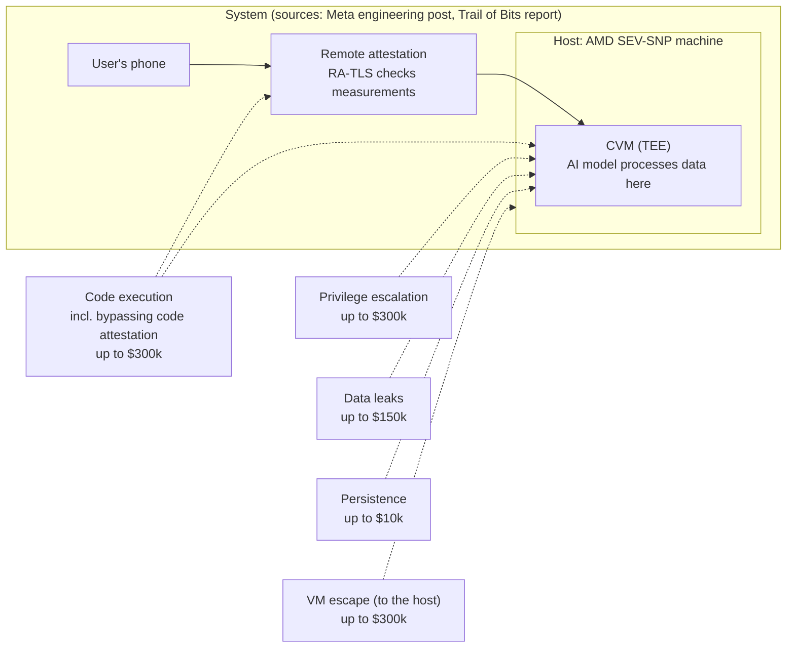

> 🌏 [中文版](/posts/tech/2026-10-14-bug-bounty-zero-09-tee-and-confidential-computing)

[Part 0 of this series](/posts/tech/2026-10-13-bug-bounty-top-payouts-fact-check-en) found that [Meta's WhatsApp Private Processing bounty page](https://bugbounty.meta.com/payout-guidelines/private-processing/) lists code execution, privilege escalation and VM escape inside a TEE at up to $300,000 each. [Part 7](/posts/tech/2026-10-13-bug-bounty-zero-07-vm-and-hypervisor-en) covered the wall between virtual machines, and [part 8](/posts/tech/2026-10-13-bug-bounty-zero-08-hyper-v-escape-case-study-en) took apart a case where that wall had a hole. This part looks at a different kind of wall: one that keeps out not only other customers but the operator of the machine too.

Three questions: what does a TEE protect, what does remote attestation prove, and which part of the design does each row of Meta's bounty table target?

This post covers no attack techniques and does not speculate about Meta's internal implementation. TEE technologies differ by vendor, so I only write what the sources say outright.

## Definitions first: TEE and confidential computing

Data has three states: at rest, in transit, and in use. Encryption for the first two is routine. But when a program computes on data, the data has to be decrypted first. Confidential computing targets that third state.

According to [Microsoft Learn's overview](https://learn.microsoft.com/en-us/azure/confidential-computing/overview), the term was established by the Confidential Computing Consortium (CCC, a Linux Foundation group), which defines it this way:

> Confidential Computing protects data in use by performing computation in a hardware-based, attested Trusted Execution Environment.

The same Microsoft page says Azure confidential computing helps prevent unauthorized access to data in use, including by the cloud operator, and that when it is enabled and properly configured, Microsoft can't access unencrypted customer data. The [CCC homepage](https://confidentialcomputing.io/) makes a similar claim: hardware-enforced isolated contexts where even the hypervisor and cloud provider can't inspect running workloads.

In plain terms: a TEE (Trusted Execution Environment) is a vault room inside a bank. The hardware builds the room, and the people who run the building can't walk in. The key phrase is "hardware-based": the isolation doesn't depend on an administrator promising not to look.

### How this differs from the VM isolation in part 7

Part 7's isolation is about tenants versus each other: [Azure's isolation documentation](https://learn.microsoft.com/en-us/azure/security/fundamentals/isolation-choices) describes the hypervisor separating different customers' VMs on shared hardware. Confidential computing adds a layer; per the two sources above, it puts the cloud operator on the list of parties who shouldn't see inside.

The two aren't alternatives. Trail of Bits' review report describes AMD SEV-SNP, the confidential-VM technology Meta uses, like this: each VM's memory is encrypted with a unique key managed by a secure processor, so the memory can't be read or modified by the hypervisor or other VMs. It is still a VM; the hypervisor just gets less trust. That is what the sources say. How Intel TDX, Arm CCA or NVIDIA do it, this post doesn't cover.

## Remote attestation: a verifiable receipt for "which program runs in this room"

The vault room raises a question. If I'm sending data in, how do I know I'm walking into the right room, running the program I expect?

That's what attestation is for. According to [Microsoft Azure Attestation's documentation](https://learn.microsoft.com/en-us/azure/attestation/overview), attestation is a process for demonstrating that software binaries were properly instantiated on a trusted platform, so a remote relying party can gain confidence that only the intended software is running on trusted hardware.

The Trail of Bits blog titles the feature "Private Inference," while Meta and the review report consistently say "Private Processing"; going by how the blog uses the two terms in the same article they are the same system, but the blog never says so outright. It describes the "measurement" part from another angle: a cryptographic checksum of the code running in the enclave, which the client uses to confirm it is talking to legitimate, unmodified software.

An analogy: the door of each room issues a hardware-signed slip saying "the program in this room has fingerprint X." You check whether X is the one you trust, and only then send your data in.

Two limits to remember, both from the sources above:

1. Attestation says which program is running. It doesn't promise that program is free of bugs.
2. Attestation only covers what was measured. Trail of Bits' first lesson from this audit is not to trust data outside your measurement.

## Why WhatsApp uses it

According to the [Meta engineering post](https://engineering.fb.com/2025/04/29/security/whatsapp-private-processing-ai-tools/): WhatsApp is end-to-end encrypted, but AI processing today mostly means large language models running on servers, where the user's request is visible to the provider. Meta wanted features like message summaries to work without Meta or WhatsApp being able to read the messages. The result is Private Processing, an optional capability built on a TEE.

The steps in that post that matter here:

1. The phone and the TEE set up an RA-TLS (Remote Attestation + TLS) session; verifying the attestation includes cross-checking measurements against a third-party ledger, so the client only connects to code that meets the verifiable-transparency guarantee.
2. The request is encrypted with an ephemeral key that only the device and the selected TEE can use.
3. The AI models process the data inside a confidential virtual machine (CVM, which Meta describes as a type of TEE), without storing messages, and the result is returned encrypted.
4. After the session ends, Private Processing retains no access to the messages.

The [Trail of Bits report](https://github.com/trailofbits/publications/blob/master/reviews/2025-08-meta-whatsapp-privateprocessing-securityreview.pdf) fills in the hardware side: each back-end component is an AMD SEV-SNP host with a guest CVM on it, and the LLM Predictor and Output Guard components also have NVIDIA H100 GPUs in confidential-compute mode. If the client fails to verify the attestation, it closes the connection and sends no user data.

Meta's own post doesn't claim this is bulletproof. It says TEE software exploitation is a growing area of research, that researchers have repeatedly demonstrated ways to bypass TEE guarantees, and that Meta therefore builds on defense in depth.

## What each row of the bounty table maps to

Below is what Meta's bounty page lists (I read the full page on 2026-10-14), under the headings "TEE runtime attacks" and "VM escape":

| Category | Page's description | External scenarios, max | Internal scenarios only |
|---|---|---|---|
| Code execution | Vulnerabilities that enable RCE within the TEE, **including bypassing code attestation** | $300,000 | $50,000 |
| Privilege escalation | Vulnerabilities that enable elevation of privileges | $300,000 | $50,000 |
| Data leaks | Vulnerabilities that cause data to leak (e.g. external storage, or memory leaks containing user data) | $150,000 | $50,000 |
| VM escape | Vulnerabilities that enable escapes to the host | $300,000 | N/A |
| Persistence | Vulnerabilities that let a malicious user persist access to a workload | $10,000 | $5,000 |

Three more things on the page:

- Every amount carries an asterisk, but the page as I read it doesn't show the footnote, so I could not verify what the asterisk means.
- Vulnerabilities limited to internal attack scenarios follow the right-hand column. The page says the main payouts are based on external-actor scenarios and internal-only ones follow a separate table.
- The scope page says access to Private Processing is by invitation only, to validate the security of Meta's TEE.

The diagram puts each row back into the system. The bounty-row text comes from the table above; which part each row attaches to is my own mapping, not Meta's. The system components come from Meta's engineering post and the Trail of Bits report.

Row by row, in plain words (my mapping):

- **Code execution, including bypassing code attestation**: touches both the program inside the room and the slip at the door. By writing "bypassing code attestation" into this row, the page treats the attestation itself as a target.
- **Privilege escalation**: climbing higher if the program inside has levels of permission.
- **Data leaks**: the page's examples are external storage and memory leaks containing user data. Meta's design goals say messages aren't retained after processing and only limited logs leave the CVM; this row tests that promise. The log-filtering part of that design, though, is listed in Trail of Bits' report as outside its review (see the next section), so the sources don't say whether it was independently verified.
- **VM escape**: the other side of the wall is the host. That's part 7's subject, except here the host is the operator, the party the design trusts least. For internal scenarios this row is N/A; the page doesn't say why, and I won't guess.
- **Persistence**: the page says persisting access to a workload. It has the lowest amount, and the source doesn't say why. Meta's design lists statelessness as a goal; whether the two are related, the sources don't say, and I won't fill that in.

As for why the top figure is $300,000: the bounty page doesn't explain its pricing. My judgment is that the system promises "even Meta can't see it," so breaking in breaks the promise itself, but that is inference, not something the page says.

## What the outside review actually found

Before launch, Meta had [Trail of Bits](https://github.com/trailofbits/publications/blob/master/reviews/2025-08-meta-whatsapp-privateprocessing-securityreview.pdf) review the system. These figures are checked against the report text:

- Six consultants worked from February 3 to 28, 2025, 12 engineer-weeks in total, in three phases: design, infrastructure and code review.
- 28 issues in all. By severity: 8 high, 4 medium, 4 low, 12 informational.
- Fix status across all 28: 16 resolved, 4 partially resolved, 8 unresolved (3 low, 5 informational). Of the 8 high-severity issues, 6 were resolved and 2 partially resolved.
- The report states four coverage limits: no analysis of physical side channels and no attempt at physical tampering attacks; no review of the implementations of proposed extensions and security features such as host hardening, log filtering and TEE application containerization; no review of third-party software or AMD and NVIDIA firmware and drivers; and no comprehensive analysis of the open-source Llama stack behind the LLM Predictor and Output Guard.

In its [blog post](https://blog.trailofbits.com/2026/04/07/what-we-learned-about-tee-security-from-auditing-whatsapps-private-inference/), Trail of Bits drew four lessons. I only paraphrase the ideas here, with no technical detail:

1. Don't trust anything outside your measurement: some settings were loaded after the measurement was taken, so attestation would still pass while what ran could have changed.
2. Likewise, boot-time hardware description data wasn't included in the measurement.
3. When checking a firmware patch level, verify against the vendor-signed certificate rather than trusting what the firmware reports about itself.
4. Attestations need freshness: one not tied to the specific connection could in principle be replayed.

What do these have to do with the bounty table? My judgment: they show why "bypassing code attestation" earns its own mention in a row, since gaps in attestation tend to come from implementation details. That's my reading; Meta has never said the table was designed from this report.

Trail of Bits concludes that the issues weren't fundamental flaws of the TEE model but implementation and deployment gaps. They also say TEEs aren't a silver bullet: every unmeasured input and every missing validation can become a vulnerability.

## TEEs aren't magic

The limits the sources state outright:

- Attestation says which program is running (Microsoft Learn).
- Meta itself writes that researchers have repeatedly bypassed TEE guarantees, and that physical attacks may defeat them too (Meta engineering post).
- AMD SEV-SNP's threat model doesn't defend against advanced physical attacks such as active DRAM tampering or fault injection (Trail of Bits report).
- Meta's overall payout-guidelines page notes under Private Processing that attacks against the firmware and hardware are out of scope for the Meta Bug Bounty program, though Meta will work with researchers to support disclosures to its suppliers. So the diagram and table above describe the software and design layers, not the firmware and hardware layers.
- Full public verification is still hard: the report notes the CVM images can't be built reproducibly from public sources (TOB-WAPI-18).

## What you should be able to say now

What a TEE protects: data and code while in use, including from the operator. What attestation proves: which program is running in that room. The bounty rows: code execution maps to the program inside and the slip at the door, privilege escalation to the room's interior, data leaks to whether data gets out, VM escape to the wall between the room and the host, and persistence to long-term access to a workload.

One thing to do tonight: open [Meta's bounty page](https://bugbounty.meta.com/payout-guidelines/private-processing/), redraw the diagram above yourself, write beside each row which part you think it targets, then compare with this post. A row you can't justify is a row you haven't understood yet.

## Next

The [next part](/posts/tech/2026-10-14-bug-bounty-zero-10-ai-era-bounty-en) looks at bounty programs in the AI era.

## References

- [WhatsApp Private Processing Bounty Guidelines (Meta Bug Bounty)](https://bugbounty.meta.com/payout-guidelines/private-processing/)
- [Meta Bug Bounty payout guidelines overview (the Private Processing section notes firmware and hardware are out of scope)](https://bugbounty.meta.com/payout-guidelines/)
- [Meta Bug Bounty scope page (Private Processing is invitation only)](https://bugbounty.meta.com/scope/)
- [Building Private Processing for AI tools on WhatsApp (Engineering at Meta, 2025-04-29)](https://engineering.fb.com/2025/04/29/security/whatsapp-private-processing-ai-tools/)
- [Meta WhatsApp Private Processing: Security Assessment with Fix Review (Trail of Bits, 2025-08-26 edition)](https://github.com/trailofbits/publications/blob/master/reviews/2025-08-meta-whatsapp-privateprocessing-securityreview.pdf)
- [What we learned about TEE security from auditing WhatsApp's Private Inference (Trail of Bits Blog, 2026-04-07; the title's "Private Inference" and "Private Processing" appear to be the same system, inferred from the article's usage)](https://blog.trailofbits.com/2026/04/07/what-we-learned-about-tee-security-from-auditing-whatsapps-private-inference/)
- [What is confidential computing? (Microsoft Learn, quoting the CCC definition)](https://learn.microsoft.com/en-us/azure/confidential-computing/overview)
- [Microsoft Azure Attestation (Microsoft Learn)](https://learn.microsoft.com/en-us/azure/attestation/overview)
- [Confidential Computing Consortium](https://confidentialcomputing.io/)
- [Azure isolation choices (Microsoft Learn)](https://learn.microsoft.com/en-us/azure/security/fundamentals/isolation-choices)
- [Top bug bounty payouts, fact-checked (series part 0)](/posts/tech/2026-10-13-bug-bounty-top-payouts-fact-check-en)
- [VMs and hypervisors (series part 7)](/posts/tech/2026-10-13-bug-bounty-zero-07-vm-and-hypervisor-en)
- [A Hyper-V escape case study (series part 8)](/posts/tech/2026-10-13-bug-bounty-zero-08-hyper-v-escape-case-study-en)
