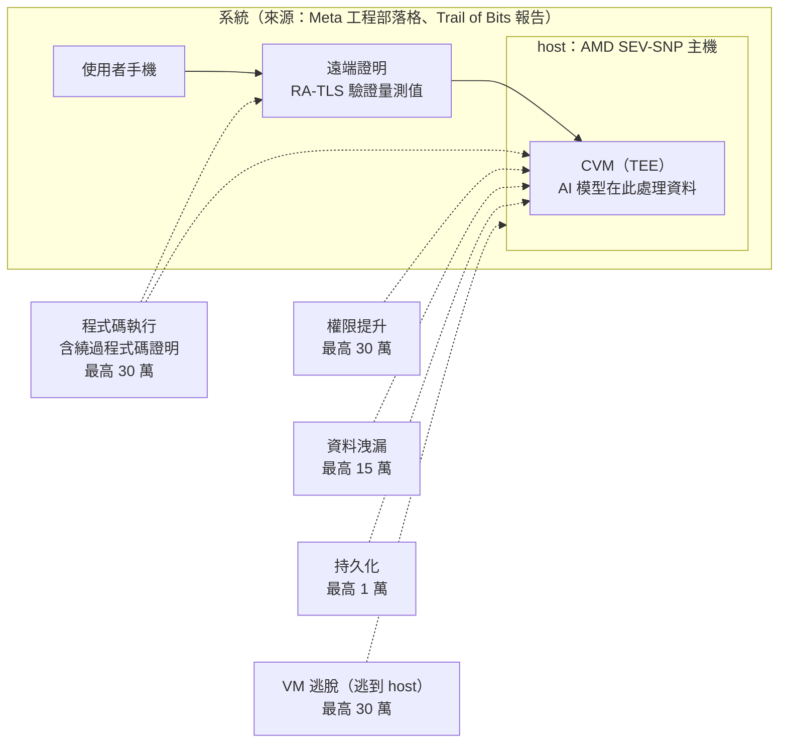

> 🌏 [English version](/posts/tech/2026-10-14-bug-bounty-zero-09-tee-and-confidential-computing-en)

[系列第 0 篇](/posts/tech/2026-10-13-bug-bounty-top-payouts-fact-check)查到，[Meta 的 WhatsApp Private Processing 獎金頁](https://bugbounty.meta.com/payout-guidelines/private-processing/)把 TEE 內的程式碼執行、權限提升、VM 逃脫各列到最高 30 萬美元。[第 7 篇](/posts/tech/2026-10-13-bug-bounty-zero-07-vm-and-hypervisor)講了虛擬機之間的牆，[第 8 篇](/posts/tech/2026-10-13-bug-bounty-zero-08-hyper-v-escape-case-study)拆了一個牆上有洞的案例。這一篇換一種牆：不只隔開客戶彼此，還要把機器的營運者也擋在外面。

這篇想回答三個問題：TEE 保護什麼？遠端證明（attestation）證明什麼？Meta 獎金表的每一列，打的是這套設計的哪個環節？

本文不講任何攻擊手法，也不推測 Meta 沒有公開的內部實作。各家 TEE 技術的架構不同，我只寫來源明說的部分。

## 先講定義：TEE 與機密運算

資料有三種狀態：存放時、傳輸時、使用時。前兩種靠加密保護已經很普遍，但程式要拿資料來運算時，資料得先解開。機密運算（confidential computing）處理的就是第三種。

依 Microsoft Learn 的[機密運算說明](https://learn.microsoft.com/en-us/azure/confidential-computing/overview)，這個詞由 Confidential Computing Consortium（CCC，Linux Foundation 底下的組織）建立，CCC 的定義是：

> Confidential Computing protects data in use by performing computation in a hardware-based, attested Trusted Execution Environment.

Microsoft 的同一頁說，Azure 的機密運算能防止未經授權的人存取使用中的資料，包括雲端營運者；在啟用並正確設定時，Microsoft 無法存取未加密的客戶資料。[CCC 首頁](https://confidentialcomputing.io/)也有類似說法：硬體強制的隔離環境，連 hypervisor 與雲端供應商都看不到執行中的工作負載。

白話版：TEE（Trusted Execution Environment，可信執行環境）像銀行裡的保險箱房間。房間由硬體隔出來，管理大樓的人、大樓的總機房都進不去。「hardware-based」這個詞很重要：隔離靠硬體，不是靠管理員保證不偷看。

### 跟第 7 篇的虛擬機隔離差在哪

第 7 篇的隔離，目標是租戶彼此：[Azure 的隔離說明](https://learn.microsoft.com/en-us/azure/security/fundamentals/isolation-choices)講的是同一台實體機上，不同客戶的 VM 由 hypervisor 隔開。機密運算多加的一層，依上面兩份來源，是把雲端營運者也列進「不該看到」的對象。

這兩者不是二選一。Trail of Bits 的審查報告描述，Meta 用的 AMD SEV-SNP 是一種給 VM 用的機密運算技術：每台 VM 的記憶體用一把由安全處理器管理的專屬金鑰加密，使 VM 的記憶體不能被 hypervisor 或其他 VM 讀取或修改。所以它仍然是一台 VM，只是 hypervisor 的信任地位被調低了。這是來源明說的部分；其他廠商（Intel TDX、Arm CCA、NVIDIA 等）怎麼做，本篇不展開。

## 遠端證明：出示一張可驗證的「房間裡跑的是哪份程式」

保險箱房間有個問題：我是要把資料送進去的人，我怎麼知道我走進的真的是那個房間，裡面也真的是我預期的程式？

這就是 attestation 的工作。依 [Microsoft Azure Attestation 的說明](https://learn.microsoft.com/en-us/azure/attestation/overview)，attestation 是證明軟體二進位檔有在可信平台上被正確啟動的過程，讓遠端的依賴方（relying party）確信「只有預期的軟體在可信硬體上執行」。

Trail of Bits 的部落格用另一個角度描述其中的「measurement」。順帶一提，該部落格標題稱這項功能為 "Private Inference"，Meta 與審查報告則一律用 "Private Processing"；從同一篇文章前後的用語看，兩者指的是同一個系統，但部落格沒有明寫這一點。部落格這樣說明：它是對 enclave 裡執行的程式碼算出的密碼學檢查碼，客戶端靠它確認自己面對的是未被修改的合法軟體。

用比喻：每間房間的門口會吐出一張由硬體簽章的證明，上面寫著「這間房裡跑的程式，指紋是 X」。你拿到證明後，先核對 X 是不是你信任的那份，核對通過才把資料送進去。

兩個要記住的限制，都來自上面的來源：

1. 證明講的是「跑的是哪份程式」。它不保證那份程式沒有漏洞。
2. 證明只涵蓋被量測（measured）的東西。Trail of Bits 在這次審查得到的第一條教訓是：不要信任量測範圍之外的資料。

## WhatsApp 為什麼用它

[Meta 工程部落格](https://engineering.fb.com/2025/04/29/security/whatsapp-private-processing-ai-tools/)的說法：WhatsApp 是端對端加密，但目前的 AI 處理多半是大型語言模型跑在伺服器上，使用者的請求對服務提供者可見。Meta 想做的是讓 AI 摘要訊息這類功能，在不讓 Meta 或 WhatsApp 讀到訊息的前提下運作。這項功能叫 Private Processing，是選用的，建立在 TEE 之上。

文中列的流程，我挑跟本篇有關的幾步：

1. 手機與 TEE 之間建立 RA-TLS（Remote Attestation + TLS）連線；驗證證明時，會拿量測值去對照第三方帳本，確保客戶端只連到符合「可驗證透明」的程式。
2. 請求以只有手機與選定 TEE 解得開的暫時金鑰加密。
3. AI 模型在機密虛擬機（CVM，Meta 說明這是 TEE 的一種）裡處理資料，不儲存訊息，結果加密送回。
4. 工作階段結束後，Private Processing 不保有對訊息的存取。

[Trail of Bits 的報告](https://github.com/trailofbits/publications/blob/master/reviews/2025-08-meta-whatsapp-privateprocessing-securityreview.pdf)補了硬體面：Meta 的後端元件各自由一台 AMD SEV-SNP 處理器的主機與其上的來賓 CVM 組成，其中 LLM Predictor 與 Output Guard 兩個元件另外配 NVIDIA H100 機密運算模式的 GPU。客戶端若驗證證明失敗，會關閉連線、不送出使用者資料。

Meta 在同一篇文章裡也沒有說這是萬能的。它寫到，TEE 軟體被攻破是一個成長中的研究領域，研究者已多次示範繞過 TEE 保證的做法，所以 Meta 採取縱深防禦。

## 獎金表每一列，對應哪個環節

下面是 Meta 獎金頁（2026-10-14 我讀了全文）列出的內容，標題是「TEE runtime attacks」與「VM escape」：

| 類別 | 頁面的描述 | 外部情境最高 | 僅限內部情境 |
|---|---|---|---|
| 程式碼執行 | 讓攻擊者在 TEE 內取得 RCE 的漏洞，**包含繞過程式碼證明** | 300,000 美元 | 50,000 美元 |
| 權限提升 | 讓權限被提升的漏洞 | 300,000 美元 | 50,000 美元 |
| 資料洩漏 | 造成資料外洩的漏洞（例：外部儲存，或含使用者資料的記憶體洩漏） | 150,000 美元 | 50,000 美元 |
| VM 逃脫 | 讓攻擊者逃到 host 的漏洞 | 300,000 美元 | N/A |
| 持久化 | 讓惡意使用者能持續保有對某個工作負載的存取 | 10,000 美元 | 5,000 美元 |

頁面還有三件事：

- 每個金額後面都有星號，但我讀到的頁面沒有顯示星號的註解，所以星號的意思我未能查證。
- 「僅限內部攻擊情境」的漏洞適用上表最右欄。頁面原文是：上面的獎金以外部威脅行為者的情境為基礎，限於內部情境的漏洞照另一張表。
- 範圍頁（scope）寫明，Private Processing 的存取是「僅限受邀」（by invitation only），用來驗證 Meta 的 TEE 安全性。

下圖把每一列放回系統裡。圖中的「獎金列」文字都來自上表；把它連到哪一段，是我自己的對照，不是 Meta 寫的。系統的元件取自 Meta 的工程文章與 Trail of Bits 的報告。

各列的白話解讀（我的對照）：

- **程式碼執行，含繞過程式碼證明**：同時碰到房間裡的程式，以及門口那張證明。頁面特別把「繞過程式碼證明」寫進這一列，等於把證明本身列為攻擊目標之一。
- **權限提升**：房間裡的程式有分權限的話，往上爬。
- **資料洩漏**：頁面舉的例子是外部儲存、含使用者資料的記憶體洩漏。回頭看 Meta 的設計目標：處理完不保留訊息、只放行有限的記錄。這一列檢查的就是這個承諾。不過「只放行有限的記錄」這項設計（log filtering），Trail of Bits 的報告列為未審查的範圍（見下一節），所以它有沒有被外部審查驗證過，來源沒有說。
- **VM 逃脫**：牆的另一面是 host。這就是[第 7 篇](/posts/tech/2026-10-13-bug-bounty-zero-07-vm-and-hypervisor)的主題，只是這次 host 是營運者自己，是設計上最不該被信任的一方。內部情境下這列是 N/A，頁面沒有解釋原因，我不推測。
- **持久化**：頁面說的是對某個工作負載保有存取。金額最低，來源沒寫為什麼；Meta 的設計說明裡有「無狀態」的目標，兩者是否相關，來源沒說，我不替它補。

至於為什麼最高 30 萬：獎金頁沒有解釋定價理由。我的判斷是，因為這個系統承諾的是「連 Meta 都看不到」，一旦被打穿，承諾本身就破了，但這是推論，頁面沒有這樣寫。

## 外部審查實際找到什麼

Meta 在上線前請 [Trail of Bits](https://github.com/trailofbits/publications/blob/master/reviews/2025-08-meta-whatsapp-privateprocessing-securityreview.pdf) 審查。以下數字都對過報告的原文：

- 六位顧問在 2025 年 2 月 3 日到 28 日做審查，共 12 人週，分設計、基礎設施、程式碼三階段。
- 共 28 個問題。依嚴重度：高 8、中 4、低 4、資訊 12。
- 修補狀態：全部 28 個裡，16 個已解決、4 個部分解決、8 個未解決（3 個低、5 個資訊）。8 個高嚴重度問題中，6 個已解決、2 個部分解決。
- 報告也寫明了四條範圍限制：沒有分析實體旁路，也沒有嘗試實體竄改攻擊；沒有審查 host hardening、log filtering、TEE 應用容器化這些提議中的延伸與安全功能的實作；沒有審查第三方軟體與 AMD、NVIDIA 的韌體與驅動；沒有全面分析支撐 LLM Predictor 與 Output Guard 的開源 Llama stack。

Trail of Bits 在[部落格](https://blog.trailofbits.com/2026/04/07/what-we-learned-about-tee-security-from-auditing-whatsapps-private-inference/)整理了四條教訓，這裡只轉述概念，不涉及細節：

1. 量測範圍外的東西不能信：有些設定在量測之後才載入，證明仍會通過，但實際跑的內容可能已經變了。
2. 同理，還有開機時的硬體描述資料沒被納入量測。
3. 檢查韌體的修補版本時，要對照廠商簽章的憑證，不能只信韌體自己報的版本。
4. 證明需要「新鮮度」：沒有和該次連線綁在一起的證明，理論上可以被重播。

這四條跟獎金表有什麼關係？我的判斷是：它們說明了「繞過程式碼證明」為什麼值得單獨寫進一列；證明機制的缺口，多半出在實作細節。但這是我的解讀，Meta 沒有說過獎金表是依這份報告設計的。

Trail of Bits 的結論是，這些問題不是 TEE 模型的根本缺陷，而是實作與部署的缺口；他們同時說，TEE 不是萬靈丹，每一個未量測的輸入、每一項缺少的驗證，都可能變成漏洞。

## TEE 不是萬能

整理一下來源明說的限制：

- 證明只說明跑的是哪份程式（Microsoft Learn）。
- Meta 自己寫，研究者已多次示範繞過 TEE 保證；實體攻擊也可能破壞 TEE 保證（Meta 工程部落格）。
- AMD SEV-SNP 的威脅模型不涵蓋進階的實體攻擊，如主動竄改 DRAM、故障注入（Trail of Bits 報告）。
- Meta 獎金總表頁在 Private Processing 區塊註明：針對韌體與硬體的攻擊不在 Meta 獎金計畫的範圍內，但 Meta 會協助把揭露轉交給供應商。所以上面那張對照圖與獎金表，談的是軟體與設計層，不含韌體與硬體層。
- 完整的公開驗證仍有困難：報告指出 CVM 映像檔無法由公開原始碼重現建置（TOB-WAPI-18）。

## 讀完你應該能說出

TEE 保護什麼：使用中的資料與程式，對象包含營運者。attestation 證明什麼：這間房裡跑的是哪份程式。獎金表每一列：程式碼執行對應房間裡的程式與門口的證明，權限提升對應房間內部，資料洩漏對應資料有沒有漏出去，VM 逃脫對應房間與 host 之間的牆，持久化對應工作負載上的長期存取。

今晚能做的事：打開 [Meta 的獎金頁](https://bugbounty.meta.com/payout-guidelines/private-processing/)，把上面那張圖自己重畫一次，每一列旁邊寫上你認為它打的是哪個環節，再回來對照本文。寫不出理由的那一列，就是還沒讀懂的地方。

## 下一步

[下一篇](/posts/tech/2026-10-14-bug-bounty-zero-10-ai-era-bounty)接著看 AI 時代的獎金計畫。

## 參考資料

- [WhatsApp Private Processing 獎金指引（Meta Bug Bounty）](https://bugbounty.meta.com/payout-guidelines/private-processing/)
- [Meta Bug Bounty 獎金總表頁（Private Processing 區塊註明韌體與硬體不在範圍內）](https://bugbounty.meta.com/payout-guidelines/)
- [Meta Bug Bounty 範圍頁（Private Processing 為僅限受邀）](https://bugbounty.meta.com/scope/)
- [Building Private Processing for AI tools on WhatsApp（Engineering at Meta，2025-04-29）](https://engineering.fb.com/2025/04/29/security/whatsapp-private-processing-ai-tools/)
- [Meta WhatsApp Private Processing: Security Assessment with Fix Review（Trail of Bits，2025-08-26 版）](https://github.com/trailofbits/publications/blob/master/reviews/2025-08-meta-whatsapp-privateprocessing-securityreview.pdf)
- [What we learned about TEE security from auditing WhatsApp's Private Inference（Trail of Bits Blog，2026-04-07；標題的 Private Inference 與 Private Processing 應為同一系統，為依用語的推論）](https://blog.trailofbits.com/2026/04/07/what-we-learned-about-tee-security-from-auditing-whatsapps-private-inference/)
- [What is confidential computing?（Microsoft Learn，引用 CCC 的定義）](https://learn.microsoft.com/en-us/azure/confidential-computing/overview)
- [Microsoft Azure Attestation（Microsoft Learn）](https://learn.microsoft.com/en-us/azure/attestation/overview)
- [Confidential Computing Consortium](https://confidentialcomputing.io/)
- [Azure 隔離選項（Microsoft Learn）](https://learn.microsoft.com/en-us/azure/security/fundamentals/isolation-choices)
- [Bug Bounty 頂級獎金查證（系列第 0 篇）](/posts/tech/2026-10-13-bug-bounty-top-payouts-fact-check)
- [虛擬機與 Hypervisor（系列第 7 篇）](/posts/tech/2026-10-13-bug-bounty-zero-07-vm-and-hypervisor)
- [Hyper-V 逃脫案例拆解（系列第 8 篇）](/posts/tech/2026-10-13-bug-bounty-zero-08-hyper-v-escape-case-study)
