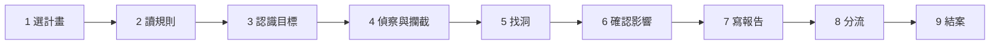

> 🌏 [English version](/posts/tech/2026-10-15-bug-bounty-how-it-works-en)

你可能在社群上看過「找到一個漏洞拿 25 萬美元」這類貼文，想知道這條路實際長什麼樣。這篇先回答三件事：漏洞獵人每天在做什麼、一個漏洞從發現到領錢要經過哪些步驟、這個系列會帶你走到哪裡。讀完你能畫出整個流程，知道每一篇在流程的哪一段。

這個系列寫給會一點程式、但沒有資安背景的人。看得懂 20 行的 Python、用過終端機就夠了，不需要會 C，也不需要先懂網路協定。

## Bug bounty 是什麼

Bug bounty（漏洞獎勵計畫）是公司公開邀請外部的人來找自己系統的漏洞，找到並照規則回報，就付錢。Google、Microsoft、Meta、Apple 都有，很多公司則把計畫放在 [HackerOne](https://www.hackerone.com/)、[Bugcrowd](https://www.bugcrowd.com/) 這類平台上，由平台幫忙收報告、做初步審查。

它有一個不付錢的近親，叫漏洞揭露計畫（Vulnerability Disclosure Program，VDP）。美國 CISA 要求聯邦機關建立 VDP 的指令裡把兩者分得很清楚：VDP 的核心是**授權善意的安全研究、承諾回應報告**，告訴大家報告寄到哪、哪些測試被允許；bug bounty 則是在這之上，[對有效且有影響的發現付錢](https://www.cisa.gov/news-events/directives/bod-20-01-develop-and-publish-vulnerability-disclosure-policy)。同一份指令也提醒，付錢會吸引更多人來找，也可能帶來更多低品質的報告。

台灣也有通報管道。[HITCON ZeroDay](https://zeroday.hitcon.org/) 收研究者的漏洞通報，審核後轉給該組織的窗口、追蹤修補，處理完再公開細節，角色比較接近 VDP。要分清楚的是：通報管道收報告，不代表授權你去測試那個組織的系統。哪些東西能測，[下一篇講規則與範圍](/posts/tech/2026-10-13-bug-bounty-zero-01-rules-and-scope)會細講。

整個系列會用同一個比喻：**把一個系統想成一棟大樓**。計畫頁面是管理委員會貼出的公告，寫明歡迎檢查哪幾層樓、不准做什麼、找到問題要交給誰。漏洞獵人是受邀來檢查的人，找到門鎖壞了，就寫報告交給管委會，管委會確認後發獎金。

## 一個漏洞的九個步驟

| 步驟 | 在做什麼 | 常卡在哪 | 系列哪一篇 |
|---|---|---|---|
| 1 選計畫 | 挑一個計畫：平台上的、公司自營的、有付錢的或只有 VDP | 一開始就挑最熱門、最多人搶的目標 | 本篇 |
| 2 讀規則 | 看 scope（哪些網域能測）、禁止的手法、帳號規定 | 以為「是這家公司的網站」就能測 | [規則與範圍](/posts/tech/2026-10-13-bug-bounty-zero-01-rules-and-scope) |
| 3 認識目標 | 搞懂網站怎麼運作：請求、回應、Cookie | 只會背漏洞名詞，看不懂請求 | [網站怎麼運作](/posts/tech/2026-10-13-bug-bounty-zero-02-how-websites-work) |
| 4 偵察與攔截 | 盤點目標有哪些功能、參數，用工具攔下請求來看、來改 | 一上來就開自動掃描器狂掃 | [獵人的工作台](/posts/tech/2026-10-15-bug-bounty-hunter-workbench) |
| 5 找洞 | 針對盤點出來的地方找特定類型的漏洞 | 什麼都想試，沒有一個試得深 | [XSS 與 IDOR](/posts/tech/2026-10-13-bug-bounty-zero-03-common-web-bugs)、[RCE](/posts/tech/2026-10-13-bug-bounty-zero-04-what-is-rce)，以及後面的記憶體與虛擬機篇 |
| 6 確認影響 | 證明這個洞能造成什麼後果，但不擴大、不碰別人的資料 | 為了「證明嚴重」越線去存取真實使用者資料 | XSS 與 IDOR、RCE 篇 |
| 7 寫報告 | 寫出別人照著做就能重現的報告 | 步驟不完整、沒寫影響 | [寫報告與分流](/posts/tech/2026-10-14-bug-bounty-zero-11-reports-and-expected-value) |
| 8 分流 | 計畫方或平台審查：能不能重現、算不算數、多嚴重 | 被要求補資料卻沒回 | 寫報告與分流篇 |
| 9 結案 | 修好並發獎金，或判成重複、資訊性、不適用 | 期待每份報告都有錢 | 本篇下一節 |

第 4 步和第 5 步是大家想像中「駭客」的部分，但前後的步驟一樣決定你拿不拿得到錢。規則沒讀清楚，找到的洞可能不算數，還可能違法；報告寫不好，審查的人重現不了，洞再嚴重也會卡住。

## 報告的五種結局

以 [HackerOne 的報告狀態說明](https://docs.hackerone.com/en/articles/8475030-report-states)為例，報告送出後先是「New」（等待驗證）。審查的人看不懂或重現不了，會改成「Needs More Info」要你補；確認是真的漏洞，就改成「Triaged」，交給公司內部去修。最後會落在下面其中一種結局：

| 結局 | 意思 | 有沒有獎金 |
|---|---|---|
| Resolved（已解決） | 漏洞確認、已修好 | 有效報告才可能有 |
| Duplicate（重複） | 別人先回報過，或公司本來就知道 | 通常沒有 |
| Informative（資訊性） | 內容正確，但公司認為不需要處理，常見於範圍外或已知問題 | 沒有 |
| Not Applicable（不適用） | 重現不了，或沒有證明出安全影響 | 沒有，還會扣平台上的聲望分數 |
| Spam（垃圾） | 根本不是漏洞，或內容是廣告、騷擾 | 沒有，扣分更多 |

重複這一項值得特別記住。[Google VRP 的規則頁](https://bughunters.google.com/about/rules/google-friends/google-and-alphabet-vulnerability-reward-program-vrp-rules)寫得很直接：「First in, best dressed」，只有第一個回報這個未知漏洞的人才拿得到獎金。[Meta 的規則](https://bugbounty.meta.com/scope/)也是重複報告只付給第一個提交的人。熱門目標上的簡單漏洞，很可能早就有人交過了。

所以期待要放對。五種結局只有一種有錢，而且獎金表上的數字只是起點，實際金額要看漏洞影響多大、報告品質多好，最後由計畫方決定。這個系列後面會回頭整理各家的頂級價碼，也會教你用期望值估算值不值得花時間。

## 走一遍：一份虛構的 IDOR 報告

用一個虛構的例子把九步串起來。IDOR 是「把網址上的編號換成別人的，就看得到別人的資料」，[XSS 與 IDOR 那篇](/posts/tech/2026-10-13-bug-bounty-zero-03-common-web-bugs)會細講。

1. **選計畫**：小林在平台上挑了一個中型電商的計畫，獎金不高，但參與的人比熱門大公司少。
2. **讀規則**：計畫頁寫明主站和 `api.` 子網域在範圍內，禁止 DoS 和社交工程，要求用自己註冊的帳號測試。他註冊了**兩個自己的帳號** A 和 B。
3. **認識目標**：他打開瀏覽器的開發者工具，看下訂單時送出了哪些請求。
4. **偵察與攔截**：他把網站的功能列成一張表：註冊、搜尋、購物車、訂單、退貨。查看訂單時，網址是 `/api/orders/1532`。
5. **找洞**：他用帳號 A 登入，把 `1532` 換成帳號 B 的訂單編號 `1533`，結果看到了 B 的收件地址。
6. **確認影響**：他只用自己的兩個帳號互相驗證，沒有去試其他人的編號。這樣已經足以證明「任何人都能看別人的訂單」。
7. **寫報告**：標題、摘要、重現步驟（含兩個帳號怎麼建立）、影響（地址外洩）、修補建議（伺服器端檢查訂單擁有者）。
8. **分流**：審查的人回覆「Needs More Info」，問用的是哪個 App 版本。他補上之後，報告變成「Triaged」。
9. **結案**：兩週後狀態變成「Resolved」，他拿到獎金。換一個平行世界，同一份報告也可能收到「Duplicate」：三個月前已經有人交過了。

第 2 步和第 6 步是新手最容易出事的地方。用兩個自己的帳號互相測試，是確認 IDOR 又不碰到別人資料的標準做法。

## 這個系列會帶你走到哪

整個系列照上面的九步排，前面先走完一輪完整流程，後面回答「為什麼最貴的洞在底層」。

| order | 篇名 | 回答的問題 |
|---|---|---|
| 0 | 本篇 | 漏洞獵人在做什麼？流程長什麼樣？ |
| 1 | [規則與範圍](/posts/tech/2026-10-13-bug-bounty-zero-01-rules-and-scope) | 拿到一個計畫，什麼能測、什麼不能測？ |
| 2 | [網站怎麼運作](/posts/tech/2026-10-13-bug-bounty-zero-02-how-websites-work) | 按下連結後，瀏覽器和伺服器交換了什麼？ |
| 3 | [獵人的工作台](/posts/tech/2026-10-15-bug-bounty-hunter-workbench) | 實際上要怎麼看一個網站的請求、怎麼改？ |
| 4 | [XSS 與 IDOR](/posts/tech/2026-10-13-bug-bounty-zero-03-common-web-bugs) | 網站最常見的兩種洞是什麼？ |
| 5 | [RCE](/posts/tech/2026-10-13-bug-bounty-zero-04-what-is-rce) | 外人怎麼可能叫伺服器執行程式？ |
| 6 | [寫報告與分流](/posts/tech/2026-10-14-bug-bounty-zero-11-reports-and-expected-value) | 找到洞之後怎麼寫才會被接受？ |
| 7 | [程式在記憶體裡怎麼跑](/posts/tech/2026-10-13-bug-bounty-zero-05-how-programs-use-memory) | 為什麼最貴的洞在底層？ |
| 8 | [緩衝區溢位](/posts/tech/2026-10-13-bug-bounty-zero-06-memory-bugs-buffer-overflow) | 多寫幾個字元，為什麼可能讓別人控制程式？ |
| 9 | [虛擬機與 hypervisor](/posts/tech/2026-10-13-bug-bounty-zero-07-vm-and-hypervisor) | 一台機器切給很多人用，牆破了會怎樣？ |
| 10 | [Hyper-V 逃脫案例](/posts/tech/2026-10-13-bug-bounty-zero-08-hyper-v-escape-case-study) | 一個真實的逃脫漏洞長什麼樣？ |
| 11 | [TEE 與機密運算](/posts/tech/2026-10-14-bug-bounty-zero-09-tee-and-confidential-computing) | 怎麼讓連機器主人都看不到裡面在算什麼？ |
| 12 | [AI 產品的漏洞](/posts/tech/2026-10-14-bug-bounty-zero-10-ai-era-bounty) | AI 產品的獎金計畫收什麼、不收什麼？ |
| 13 | [頂級獎金地圖](/posts/tech/2026-10-13-bug-bounty-top-payouts-fact-check) | 哪些漏洞值幾十萬美元？為什麼是這些？ |
| 14 | [接下來怎麼練](/posts/tech/2026-10-14-bug-bounty-zero-12-certifications-and-learning-map) | 讀完之後，第一個月怎麼練？ |

讀到第 6 篇，你已經能在官方練習靶場找一個洞、寫一份合格的報告。第 7 篇開始會用到一點 C，該篇開頭附了一份短短的讀法。整個系列的練習都只在自己的電腦和官方靶場進行，不會教你去測沒有授權的系統。

## 自我檢查

下面三個狀況，各在九步的哪一步？下一步該做什麼？

1. 你送出報告後收到回覆：「我們無法重現，請提供更多細節。」
2. 你在一家公司的子網域找到一個問題，但那個子網域不在計畫頁列出的清單上。
3. 你的報告被標成 Duplicate。

參考答案

1. 第 8 步分流，狀態是 Needs More Info。補上完整的重現步驟、環境、截圖或影片，越快越好；HackerOne 上超過 30 天沒回會自動以 Informative 結案。
2. 第 2 步讀規則。不在清單上就不要測，先問計畫方。已經碰到的，停下來，照計畫規則通報。
3. 第 9 步結案。這份報告通常不會有獎金。檢討的方向是選目標（第 1 步）：太熱門的目標、太容易找的洞，重複機率高。

下一篇從第 2 步開始：[拿到一個計畫頁面，怎麼判斷什麼能測、什麼不能測](/posts/tech/2026-10-13-bug-bounty-zero-01-rules-and-scope)。

## 參考資料

- [BOD 20-01: Develop and Publish a Vulnerability Disclosure Policy（CISA）](https://www.cisa.gov/news-events/directives/bod-20-01-develop-and-publish-vulnerability-disclosure-policy)
- [Report States（HackerOne Help Center）](https://docs.hackerone.com/en/articles/8475030-report-states)
- [Google and Alphabet Vulnerability Reward Program (VRP) Rules](https://bughunters.google.com/about/rules/google-friends/google-and-alphabet-vulnerability-reward-program-vrp-rules)
- [Meta Bug Bounty：Program scope](https://bugbounty.meta.com/scope/)
- [HITCON ZeroDay 漏洞通報平台](https://zeroday.hitcon.org/)
- [HackerOne](https://www.hackerone.com/)
- [Bugcrowd](https://www.bugcrowd.com/)
