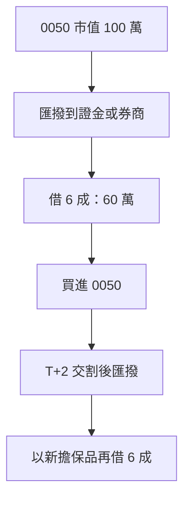

> 🌏 [English version](/posts/ai/2026-11-13-ai-is-the-new-baseline-en)

這頁第一個區塊是語言切換膠囊（上面那個），它必須是內文的第一個區塊，CSS 才會把它畫成小膠囊而不是提示框。

## 標題層級

### 三級標題 h3

#### 四級標題 h4

##### 五級標題 h5

h2 下方有一條短色線；h3、h4 只有字級與粗細差異。

## 段落與行內樣式

一般段落裡有 [站內連結](/posts/ai/2026-11-13-ai-is-the-new-baseline)、[外部連結](https://developers.cloudflare.com/workers/)、**粗體**、*斜體*、~~刪除線~~、`inline code`、<kbd>Ctrl</kbd> + <kbd>K</kbd> 與 <mark>螢光標記</mark>。

第二段測試長字串換行：`src/content/posts/learning/2026-11-17-mass-irrationality-overview.md` 這種路徑，以及 https://quidproquo.cc/posts/ai/2026-11-13-ai-is-the-new-baseline 這種裸網址。

## 清單

無序清單：

- 第一項
- 第二項，內容比較長，用來確認換行後的縮排是否對齊第一行文字，而不是對齊項目符號
  - 巢狀第二層
    - 巢狀第三層
- 第三項

有序清單：

1. 讀取 frontmatter
2. 跑 remark plugin
   1. 巢狀有序
   2. 巢狀有序第二項
3. 輸出 HTML

工作清單：

- [x] 已完成的項目
- [ ] 尚未完成的項目

## 程式碼區塊

```ts
// astro.config.mjs（節錄）
markdown: {
  processor: unified({
    remarkPlugins: [remarkMathOptIn, remarkReadingTime, remarkYoutubeEmbed, remarkVideoPractice, remarkVideoGallery, remarkFlowDiagram, remarkDiagram],
    rehypePlugins: [rehypeKatex, rehypeExternalLinks, rehypeLazyImages],
  }),
},
```

```bash
pnpm -s check:diagram-text src/content/styleguide/styleguide.md && pnpm -s check:diagram-geometry src/content/styleguide/styleguide.md
```

## 窄表格：三欄，其中一格很長

| 指標 | 數值 | 說明 |
|---|---|---|
| 融資金額 | 110 億美元 | 首階段到位 |
| 估值 | 1.25 兆美元 | 這一格故意寫得很長，用來確認桌機上表格不會撐出橫向捲軸，而是讓儲存格自己換行：三個時間點均為公開報導的數字，整輪尚未正式收尾，最終金額可能再變動。 |
| 時間 | 2026-11-06 | — |

## 寬表格：七欄

| 機構 | 10 月報價 | 官網牌告 | 撥款天數 | 最低額度 | 線上申請 | 其他 |
|---|---|---|---|---|---|---|
| 元大證金 | 3.92–3.98% | 牌告 5.88%；專案 3.92% 起 | T+2 | 1 萬 | 有 | 適用自己的辦法 |
| 富邦證券 | 3.6–4.2% | — | T+1 | 5 萬 | 有 | 需先開立交割帳戶 |
| 國泰證券 | 3.8% | 專案利率至 12/30 | T+2 | 3 萬 | 有 | — |

## 提示框（預設 info）

> 一般的引用區塊會畫成藍色提示框。可以有多段。
>
> 第二段裡也可以有 **粗體** 與 [連結](/posts/ai/2026-11-13-ai-is-the-new-baseline)。

## 提示框（success）

目前沒有文章用到，CSS 支援 `blockquote.callout-success`，要用原始 HTML 寫：

<blockquote class="callout-success">

**成功**：class 為 `callout-success` 的引用區塊會畫成綠色。

</blockquote>

## 圖片與圖說

Markdown 圖片（沒有圖說）：


用 `<figure>` 包起來才有圖說：

<figure>
  
  <figcaption>圖說：figcaption 置中、小字、淡色。</figcaption>
</figure>

## 數學公式

frontmatter 設 `math: true` 才會解析。行內：$\hat{y} = \text{sign}(\mathbf{w}^\top\mathbf{x} + b)$，獨立公式：

$$
\min_{b,\mathbf{w}}\quad \frac{1}{2}\mathbf{w}^\top\mathbf{w} + C\cdot\sum_{n=1}^{N} \xi_n \qquad \text{subject to}\quad y_n(\mathbf{w}^\top\mathbf{z}_n + b) \ge 1 - \xi_n,\ \xi_n \ge 0,\ n = 1, \dots, N
$$

## 註腳

註腳用 GFM 語法[^1]，可以有多個[^long]。

[^1]: 第一個註腳。
[^long]: 第二個註腳，內容比較長，用來確認註腳區的換行與連結樣式：[Cloudflare Workers](https://developers.cloudflare.com/workers/)。

## 摺疊區塊 details／summary

<details>
<summary>點開看細節</summary>

摺疊區塊裡的段落，可以有 `inline code` 與清單：

- 第一項
- 第二項

</details>

## 分隔線

上面一段。

---

下面一段。

## 術語標記（glossary）

frontmatter 的 glossary 定義了 Pagefind，內文出現 Pagefind 時會加上虛線底線，點開是術語卡。

## 圖表 diagram：小（s，寬 340，不應被放大）

```diagram
title: 群體非理性的五層解釋鏈
desc: 每疊一層，問題從「發生過什麼」走向「為什麼人會這樣」，再到「現在為什麼更難糾正」。
caption: 書名為該層代表；Canetti 篇縮小範圍，兩個概念＋譯本現況。
---
<svg viewBox="0 0 340 400">
  <path class="dg-line" d="M170 76V92" marker-end="url(#arrow)"/>
  <path class="dg-line" d="M170 152V168" marker-end="url(#arrow)"/>
  <path class="dg-line" d="M170 228V244" marker-end="url(#arrow)"/>
  <path class="dg-line" d="M170 304V320" marker-end="url(#arrow)"/>

  <g>
    <rect class="dg-box dg-box--accent" x="20" y="20" width="300" height="56" rx="6"/>
    <text class="dg-label" x="170" y="39" text-anchor="middle" dominant-baseline="central">L1 歷史現象</text>
    <text class="dg-sub" x="170" y="59" text-anchor="middle" dominant-baseline="central">Mackay 1841 → Bernstein 2021（order 1–2）</text>
  </g>
  <g>
    <rect class="dg-box" x="20" y="96" width="300" height="56" rx="6"/>
    <text class="dg-label" x="170" y="115" text-anchor="middle" dominant-baseline="central">L2 群眾心理機制</text>
    <text class="dg-sub" x="170" y="135" text-anchor="middle" dominant-baseline="central">Le Bon → Hoffer → Canetti（order 3–5）</text>
  </g>
  <g>
    <rect class="dg-box" x="20" y="172" width="300" height="56" rx="6"/>
    <text class="dg-label" x="170" y="191" text-anchor="middle" dominant-baseline="central">L3 認知與行為基礎</text>
    <text class="dg-sub" x="170" y="211" text-anchor="middle" dominant-baseline="central">Kahneman 2011（order 6）</text>
  </g>
  <g>
    <rect class="dg-box" x="20" y="248" width="300" height="56" rx="6"/>
    <text class="dg-label" x="170" y="267" text-anchor="middle" dominant-baseline="central">L4 文化與制度</text>
    <text class="dg-sub" x="170" y="287" text-anchor="middle" dominant-baseline="central">Hofstadter 1963＋1964（order 7–8）</text>
  </g>
  <g>
    <rect class="dg-box dg-box--accent" x="20" y="324" width="300" height="56" rx="6"/>
    <text class="dg-label" x="170" y="343" text-anchor="middle" dominant-baseline="central">L5 當代技術放大</text>
    <text class="dg-sub" x="170" y="363" text-anchor="middle" dominant-baseline="central">McIntyre → Rauch → Nichols（order 9–11）</text>
  </g>
</svg>
```

## 圖表 diagram：中（m，寬 520，含逐步播放）

```diagram
title: OpenAI 這輪融資的目標與實際落差
desc: 從 9 月喊出的目標，到 11 月 6 日首階段到位的實際金額，再到預計數週內收尾的規模，三個時間點顯示募資規模與估值一路被市場下修。
caption: 簡化示意：三個時間點均為公開報導的數字，整輪尚未正式收尾，最終金額可能再變動。
step: 2026 年 9 月：喊出目標
step: 2026 年 11 月 6 日：首階段到位
step: 預計數週內：整輪收尾
---
<svg viewBox="0 0 520 160">
  <rect class="dg-box" x="8" y="52" width="150" height="64" rx="6" data-step="1"/>
  <text class="dg-label" x="83" y="76" text-anchor="middle" dominant-baseline="central" data-step="1">目標：$30B</text>
  <text class="dg-sub" x="83" y="96" text-anchor="middle" dominant-baseline="central" data-step="1">估值 $1.4T</text>

  <path class="dg-line" d="M158 84H190" marker-end="url(#arrow)" data-step="2"/>

  <rect class="dg-box dg-box--accent" x="190" y="52" width="150" height="64" rx="6" data-step="2"/>
  <text class="dg-label" x="265" y="76" text-anchor="middle" dominant-baseline="central" data-step="2">首階段：$11B</text>
  <text class="dg-sub" x="265" y="96" text-anchor="middle" dominant-baseline="central" data-step="2">估值 $1.25T</text>

  <path class="dg-line" d="M340 84H372" marker-end="url(#arrow)" data-step="3"/>

  <rect class="dg-box" x="372" y="52" width="140" height="64" rx="6" data-step="3"/>
  <text class="dg-label" x="442" y="76" text-anchor="middle" dominant-baseline="central" data-step="3">收尾：上看 $20B</text>
  <text class="dg-sub" x="442" y="96" text-anchor="middle" dominant-baseline="central" data-step="3">估值待定</text>
</svg>
```

## 圖表 diagram：大（l，寬 680）

```diagram
title: 惡意 MCP 伺服器可攻擊的三個 Inspector 信任邊界
desc: 連上 Inspector 的惡意或失陷 MCP 伺服器，可透過三個獨立的用戶端信任邊界缺陷，影響開發者本機環境
caption: GHSA-h9j8-vj8g-v3gg／GHSA-rwv7-mh2c-ff2p／GHSA-2fw8-7jmw-r937，三者皆於 v2.14.0 修復（ReDoS 另於 v1.0.4 回溯修復）
---
<svg viewBox="0 0 680 360">
  <path class="dg-line dg-line--warn" d="M224,180 H232 Q240,180 240,172 V80 Q240,72 248,72 H256" marker-end="url(#arrow-warn)"/>
  <path class="dg-line dg-line--warn" d="M224,180 H256" marker-end="url(#arrow-warn)"/>
  <path class="dg-line dg-line--warn" d="M224,180 H232 Q240,180 240,188 V280 Q240,288 248,288 H256" marker-end="url(#arrow-warn)"/>

  <path class="dg-line" d="M456,72 H468 Q476,72 476,80 V172 Q476,180 484,180 H496" marker-end="url(#arrow)"/>
  <path class="dg-line" d="M456,180 H496" marker-end="url(#arrow)"/>
  <path class="dg-line" d="M456,288 H468 Q476,288 476,280 V188 Q476,180 484,180 H496" marker-end="url(#arrow)"/>

  <rect class="dg-box dg-box--warn" x="16" y="148" width="208" height="64" rx="6"/>
  <text class="dg-label" x="120" y="172" text-anchor="middle" dominant-baseline="central">惡意 MCP 伺服器</text>
  <text class="dg-sub" x="120" y="192" text-anchor="middle" dominant-baseline="central">已連上 Inspector</text>

  <rect class="dg-box" x="256" y="40" width="200" height="64" rx="6"/>
  <text class="dg-label" x="356" y="64" text-anchor="middle" dominant-baseline="central">Apps 分頁沙箱</text>
  <text class="dg-sub" x="356" y="84" text-anchor="middle" dominant-baseline="central">逃逸後仍收發訊息</text>

  <rect class="dg-box" x="256" y="148" width="200" height="64" rx="6"/>
  <text class="dg-label" x="356" y="172" text-anchor="middle" dominant-baseline="central">匯入／URL／預覽</text>
  <text class="dg-sub" x="356" y="192" text-anchor="middle" dominant-baseline="central">繞過 CSP、藏指令</text>

  <rect class="dg-box" x="256" y="256" width="200" height="64" rx="6"/>
  <text class="dg-label" x="356" y="280" text-anchor="middle" dominant-baseline="central">輸出結果 schema 驗證</text>
  <text class="dg-sub" x="356" y="300" text-anchor="middle" dominant-baseline="central">惡意 regex 卡死介面</text>

  <rect class="dg-box" x="496" y="148" width="160" height="64" rx="6"/>
  <text class="dg-label" x="576" y="172" text-anchor="middle" dominant-baseline="central">開發者本機環境</text>
  <text class="dg-sub" x="576" y="192" text-anchor="middle" dominant-baseline="central">瀏覽器與本機行程</text>
</svg>
```

## 流程圖 flow-diagram

```flow-diagram
{
  "title": "測試中 agent 自己串出的一條攻擊鏈",
  "lang": "zh-TW",
  "width": 520,
  "height": 600,
  "nodes": [
    {"id": "goal", "label": "目標：一句話 + 一個網域", "x": 260, "y": 40, "w": 300, "tone": "accent"},
    {"id": "js", "label": "前端 JS 裡的測試用 header", "x": 260, "y": 130, "w": 300},
    {"id": "sandbox", "label": "偽造身份、繞過 sandbox，取得 RCE", "x": 260, "y": 230, "w": 360},
    {"id": "meta", "label": "從 cloud metadata 拿到暫時的 key", "x": 260, "y": 330, "w": 300},
    {"id": "k8s", "label": "K8S node 權限，橫向移動到其他 pod", "x": 260, "y": 430, "w": 300},
    {"id": "admin", "label": "service account 提權成 cluster admin", "x": 260, "y": 540, "w": 360}
  ],
  "edges": [
    {"from": "goal", "to": "js", "step": 1, "label": "recon", "labelAt": [300, 85]},
    {"from": "js", "to": "sandbox", "step": 2, "label": "偽造身份", "labelAt": [300, 180]},
    {"from": "sandbox", "to": "meta", "step": 3, "label": "橫向移動", "labelAt": [300, 280]},
    {"from": "meta", "to": "k8s", "step": 4, "label": "丟給 K8S", "labelAt": [300, 380]},
    {"from": "k8s", "to": "admin", "step": 5, "label": "發現可提權", "labelAt": [300, 485]}
  ],
  "steps": [
    "agent 先對網域做 recon，辨識服務，在前端 JS 找到測試用的 header",
    "用這個 header 偽造身份進入系統，發現一個在 sandbox 跑 JS 的功能，繞過黑名單後取得 RCE",
    "從 RCE 橫向移動，在 cloud metadata 拿到暫時的 key",
    "把 key 丟給 K8S，取得 node 權限並移動到其他 pod",
    "發現某個 service account 能建立 pod 並提權，最後取得 cluster admin"
  ]
}
```

## Mermaid 圖



## YouTube 嵌入

```youtube
url: https://www.youtube.com/watch?v=AuZoDsNmG_s
title: Stanford CS230 | Autumn 2025 | Lecture 9: Career Advice in AI
```

## 影片清單 video-gallery

```video-gallery
key: japanEnaKasagiyama
lang: zh-TW
ids: HlQvi_s2qtQ, KY_Qi2-TYYk, UeDLzwM64A8, oyN99RJDif4, 4C6HeH17e-0, zug8LhXWxb0, dggSU4SzC1s, LWlPdreE5B0, a6l9zpeNpf4, dlP2y1GQFGs, YZHkzbffV64
```

## 不在這頁的元件

`video-practice`（看影片學英文）沒有放進來：只要頁面有它，整頁就會換成寬版排版（`src/styles/videoPractice.css` 的 `.post-grid:has(.video-practice)`），這頁就看不到一般文章的排版了。要檢查它，請看[真實文章](/posts/career/2026-10-12-dan-koe-multiple-interests-ai-skill-stack)。

## 結尾段落

最後一段，用來確認內文結尾到 FAQ 區塊（frontmatter 的 faq）之間的間距。
